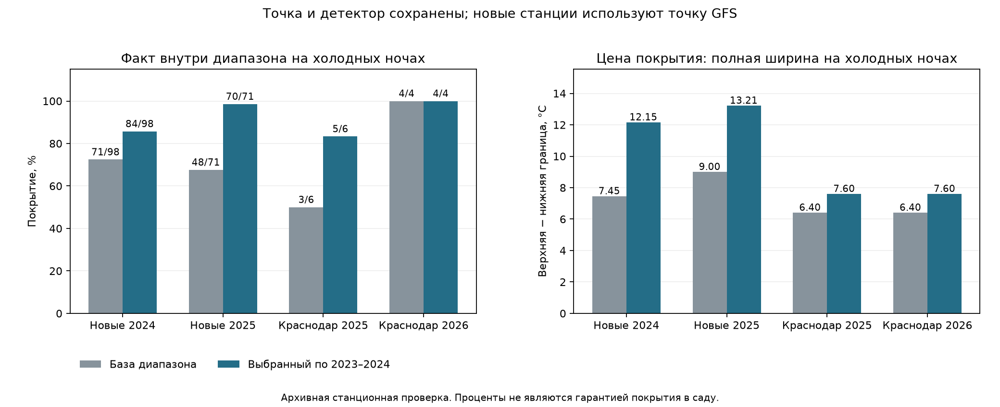

# Надёжность диапазона на холодных ночах и новых станциях

Выбор только по 2023–2024: `cold0_risk5_q0.95_altall`. Диагностический кандидат `cold0_risk5_q0.9_altall` также зафиксирован до проверки. Исходный минимум Краснодара и детектор сохранены; на новых станциях точка — исходный GFS, детектор не перенесён. Полевой выпуск не изменён.

## Что изменено

Нижняя граница может расширяться по хвосту ошибок фактически холодных калибровочных ночей других станций. На входе прогнозирования используются только прогнозный минимум и высота станции; фактическая температура и метка холода входят только в калибровку. Для Huber и GFS используются отдельные ошибки соответствующей точки. Указанная квантиль хвоста не является обещанием покрытия холодных ночей или вероятностью ущерба.

В prior-проверке исключается вся календарная неделя плюс два дня с обеих сторон на всех станциях. В региональном банке дополнительно исключается оцениваемая станция. Один максимум ошибки на дату заменяет много коррелированных станция-ночей при оценке хвоста. Недели и даты всё равно могут разделять одно похолодание: независимость не доказана. При недостатке дат конечная квантиль не подменяется максимумом; явно сохраняется прежняя граница.

Проверены 16 вариантов расширения и база. Выбор требует отсутствия ухудшения покрытия в каждом prior-году и ограничивает среднюю ширину тёплых ночей 1.10×, всех ночей 1.15× базы. Эти ограничения относятся к prior-проверке, а не являются гарантией на новом климате.

## Проверка 2023–2024 до новых данных

| Год | Срез | Метод | Холодные покрыты | Нижние промахи | Ширина всех, °C | Холодных, °C | Без доступного хвоста |
|---|---|---|---:|---:|---:|---:|---:|
| 2023 | Краснодар | Прежний диапазон | 3/3 | 0 | 4.872 | 4.904 | 0 |
| 2023 | Краснодар | Выбранный диапазон | 3/3 | 0 | 4.956 | 4.904 | 14 |
| 2023 | Другие development-станции | Прежний диапазон | 18/36 | 6 | 7.446 | 7.338 | 0 |
| 2023 | Другие development-станции | Выбранный диапазон | 18/36 | 6 | 7.537 | 7.338 | 158 |
| 2024 | Краснодар | Прежний диапазон | 4/4 | 0 | 6.086 | 6.258 | 0 |
| 2024 | Краснодар | Выбранный диапазон | 4/4 | 0 | 6.170 | 6.567 | 15 |
| 2024 | Другие development-станции | Прежний диапазон | 38/58 | 8 | 9.053 | 8.851 | 0 |
| 2024 | Другие development-станции | Выбранный диапазон | 42/58 | 4 | 9.884 | 10.336 | 41 |

## Новые станции: список до загрузки целей

Восемь станций выбраны по ICAO, географии и периоду работы из метаданных NOAA; все исключены из прежних инвентаризаций и загруженных наблюдений. Из них пять имеют не менее 30 полных ночей в 2024 и 2025. Непригодные станции не заменялись. Для 2026 все восемь ISD-Lite URL вернули HTTP404: новых станционных метрик этого года нет. Краснодарский 2026 из прежнего отдельного источника сохранён.

| Станция | Полных 2024 | Полных 2025 | 2026 |
|---|---:|---:|---|
| ASTRAKHAN · 353942-99999 | 76 | 84 | HTTP Error 404: Not Found |
| CHERTOVITSKOYE · 341220-99999 | 75 | 83 | HTTP Error 404: Not Found |
| LIPETSK ARPT · 279300-99999 | 77 | 83 | HTTP Error 404: Not Found |
| TSENTRALNY · 341720-99999 | 0 | 0 | HTTP Error 404: Not Found |
| GAGARIN · 341710-99999 | 76 | 83 | HTTP Error 404: Not Found |
| BRYANSK · 268980-99999 | 0 | 0 | HTTP Error 404: Not Found |
| PENZA · 279620-99999 | 0 | 0 | HTTP Error 404: Not Found |
| KURUMOCH · 289000-99999 | 76 | 84 | HTTP Error 404: Not Found |

2024 на новых станциях использует только банк ошибок 2023; 2025 — банк 2024. Их цели не использованы для выбора, калибровки или изменения точки. Однако prior-выбор видел 2024 других станций, а погода пространственно зависима. Новизна станции не превращает этот результат в независимый перспективный тест.

## Контрольные результаты

Ширина — полная верхняя граница минус нижняя, не ±указанное число. Региональная база — эмпирический диапазон ошибки GFS, построенный по development-станциям; GFS сам такого вероятностного диапазона здесь не выдаёт.

| Срез | Метод | Полных ночей | Холодные покрыты | Нижние / верхние холодные промахи | Ширина всех, °C | Холодных, °C | Тёплых, °C | Холодный interval score90 |
|---|---|---:|---:|---:|---:|---:|---:|---:|
| Новые станции 2024 | База диапазона GFS | 380 | 71/98 | 15/12 | 7.454 | 7.454 | 7.454 | 21.331 |
| Новые станции 2024 | Выбранный диапазон | 380 | 84/98 | 2/12 | 9.303 | 12.153 | 8.312 | 19.812 |
| Новые станции 2024 | Диагностический кандидат | 380 | 80/98 | 6/12 | 8.515 | 10.151 | 7.947 | 19.073 |
| Новые станции 2025 | База диапазона GFS | 417 | 48/71 | 22/1 | 8.995 | 8.995 | 8.995 | 18.636 |
| Новые станции 2025 | Выбранный диапазон | 417 | 70/71 | 0/1 | 10.553 | 13.213 | 10.007 | 13.392 |
| Новые станции 2025 | Диагностический кандидат | 417 | 67/71 | 3/1 | 10.129 | 12.065 | 9.731 | 12.528 |
| Новые станции 2026 | База диапазона GFS | 0 | 0/0 | 0/0 | — | — | — | — |
| Новые станции 2026 | Выбранный диапазон | 0 | 0/0 | 0/0 | — | — | — | — |
| Новые станции 2026 | Диагностический кандидат | 0 | 0/0 | 0/0 | — | — | — | — |
| Краснодар 2025 | Прежний диапазон | 91 | 3/6 | 2/1 | 6.125 | 6.404 | 6.105 | 15.532 |
| Краснодар 2025 | Выбранный диапазон | 91 | 5/6 | 0/1 | 6.479 | 7.599 | 6.400 | 11.326 |
| Краснодар 2025 | Диагностический кандидат | 91 | 4/6 | 1/1 | 6.317 | 7.052 | 6.265 | 12.297 |
| Краснодар 2026 | Прежний диапазон | 86 | 4/4 | 0/0 | 6.136 | 6.404 | 6.123 | 6.404 |
| Краснодар 2026 | Выбранный диапазон | 86 | 4/4 | 0/0 | 6.525 | 7.599 | 6.473 | 7.599 |
| Краснодар 2026 | Диагностический кандидат | 86 | 4/4 | 0/0 | 6.347 | 7.052 | 6.313 | 7.052 |

Interval score90 = ширина + 20×выход факта за границу; меньше лучше. Это сравнительный штраф, не доказанная вероятность. Диагностический кандидат не заменяет выбранный после удачного контроля.

На новых сайтах2024 холодное покрытие72.4%→85.7% сопровождается ростом холодной ширины на63.1%, общей на24.8% и тёплой на11.5%. В2025 покрытие67.6%→98.6%, холодная ширина+46.9%, общая+17.3%, тёплая+11.3%. Перенос превышает prior-ограничения ширины: их нельзя выдавать за обещание продукта. Число диапазонов, пересекающих0°C, выросло74→86 и124→142; это дополнительные неоднозначные ночи, не новые тревоги детектора. В2024 остаются2 нижних и12 верхних холодных промахов. ВКраснодаре2026 покрытие не улучшилось, а ширина/штраф выросли: выигрыш не универсален.

## Результаты по каждой новой станции

| Год | Станция | Метод | Холодные покрыты | Нижние / верхние промахи | Ширина холодных, °C | Всех, °C |
|---|---|---|---:|---:|---:|---:|
| 2024 | LIPETSK ARPT | Прежний диапазон | 21/24 | 2/1 | 7.454 | 7.454 |
| 2024 | LIPETSK ARPT | Выбранный диапазон | 23/24 | 0/1 | 12.201 | 9.550 |
| 2024 | KURUMOCH | Прежний диапазон | 14/22 | 2/6 | 7.454 | 7.454 |
| 2024 | KURUMOCH | Выбранный диапазон | 15/22 | 1/6 | 12.201 | 9.765 |
| 2024 | CHERTOVITSKOYE | Прежний диапазон | 17/21 | 4/0 | 7.454 | 7.454 |
| 2024 | CHERTOVITSKOYE | Выбранный диапазон | 20/21 | 1/0 | 11.975 | 9.289 |
| 2024 | GAGARIN | Прежний диапазон | 15/21 | 1/5 | 7.454 | 7.454 |
| 2024 | GAGARIN | Выбранный диапазон | 16/21 | 0/5 | 12.201 | 9.265 |
| 2024 | ASTRAKHAN | Прежний диапазон | 4/10 | 6/0 | 7.454 | 7.454 |
| 2024 | ASTRAKHAN | Выбранный диапазон | 10/10 | 0/0 | 12.201 | 8.641 |
| 2025 | LIPETSK ARPT | Прежний диапазон | 11/16 | 5/0 | 8.995 | 8.995 |
| 2025 | LIPETSK ARPT | Выбранный диапазон | 16/16 | 0/0 | 13.213 | 11.079 |
| 2025 | KURUMOCH | Прежний диапазон | 17/17 | 0/0 | 8.995 | 8.995 |
| 2025 | KURUMOCH | Выбранный диапазон | 17/17 | 0/0 | 13.213 | 10.853 |
| 2025 | CHERTOVITSKOYE | Прежний диапазон | 7/18 | 11/0 | 8.995 | 8.995 |
| 2025 | CHERTOVITSKOYE | Выбранный диапазон | 18/18 | 0/0 | 13.213 | 10.570 |
| 2025 | GAGARIN | Прежний диапазон | 9/14 | 4/1 | 8.995 | 8.995 |
| 2025 | GAGARIN | Выбранный диапазон | 13/14 | 0/1 | 13.213 | 10.469 |
| 2025 | ASTRAKHAN | Прежний диапазон | 4/6 | 2/0 | 8.995 | 8.995 |
| 2025 | ASTRAKHAN | Выбранный диапазон | 6/6 | 0/0 | 13.213 | 9.799 |

## Объём и зависимость холодных данных

| Срез | Холодных станция-ночей | Холодных дат | Групп эпизодов | Полностью покрытых групп, база → выбранный |
|---|---:|---:|---:|---:|
| Новые станции 2024 | 98 | 28 | 6 | 1 → 4 |
| Новые станции 2025 | 71 | 29 | 6 | 1 → 5 |
| Новые станции 2026 | 0 | 0 | 0 | 0 → 0 |
| Краснодар 2025 | 6 | 6 | 3 | 1 → 2 |
| Краснодар 2026 | 4 | 4 | 1 | 1 → 1 |

Группы эпизодов — холодные даты с разрывом не более двух дней; это приближение, не независимые метеорологические события. Парная недельная описательная оценка изменений покрытия/ширины сохранена в JSON. Её интервал не является доказательством полевой надёжности.

## Что можно обещать агроному

Численные исследовательские метрики не отфильтрованы по области исходного Huber. В reference-records сохранены признаки экстраполяции на 6/1 из92 прогнозных ночей2025/2026. Поле extrapolation_nights в scores новых диапазонов не вычисляет этот отдельный контроль области; его ноль нельзя читать как отсутствие OOD. Изменённый диапазон не обходил прежние полевые ограничения и в полевой выпуск не подключён.

Показываем исходный прогноз, его эмпирический диапазон неопределённости и необходимость локальной проверки. Исходная выдача и решение сохраняются для последующего сравнения с фактами. Диапазон не меняет тревоги прежнего детектора; интервальные пересечения нуля не превращаются в новые сигналы.

Нельзя обещать 90/95% покрытия холодных ночей на новом участке, отсутствие пропущенного холода, точное включение защиты или вероятность повреждения яблони. Проверка относится к минимуму 14 часовых измерений воздуха на станции, а не непрерывному минимуму цветка. ISD-Lite не содержит всех исходных подробных QC-флагов. Новые территории требуют перспективной проверки и локальных датчиков.

## Неизменность и воспроизведение

Выбор зафиксирован: 2026-10-14T21:03:15.478562+00:00. SHA256: `7729494739c662761973c31fd16feaf187f8c3f5d21d40f0b7aa9ca4c6930e7a`. Проверены все 184 исходных объектов детектора: вероятность, событие, маска, начало и длительность совпадают. Точечный прогноз Краснодара совпадает с прежним архивом; новая станционная точка остаётся GFS. 2025–2026 исключены из выбора/калибровки; прежние контрольные годы уже просматривались и не названы слепыми.

```powershell
.\.venv\Scripts\python.exe -m agro_checker.cold_reliability_study --select-only
.\.venv\Scripts\python.exe -m agro_checker.cold_reliability_archive --extract
.\.venv\Scripts\python.exe -m agro_checker.cold_reliability_study
.\.venv\Scripts\python.exe -m agro_checker.cold_reliability_report
```

При офлайн-повторе отсутствующие404-файлы нельзя скачать: используйте сохранённый аудит и извлечение, либо повторите онлайн-аудит доступности. Замороженный source/config нельзя менять после контроля; следующий эксперимент создаётся отдельно.


