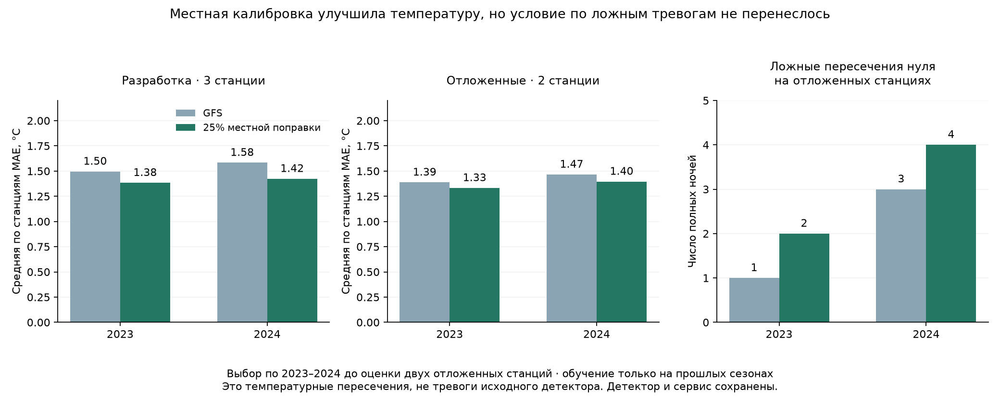

# Перенос на станции с холодными ночами

17 октября 2026 года. **Температуру удалось улучшить, но перенос без роста ложных пересечений нуля пока не подтверждён.** На трёх станциях разработки прошла местная поправка с весом 25%; на двух отложенных станциях она добавила по одной ложной холодной ночи в каждом году. Исследовательский выбор сохранён, к продукту не допущен. Исходный детектор и сервис не изменялись.

## Данные и разделение

Дополнительно скачаны **15 полных годовых NOAA ISD файлов за 2022–2024**, 264078 сообщений, 6566148 байт gzip. Это не прежние ISD-Lite: сохранены исходный срок до минуты, QC температуры, тип сообщения, координаты, высота, номер строки и оригинальные байты с URL/SHA/датой получения. Принимается только NOAA QC1/5; QC2/9 не превращаются в измерения. Полные файлы содержат другие физические позиции — они сохранены отдельно, ни одна не подмешана к аэропортовой серии.

Площадки зафиксированы до чтения новых наблюдений по прежнему реестру, географии и доступности. Выбирается одна преобладающая координатная группа около позиции реестра по числу сообщений, без использования холода/ошибок. Отличия высоты реестра до 0.3м соответствуют целочисленной высоте ISD. Прогноз GFS и HGT из старого проверенного архива используются только после подтверждения той же ближайшей ячейки 0.25°. Новых погодных выпусков или подмены целей реанализом нет.

|Станция|Координаты / высота|Роль|Полных 14-часовых ночей 2022 / 2023 / 2024|Холодных полных ночей 2022 / 2023 / 2024|
|---|---|---|---:|---:|
|Гумрак|48.783, 44.346 / 147м|выбор|86 / 83 / 76|25 / 7 / 19|
|Элиста|46.367, 44.333 / 153м|выбор|86 / 81 / 76|21 / 5 / 12|
|Нальчик|43.513, 43.637 / 445м|выбор|85 / 81 / 76|20 / 3 / 1|
|Шпаковское|45.109, 42.113 / 453м|отложенная проверка|88 / 81 / 76|21 / 6 / 7|
|Минеральные Воды|44.225, 43.082 / 321м|отложенная проверка|87 / 81 / 76|19 / 7 / 2|

Всего 1219 полных станция-ночей за три весны; из них 175 холодных. В годах проверки 2023–2024 — 787 полных ночей, 69 холодных. На двух отложенных площадках — 314 полных ночей, 22 холодные; это станция-ночи, а не 22 независимые погодные волны. Все обычные тёплые ночи сохранены для оценки ложных пересечений. Кроме полных ночей, доступны 18640 точных часовых целей за три весны; пропуски не заполнялись, минуты не округлялись. Полнота и QC по годам — в JSON-сводке.

Прежние данные, включая смешанный код 370010, не переписывались. Витязево и Анапа не входят в новый целевой набор. Модель Витязево остаётся лишь отдельным диагностическим примером прямого переноса.

## Честная проверка двух режимов

1. **Без местных измерений:** общая погодная регрессия обучается на других станциях. В проверке каждой из трёх станций разработки её данные исключены из обучения целиком, включая предыдущие годы. Отдельный вариант добавляет высоту и разницу высоты станции с поверхностью GFS, взаимодействия с ветром и ясностью неба.
2. **С местной историей:** модель использует только прошлые сезоны той же физической станции. Проверены средняя ошибка по сроку, погодные регрессии и поправки с весом 25% / 50%. Это местная адаптация, не перенос на станцию без измерений.

Хронология обоих режимов: **обучение 2022 → проверка 2023; обучение 2022–2023 → проверка 2024**. Масштабирование признаков обучается только на прошлых данных. Станции и ночи сбалансированы по весу. Для местной модели нужно минимум 20 разных прошлых ночей; это технический минимум поддержки, не гарантия качества. Исходные погодные признаки взяты из одного GFS06UTC, горизонты 10–23 часа, сценарий выдачи 15UTC. Архивная доступность проверена прежним LastModified+10 минут; историческая первая публикация не доказана.

Два выбора сохраняются с SHA **до оценки Шпаковского и Минеральных Вод**. Их ошибки не участвуют в настройке. Для проверки режима без меток их данные отсутствуют в обучении; для местной адаптации разрешены только их прошлые годы, и это явно помечено. Эти станции раньше уже изучались в других экспериментах: новая очистка источника не делает проверку новым слепым тестом.

2025–2026 не открывались и не оценивались этим опытом. Настройки выбирались только по 2023–2024; ни один кандидат не дообучен на 2024. Прежние модели/детектор/интервалы/выборы сохранены.

## Выбор на трёх станциях разработки

Реестр 10 вариантов сохранён до расчёта ошибок в [протоколе](../config/cold_station_transfer.json). Кандидат должен в каждом году улучшить среднюю по станциям часовую MAE минимум на 5%, не ухудшить холодную MAE, минимум полной ночи и суммарные пропуски. Ложные холодные полные ночи не должны вырасти **ни на одной отдельной станции в отдельном году**. Общим снижением нельзя скрыть ухудшение одной площадки.

Выбор без местных меток — **GFS**. Общие погодные модели снижают ошибку, но увеличивают ложные пересечения. Добавление высоты без достаточного разнообразия станций особенно нестабильно: при исключении одной площадки остаются всего две для обучения зависимости от рельефа, а при переносе приходится экстраполировать. Этот вариант отклонён, физическая универсальная поправка по высоте не заявляется.

Выбор с местной историей — **`local_blend_25`**: GFS + 25% местной погодной поправки Ridge1000. Более сильные поправки тоже снижают MAE, но не проходят ограничение по ложным пересечениям.

|Год|Полных / холодных ночей|Часовая MAE GFS → кандидат, °C|Холодная часовая MAE, °C|MAE минимума, °C|Пропуски|Ложные холодные ночи|
|---|---:|---:|---:|---:|---:|---:|
|2023|245 / 15|1.495 → 1.383|2.265 → 2.038|1.741 → 1.597|9 → 8|2 → 2|
|2024|228 / 32|1.583 → 1.424|2.240 → 1.972|1.860 → 1.643|10 → 6|1 → 1|

Средние MAE здесь имеют равный вес станций, а не число доступных часов. Выигрыш по общей температуре 7.5% / 10.1%. Число ложных ночей 2 / 1 сохранено на каждой площадке, пропуски сократились 9→8 и 10→6.

|Вариант|Часовая MAE 2023 / 2024, °C|Холодная MAE 2023 / 2024, °C|Ложные ночи 2023 / 2024|Выбор|
|---|---:|---:|---:|---|
|gfs|1.495 / 1.583|2.265 / 2.240|2 / 1|выбран|
|airport_transfer|1.899 / 2.086|1.891 / 1.673|12 / 21|сравнение|
|pooled_100|1.324 / 1.423|1.320 / 1.247|7 / 10|не прошёл|
|pooled_1000|1.328 / 1.414|1.426 / 1.282|5 / 8|не прошёл|
|pooled_geo_1000|5.162 / 7.274|5.883 / 8.095|1 / 0|не прошёл|
|local_bias_20|1.336 / 1.319|1.924 / 1.773|3 / 3|не прошёл|
|local_ridge_100|1.147 / 1.153|1.437 / 1.254|4 / 5|не прошёл|
|local_ridge_1000|1.172 / 1.166|1.553 / 1.319|4 / 5|не прошёл|
|local_blend_25|1.383 / 1.424|2.038 / 1.972|2 / 1|выбран|
|local_blend_50|1.288 / 1.297|1.834 / 1.718|2 / 2|не прошёл|

Полные причины отклонения каждого варианта сохранены в JSON. Результат разработки не считается доказательством качества на новых площадках.

## Что произошло на двух отложенных станциях

Фиксированный кандидат с местной историей, без изменения веса 25% после проверки:

|Год|Полных / холодных ночей|Часовая MAE GFS → кандидат, °C|Холодная часовая MAE, °C|MAE минимума, °C|Пропуски|Ложные холодные ночи|
|---|---:|---:|---:|---:|---:|---:|
|2023|162 / 13|1.387 → 1.333|3.056 → 2.890|1.589 → 1.545|8 → 7|1 → 2|
|2024|152 / 9|1.466 → 1.396|1.716 → 1.595|1.462 → 1.403|5 → 5|3 → 4|

Температура улучшилась на 4.0% / 4.8%; холодная MAE — на 5.4% / 7.1%. Но ложные пересечения выросли 1→2 и 3→4, а пропуски сократились только в 2023. На 22 полных холодных станция-ночах найдено 10 против 9 у GFS; осталось 12 пропусков против 13. Такой результат не позволяет обещать надёжное обнаружение холода.

|Станция|Год|Часовая MAE GFS → кандидат, °C|Холодная MAE, °C|Найдено холодных GFS → кандидат|Ложные ночи|
|---|---|---:|---:|---:|---:|
|Шпаковское|2023|1.184 → 1.129|1.376 → 1.357|4/6 → 5/6|0 → 0|
|Минеральные Воды|2023|1.590 → 1.536|4.736 → 4.423|1/7 → 1/7|1 → 2|
|Шпаковское|2024|1.292 → 1.219|2.092 → 1.972|3/7 → 3/7|2 → 3|
|Минеральные Воды|2024|1.639 → 1.572|1.340 → 1.218|1/2 → 1/2|1 → 1|

Описательный парный bootstrap недель по тем же датам всех станций даёт диапазон разницы часовой MAE [-0.079; -0.047]°C относительно GFS, 28 непустых календарных блоков, 2000 повторов, равный вес годов. Здесь часы объединены, поэтому это не та же величина, что равновесная станционная метрика выбора. Диапазон поддерживает небольшой выигрыш температуры, но не доказывает отсутствие роста ложных тревог, независимость станций или качество на ферме.

Новые ложные случаи:

|Станция|Дата ночи|Минимум измеренных 14 часов, °C|Минимум GFS, °C|Минимум кандидата, °C|
|---|---|---:|---:|---:|
|Минеральные Воды|2023-04-16|0.00|+0.052|-0.078|
|Шпаковское|2024-03-03|0.00|+0.175|-0.060|

Наблюдения основных площадок приходят из FM-15; проверка их дискретности сохранена отдельно в сводке. Зарегистрированные 0°C не означают известный физический минимум с точностью сотой градуса. Однако задним числом округлять −0.06/−0.08°C к нулю, менять порог или удалять эти случаи нельзя: это изменило бы условие проверки после результата. На текущих зарегистрированных данных оба считаются дополнительными ложными температурными пересечениями.

На неполных ночах ситуация тоже не скрыта: по минимуму только доступных сроков на двух станциях GFS имеет 29 холодных станция-ночей и 15 пропусков, кандидат — те же 29 и 13 пропусков; ложных ночей 4→6. Это отдельная частичная цель, не доказательство минимума между наблюдениями. Подробности доступны в `available_term_sampled_minima`.

**Условие «точнее без роста ложных тревог» на отложенных площадках не выполнено.** Ни вес, ни порог, ни выбор после этого не менялись. Исследовательский кандидат остаётся для дальнейшей проверки; производственный допуск не выдан. Для площадки без местных измерений исследование сохраняет GFS без чужой калибровки.

## Что это даёт продукту

Теперь есть проверка на действительно холодных полных ночах, с контролем качества и физической идентичности станций, с раздельной оценкой переноса без меток и местного обучения. Прямой перенос аэропортовой модели на эти станции заметно увеличивает ложные пересечения: на отложенных площадках 10 / 22 против GFS 1 / 3. Хорошая холодная MAE сама по себе не делает модель пригодной для предупреждений.

Исходный продуктовый детектор, его вероятности, порог, маски и времена эпизода сохранены. Все приведённые «ложные ночи» — диагностика минимума температуры <0°C, **не новые тревоги детектора**. Нельзя обещать температуру цветков яблони, повреждение урожая или время запуска защиты по этим станционным данным. Непрерывный минимум и длительность холода между измерениями не проверены; часовые серии не описывают весь сад.

Следующий полезный опыт: заранее зарегистрировать работу с пограничной температурой и её неопределённостью, а также проверку переноса вне диапазона высот/погодных признаков обучения. Нужны более точные местные датчики и независимые будущие холодные эпизоды; проверять отдельно стоимость лишнего выезда и пропуска, сохраняя чувствительность. Это план следующего опыта, а не изменение текущего порога. Рабочая точка фермы пока не имеет собственных целей и не получает обещаний качества по этим станциям.

## Воспроизводимость и ограничения

- Проверка 17 октября: **470 Python + 20 JavaScript = 490 тестов прошли, без пропусков**. В том числе 12 новых проверок QC/позиции/LOSO/местного обучения/хронологии/пороговых ограничений. Дополнительно подтверждены SHA прежних моделей и выборов, неизменность полевого выпуска, отсутствие новых измерений фермы; график просмотрен и ссылки проверены.
- [JSON-сводка со всеми станциями, QC, ошибками и решениями](COLD_STATION_TRANSFER_SUMMARY.json).
- Данные: `agro_checker/cold_station_data.py`; модели: `cold_station_study.py`; отчёт отдельно: `cold_station_report.py`.
- Новый кэш `data/working-zone-01/cold-station-transfer/`: оригинальные gzip, раздельные annual/other-positions, цели, источник GFS/HGT, модели, прогнозы и протоколы с SHA.
- Выбор SHA `df0dac3d48bb26d5def17fdd0c63b1a0ffe872072c520597d61dc2c09e46d42e`; пространственная оценка SHA `f2f14a55334cd9c58a08bd8831095cd9fb112d254ec569273d31e05d1d451d7d`. Научные источники, протокол и кэш после фиксации неизменяемы. Последующий поиск — новым экспериментом.
- Источник: NOAA NCEI full ISD, например [Гумрак 2022](https://www.ncei.noaa.gov/pub/data/noaa/2022/345600-99999-2022.gz), [Шпаковское 2024](https://www.ncei.noaa.gov/pub/data/noaa/2024/349490-99999-2024.gz), [спецификация ISD](https://www.ncei.noaa.gov/pub/data/noaa/isd-format-document.pdf). Все 15 фактических URL, SHA и время получения — в JSON-сводке; это источник наблюдений станций, не измерения фермы.

Запуск из корня: `.venv\Scripts\python.exe -X utf8 -m agro_checker.cold_station_report`. Повтор проверяет зафиксированные результаты, не выбирает новый вариант по пространственным ошибкам.
