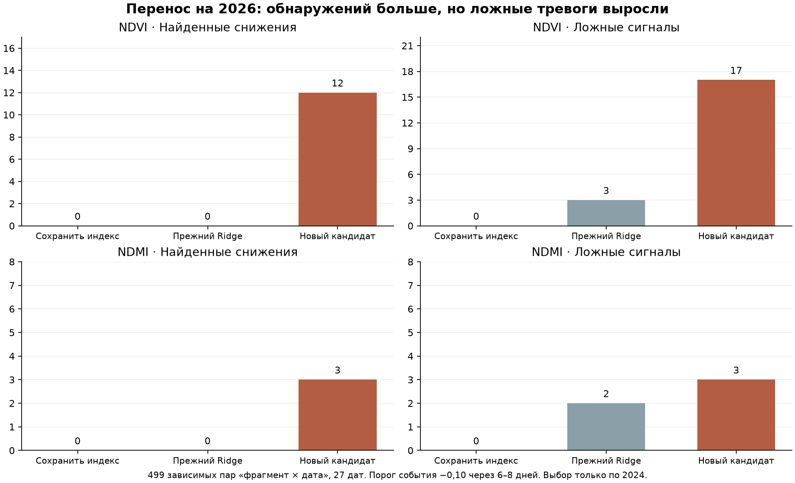

# Консервативный детектор резких снижений NDVI/NDMI

Проверка 20 октября 2026. **Обнаружение улучшилось, но цель «без роста ложных тревог» на всём секторе не достигнута. Оба кандидата отклонены для подключения.** Прежние точечный прогноз, детектор, диапазоны, интерфейс и журнал сохранены.

## Постановка и данные

Предсказывается падение медианного индекса фиксированного внутреннего ядра не менее чем на 0,10 на ближайшем пригодном снимке через 6–8 дней. Это спектральное событие, не болезнь и не подтверждённый ущерб. Маски, исходные пары и приблизительные контуры не менялись для улучшения метрик.

Полный набор 2024: 573 пары. Пять южных фрагментов R23–R27 исключены из обучения и выбора; итоговое обучение — 489 пар на 39 датах, последняя целевая дата 2024-10-14. Последовательный выбор: 274 пары на 25 датах, июнь–октябрь 2024. Обучение каждого месяца использует только целевые даты строго раньше его начала; пересекающие границу окна исключаются. Близкие площади одной даты находятся вместе. Даты имеют одинаковый суммарный вес.

2026 не участвовал в обучении, выборе признаков, моделей, условий или порогов. Выбор и веса зафиксированы до оценки. Этот архив уже изучался ранее; **новым слепым тестом его называть нельзя**. 2025 отсутствует в существующем спутниковом наборе и не проверялся.

## Что попробовали

До обучения зафиксированы 13 кандидатов: прошлый темп как простой контроль; логистическая регрессия с двумя уровнями регуляризации; ExtraTrees с двумя минимальными размерами листа; регрессия изменения CatBoost с квантилями 0,5 и 0,9. Для обучаемых семейств — семь прежних входов либо 40 входов с прошлыми пиксельными/сезонными признаками. Догадки о культуре, календарь будущих операций, ID поля, будущие снимки и целевые аудиты не являются признаками.

Проверены два заранее заданных условия сигнала: без ограничения либо совместное предыдущее снижение обоих индексов не менее 0,05 в пересчёте на неделю при текущем NDVI≥0,40 / NDMI≥0,00. Пороги заданы сеткой до обучения. Приоритет отбора — полнота с равным весом дат; жёсткий бюджет — **0 ложных пар и 0 дат с ложной тревогой**, как у сохранения индекса; минимум 2 попадания на 2 датах. Проверено 276 комбинаций на индекс. Отбор по этим же 25 датам оптимистичен и не является независимой проверкой. Числа выходов классификаторов не объявляются откалиброванными вероятностями; квантильная регрессия не даёт гарантии покрытия.

## Выбор только по 2024

| Индекс | Кандидат | Порог | Найдено / событий | Дат попаданий | Ложные |
|---|---|---:|---:|---:|---:|
| NDVI | history_season_extra_10 | 0.5 | 4 / 44 | 3 | 0 |
| NDMI | basic_logit_1.0 | 0.85 | 9 / 36 | 2 | 0 |

Оба выбранных варианта используют совместный прошлый отрицательный темп. Поэтому проверяется прежде всего прогноз **продолжения уже начавшегося снижения**, а не предупреждение до его начала. Финальные модели обучены на полном пригодном сезоне 2024 после выбора; численная шкала и перенос в другой сезон не гарантируются нулём ошибок на отборе.

## Перенос на весь сектор 2026

499 одинаковых пар «фрагмент × дата», 27 дат выдачи с 28 июля; факты до 19 октября. Полнота и точность тревог ниже рассчитаны по парам; они не совпадают с полнотой с равным весом дат, используемой при отборе. Событийные пары связаны общими снимками и пересекающимися окнами.

| Индекс | Вариант | Найдено / событий | Ложные пары | Дат с ложными | Полнота | Доля верных тревог |
|---|---|---:|---:|---:|---:|---:|
| NDVI | Сохранить индекс | 0 / 50 | 0 | 0 | 0.0% | — |
| NDVI | Прежний Ridge | 0 / 50 | 3 | 3 | 0.0% | 0.0% |
| NDVI | Новый кандидат | 12 / 50 | 17 | 10 | 24.0% | 41.4% |
| NDVI | Прежний отклонённый классификатор | 10 / 50 | 12 | 8 | 20.0% | 45.5% |
| NDMI | Сохранить индекс | 0 / 42 | 0 | 0 | 0.0% | — |
| NDMI | Прежний Ridge | 0 / 42 | 2 | 2 | 0.0% | 0.0% |
| NDMI | Новый кандидат | 3 / 42 | 3 | 3 | 7.1% | 50.0% |
| NDMI | Прежний отклонённый классификатор | 0 / 42 | 2 | 2 | 0.0% | 0.0% |

Сохранение индекса всегда предсказывает нулевое изменение, поэтому его нулевые ложные тревоги сопровождаются нулевыми попаданиями. Это прозрачный контроль, а не хороший детектор. Новый NDVI находит больше, чем прежний отклонённый классификатор, но также выдаёт больше ложных тревог. NDMI впервые находит часть событий в этом эксперименте, но на всём секторе также превышает бюджет 2→3.

С равным весом дат полнота новых сигналов: NDVI 21.0%, NDMI 6.2%. Точечный прогноз не менялся: MAE NDVI 0,0460 против сохранения 0,0441; NDMI 0,0445 против 0,0431. Нельзя приписывать новой классификации улучшение этих MAE.

## Пространственная проверка

| Поднабор | Индекс | Пар | Попадания: прежний → новый | Ложные: прежний → новый | Дат с новыми ложными |
|---|---|---:|---:|---:|---:|
| Отложенные площади, 2024 | NDVI | 84 | 0 → 7 из 10 | 0 → 0 | 0 |
| Отложенные площади, 2024 | NDMI | 84 | 0 → 2 из 11 | 0 → 0 | 0 |
| Отложенные площади, 2026 | NDVI | 102 | 0 → 6 из 18 | 0 → 1 | 1 |
| Отложенные площади, 2026 | NDMI | 102 | 0 → 3 из 15 | 0 → 0 | 0 |
| Остальные площади, 2026 | NDVI | 397 | 0 → 6 из 32 | 3 → 16 | 10 |
| Остальные площади, 2026 | NDMI | 397 | 0 → 0 из 27 | 2 → 3 | 3 |

На пяти отложенных площадях NDMI в 2026 находит 3 из 15 событий без ложных тревог. Это ограниченный положительный результат. На остальных площадях у того же кандидата 0 попаданий и 3 ложные тревоги. **Выбирать только удачные фрагменты по 2026 или подключать модель на них нельзя.** Соседние фрагменты не являются независимыми хозяйствами. Хороший пространственный результат в 2024 также не подтвердил перенос во времени.

## Что выяснили об ошибках

Из 17 ложных NDVI-сигналов 5 сопровождались нулевым или положительным фактическим изменением. Все 3 ложные NDMI-тревоги сопровождались ростом индекса. Следовательно, проблему нельзя объяснить только пограничным случаем «снижение чуть меньше 0,10»: отрицательная прошлая динамика не всегда продолжается. Почему она разворачивается — развитие культуры, уборка, операции, состав пикселей или другие причины — без полевых данных не установлено. Пороги и метки после этого анализа не менялись.

## Решение и следующий шаг

Условие замены проверено одновременно относительно Ridge и сохранения индекса, по ложным парам и датам, на всём секторе и пространственном резерве. **Оба кандидата не прошли. Подключения к продукту нет.** Нельзя повышать порог по увиденным ошибкам 2026 и повторно называть этот же архив независимой проверкой.

Следующий содержательный эксперимент требует дополнительных обучающих сезонов с заранее выделенной новой проверкой, а также фактических культур и операций. Они позволят отличать продолжение снижения от нормального разворота или уборки. Результаты осмотров нужны отдельно, чтобы проверять полезность сигнала для агронома. Ни метки культур, ни осмотры в этой работе не выдумывались.

## Воспроизведение и контроль

Последовательность: `scripts/train_conservative_decline.py protocol`, затем `fit`, затем `evaluate`; после замораживания повторное обучение запрещено. Проверка `scripts/verify_conservative_decline.py` воспроизводит выбор из 2024, сверяет сроки, резерв, хеши, все 499 исходных прогнозов и тревог, неизменность 1472 прежних файлов. Исходный mean-прогноз, интервалы и журнал сохранены. Фиксация: `90c486a8e9ac6082e674e6cc2c468bf24483c0eccb5ea1703663a39927afcd4b`.
