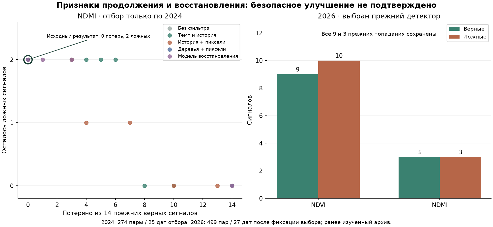

# Продолжение снижения или восстановление: проверка новых признаков

21 октября 2026. **Снизить ложные тревоги без потери прежних найденных снижений не удалось.** Добавлены и проверены признаки формы прошлой динамики и общих пикселей. По результатам отбора 2024 дополнительный фильтр отключён для обоих индексов. На 2026 все исходные сигналы сохранены; производственные модели, диапазоны, интерфейс и журнал не менялись.

## Что добавили

Модель прогнозирует снижение медианного NDVI/NDMI минимум на 0,10 через 6–8 дней. Это спектральное событие. Повреждение растений, болезнь, дефицит воды и полезность осмотра не размечены и не предсказываются как подтверждённый факт.

| Признаки | Что именно рассчитывается к дате выдачи |
|---|---|
| Темп и изменение темпа | Последний недельный темп, предшествующий темп и их разность; реальные неодинаковые интервалы между снимками учтены |
| Устойчивость снижения | Число последовательных отрицательных изменений; отличие последнего темпа от прошлых 30 и 60 дней |
| Положение в прошлой истории | Наблюдавшиеся диапазон и просадка от уже видимого максимума; будущий сезонный максимум не используется |
| Связь NDVI и NDMI | Оба ряда входят совместно, есть признак несовпадения направления; это не диагноз |
| Одни и те же пиксели | Темпы и изменение темпа на общем пересечении трёх снимков, доли продолжающих снижение, разворачивающихся вверх и замедляющих снижение пикселей |
| Поддержка и пропуски | Полнота текущего снимка и её изменение, длина истории, интервалы, отдельные флаги отсутствующей третьей даты и недостаточного общего покрытия |

Третий снимок — ближайший пригодный за 2–21 день **до предыдущего**. История ограничена текущим годом, одной площадью и одной версией обработки, не позднее выдачи. Общая поддержка требует минимум 10 пикселей и 80% ядра. При нехватке поддержки признаки помечаются отсутствующими; ни один исходный пример из проверки не исключён.

В прямой модели 26 временных признаков, с пикселями — 42. Ни идентификатор площади, ни будущий целевой снимок, ни результаты аудита цели не входят в модель. Это всё ещё приблизительные восстановленные фрагменты R01–R27 с неподтверждёнными границами; R18 не имел достаточного ядра в исходной когорте. Ядра снижают влияние края, но не подтверждают границы.

## Почему проверку пришлось разделить на два этапа

Сначала использованы 418 причинных прогнозов базового детектора на 33 датах 2024. Каждая исходная оценка получена моделью, не видевшей свой целевой снимок. Новый фильтр ежемесячно обучался только на завершённых парах до начала месяца; проверка — июнь–октябрь, те же 274 пары / 25 дат. Окна, пересекающие границу проверки, исключены, все площади одной даты проверяются вместе.

Однако обе ложные тревоги NDMI оказались в июне. До начала июня в таком наборе всего 14 причинных прогнозов с одной даты. Ни один обучаемый фильтр не имел достаточной поддержки и сохранял все тревоги. Это **недостаточная проверка признаков на этих ложных случаях**, а не доказательство бесполезности признаков. Первый этап сохранён отдельно в `continuation-recovery`; на 2026 он вообще не оценивался.

**До открытия 2026** зарегистрирован второй этап: самостоятельный классификатор формы ряда на всех 489 исходных обучающих парах 2024 / 39 датах. Обе оценки базового детектора полностью исключены из его входов. Поэтому можно использовать март–май напрямую, не получать для них собственные обучающие прогнозы базовой модели. Порогов поддержки не снижали. Июньский NDMI теперь обучается на достаточных классах и датах; для трёх NDVI-голов в июне ещё действует fallback. У модели восстановления в июне NDVI поддержка есть.

Базовая тревога для отбора при этом остаётся прежней причинной оценкой; когорта проверки — ровно те же 274 ключа. Для применения новый слой может только убрать старую тревогу, а не создать новую. При недостатке поддержки он сохраняет исходный сигнал.

## Какие варианты сравнили

- Отсутствие дополнительного фильтра.
- Регуляризованная логистическая модель по временным признакам.
- Та же модель с пикселями.
- Неглубокий ExtraTrees с пикселями: 256 деревьев, глубина 3, минимум 15 строк в листе.
- Отдельная логистическая модель восстановления: целевая метка — рост индекса минимум на 0,03. Умеренное снижение и неизменность **не называются восстановлением**. Её keep-score равен единице минус оценка восстановления.

У логистических моделей C=0,1; нормировки обучаются только на прошлом с равным суммарным весом дат. Сетка порогов и алгоритмы зафиксированы заранее. Требования допуска на отборе: сохранить **каждый** прежний TP, не добавить тревог, строго уменьшить ложные пары и не увеличить даты с ложными. При равенстве — меньший порог. Если полезного варианта нет, фильтр отключён.

Финальные базовые веса неизменны: NDVI `season25`, порог 0,5; NDMI прежний `2024_only`, порог 0,85; в обоих прежнее условие прошлой отрицательной динамики. Принятого сезонного NDMI-детектора нет. Новый классификатор формы не заменяет их.

## Что выяснилось на 2024

У исходного NDVI на отборе 4 попадания и **0 ложных**, поэтому доказать уменьшение ложных здесь нельзя. У NDMI — 14 попаданий и 2 ложные тревоги. Причинные базовые модели обновлялись по датам; эти числа не подменяются результатами прежних моделей с ежемесячным обновлением.

Обе ложные NDMI — не восстановления:

- R04, выдача 6 июня → 13 июня: фактическое изменение **−0,0957**, чуть выше порога −0,10. Последний темп −0,106 в неделю, предшествующий −0,186; снижение замедлялось, но продолжалось на 75% общих пикселей.
- R15, 11 июня → 18 июня: **−0,0695**. Прошлый темп −0,146 против предшествующего −0,100; 95% общих пикселей продолжали снижение. По прошлому снимку это не выглядело разворотом вверх.

Это факты сохранённого спектрального архива, не полевые наблюдения. Первая метка близка к выбранной границе события; погрешность самой метки не оценена. Порог события не менялся ради улучшения показателей. Причины изменений — уборка, сезонный ход, обработка или стресс — по этим данным не установлены.

| Вариант NDMI | Минимум ложных при сохранении всех 14 TP | Удалено ложных в наиболее щадящем варианте с удалением | Цена: потеряно прежних TP |
|---|---:|---:|---:|
| identity | 2 | 2 | 14 |
| temporal_logit | 2 | 2 | 8 |
| pixels_logit | 2 | 1 | 4 |
| pixels_extra | 2 | 2 | 14 |
| recovery_logit | 2 | 2 | 14 |

Эта таблица описывает только заранее заданную сетку на **2024**, не рекомендует варианты с потерями. Лучший по числу сохранённых попаданий вариант, который хоть что-то убирает, — логистическая модель с пикселями: минус одна ложная, но минус четыре верных. Поэтому он отклонён. Модель восстановления также не помогла: ложные случаи продолжали снижаться, а не восстанавливались.

Полнота обучающих признаков: третья прошлая дата есть у 474 из 489, достаточно общих пикселей у 467 из 489; использовано 58 архивных сцен. Пропуски сохранены флагами, не заполнены выдуманными значениями наблюдений.

## Проверка фиксированного выбора на 2026

По 2024 выбран `identity`, дополнительный порог 0 для обоих индексов. Поэтому ниже проверяется сохранность прежнего детектора, а **не качество отвергнутых новых моделей на 2026**. На 2026 они не оценивались, новые настройки после просмотра результата не выбирались.

499 пар / 27 дат. 2026 ранее изучался, это проверка без нового подбора, не новый слепой тест. 2025 отсутствует в текущем архиве и не подменяется другим годом.

| Индекс | Вариант | Найдено / всех снижений | Ложных | Дат с ложными | Точность тревог | Доля найденных |
|---|---|---:|---:|---:|---:|---:|
| NDVI | Исходный | 9 / 50 | 10 | 8 | 47.4% | 18.0% |
| NDVI | После отбора | 9 / 50 | 10 | 8 | 47.4% | 18.0% |
| NDMI | Исходный | 3 / 42 | 3 | 3 | 50.0% | 7.1% |
| NDMI | После отбора | 3 / 42 | 3 | 3 | 50.0% | 7.1% |

Сохранены конкретные 9 прежних попаданий NDVI и 3 NDMI. Новых тревог, удалённых ложных и потерянных TP — по нулю. Для простого сохранения индекса — 0 попаданий и 0 ложных; прежний Ridge — 0 попаданий / 3 ложные NDVI и 0 / 2 NDMI. Исследовательский детектор находит больше событий, но не превосходит сохранение индекса по числу ложных.

Поддержка новых признаков 2026: третья дата у 471 из 499, общие пиксели у 460. Эти случаи не использованы для выбора или коррекции фильтра.

| Поднабор | Индекс | Пар | Попаданий | Ложных | Потеряно прежних TP |
|---|---|---:|---:|---:|---:|
| Резерв 2024 | NDVI | 84 | 7 | 0 | 0 |
| Основные площади 2026 | NDVI | 397 | 5 | 9 | 0 |
| Резерв 2026 | NDVI | 102 | 4 | 1 | 0 |
| Резерв 2024 | NDMI | 84 | 2 | 0 | 0 |
| Основные площади 2026 | NDMI | 397 | 0 | 3 | 0 |
| Резерв 2026 | NDMI | 102 | 3 | 0 | 0 |

Соседние резервные фрагменты не являются новым независимым хозяйством. Пары зависимы по датам и могут описывать перекрывающиеся изменения; числа нельзя трактовать как сотни независимых агрономических случаев.

## Что это значит для продукта

**Обещать надёжное предсказание резких снижений пока нельзя.** Сохранены прежние результаты; нового улучшения ложных тревог нет. Точность среди тревог около половины, а большинство размеченных снижений пропускается. Нет оснований считать отсутствие тревоги подтверждением нормального состояния поля или выдавать эти оценки за вероятности повреждений.

Для продукта подтверждён более узкий сценарий: показать уже наблюдавшееся изменение на пригодных снимках, качество поддержки и историю места, помочь агроному назначить осмотр и записать реальный результат. Прогнозные сигналы пока исследовательские. Ни один осмотр или его исход здесь не выдуман.

Следующий полезный ресурс — подтверждённые культуры и даты операций, причины реальных тревог и независимый сезон проверки, заранее отделённый от разработки. Это даст возможность отличать ожидаемое снижение после операции от изменения, заслуживающего осмотра. Расширять сетку до удачного результата на уже просмотренном 2026 нельзя.

## Воспроизведение и ограничения

Команды: `scripts/train_continuation_recovery.py protocol|fit` — первый сохранённый этап; `scripts/train_continuation_shape.py protocol|fit|evaluate` — прямой вариант; `scripts/verify_continuation_shape.py`. Повторный fit после заморозки и повторная оценка запрещены. Исполняемые источники и файлы протокола зафиксированы хешами, контрольные пиксели проверены.

Заморозка второго этапа: `3ceb897b49ae089703361eda57931106dd59e43bfc965fdf058a4c69aa0a26ac`. Проверка воспроизвела оба отбора, исключение будущих сроков и R23–R27 из обучения, ту же когорту 274/499, неизменность исходных оценок, точечного прогноза и Ridge, сохранность конкретных найденных случаев. 2230 прежних файлов проверены, изменений нет. 108 целевых тестов прошли, включая 19 новых проверок причинности, масок, неравных интервалов и защит отбора.

2024 неоднократно использовался в предыдущих экспериментах, поэтому оценки отбора оптимистичны. Данные переобработаны; доступность каждого снимка в исторический момент выдачи и задержка доставки не доказаны. Межгодовой перенос, различия версий обработки и неподтверждённые границы остаются ограничениями. Модель масштаба/диапазона не переобучалась. Версии библиотек сохранены в `runtime.json`.
