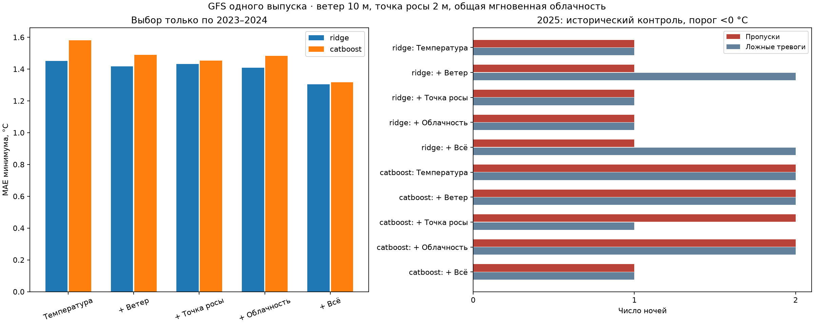

# Ветер, точка росы и облачность: проверка дополнительных признаков GFS

Расчёт 2026-10-12T16:30:42.684005+00:00. Выбор на 2023–2024: **ridge_temperature_all**. В историческом контроле 2025 MAE минимума 1.562 → 1.289 °C, пропуски 2 → 1, ложные тревоги 0 → 2.

## Ответ на вопрос о новых признаках

- ridge: MAE 2023–2024 1.450 → 1.305 °C; MAE 2025 1.354 → 1.289 °C. Пропуски 2025 1 → 1, ложные тревоги 1 → 2. 95% диапазон добавочного выигрыша [-0.031, 0.174] °C.
- catboost: MAE 2023–2024 1.580 → 1.317 °C; MAE 2025 1.289 → 1.256 °C. Пропуски 2025 2 → 1, ложные тревоги 2 → 1. 95% диапазон добавочного выигрыша [-0.031, 0.098] °C.

Совместное добавление полей снижает среднюю ошибку в обеих проверках для обоих алгоритмов, но 95% диапазоны добавочного выигрыша на 2025 включают ноль. На валидации новые поля не уменьшили пропуски относительно температурных моделей. На 2025 у Ridge обнаружение не улучшилось и выросли ложные тревоги; у CatBoost улучшились ночные исходы. **Замена победителя на CatBoost после просмотра 2025 не выполняется.** Это перспективные исследовательские признаки, а не подтверждённое полевое преимущество.

## Протокол до расчёта моделей

Группы и настройки закреплены в `config/covariate_study.json` до оценки новых моделей. Два алгоритма с прежними настройками: Ridge alpha=10 (стандартизация только на обучении), CatBoost MAE, 200 деревьев глубиной 3, learning_rate=0.03, L2=10, фиксированный seed. Без поиска параметров и early stopping. Пять групп: температура; температура+ветер; +точка росы; +облачность; все признаки. Базы: GFS, медианный сдвиг минимума, поправка по часу. Все 13 методов сравниваются на одинаковых полных ночах.

Временная проверка: 2022 → 2023 и 2022–2023 → 2024; выбор по MAE объединённых валидационных ночей. Порядок конфигурации разрешает равенство. Все итоговые модели обучены на 2022–2023 без дообучения на 2024. Выбор, хэши протокола/входов/моделей сохранены в `models/research-covariates/selection-before-2025.json` перед прогнозами и метриками 2025. **2025 уже просмотрен раньше; это исторический контроль, не свежий слепой тест.** Погодный порог всегда строгий `<0 °C`, запас тревоги не подбирался. MAE и обнаружение заморозков оцениваются отдельно.

## Источник и полнота

5152/5152 часов, 20608 сообщений, 15.83 GiB диапазонов; ошибок 0. Запоздалые поля по архивному proxy: {'u10': 0, 'v10': 0, 'dewpoint': 0, 'cloud': 0}. Исходных парных ночей 366, общих полных 366; по годам {'2022': 92, '2023': 92, '2024': 91, '2025': 91}.

Из исходных NOAA GFS 0.25° объектов берутся UGRD/VGRD на 10 м (м/с), DPT на 2 м (K → °C), TCDC для всей атмосферы (%). Выбраны мгновенные поля; усреднённый TCDC из соседней записи не используется. Проверены центр, параметр, слой, единицы, шаг, выпуск, время действия, сетка и точка. ETag и Last-Modified каждого диапазона совпадают с температурным объектом, исключая смешение версий. Каждый диапазон имеет SHA-256 и точный HTTP 206 Content-Range. Повторный запуск восстанавливает незавершённую загрузку.

Доступность: S3 Last-Modified + 10 минут <= выдача 18:00 МСК. Это архивный proxy с предположением о публичной доступности тогда, а не журнал первой публикации. Фактическое время публикации оставлено пустым. Пропуски/опоздания исключают всю ночь из сравнения; другой выпуск и импутация не подставляются. Наблюдения только ISD-lite/METAR, все 14 часов; модельные заполнения исключены.

## Признаки

К прежним 12 температурным/календарным признакам добавлены 11: средняя и минимальная скорость ветра, скорость в час минимума GFS; средняя/минимальная точка росы и её значение в этот час; средняя разность температура−точка росы и разность в этот час; средняя/минимальная общая облачность и её значение в этот час. Скорость ветра рассчитывается как sqrt(U²+V²) для каждого часа до агрегации. Час минимума выбран по прогнозу GFS, а не по последующему факту. Используются только прогнозные значения этого выпуска.

## Результаты выбора: 2023–2024

| Метод | MAE минимума °C | Попадания | Пропуски/холодных | Ложные тревоги |
|---|---:|---:|---:|---:|
| identity | 1.785 | 1 | 6/7 | 0 |
| night_min_median | 1.615 | 2 | 5/7 | 1 |
| lead_hour_median | 1.666 | 2 | 5/7 | 0 |
| ridge_temperature | 1.450 | 4 | 3/7 | 1 |
| ridge_temperature_wind | 1.416 | 4 | 3/7 | 1 |
| ridge_temperature_dewpoint | 1.431 | 4 | 3/7 | 1 |
| ridge_temperature_cloud | 1.409 | 4 | 3/7 | 2 |
| ridge_temperature_all | 1.305 | 4 | 3/7 | 2 |
| catboost_temperature | 1.580 | 4 | 3/7 | 1 |
| catboost_temperature_wind | 1.488 | 4 | 3/7 | 1 |
| catboost_temperature_dewpoint | 1.452 | 4 | 3/7 | 1 |
| catboost_temperature_cloud | 1.482 | 4 | 3/7 | 1 |
| catboost_temperature_all | 1.317 | 4 | 3/7 | 1 |

## Исторический контроль 2025

| Метод | MAE минимума °C | MAE холодных °C | Bias °C | Попадания | Пропуски/холодных | Ложные тревоги | Recall | Precision |
|---|---:|---:|---:|---:|---:|---:|---:|---:|
| identity | 1.562 | 2.790 | 1.097 | 4 | 2/6 | 0 | 0.667 | 1.000 |
| night_min_median | 1.413 | 2.529 | 0.314 | 4 | 2/6 | 1 | 0.667 | 0.800 |
| lead_hour_median | 1.453 | 2.689 | 0.894 | 4 | 2/6 | 0 | 0.667 | 1.000 |
| ridge_temperature | 1.354 | 2.902 | 0.080 | 5 | 1/6 | 1 | 0.833 | 0.833 |
| ridge_temperature_wind | 1.347 | 2.948 | -0.030 | 5 | 1/6 | 2 | 0.833 | 0.714 |
| ridge_temperature_dewpoint | 1.343 | 2.866 | 0.094 | 5 | 1/6 | 1 | 0.833 | 0.833 |
| ridge_temperature_cloud | 1.337 | 2.537 | 0.030 | 5 | 1/6 | 1 | 0.833 | 0.833 |
| ridge_temperature_all | 1.289 | 2.556 | -0.080 | 5 | 1/6 | 2 | 0.833 | 0.714 |
| catboost_temperature | 1.289 | 2.627 | 0.149 | 4 | 2/6 | 2 | 0.667 | 0.667 |
| catboost_temperature_wind | 1.281 | 2.809 | 0.090 | 4 | 2/6 | 2 | 0.667 | 0.667 |
| catboost_temperature_dewpoint | 1.283 | 2.722 | 0.152 | 4 | 2/6 | 1 | 0.667 | 0.800 |
| catboost_temperature_cloud | 1.293 | 2.656 | 0.071 | 4 | 2/6 | 2 | 0.667 | 0.667 |
| catboost_temperature_all | 1.256 | 2.634 | 0.026 | 5 | 1/6 | 1 | 0.833 | 0.833 |

## Дают ли новые поля выигрыш относительно температурной модели?

Положительное число — MAE температурной модели минус MAE модели с новыми полями, внутри того же алгоритма. 95% парный bootstrap по календарным блокам 7 дней, 5000 повторов; варианты 3/14 дней также сохранены в JSON. Один контрольный сезон, редкие связанные заморозки, 13 сравнений; интервалы не доказывают переносимость и не скорректированы на множественные попытки.

| Алгоритм | Добавленные поля | Выигрыш 2023–2024 °C | Выигрыш 2025 °C | 95% диапазон 2025 °C |
|---|---|---:|---:|---|
| ridge | temperature_wind | 0.034 | 0.007 | [-0.049, 0.065] |
| ridge | temperature_dewpoint | 0.019 | 0.011 | [-0.020, 0.046] |
| ridge | temperature_cloud | 0.042 | 0.017 | [-0.038, 0.077] |
| ridge | temperature_all | 0.146 | 0.066 | [-0.031, 0.174] |
| catboost | temperature_wind | 0.092 | 0.007 | [-0.067, 0.080] |
| catboost | temperature_dewpoint | 0.128 | 0.006 | [-0.065, 0.082] |
| catboost | temperature_cloud | 0.098 | -0.005 | [-0.077, 0.075] |
| catboost | temperature_all | 0.264 | 0.033 | [-0.031, 0.098] |



## Холодные ночи и тревоги

| Ночь | Факт °C | GFS °C | Ridge температура °C | Ridge все °C | CatBoost температура °C | CatBoost все °C | Выбранный: ridge_temperature_all °C |
|---|---:|---:|---:|---:|---:|---:|---:|
| 2025-03-01 | -14.000 | -15.200 | -18.047 | -17.893 | -17.321 | -18.007 | -17.893 |
| 2025-03-02 | -4.000 | -4.256 | -5.991 | -5.606 | -5.088 | -6.057 | -5.606 |
| 2025-03-03 | -9.000 | -3.818 | -4.803 | -4.971 | -5.422 | -5.449 | -4.971 |
| 2025-03-04 | 2.000 | 0.247 | -1.257 | -0.594 | -0.074 | -0.291 | -0.594 |
| 2025-03-07 | -4.000 | 2.909 | 1.195 | 0.423 | 1.719 | 0.531 | 0.423 |
| 2025-03-18 | 1.000 | 1.518 | 0.158 | 0.351 | -0.094 | 0.027 | 0.351 |
| 2025-03-19 | -1.000 | -0.182 | -2.323 | -2.323 | -1.955 | -1.729 | -2.323 |
| 2025-03-20 | -1.000 | 1.374 | -0.343 | -1.061 | 0.098 | -0.073 | -1.061 |
| 2025-04-12 | 2.000 | 2.042 | 0.266 | -0.119 | 0.610 | 0.040 | -0.119 |

| Метод | Холодных последовательных серий | Хотя бы одна ночь обнаружена | Все ночи серии обнаружены |
|---|---:|---:|---:|
| identity | 3 | 2 | 1 |
| ridge_temperature | 3 | 2 | 2 |
| ridge_temperature_all | 3 | 2 | 2 |
| catboost_temperature | 3 | 2 | 1 |
| catboost_temperature_all | 3 | 2 | 2 |

Серии — описательная группировка соседних холодных ночей, не доказанное число независимых погодных событий. Полные метрики каждого сезона и значения новых признаков по ошибочным ночам сохранены в JSON. Температура станции аэропорта не является температурой цветков/сада; реальные фазы яблони отсутствуют. Добавление физических признаков не заменяет независимый QC целочисленных целей и проверку за пределами температур обучения. Выигрыш MAE сам по себе не подтверждает более полезные тревоги или предотвращение ущерба.

Ночь 7–8 марта: факт -4.000 °C, Ridge со всеми полями +0.423 °C, CatBoost со всеми полями +0.531 °C. Прогноз не пересёк 0 °C у 13 из 13 методов.

Ночь 20–21 марта: catboost_temperature_all -0.073 °C при факте -1.000 °C. Прогноз близок к порогу; такой исход не является устойчивым доказательством обнаружения заморозка.

Ночь 12–13 апреля: ridge_temperature_all -0.119 °C при факте +2.000 °C. Прогноз близок к порогу; такой исход не является устойчивым доказательством обнаружения заморозка.

Обнаружение хотя бы одной ночи в каждой серии не улучшается у моделей со всеми полями относительно GFS в этом контроле: см. отдельную таблицу серий выше.

## Аудит новых входов

| Год | Часов прогноза | Диапазон скорости ветра м/с | Диапазон T−Td °C | Часов с Td>T | Доля полностью ясных / облачных часов |
|---|---:|---|---|---:|---|
| 2022 | 1288 | 0.065…14.528 | -0.036…12.781 | 2 | 7.3% / 42.2% |
| 2023 | 1288 | 0.117…11.545 | 0.224…11.124 | 0 | 4.3% / 47.1% |
| 2024 | 1288 | 0.178…13.616 | 0.610…14.061 | 0 | 9.2% / 35.2% |
| 2025 | 1288 | 0.106…11.975 | -0.012…17.100 | 1 | 10.2% / 38.1% |

Исходная разность T−Td сохранена без отсечения; это аудит прогнозных полей, не наблюдаемой влажности. Диапазоны 23 признаков на обучении и выходы за них в 2025 сохранены в JSON, без изменения прогнозов по результатам диагностики.

## Воспроизведение

```powershell
.\.venv\Scripts\python.exe -m agro_checker covariate-fetch --workers 10
.\.venv\Scripts\python.exe -m agro_checker covariate-study --offline
```

Зависимости: `requirements-archive.txt` и `requirements-model.txt`. Сырые диапазоны — `data/raw/gfs-covariates/`; извлечения/манифест — `data/raw/covariate-*.json`; признаки/прогнозы — `data/processed/covariate-study/`; модели и закреплённый выбор — `models/research-covariates/`. Исследование не изменяет демонстрационную модель. [Численные результаты и происхождение](COVARIATE_STUDY_SUMMARY.json).

Источники: [официальный каталог NOAA GFS](https://www.nco.ncep.noaa.gov/pmb/products/gfs/), [NOAA/AWS](https://registry.opendata.aws/noaa-gfs-bdp-pds/).
