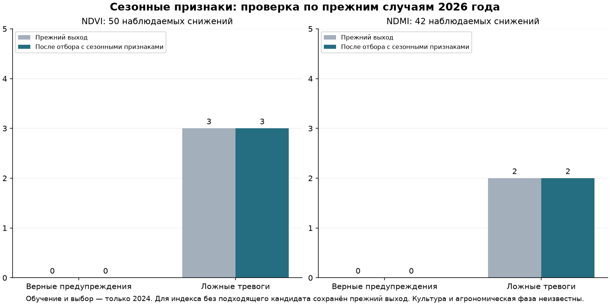

# Культура, фаза сезона и ложные спутниковые тревоги

Дата: 19 октября 2026. **Улучшение с выполнением ограничения на ложные тревоги не подтверждено.** Статус: исследование; автоматического рабочего допуска и замены прежней модели нет.

## Что удалось узнать о культурах из открытых данных

**Подтверждённой культуры 2024 по восстановленным R01–R27 не найдено.** Все `crop=null`, `crop_year=null`, `actual_phase=null` сохранены. Это результат проверки перечисленных открытых источников, не утверждение об отсутствии такой информации вообще.

| Источник | Что реально предоставляет | Как использован |
|---|---|---|
| [WorldCereal Global Maps](https://esa-worldcereal.org/en/products/global-maps) | Опубликованные глобальные карты за 2021; виды сгруппированы, например зерновые включают несколько культур. На официальной странице следующие продукты только анонсированы до конца 2026. | Карта 2021 не выдана за культуру 2024/2026. Признака истинной текущей культуры из неё нет. |
| [WorldCereal RDM](https://worldcereal.github.io/worldcereal-documentation/rdm/explore.html) | Открытые опорные наблюдения и метаданные через документированныйAPI. | Запрос bbox37.89405…38.01875,44.96721…45.12349 со сроком 2024 вернул HTTP200 и `[]`. Запрос, ответ и SHA сохранены; публичные метки не получены. |
| [WorldCereal календарь и AEZ](https://esa-worldcereal.org/en/products/crop-calendars) | Региональные сезоны пшеницы/кукурузы на основе календаря 0.5°, а не культура и фаза отдельного поля. | Скачан фиксированный [AEZ2023](https://zenodo.org/records/7875105), опубликован 2023-05-12. Пробовались численные календарные ориентиры без назначения культуры. |
| [Copernicus фенология](https://land.copernicus.eu/en/products/vegetation?tab=technical_summary) | В том числе годовые параметры растительности: прошлые/итоговые SOS, максимум иEOS. | Итоговый максимум/конец текущего года не подан в прогноз до его фактического наступления; готовая годовая карта не стала исторически доступной фазой. |
| Карточка поля№20 от пользователя | Подпись «соя» в сезоне 2024, но нет надёжной пространственной связи с Rxx. | Сохранена как пользовательское неподтверждённое свидетельство; не распространена на все площади и не использована как метка. |

WorldCereal умеет строить новые карты с моделями и опорными данными; это не означает, что у нас появилась истинная культура для неизвестных границ. Новая классификация культур без местной проверки тоже была бы внешней оценкой, а не разметкой. Культуры/цветение/созревание по NDVI не выдумывались; карты/модели 2025–2026 не использованы для выбора признаков и настроек.

## Неопределённость календарного источника

Геометрическая проверка выявила перекрывающиеся AEZ над 17 фрагментами (R01, R02, R03, R04, R05, R06, R07, R08, R09, R10, R11, R12, R13, R14, R15, R16, R17). Например, для R01 суммарная площадь пересечений соответствует двум покрытиям, а альтернативы имеют разные календарные даты. Это не вероятности культур. Конфликтующие значения **не нормализовались в выдуманную смесь вероятностей**: календарные входы помечены недоступными (`calendar_unambiguous=0`). Это консервативное правило эксперимента; само перекрытие не доказывает ошибку источника. Сохранены все 11 сценариев сдвига/ядра/расширения и сырые площади перекрытий. Для однозначного покрытия календарь остаётся грубым региональным ориентиром; неизвестная культура не становится известной.

Это уточнение источника внесено до первого успешного обучения, с сохранением исходного протокола в `protocol-before-source-audit.json`. Критерии отбора и 2026 по нему не менялись. Внешняя геометрия календаря не подтверждает границы хозяйства.

## Как учтена сезонная динамика без разметки фаз

Модель получает **только уже наблюдавшуюся динамику**: длительность/число доступных дат той же версии обработки, максимум и минимум индекса к текущему дню, давность последнего наблюдавшегося максимума, снижение от него, положение в уже наблюдавшемся диапазоне и темп за 60 дней. Это 17 дополнительных численных признаков, а не классы культуры илиBBCH.

Достаточность истории явно отмечена: минимум 4 наблюдаемых даты за 30 дней. Будущие пики и даты уборки не восстанавливаются задним числом. При смене версии обработки история обрывается; соседние версии не соединяются для создания удобной формы сезона. Отсутствующая история не интерполируется. Нулевой диапазон не превращается в искусственную фазу.

Чтобы не начинать историю только с весны/лета, получены 24 полные сцены января–февраля 2024. После замораживания модели отдельно получены 86 полные сцены марта–21 июля 2026 **только для более ранних входных признаков** тестовых дат. Соседние частичные сцены сохранены отдельно (24 / 84); ошибок получения 0 / 0.

Набор целевых случаев не изменился: сверка по идентификаторам площадей и снимков подтвердила точное совпадение исходных и целевых дат и наблюдаемых значений с предыдущей проверкой. Сезонные пропуски не использованы для удаления неудобных тестовых пар. На 2026 по-прежнему 499 пар на 27 датах. На них достаточно истории у 395 пар; это ограничение признаков, а не повод объявить остальные успешными прогнозами.

## Обучение и выбор только по 2024

Кандидаты:4 варианта (сезонная история / сезонная история+региональный календарь; вес события 1/3), фиксированная глубина 3 и прежние 120 итераций/seed. Проверены 5 порогов, всего 20 комбинаций на индекс. Условие сигнала «оба прошлых темпа отрицательны» сохранено от предыдущего эксперимента и не подстраивалось по 2026.

Помесячные проверки июнь–октябрь 2024: каждое обучение видит только пары с целевой датой строго раньше проверяемого месяца, пересекающие границы месяца пары удалены. Выбор по 274 парам/25 датам. R23–R27 не участвуют в обучении/выборе. Отбор требует 0 ложных тревог,0 дат с ложными тревогами, минимум 2 попадания на 2 датах и полноту обнаружения с весом по датам не ниже предыдущего варианта. Это препятствует формальному «улучшению» простым выключением всех предупреждений.

Выбор:

- NDVI: подходящий сезонный кандидат не найден по критериям 2024; сохранён первоначальный выход.
- NDMI: `causal_season_w3`, порог 0.8, внеобучающие попадания 2, пропуски 34, ложные 0, даты попаданий 2.

Итоговый fit —489 пар на 39 датах только 2024. Признаки, выбор, порог и модель заморожены до получения дополнительной истории 2026. В 2025 нет ни обучения, ни выбора; 2026 только для оценки. После оценки подбор внутри этого эксперимента блокируется.

## Что получилось

В таблице первоначальный выход — события по прежнему сглаженному прогнозу; предыдущий отклонённый эксперимент — отдельный NDVI-классификатор, который дал 12 ложных тревог на 2026. Сезонный результат для индекса без подходящего кандидата — **возврат к первоначальному выходу**, не улучшение за счёт сезонных признаков.

| Проверка | Попадания: первоначальный → сезонный | Ложные: первоначальный → сезонный | Предыдущий отклонённый: попадания / ложные |
|---|---:|---:|---:|
| 5 отложенных площадей, 2024, NDVI | 0 → 0 из 10 | 0 → 0 | 6 / 0 |
| 5 отложенных площадей, 2024, NDMI | 0 → 5 из 11 | 0 → 0 | 0 / 0 |
| Все 26 пригодных площадей, 2026, NDVI | 0 → 0 из 50 | 3 → 3 | 10 / 12 |
| Все 26 пригодных площадей, 2026, NDMI | 0 → 0 из 42 | 2 → 2 | 0 / 2 |
| 5 отложенных площадей, 2026, NDVI | 0 → 0 из 18 | 0 → 0 | 6 / 1 |
| 5 отложенных площадей, 2026, NDMI | 0 → 0 из 15 | 0 → 0 | 0 / 0 |

Критерий теста по NDVI: **False**, по NDMI: **False** (нужно увеличить попадания относительно первоначального выхода и не увеличить ни число ложных, ни даты с ложными на общем 2026 и географическом резерве 2026). Даже положительный результат означал бы лишь ограниченное ретроспективное подтверждение, а не доказательство пользы агроному.

Снижение количества тревог за счёт возврата к прежнему выходу не выдавать за успех определения культуры. Прогноз продолжения падения на основе прошлого спада не является предупреждением до начала проблемы. Выход классификатора с весом события 3 и порогом 0.8 не означает 80% вероятности болезни или даже откалиброванной вероятности снижения.

## Что можно обоснованно делать в продукте

Показывать фактическую историю индексов с датами, качество/пропуски, положение относительно **ранее наблюдавшихся** значений и неизвестность культуры/агрономической фазы. Исторический календарь можно объяснять как региональный ориентир только при указании источника/года/грубой сетки и неоднозначности; он не обосновывает операцию на поле. Нельзя автоматически скрывать наблюдаемые изменения как «нормальное созревание/уборку», пока этих фактов нет.

Для полноценной проверки культурной и фазовой модели нужны минимум соответствие Rxx↔реальныйID/контур, культура и сезон, даты посева/уборки, операции и осмотры с подтверждённой фазой. Пока этого нет, возможны только спектральные признаки и внешние оценки. Экономию обработок или диагноз по ним не обещать. Прежние модели, погодный детектор, паспорт и реальные записи не заменялись.

## Проверяемость и ограничения

Сохранены страницы/ответы источников с URL, временем, SHA; исходный и уточнённый протокол, `crop-evidence.json` с незаполненными полями культуры/фазы и сценариями геометрии, признаки 2024/2026, полная таблица отбора и внеобучающие оценки, замороженная модель/выбор, тестовые результаты и отдельная проверка. Защищённые 1759 прежних файлов проверены неизменными. SHA замороженного выбора: `9b751f8f446304b2f344346e80a7dfffca7cdfc684c1c86717bc4105883504cf`.

Скрипты: `collect_crop_season_sources.py`, `collect_season_history.py 2024`, `train_crop_season_model.py fit`, после замораживания `collect_season_history.py 2026`, затем `train_crop_season_model.py evaluate`; `report_crop_season_model.py` формирует отчёт без обучения. Новый код и результаты изолированы от операционного хранилища.

Выбор по 2024 не делает 2026 новым полностью слепым тестом: его результаты уже известны по предыдущим экспериментам. Строки/даты/соседние площади зависимы, культуры и операции неизвестны. Это ретроспективный эксперимент с переработанными снимками; историческая доступность этих же байтов в день прогноза не установлена. Поддержка в облачные периоды ограничена. Ни одна ошибка не переименована в истинный класс болезни или фазу для улучшения метрик.
