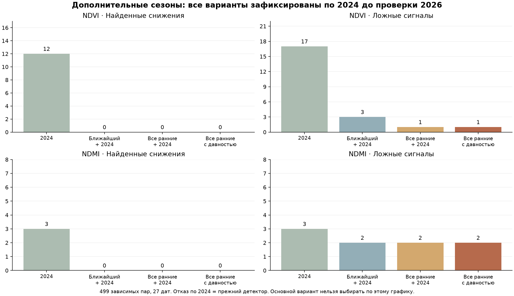

# Ранние сезоны Sentinel-2 и обнаружение резких снижений

Дата: 20 октября 2026. **Улучшить обнаружение без роста ложных тревог на всём секторе и резерве не удалось. Производственного подключения нет.** Алгоритмы, варианты обучения и правила выбора зафиксированы до проверки. Прежние точечный прогноз, диапазоны, детектор, интерфейс и журнал сохранены.

## Что собрано

Проверен Earth Search Sentinel-2 Collection-1 L2A за январь–октябрь 2019–2023 для той же сетки 20 м и приблизительных контуров. В каталоге 905 записей; допущено 330 сцен, итоговые статусы: {'excluded': 575, 'ready': 330}. Вырезки четырёх слоёв (SCL, red, NIR, SWIR), индексы, метаданные, версии удалённых объектов и SHA256 сохранены локально. Ясные пиксели не интерполируются. Полнота относится к возвращённому каталогу, а не к доказанной полноте всех съёмок ESA.

Официальное описание [Collection-1](https://sentiwiki.copernicus.eu/web/s2-processing) различает PB05.00 для ранних лет и PB05.10/05.11 для последующего переобработанного архива. Поэтому допущены только эти три версии. PB05.09 в возвращённом каталоге исключён из этого эксперимента: это не утверждение, что любой такой снимок непригоден. Проверяются согласованность scale/offset между TIFF и STAC, отсутствие двусмысленного уже применённого offset, покрытие всей сетки и высота Солнца≥20°. Причины исключения: {'outside_full_grid': 330, 'solar_elevation_below_20_or_unknown': 1, 'unsupported_processing_baseline': 244}.

| Год | Готовых сцен | Первая выдача → последний факт | Пар по всем фрагментам | Пар для обучения | Снижений NDVI / NDMI для обучения |
|---|---:|---|---:|---:|---:|
| 2019 | 85 | 2019-04-01 → 2019-10-21 | 319 | 255 | 38 / 27 |
| 2020 | 122 | 2020-03-09 → 2020-10-25 | 737 | 598 | 72 / 68 |
| 2021 | 121 | 2021-04-30 → 2021-10-27 | 409 | 337 | 27 / 31 |
| 2022 | 2 | — | 0 | 0 | 0 / 0 |
| 2023 | 0 | — | 0 | 0 | 0 / 0 |

Количество снимков не равно количеству независимых примеров. Пары требуют предыдущего наблюдения за 2–21 день и цели через 6–8 дней, одной версии обработки, ≥10 пригодных ячеек и ≥80% покрытия фиксированного ядра. Январь–февраль — только прошлая история; целевые пары март–октябрь. История ограничена текущим годом, прошлым временем и той же версией обработки. Пять резервных фрагментов R23–R27 не обучают и не выбирают настройки ни в одном году.

Смена облачной поддержки дополнительно проверена на общих пригодных пикселях, без удаления неудобных меток. Аудит исходных ранних событий по всем фрагментам:

| Индекс | Исходные события | Достаточно общих пикселей | Событие сохраняется на общих пикселях |
|---|---:|---:|---:|
| NDVI | 175 | 174 | 172 |
| NDMI | 157 | 155 | 154 |

Контуры приблизительные; новый архив не подтверждает фактические границы, культуры, операции или причину снижения. Даты начала пар и конца целевых наблюдений по годам записаны в `archive-summary.json`; отсутствие снимка в каталоге не заменялось интерполяцией.

## Как изолирован вклад старых данных

Взяты два алгоритма, выбранные по 2024 в предыдущем эксперименте: NDVI ExtraTrees с историей/сезонными признаками, NDMI логистическая регрессия с семью временными признаками. Их параметры и признаки не менялись. Сравнены четыре заранее заданных режима: только 2024; ближайший доступный ранний год+2024; все ранние годы+2024; те же годы с весом давности и периодом полураспада 2 года. В каждом случае даты имеют равный суммарный вес, затем веса нормированы; в последнем режиме добавлен множитель 2^((год−2024)/2).

| Обучение | Пар | Дат | Снижений NDVI / NDMI |
|---|---:|---:|---:|
| Только 2024 | 489 | 39 | 66 / 63 |
| Ближайший ранний + 2024 | 826 | 66 | 93 / 94 |
| Все ранние + 2024 | 1679 | 139 | 203 / 189 |
| Все ранние, вес по давности + 2024 | 1679 | 139 | 203 / 189 |

Старые годы используются только для обучения. Выбор по тем же 274 последовательным парам / 25 датам 2024, июнь–октябрь. Обучение каждого месяца содержит только целевые даты строго до его начала. Будущий результат, будущая облачность, ID поля и предполагаемая культура не входят в признаки. Жёсткое условие: 0 ложных пар и 0 дат с ложными тревогами, ≥2 попадания на ≥2 датах. Выбирается максимальная полнота с равным весом дат; при равенстве предпочтён более простой режим. Отбор по многократно использованному 2024 оптимистичен.

## Результаты выбора только по 2024

| Индекс | Обучение | Порог / условие | Найдено / событий | Ложные | Дат попаданий |
|---|---|---|---:|---:|---:|
| NDVI | Только 2024 | 0.5 / joint_momentum | 4 / 44 | 0 | 3 |
| NDVI | Ближайший ранний + 2024 | Отказ по 2024 | — | — | — |
| NDVI | Все ранние + 2024 | 0.5 / none | 2 / 44 | 0 | 2 |
| NDVI | Все ранние, вес по давности + 2024 | 0.5 / joint_momentum | 2 / 44 | 0 | 2 |
| NDMI | Только 2024 | 0.85 / joint_momentum | 9 / 36 | 0 | 2 |
| NDMI | Ближайший ранний + 2024 | Отказ по 2024 | — | — | — |
| NDMI | Все ранние + 2024 | Отказ по 2024 | — | — | — |
| NDMI | Все ранние, вес по давности + 2024 | Отказ по 2024 | — | — | — |

Все четыре режима, их пороги, веса и основной выбор заморожены до 2026. Диагностическое сравнение режимов ниже заранее предусмотрено и не даёт права заменить основной вариант после просмотра теста.

- **NDVI**: Только 2024; условие по всему сектору и резерву: **не выполнено**.
- **NDMI**: Только 2024; условие по всему сектору и резерву: **не выполнено**.

## Основной результат на 2026

Неизменные 499 пар / 27 дат, выдачи с 28 июля, факты до 19 октября. Этот архив ранее изучался: настройки по нему не выбирались, но новой слепой проверкой его называть нельзя. Данных 2025 в существующем тестовом наборе нет; они не добавлялись и не выдумывались.

| Индекс | Вариант | Найдено / событий | Ложные пары | Дат с ложными | Полнота | Доля верных тревог |
|---|---|---:|---:|---:|---:|---:|
| NDVI | Сохранить индекс | 0 / 50 | 0 | 0 | 0.0% | — |
| NDVI | Прежний Ridge | 0 / 50 | 3 | 3 | 0.0% | 0.0% |
| NDVI | Выбранный по 2024 | 12 / 50 | 17 | 10 | 24.0% | 41.4% |
| NDMI | Сохранить индекс | 0 / 42 | 0 | 0 | 0.0% | — |
| NDMI | Прежний Ridge | 0 / 42 | 2 | 2 | 0.0% | 0.0% |
| NDMI | Выбранный по 2024 | 3 / 42 | 3 | 3 | 7.1% | 50.0% |

Сохранение индекса всегда выдаёт нулевое изменение:0 ложных сопровождаются 0 попаданий. Новое обнаружение должно оцениваться вместе с ложными тревогами. Проверяются и пары, и даты ложных сигналов. Исходный точечный прогноз и его MAE не менялись; улучшение детектора не означает улучшения среднего прогноза.

## Все заранее зафиксированные режимы на 2026

| Индекс | Обучение | Найдено / событий | Ложные пары | Дат с ложными | Полнота | Доля верных тревог |
|---|---|---:|---:|---:|---:|---:|
| NDVI | Только 2024 | 12 / 50 | 17 | 10 | 24.0% | 41.4% |
| NDVI | Ближайший ранний + 2024 (отказ; прежний выход) | 0 / 50 | 3 | 3 | 0.0% | 0.0% |
| NDVI | Все ранние + 2024 | 0 / 50 | 1 | 1 | 0.0% | 0.0% |
| NDVI | Все ранние, вес по давности + 2024 | 0 / 50 | 1 | 1 | 0.0% | 0.0% |
| NDMI | Только 2024 | 3 / 42 | 3 | 3 | 7.1% | 50.0% |
| NDMI | Ближайший ранний + 2024 (отказ; прежний выход) | 0 / 42 | 2 | 2 | 0.0% | 0.0% |
| NDMI | Все ранние + 2024 (отказ; прежний выход) | 0 / 42 | 2 | 2 | 0.0% | 0.0% |
| NDMI | Все ранние, вес по давности + 2024 (отказ; прежний выход) | 0 / 42 | 2 | 2 | 0.0% | 0.0% |

## Пространственная проверка основного выбора

| Поднабор | Индекс | Пар | Попадания: прежний → новый | Ложные: прежний → новый |
|---|---|---:|---:|---:|
| Отложенные площади 2024 | NDVI | 84 | 0 → 7 из 10 | 0 → 0 |
| Отложенные площади 2024 | NDMI | 84 | 0 → 2 из 11 | 0 → 0 |
| Отложенные площади 2026 | NDVI | 102 | 0 → 6 из 18 | 0 → 1 |
| Отложенные площади 2026 | NDMI | 102 | 0 → 3 из 15 | 0 → 0 |
| Остальные площади 2026 | NDVI | 397 | 0 → 6 из 32 | 3 → 16 |
| Остальные площади 2026 | NDMI | 397 | 0 → 0 из 27 | 2 → 3 |

Нельзя выбирать успешные площади или режим по 2026. Близкие фрагменты и перекрывающиеся окна зависимы; пять южных фрагментов не являются внешним хозяйством. Срабатывания по совместному отрицательному прошлому темпу прежде всего прогнозируют продолжение снижения; предупреждение до его начала не доказано. Спектральные события не заменяют результаты осмотров.

## Контроль и воспроизведение

`scripts/collect_early_seasons.py protocol|collect|extract`; `scripts/train_early_season_decline.py protocol|fit|evaluate`; `scripts/verify_early_season_decline.py`. Проверены 1980 хешей исходных вырезок, хронология, резерв, воспроизведение выбора, все 499 пар пяти вариантов, неизменность точки/старого детектора и 1483 прежних файлов. Заморозка: `fb02f013d3c2fc95fa66c65f7a78acf938ee18ad190b0899d3388ddb6c359e4f`. После оценки повторное обучение запрещено. Данные переобработаны ретроспективно: доступность этих же байтов и задержка получения в исторический день выдачи не доказаны.

У контроля только 2024 совпадают алгоритм, входы, выбранные пороги, все сигналы на отборе 2024 и все 499 сигналов 2026 с предыдущим экспериментом. Численное тождество промежуточных оценок не подтвердилось: максимальная разница NDVI 0.00556690, NDMI 1.17e-15. В реализациях отличается порядок операций при нормировании весов; разница самих весов на проверенном блоке около 1,1×10⁻¹⁶. Не заявляется побайтовое совпадение моделей/скоров. Все режимы нового эксперимента используют одну реализацию, а сохранённые выбор и сигналы воспроизведены. Это расхождение документировано; модели или пороги после 2026 не менялись.

## Интерпретация и решение

Дополнительные годы увеличили доступное обучение с 489 до 1 679 пар и число событий NDVI 66→203, NDMI 63→189. Однако при строгом бюджете ложных тревог они не повысили полноту на 2024, поэтому основной выбор остался только 2024. На 2026 обученные NDVI-варианты со всеми ранними годами дают 0 попаданий и 1 ложную тревогу: осторожность выросла, полезное обнаружение не появилось. Для NDMI подходящих ранних вариантов не было уже на 2024; их тестовый выход в таблице — сохранённый старый детектор, а не результат нового NDMI-классификатора. Следовательно, цель не достигнута.

Из этой проверки нельзя заключить, что старые данные вообще бесполезны. Проверены конкретные алгоритмы, веса и ограниченный архив с различиями сезонов и обработки. Причинный вклад культуры, операций и версии обработки не установлен. Следующий эксперимент должен заранее отделять нормальное сезонное снижение/уборку от агрономически значимой проблемы по фактическим данным и иметь новую проверку. Подбор нового порога по уже увиденным ошибкам 2026 здесь не выполнялся.
