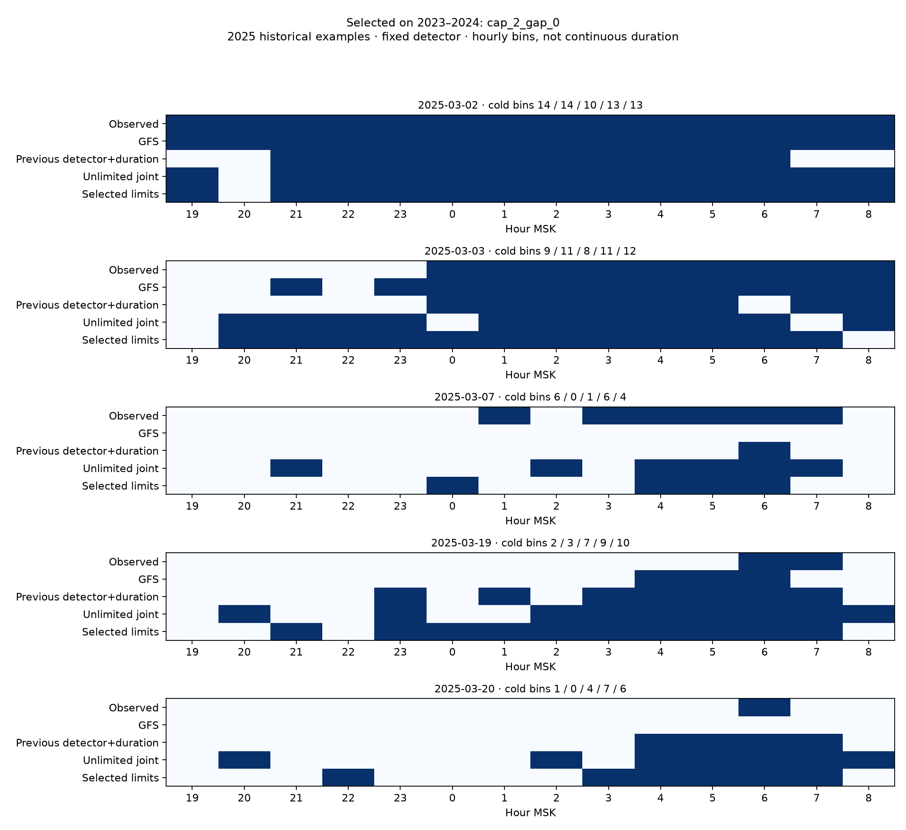

# Ограничение числа холодных эпизодов и штраф коротких разрывов

Расчёт 2026-10-12T17:58:34.763716+00:00. Краснодар, станция 34929, погодный порог T<0 °C.

Выбран **cap_2_gap_0** только по 2023–2024. 2025 ранее просмотрен и остаётся историческим контролем; по нему параметры не подбирались. Детектор и исходные коэффициенты CRF сохранены.

## Постановка
Настройка выбора: максимум 2 эпизода, дополнительный штраф λ=0. Механизм штрафа реализован и проверен, но положительные λ=2/5 не выиграли критерий 2023–2024. Нулевой штраф сохранён и в исторической проверке.


Повторно используется прежняя CRF L2=10 и decoder ожидаемой потери, выбранные по прошлым сезонам. Новый prior ограничивает поддержку и решение максимумом одного или двух эпизодов. Внутренний тёплый разрыв длиной один час получает стоимость1, два часа —0,5, длиннее —0; тёплые края окна не являются разрывом. Из логарифмической оценки всей маски вычитается λ·стоимость, затем распределение нормируется по допустимым маскам. λ=0/2/5 в единицах log-score; это модельный prior, не экономическая цена.

Один эпизод допускает105 непустых масок, два —1470. Для cap=1 внутренних разрывов нет, все λ эквивалентны, поэтому оставлен один вариант cap1/λ0. Реестр: четыре ограниченных варианта плюс прежний detector+duration и unlimited joint как fallback. GFS отдельно как база. Ограничение применяется и к posterior, и к пространству действий decoder; разрешённый posterior сам по себе не гарантировал бы разрешённого решения.

Штраф не заполняет измеренные разрывы и не меняет цели. Исходная CRF учится на всех истинных холодных обучающих ночах, включая маски с числом эпизодов больше cap. Новые ограничения задают prior прогнозной формы, а не отбор удобных целей. Неполные14 температур исключаются по прежнему правилу, без imputation. Порог строго T<0: факт0 °C не считается холодом.

Фиксированный ночной detector event_duration_weather@0.25 сохранён. Без тревоги маска пустая, с тревогой непустая: список тревог у всех вариантов точно совпадает. Если cap слишком жёсткий, истинная форма нескольких эпизодов может быть недостижима; это ограничение показано в аудите и метриках.

## Выбор и аудит

Фолды2022→2023 и2022–2023→2024; scaler/28 коэффициентов обучаются только на прошлом. Настройки исходной CRF неизменны, final fit только2022–2023 и совпадает с предыдущими frozen моделями. `episode-limits-select` не открывает наблюдения2025; выбор и SHA моделей записаны до их чтения в study. Повторение проверяет неизменность выбора, коэффициентов, входов и родительского frozen выбора.

Критерий прежний: L=0,25 miss-rate +0,15 false-alarm-rate +0,20 cold-duration-MAE/14 +0,10 warm-duration-MAE/14 +0,15 cold-mask-mismatch/14 +0,15 first-hour-error/14. За пропуск первого холодного часа заранее задан штраф14, он не выдаётся за измеренную ошибку начала. Классы объединяются по своим знаменателям. Пропуски/ложные совпадают у вариантов с прежним detector, поэтому выбор определяется формой и длительностью.

| Год | Полных ночей | Холодных | Истинных ночей с >1 эпизодом | С >2 эпизодами |
|---|---:|---:|---:|---:|
| 2022 | 92 | 18 | 3 | 0 |
| 2023 | 92 | 3 | 0 | 0 |
| 2024 | 91 | 4 | 0 | 0 |
| 2025 | 91 | 6 | 1 | 0 |

Ни одна такая ночь не удалена и её наблюдения не сглажены. Всего7 холодных ночей в выборе и21 в final fit; устойчивость ограничена.

| Вариант | L ↓ | Пропуски/7 | Ложные | MAE холодной длительности ч | Несовпавших часов холодной маски | Первый час с штрафом за пропуск ч |
|---|---:|---:|---:|---:|---:|---:|
| previous_detector_duration | 0.248 | 2 | 1 | 3.857 | 4.143 | 7.143 |
| unlimited_joint | 0.232 | 2 | 1 | 2.571 | 4.000 | 7.429 |
| cap_1_gap_0 | 0.231 | 2 | 1 | 3.571 | 3.857 | 6.143 |
| cap_2_gap_0 | 0.222 | 2 | 1 | 3.143 | 3.714 | 6.000 |
| cap_2_gap_2 | 0.230 | 2 | 1 | 3.286 | 3.857 | 6.429 |
| cap_2_gap_5 | 0.226 | 2 | 1 | 3.143 | 3.714 | 6.429 |

| Сезон | Метод | Пропуски/холодных | Ложные | MAE холодной длительности ч | Первый час MAE попаданий ч (n) |
|---|---|---|---:|---:|---|
| 2023 | gfs | 2/3 | 0 | 3.333 | 5.000 (1) |
| 2023 | previous_detector_duration | 1/3 | 1 | 3.000 | 4.500 (2) |
| 2023 | unlimited_joint | 1/3 | 1 | 3.667 | 5.000 (2) |
| 2023 | cap_2_gap_0 | 1/3 | 1 | 3.667 | 4.000 (2) |
| 2024 | gfs | 4/4 | 0 | 6.250 | — (0) |
| 2024 | previous_detector_duration | 1/4 | 0 | 4.500 | 4.333 (3) |
| 2024 | unlimited_joint | 1/4 | 0 | 1.750 | 4.667 (3) |
| 2024 | cap_2_gap_0 | 1/4 | 0 | 2.750 | 2.000 (3) |

## Исторический 2025

| Вариант | Пропуски/6 | Ложные | MAE длительности все / холодные ч | Первый час MAE попаданий ч (n) | MAE числа эпизодов холодных | Коротких разрывов прогноза всего |
|---|---:|---:|---|---|---:|---:|
| previous_detector_duration | 0 | 3 | 0.319 / 3.000 | 2.667 (6) | 0.667 | 3 |
| unlimited_joint | 0 | 3 | 0.473 / 3.333 | 4.833 (6) | 1.667 | 12 |
| gfs | 2 | 0 | 0.110 / 1.667 | 1.250 (4) | 0.667 | 1 |
| cap_1_gap_0 | 0 | 3 | 0.484 / 3.667 | 3.333 (6) | 0.167 | 0 |
| cap_2_gap_0 | 0 | 3 | 0.473 / 3.500 | 3.833 (6) | 0.667 | 4 |
| cap_2_gap_2 | 0 | 3 | 0.429 / 3.167 | 4.000 (6) | 0.500 | 1 |
| cap_2_gap_5 | 0 | 3 | 0.407 / 3.000 | 4.000 (6) | 0.500 | 1 |

Первый холодный отсчёт только на одинаковых попаданиях; ошибка физического начала за краем окна неизвестна:

| База | Определение | Пар | MAE базы ч | MAE выбранного ч |
|---|---|---:|---:|---:|
| gfs | Первый холодный отсчёт | 4 | 1.250 | 3.500 |
| gfs | Без границы начала у обоих | 2 | 2.500 | 6.500 |
| previous_detector_duration | Первый холодный отсчёт | 6 | 2.667 | 3.833 |
| previous_detector_duration | Без границы начала у обоих | 4 | 3.500 | 5.500 |
| unlimited_joint | Первый холодный отсчёт | 6 | 4.833 | 3.833 |
| unlimited_joint | Без границы начала у обоих | 4 | 7.000 | 5.500 |

Парный bootstrap MAE длительности холодных ночей:5000 повторов календарных блоков; положительная разность — выигрыш выбранного. Тёплые блоки не удаляются; повторения без холодных ночей посчитаны отдельно. Один просмотренный сезон с6 событиями не подтверждает переносимость.

| База | Блок дней | Выигрыш ч | 95% диапазон ч | Повторов без холодных ночей |
|---|---:|---:|---|---:|
| gfs | 3 | -1.833 | [-5.500, 4.000] | 199 |
| gfs | 7 | -1.833 | [-5.500, 0.000] | 579 |
| gfs | 14 | -1.833 | [-5.500, 0.000] | 452 |
| previous_detector_duration | 3 | -0.500 | [-2.500, 3.000] | 199 |
| previous_detector_duration | 7 | -0.500 | [-2.500, 0.500] | 579 |
| previous_detector_duration | 14 | -0.500 | [-2.500, 0.500] | 452 |
| unlimited_joint | 3 | -0.167 | [-2.000, 0.333] | 199 |
| unlimited_joint | 7 | -0.167 | [-0.250, 0.000] | 579 |
| unlimited_joint | 14 | -0.167 | [-0.250, 0.000] | 452 |

| Холодная ночь или тревога | Исход | Часов факт/GFS/прежний/unlimited/выбранный | Первый час факт/выбранный МСК | Эпизодов факт/выбранный |
|---|---|---|---|---|
| 2025-03-01 | hits | 14/14/14/10/12 | 01.03 19:00/01.03 20:00 | 1/2 |
| 2025-03-02 | hits | 14/14/10/13/13 | 02.03 19:00/02.03 19:00 | 1/2 |
| 2025-03-03 | hits | 9/11/8/11/12 | 04.03 00:00/03.03 20:00 | 1/1 |
| 2025-03-07 | hits | 6/0/1/6/4 | 08.03 01:00/08.03 00:00 | 2/2 |
| 2025-03-18 | false_alarms | 0/0/3/7/6 | —/18.03 23:00 | 0/2 |
| 2025-03-19 | hits | 2/3/7/9/10 | 20.03 06:00/19.03 21:00 | 1/2 |
| 2025-03-20 | hits | 1/0/4/7/6 | 21.03 06:00/20.03 22:00 | 1/2 |
| 2025-04-08 | false_alarms | 0/0/5/8/7 | —/08.04 22:00 | 0/2 |
| 2025-04-11 | false_alarms | 0/0/3/8/9 | —/11.04 22:00 | 0/2 |

## Вывод

Список тревог прежнего detector сохранён: 6 попаданий, 0 пропусков, 3 ложных. MAE холодной длительности GFS/прежний/unlimited/выбранный: 1.667/3.000/3.333/3.500 ч. На 4 общих с GFS попаданиях MAE первого холодного часа 1.250→3.500 ч. По 2025 вариант не менялся; обнаружение и расписание оцениваются отдельно, с числом пропусков и ложных тревог. Модель демонстрации не заменена.



## Воспроизведение

```powershell
.\.venv\Scripts\python.exe -m agro_checker episode-limits-select --offline
.\.venv\Scripts\python.exe -m agro_checker episode-limits-study --offline
.\.venv\Scripts\python.exe -m agro_checker episode-limits-replay --night 2025-03-07
```

Нужны исходные кэши и предыдущий `episode-select` с frozen моделями. Новых загрузок нет. Тот же выпуск GFS06UTC, gate Last-Modified+10мин к18МСК, ближайшая ячейка, источники ISD-lite/METAR. Первая публикация неизвестна. Станционная температура2м не равна температуре тканей яблони; фаза сада неизвестна. Начало — первый отрицательный часовой отсчёт, длительность — число холодных часовых интервалов в[19,09), не непрерывное измерение. На границах окна начало/конец неизвестны, интерполяции нет. Вероятности не откалиброваны.

Frozen модели/выбор: `models/research-episode-limits/`; все368 выдач/CSV/SHA snapshot: `data/processed/episode-limits/`. Replay маркирует роль сезона и отделяет факт. Старые артефакты/UI сохранены. [Численная сводка и происхождение](EPISODE_LIMITS_SUMMARY.json).
