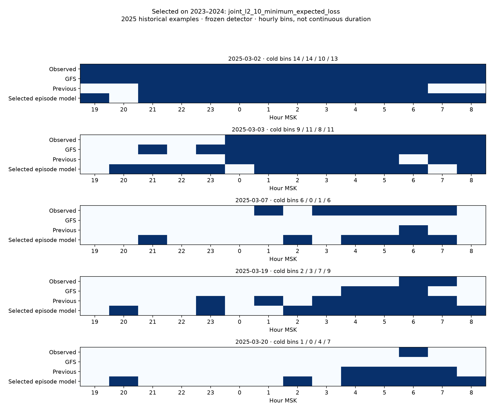

# Совместная модель холодных эпизодов

Расчёт 2026-10-12T17:44:50.641841+00:00. Краснодар 34929, станционная T<0 °C, 14 часов 19–08 МСК.

Выбран **joint_l2_10_minimum_expected_loss** по 2023–2024; финальное обучение 2022–2023, 21 холодных ночей. 2025 ранее просмотрен и используется только как исторический контроль, не слепой тест.

## Что совместно и что закреплено

Ночной детектор `event_duration_weather@0.25` сохранён из предыдущего эксперимента. Его коэффициенты и порог проверены по SHA и повторному fit, его список тревог сохраняется точно. Новая модель совместно учит расположение холодных часов, длительность, число эпизодов и границы при условии, что ночь холодная. Это условная совместная модель формы эпизодов, а не заново обученное обнаружение события.

Линейная CRF нормирует оценку по всем 2^14−1=16383 непустым маскам. Признаки: суммы погоды по холодным часам, холодная доля и квадрат, число эпизодов/переходов, первый/последний холодный час, отрицательные края окна, суммы квадратов длин эпизодов и взаимодействия квадрата длительности с прогнозом ночи. Разрывы допустимы; ни один физический эпизод не принудительно соединяется через тёплый час. 28 совместных коэффициентов, scaler только обучения, без календаря или фактических измерений во входах.

Обучение — точная условная log-likelihood полной маски на фактически холодных обучающих ночах + L2. Все 14 пригодных температур обязательны. Ночные ошибки классификатора не меняют набор обучения формы: истинные холодные ночи используются целиком. У тёплых ночей входные прогнозы участвуют только в обучающем scaler.

Четыре фиксированных варианта: L2=1/10 × MAP/минимум ожидаемой ошибки. MAP выбирает наиболее вероятную маску. Второй decoder минимизирует сумму ожидаемых ошибок: доля несовпавших часов + |длительность−факт|/14 + |первый холодный час−факт|/13 + 0,25·|число эпизодов−факт|/7. Считается точно по распределению всех масок. Для ночей без тревоги возвращается пустая маска, для ночей с тревогой — непустая. Состояния не превращаются в искусственные температуры; модельные оценки не откалиброваны как вероятности.

## Как выбиралась модель

Фолды 2022→2023 и 2022–2023→2024. Реестр: четыре совместных варианта и прежний метод как fallback; GFS отдельно как база. L = 0,25·miss-rate + 0,15·false-alarm-rate + 0,20·MAE длительности холодных/14 + 0,10·MAE длительности тёплых/14 + 0,15·несовпадение маски холодных/14 + 0,15·ошибка первого часа холодных/14. Для пропуска первого часа штраф 14; это заранее заданная исследовательская цена пропуска, не измеренная ошибка начала. Классы объединяются по своим знаменателям, не средним процентов сезонов. У совместных моделей список тревог совпадает с прежним, поэтому различия L определяются формой эпизода.

`episode-select` читает наблюдения только 2022–2024, сохраняет выбор и модели до чтения 2025. `episode-study` проверяет frozen выбор, коэффициенты и SHA перед исторической оценкой. Нет подбора порога/регуляризации/decoder по 2025, early stopping по нему или повторного fit на 2024. Семь холодных ночей в выборе и 21 в обучении ограничивают устойчивость.

| Вариант | L ↓ | Пропуски/7 | Ложные | MAE холодной длительности ч | Несовпавших часов холодной маски | Первый час с штрафом за пропуск ч |
|---|---:|---:|---:|---:|---:|---:|
| previous_detector_duration | 0.248 | 2 | 1 | 3.857 | 4.143 | 7.143 |
| joint_l2_1_map | 0.283 | 2 | 1 | 5.000 | 5.000 | 8.000 |
| joint_l2_1_minimum_expected_loss | 0.239 | 2 | 1 | 3.857 | 4.429 | 6.000 |
| joint_l2_10_map | 0.260 | 2 | 1 | 4.286 | 4.286 | 7.429 |
| joint_l2_10_minimum_expected_loss | 0.232 | 2 | 1 | 2.571 | 4.000 | 7.429 |

| Сезон | Метод | Пропуски/холодных | Ложные | MAE холодной длительности ч | Первый час MAE попаданий ч (n) |
|---|---|---|---:|---:|---|
| 2023 | gfs | 2/3 | 0 | 3.333 | 5.000 (1) |
| 2023 | previous_detector_duration | 1/3 | 1 | 3.000 | 4.500 (2) |
| 2023 | joint_l2_10_minimum_expected_loss | 1/3 | 1 | 3.667 | 5.000 (2) |
| 2024 | gfs | 4/4 | 0 | 6.250 | — (0) |
| 2024 | previous_detector_duration | 1/4 | 0 | 4.500 | 4.333 (3) |
| 2024 | joint_l2_10_minimum_expected_loss | 1/4 | 0 | 1.750 | 4.667 (3) |

## Исторический 2025

| Вариант | Пропуски/6 | Ложные | MAE длительности все / холодные ч | Первый час MAE попаданий ч (n) | Несовпавших часов холодной маски | Recall холодных часов |
|---|---:|---:|---|---|---:|---:|
| previous_detector_duration | 0 | 3 | 0.319 / 3.000 | 2.667 (6) | 3.000 | 0.783 |
| gfs | 2 | 0 | 0.110 / 1.667 | 1.250 (4) | 2.000 | 0.826 |
| joint_l2_1_map | 0 | 3 | 0.495 / 5.833 | 5.833 (6) | 6.167 | 0.587 |
| joint_l2_1_minimum_expected_loss | 0 | 3 | 0.462 / 4.167 | 4.500 (6) | 4.833 | 0.587 |
| joint_l2_10_map | 0 | 3 | 0.571 / 4.500 | 4.167 (6) | 4.500 | 0.891 |
| joint_l2_10_minimum_expected_loss | 0 | 3 | 0.473 / 3.333 | 4.833 (6) | 4.667 | 0.804 |

Ошибка первого холодного отсчёта только на одинаковых попаданиях; границы окна показаны отдельно:

| База | Определение | Пар | MAE базы ч | MAE выбранного ч |
|---|---|---:|---:|---:|
| GFS | Первый холодный отсчёт | 4 | 1.250 | 3.750 |
| GFS | Без границы начала у обоих | 2 | 2.500 | 7.000 |
| Прежний детектор+длительность | Первый холодный отсчёт | 6 | 2.667 | 4.833 |
| Прежний детектор+длительность | Без границы начала у обоих | 4 | 3.500 | 7.000 |

Парный bootstrap MAE длительности на фактически холодных ночах, 5000 повторов календарных блоков. Тёплые блоки сохраняются, повторения без холодных ночей исключены и посчитаны; положительная разность означает выигрыш выбранного метода. Один сезон/шесть событий и выбор по семи событиям не доказывают переносимость.

| База | Блок дней | Выигрыш ч | 95% диапазон ч | Повторов без холодных ночей |
|---|---:|---:|---|---:|
| GFS | 3 | -1.667 | [-5.500, 6.000] | 199 |
| GFS | 7 | -1.667 | [-5.500, 0.250] | 579 |
| GFS | 14 | -1.667 | [-5.500, 0.250] | 452 |
| Прежний метод | 3 | -0.333 | [-2.500, 5.000] | 199 |
| Прежний метод | 7 | -0.333 | [-2.500, 0.750] | 579 |
| Прежний метод | 14 | -0.333 | [-2.500, 0.750] | 452 |

| Холодная ночь или тревога | Исход | Часов факт / GFS / прежний / выбранный | Первый холодный час факт / выбранный МСК | Эпизодов факт / выбранный |
|---|---|---|---|---|
| 2025-03-01 | hits | 14 / 14 / 14 / 10 | 01.03 19:00 / 01.03 20:00 | 1 / 3 |
| 2025-03-02 | hits | 14 / 14 / 10 / 13 | 02.03 19:00 / 02.03 19:00 | 1 / 2 |
| 2025-03-03 | hits | 9 / 11 / 8 / 11 | 04.03 00:00 / 03.03 20:00 | 1 / 3 |
| 2025-03-07 | hits | 6 / 0 / 1 / 6 | 08.03 01:00 / 07.03 21:00 | 2 / 3 |
| 2025-03-18 | false_alarms | 0 / 0 / 3 / 7 | — / 18.03 21:00 | 0 / 3 |
| 2025-03-19 | hits | 2 / 3 / 7 / 9 | 20.03 06:00 / 19.03 20:00 | 1 / 3 |
| 2025-03-20 | hits | 1 / 0 / 4 / 7 | 21.03 06:00 / 20.03 20:00 | 1 / 3 |
| 2025-04-08 | false_alarms | 0 / 0 / 5 / 8 | — / 08.04 20:00 | 0 / 3 |
| 2025-04-11 | false_alarms | 0 / 0 / 3 / 8 | — / 11.04 20:00 | 0 / 3 |

## Диагностика совместного распределения

Множество допустимых масок включает много раздробленных последовательностей. При нулевых коэффициентах модель задаёт равномерный закон по маскам, не по эпизодам: средняя длительность 7.000 ч, число эпизодов 3.750, масса холода в первом часе 0.500. Регуляризация тянет коэффициенты к этому закону. Поэтому доступность всех разрывов сама по себе не означает правильный prior формы эпизода; совместный decoder тоже может выбирать разрозненные ранние часы.

| Рискованная ночь | Эпизодов факт / выбранный | Ожидаемых эпизодов | Масса одного эпизода | Максимальная масса маски | Масса холода в первом часе |
|---|---|---:|---:|---:|---:|
| 2025-03-01 | 1 / 3 | 3.237 | 0.040 | 0.014 | 0.440 |
| 2025-03-02 | 1 / 2 | 2.588 | 0.167 | 0.099 | 0.638 |
| 2025-03-03 | 1 / 3 | 3.078 | 0.064 | 0.028 | 0.564 |
| 2025-03-07 | 2 / 3 | 3.215 | 0.037 | 0.001 | 0.186 |
| 2025-03-18 | 0 / 3 | 3.354 | 0.022 | 0.001 | 0.236 |
| 2025-03-19 | 1 / 3 | 3.368 | 0.022 | 0.003 | 0.355 |
| 2025-03-20 | 1 / 3 | 3.424 | 0.018 | 0.001 | 0.281 |
| 2025-04-08 | 0 / 3 | 3.400 | 0.019 | 0.001 | 0.287 |
| 2025-04-11 | 0 / 3 | 3.390 | 0.020 | 0.001 | 0.322 |

Таблица — диагностика фиксированной модели после исторической проверки, не новый подбор. Данных для совместной формы мало: 21 холодная обучающая ночь и семь в выборе. Сравнение decoder показывает разные компромиссы числа эпизодов/длительности/первого часа; по 2025 на другой вариант не переключались. Для следующего независимого эксперимента нужно заранее обосновать prior формы эпизодов и масштаб признаков при регуляризации.

## Вывод

Обнаружение сохранено механически: у прежнего и выбранного метода 0 пропусков и 3 ложных тревог, у GFS 2 и 0. MAE длительности холодных ночей: GFS 1.667, прежний 3.000, выбранный 3.333 ч. Первый холодный час на 6 общих попаданиях прежний→выбранный 2.667→4.833 ч; на 4 общих попаданиях GFS→выбранный 1.250→3.750 ч. Качество расписания и обнаружение нужно оценивать отдельно, включая ложные тревоги. Демонстрация не заменена.



## Воспроизведение и границы

```powershell
.\.venv\Scripts\python.exe -m agro_checker episode-select --offline
.\.venv\Scripts\python.exe -m agro_checker episode-study --offline
.\.venv\Scripts\python.exe -m agro_checker episode-replay --night 2025-03-07
```

Тот же исходный выпуск GFS 06 UTC, gate Last-Modified+10 минут к 18 МСК, nearest-point и источники ISD-lite/METAR. Первая публикация неизвестна. Предсказывается T воздуха на станции 2 м, не температура цветков/урожай. Начало — первый отрицательный часовой отсчёт; длительность — число холодных часовых интервалов в [19,09), не непрерывное измеренное время. При отрицательном первом/последнем отсчёте начало/конец за окном неизвестны; интерполяции и минутной точности нет.

Модели/выбор — `models/research-episodes/`; все 368 выдач/CSV/SHA snapshot — `data/processed/episode-study/`. Replay отделяет прогноз от последующего факта, маркирует сезон и проверяет SHA. Неполные цели исключены из fit/score, но не мешают прогнозу. Старые исследовательские артефакты и UI сохранены. [Численная сводка и происхождение](EPISODE_STUDY_SUMMARY.json).
