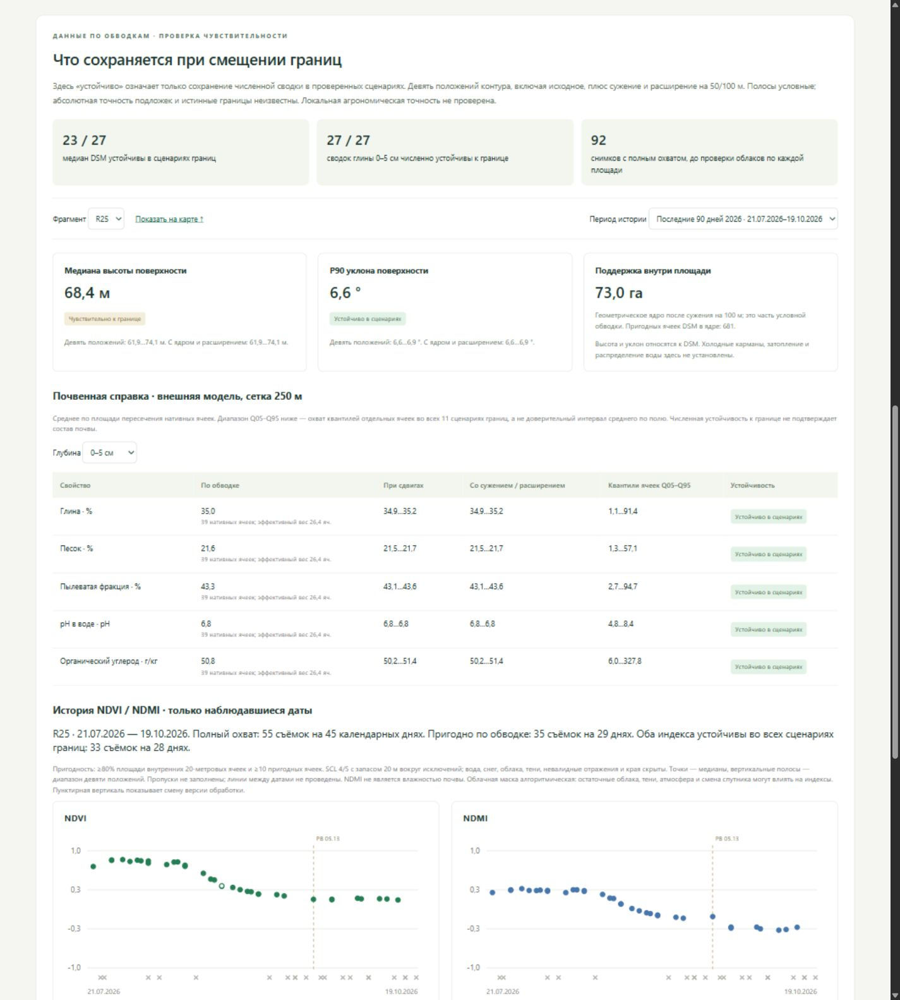

# Рельеф почвы и спутниковая история приближённых площадей

На 19 октября 2026 года для 27 цветовых фрагментов со скриншота получены рельеф, почвенная справка и история NDVI/NDMI. При сдвигах, сужении и расширении условных контуров медиана высоты поверхности устойчива в 23 фрагментах. Численная почвенная сводка меняется мало, но неопределённость самой SoilGrids существенно шире эффекта границы. Это описательные данные по приближённым обводкам, без подтверждения состава владения или агрономической точности.

[Интерактивная карта и сводки](http://127.0.0.1:8770/farm-reconstruction#area-context) · [Все численные результаты и происхождение](../data/farm-research/area-context/summary.json).



Отдельный [вид истории и сравнения внутри одной версии обработки](assets/farm-reference/area-context-history.png).

## Устойчивые результаты и чувствительные места

Северный R02 имеет медиану DSM около 3,2 м; её изменение в сценариях мало. Южный R25 расположен существенно выше: медиана меняется от 61,9 до 74,1 м. Различие этих частей по высоте сохраняется, но одно точное среднее R25 зависит от границы. У R26 диапазон медианы — 36,6–44,3 м. Рельеф пригоден для подготовки осмотра; эти значения не доказывают холодные карманы или распределение воды.

У R25 средняя модельная оценка глины 0–5 см меняется примерно от 34,9 до 35,2% во всех сценариях. При этом охват Q05–Q95 отдельных ячеек SoilGrids, затронутых хотя бы одним сценарием, составляет 1,1–91,4%. Устойчивость к границе не превращает внешнюю почвенную модель в анализ пробы. По этой справке нельзя назначать дозы удобрений или полива.

У R18 после сужения на 50 м и исключения пересекающих край ячеек остаётся 2 ячейки Sentinel-2 и ни одной ячейки DSM. Исходная сводка возможна, но сильная отметка устойчивости отключена. За последние 90 дней пригодны 34 из 55 съёмок по исходной обводке; ни одна съёмка не получила отметку устойчивости обоих индексов во всех сценариях.

У R25 за **21 сентября — 14 октября 2026**, внутри версии обработки **05.13**, NDVI изменился в пределах −0,013…−0,008 во всех сценариях. Это укладывается в рабочую зону ±0,05. Изменение NDMI — **−0,181…−0,166**: направление снижения сохраняется. NDMI описывает спектральное соотношение поверхности; из него не установлены влажность почвы, причина изменения или диагноз.

## Полученные данные

| Источник | Охват и сохранённые данные | Смысл и предел применения |
| --- | --- | --- |
| Copernicus DSM GLO-30 | 4 исходных тайла, общая расчётная сетка UTM 37N 576×321 ячеек по 30 м; DSM и производный уклон | Модель поверхности с деревьями и сооружениями. Расчётная сетка не добавляет новых измерений |
| SoilGrids WCS | 30 нативных растров 69×45 ячеек по 250 м: глина, песок, пылеватая фракция, pH и органический углерод; глубины 0–5 и 15–30 см; mean, Q05 и Q95 | Внешние модельные оценки, без локальной проверки по пробам и без текущей влажности |
| Sentinel-2 Collection 1 L2A | 184 записи каталога с завершённой пагинацией: 92 сцены с полным охватом и 92 соседние частичные плитки; ошибок получения 0 | Частичные плитки сохранены в каталоге, но не включены в общий ряд, чтобы не смешивать меняющийся охват |

DSM на зеркале относится к выпуску 2021. [Описание Copernicus DEM](https://registry.opendata.aws/copernicus-dem/) определяет его как модель поверхности. Для SoilGrids использованы нативные окна [WCS ISRIC](https://docs.isric.org/globaldata/soilgrids/WCS_from_Python.html); преобразование единиц — по [таблице ISRIC](https://docs.isric.org/globaldata/soilgrids/SoilGrids_faqs_01.html). При расчёте почвенных средних использована площадь пересечения каждой 250-метровой ячейки с полигоном. Показанное число ячеек и эффективный вес не означают независимые полевые измерения.

Спутниковые периоды разделены: **1 марта — 31 мая 2024** и **21 июля — 19 октября 2026**. В общем ряду соответственно 37 сцен на 36 календарных днях и 55 сцен на 45 календарных днях. За один день иногда есть несколько съёмок; они не считаются отдельными днями наблюдений. Это два выбранных окна, а не непрерывный ряд за все годы. По отдельным фрагментам пригодны 7–16 съёмок весны 2024 и 16–39 съёмок последнего окна 2026; облачные и другие пропуски не заполнены.

У [Earth Search Collection 1](https://github.com/Element84/earth-search/blob/main/docs/collections/sentinel-2-l2a.md) получены B04, B08, B11 и SCL. Отражения вычислены с проверкой scale/offset по STAC и TIFF. Красный и NIR усреднены с 10 до 20 м только при полном наличии дочерних пикселей; SWIR и SCL остаются на нативных 20 м. Допущены SCL 4/5, с исключением одной соседней ячейки вокруг отбраковки, и положительные валидные отражения. Алгоритмическая маска не исключает все остаточные облака и тени.

## Сценарии границ и правила устойчивости

Сценарии рассчитаны в метрической UTM 37N. Для каждого фрагмента проверены исходная геометрия и восемь направлений сдвига на его рабочий радиус 50 или 100 м. Диагонали нормированы к той же длине, а не увеличены до 71/141 м. Дополнительно проверены сужение и расширение на этот радиус.

Для DSM и спутников исключены ячейки, пересекающие границу: перед отбором центров геометрия дополнительно сужена на половину диагонали ячейки. Для пригодной спектральной сводки нужны ≥80% валидных внутренних ячеек и ≥10 пригодных ячеек. Для сильной отметки устойчивости нужны все девять положений, поддержанное ядро, внешняя область и сохранение значения в заданном допуске.

Допуски заданы в протоколе до сводки: медиана DSM 2 м; P90 уклона 1°; глина/песок/пыль 3 процентных пункта; pH 0,2; органический углерод 5 г/кг; NDVI/NDMI 0,05. Это правила отображения чувствительности, а не измеренная точность источников или агрономические пороги.

Временное изменение — медиана попиксельной разности на общей пригодной поддержке двух дат, а не разность двух средних по разным облачным окнам. Сначала взяты первая и последняя даты периода с достаточным покрытием исходного контура; выбор не зависит от величины индекса. Если версии обработки различаются, сильная отметка временного изменения отключается. Дополнительно показано отдельное окно последней версии, имеющей ≥2 пригодные даты, с первой и последней датой внутри неё.

Весна 2024 обработана в версии 05.10. В последнем окне 2026: 37 сцен версии 05.12 по 19 сентября и 18 сцен 05.13 начиная с 21 сентября. Сравнение через эту границу оставлено справочным. Даже одна версия не исключает влияние атмосферы, смены спутника и сезонных операций. Причина спектральных изменений не устанавливается.

Полосы 50/100 м остаются условными сценариями, **без гарантированного покрытия истинной границы**. Проверка девяти положений не доказывает устойчивость ко всем возможным деформациям. Абсолютное смещение подложки и реальные контуры неизвестны; происхождение реконструкции описано в [FARM_RECONSTRUCTION.md](FARM_RECONSTRUCTION.md).

## Сравнение всех фрагментов

Последние два столбца относятся к 55 сценам на 45 календарных днях окна 2026. Это счётчики съёмок. Отдельные счётчики календарных дней показаны в интерфейсе и JSON. «Устойчиво» для DSM учитывает также сужение и расширение, хотя в численном столбце показаны девять положений. Устойчивость двух индексов относится к значению на отдельной съёмке, а не к причине или направлению временного изменения.

| Фрагмент | Медиана DSM м | Девять положений м | DSM во всех сценариях | Пригодных съёмок 2026 | Оба индекса устойчивы |
| --- | ---: | ---: | --- | ---: | ---: |
| R01 | 2.8 | 2.8–2.9 | устойчиво | 35/55 | 22/55 |
| R02 | 3.2 | 3.2–3.2 | устойчиво | 35/55 | 35/55 |
| R03 | 3.3 | 3.1–3.4 | устойчиво | 34/55 | 11/55 |
| R04 | 3.8 | 3.8–3.9 | устойчиво | 39/55 | 36/55 |
| R05 | 3.3 | 3.2–3.3 | устойчиво | 33/55 | 6/55 |
| R06 | 3.5 | 3.4–3.6 | устойчиво | 16/55 | 16/55 |
| R07 | 3.3 | 3.3–3.4 | устойчиво | 32/55 | 32/55 |
| R08 | 3.5 | 3.4–3.5 | устойчиво | 33/55 | 33/55 |
| R09 | 2.8 | 2.8–2.8 | устойчиво | 24/55 | 23/55 |
| R10 | 3.3 | 3.3–3.4 | устойчиво | 31/55 | 26/55 |
| R11 | 4.1 | 4.1–4.2 | устойчиво | 32/55 | 11/55 |
| R12 | 2.5 | 2.5–2.6 | устойчиво | 33/55 | 31/55 |
| R13 | 2.8 | 2.8–2.9 | устойчиво | 29/55 | 28/55 |
| R14 | 2.6 | 2.6–2.7 | устойчиво | 30/55 | 30/55 |
| R15 | 3.6 | 3.5–3.6 | устойчиво | 32/55 | 31/55 |
| R16 | 2.9 | 2.8–2.9 | устойчиво | 35/55 | 11/55 |
| R17 | 4.0 | 3.9–4.1 | устойчиво | 33/55 | 18/55 |
| R18 | 4.1 | 3.8–5.7 | мало ядра | 34/55 | 0/55 |
| R19 | 3.7 | 3.6–3.8 | устойчиво | 35/55 | 25/55 |
| R20 | 4.0 | 3.9–4.0 | устойчиво | 34/55 | 28/55 |
| R21 | 12.5 | 12.2–12.8 | устойчиво | 37/55 | 37/55 |
| R22 | 11.6 | 11.3–12.0 | устойчиво | 37/55 | 36/55 |
| R23 | 25.2 | 24.0–26.4 | чувствительно | 36/55 | 36/55 |
| R24 | 21.6 | 20.8–22.6 | устойчиво | 37/55 | 30/55 |
| R25 | 68.4 | 61.9–74.1 | чувствительно | 35/55 | 33/55 |
| R26 | 40.3 | 36.6–44.3 | чувствительно | 35/55 | 5/55 |
| R27 | 40.9 | 40.2–41.5 | устойчиво | 32/55 | 32/55 |

## Проверки и воспроизведение

Источники находятся отдельно в `data/farm-research/area-context`. Протокол фиксирует хэш контуров, охват, интервалы времени и допуски; изменение контуров требует новой версии набора. Сохранены страницы STAC, исходные WCS/DEM, вырезки Sentinel, их SHA-256 и версии удалённых объектов до и после чтения. Контрольная сумма локальной вырезки не выдаётся за проверенный checksum полного COG. Время съёмки, обработки, создания в каталоге и получения различается; современная перепроцессированная сцена 2024 года не доказывает её доступность в исторический момент прогноза.

Пройдены 14 тестов: радиус диагональных сдвигов; пропуски, нулевой объём и порог покрытия; отказ сильной устойчивости без всех сценариев или ядра; дробные веса почвенных ячеек; целостность всех сохранённых вырезок и источников; разделение версий обработки; независимая сверка общей пиксельной поддержки пары R25; безопасная выдача ресурсов; изоляция полевого журнала; прежние проверки открытых данных. JavaScript прошёл синтаксическую проверку. Проверены браузером выбор фрагмента, глубины и периода, карты, пропуски и ограничение по ядру.

Сохранность подтверждена побайтно для **1084 файлов** прежних источников, моделей и рабочего журнала, включая **198 файлов `data/field`**. Модель, детектор, настройки и паспорт не изменены. Данные 2025–2026 не использованы для подбора прогнозной модели.

```powershell
.venv\Scripts\python.exe -X utf8 scripts/collect_farm_context.py
.venv\Scripts\python.exe -X utf8 scripts/analyze_farm_context.py
.venv\Scripts\python.exe -X utf8 scripts/render_farm_context.py
.venv\Scripts\python.exe -X utf8 -m unittest tests.test_farm_context tests.test_farm_reconstruction tests.test_land_view
```

Сборщик использует зафиксированный протокол и кеш, не обновляет прежнее окно у ориентира и не пишет в FieldStore. Дополнительные зависимости заданы в `requirements-farm-reconstruction.txt`. Набор исследовательский; автоматического обновления и оперативных агрономических назначений нет.
