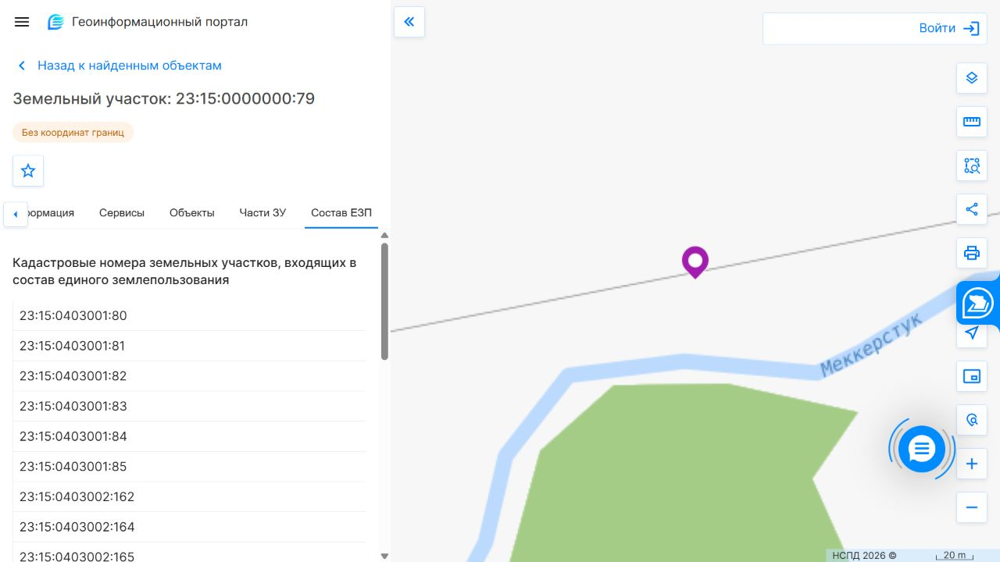

# Самостоятельное восстановление сведений о полях: результат поиска

**Обновление:** последующим шагом выполнена отдельная [приближённая реконструкция по скриншоту и спутниковой подложке](FARM_RECONSTRUCTION.md). 27 цветовых фрагментов доступны на исследовательской карте, с проверкой привязки и эвристическими полосами неопределённости. Это не получение исходных векторных границ из АгроМон и не подтверждение кадастрового состава. Ниже сохранён результат предыдущего этапа публичного поиска.

Проверено 19 октября 2026. Цель — выяснить, можно ли получить все цветные площади пользовательской карты без выгрузки из АгроМон. Охват остаётся всеми выделенными полями, не только №20. Точные векторные границы этих полей **пока не получены**.

## Что найдено самостоятельно

1. В [муниципальных материалах по обоснованию](https://krymsk-region.ru/wp-content/uploads/2023/08/materialy-po-obosnovaniyu.pdf), стр. 44, есть хозяйство с именем Бровиной Ольги Николаевны. Совпадение названия поддерживает район поиска, но не определяет границы или принадлежность отдельных полей. Документ скачан и прочитан; веб-парсер при отдельном открытии возвращал ошибку.
2. В [газете «Призыв» от 2 июля 2019](https://xn--24-dlcte5bh4g.xn--p1ai/wp-content/uploads/2019/07/priziv48-02072019.pdf#page=7), стр. 7, найдено извещение о межевании с тем же полным именем и исходным кадастровым номером **23:15:0000000:79**. Это исторический источник, не подтверждение текущего состава хозяйства или прав.
3. В [публичной карте НСПД](https://nspd.gov.ru/map?thematic=PKK) выполнен поиск этого номера. Объект найден как единое землепользование, со статусом «Ранее учтенный» и явной пометкой **«Без координат границ»**. Значение площади в карточке нельзя подставлять как площадь всего хозяйства.
4. Вкладка «Состав ЕЗП» содержит **26 кадастровых номеров**. Они сохранены как неподтверждённые поисковые зацепки в [public-cadastral-leads.json](../data/farm-research/public-cadastral-leads.json). Первый номер — 23:15:0403001:80 — проверен отдельно: поиск показал отсутствие объекта. Остальные не объявлены существующими геометриями или полями партнёра.

Публичные материалы дают направление дальнейшего поиска, но не восстанавливают автоматически современный набор цветных полей АгроМон. Кадастровый участок и производственное поле не обязаны совпадать. Ни список из 26 записей, ни исторический исходный номер не заменяют сверку с пользовательской картой.

## Что возможно без доступа к аккаунту

| Материал | Реалистичная роль | Статус |
| --- | --- | --- |
| Видимые подписи и история №20 | Подтверждение того, что написано на предоставленных скриншотах | Сохранены в FARM_MAP_EVIDENCE.md |
| Открытые муниципальные/исторические сведения | Район поиска и кадастровые зацепки | Найдены; текущая принадлежность не удостоверена |
| Публичные контуры, если удастся найти соответствующие актуальные объекты | Геометрическая сверка с картой и спутниковой подложкой | Для цветных полей ещё не получены |
| Восстановление по скриншоту и спутниковой подложке | Приближённые исследовательские полигоны с явной неопределённостью | Не выполнено; нужны устойчивые опорные точки и независимая сверка |
| Номера, культуры, операции и история всех полей закрытого аккаунта | Исходный реестр хозяйства | В открытом доступе не обнаружен; по одному общему снимку не восстановить |

Получить независимую приближённую геометрию — другой результат, чем извлечь исходный экспорт. Для такой реконструкции нужно сопоставить несколько реальных опорных объектов (перекрёстки, мосты, характерные повороты каналов), проверить привязку на отдельных контрольных объектах, затем обвести видимые цветные области. Цветные области могут включать опытные делянки, несколько производственных полей или закрытые интерфейсом фрагменты. Синие булавки и отметку положения нельзя считать датчиками или вершинами границ без подтверждения.

Оценку точности привязки можно сообщать только после проверки, а не назначать заранее. Непроверенные полигоны нельзя использовать как подтверждённую площадь, границы владения, полноценную агрономическую разметку или основание обещаний точности модели. Для исследовательских спутниковых выборок после привязки нужно учитывать влияние ошибки границы и смешанных пикселей; одной метки «приблизительно» недостаточно для заявления качества.

## Что осталось неизвестным

- Точный контур, ID и соответствие каждого выделенного поля.
- Суммарная площадь и индивидуальные культуры/фазы всех полей.
- Наличие и расположение местных приборов; история операций и измерений вне видимой карточки №20.
- Соответствие старых кадастровых записей современному составу хозяйства.

Закрытые функции АгроМон не использовались, обращения третьим лицам не отправлялись. Новый набор — исследовательский каталог зацепок, он не подключён как рабочий паспорт или геометрия. Измерения, модель, детектор, исходный ориентир и прежние данные сохранены.

Снимок результата публичного поиска (не карта подтверждённых полей хозяйства):

