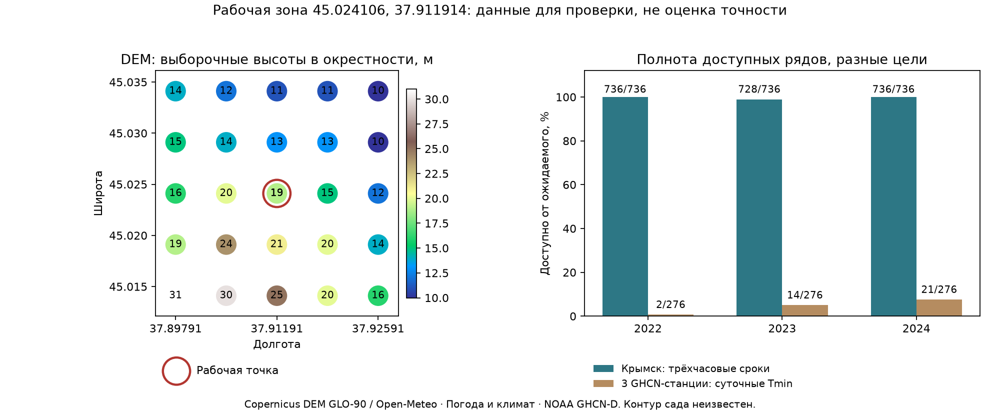

# Данные для рабочей зоны Onlyfarms

**Исследование: 17 октября 2026. Точка: 45.024106, 37.911914.** Киевское сельское поселение, Крымский район. Контур сада, сорт, фаза, оборудование и собственные датчики не предоставлены. Пространственные выборки ниже — окрестность точки, не граница хозяйства.

Последующее продолжение: [проверка происхождения и отдельный station-time эксперимент](KRYMSK_OBSERVED_TIME_REPORT.md) выполнены после этого ресерча. Ниже сохранены исходные выводы этапа поиска данных; новые fit/метрики хранятся отдельно, прежние модели и детектор не изменены.

18 октября выполнено [отдельное извлечение рельефа, почвенных квантилей и маскированных спутниковых пикселей](OPEN_LAND_REPORT.md). WCS SoilGrids доступен, несмотря на приостановленный REST; получены30 растров и144 вырезки36 сцен. Это последующий результат: формулировки ниже «пиксели не скачаны» относятся к исходному этапу. Пользователь подтвердил, что точка — ориентир, не граница сада; название и контур уточнит позже.

Главный результат: найден и реально выгружен архив Крымска37002 примерно в14,6км от рабочей точки. За весны2022–2024 получены2200 трёхчасовых записей температуры из2208 ожидаемых. Это более близкий станционный источник, чем прежний Витязево, но его нельзя выдавать за измерение сада или минимум14 почасовых значений. Исходные модели и детектор не менялись; обучение по найденным данным не проводилось.

## 1. Карта источников и решение о применении

| Источник | Что реально проверено | Роль в продукте | Ограничение |
|---|---|---|---|
| Крымск37002, архив «Погода и климат» |12 страниц весен2022–2024 с утренними данными1июня;2200 весенних отсчётов; дополнительно март2011 | Ближайшая найденная история для отдельной исследовательской проверки T и влажности | 3ч; нет исходныхQC-флагов; коммерческое использование требует письменного разрешения; окно экстремумов не подтверждено |
| NOAA GFS, исходные GRIB одного выпуска |Архив по рабочей точке, без подстановки чужих наблюдений | Прогнозные признаки и базовая модель для будущей локальной проверки | Сетка0.25°, ближайшая ячейка7,4км; не микроклимат конкретного ряда деревьев |
| NOAA ISD-Lite, Витязево |Прежний prior-аудит:85/84/76 полных ночей2022/2023/2024;44,5км | Внешний станционный benchmark при сохранении собственной географии | Идентичность станции расходится с GHCN/IEM, нельзя объединять только по37001/URKA |
| GHCN-Daily: Славянск, Анапа, Темрюк |Сырые.dly, контроль качества и флаги источника; всего37 допущенныхTMIN из828 ожидаемых станция-дней весен2022–2024 | Редкая дополнительная климатическая информация | Большой диапазон лет в inventory скрывает пропуски; другой суточный интервал; не цель нашей ночной модели |
| Copernicus DEM GLO-90 через Open-Meteo |25 высот в окрестности около2,2×2,2км | Признаки рельефа и план обследования/датчиков | Модель поверхности, шаг выборки~550м, не съёмка участка и не карта температур |
| Sentinel-2 L2A, Copernicus Data Space |Каталог36 сцен за март–май2024, одна плитка37TDK | Будущие NDVI/NDMI, сезонная динамика, неоднородность растительности после получения контура | Пиксели/SCL не скачаны; ясность самой точки не проверена; дневной снимок не даёт ночной температуры цветка |
| ERA5-Land и ERA5 через Open-Meteo |Две независимые выборки по72часа1–3апреля2024 с проверкойnull | Климатический и почвенный фон; отдельные ретроспективные исследования | Реанализы не являются измерениями и не были доступны в таком виде до исторической ночи |
| SoilGrids |Официальная документация250м и статуса доступа | Вторичный почвенный контекст для будущего развития | REST приостановлен провайдером; локальные значения не получены, нужен отдельный растровый доступ |
| Росгидромет/ВНИИГМИ-МЦД |Официальный паспорт подтверждает Крымск37002; каталог первичных данных найден | Приоритет для подтверждения происхождения и временных окон измерений | Выгрузка конкретного массива/условия доступа пока не подтверждены; запросы людям не отправлялись |

## 2. Крымск: состав и полнота

[Паспорт станции у провайдера](https://www.pogodaiklimat.ru/station/37002.htm):44.9109,38.0053, опубликованная высота35м, расстояние до точки14.58км. [Паспорт Росгидромета2017](https://www.meteorf.gov.ru/upload/iblock/58b/%D0%9F%D0%B0%D1%81%D0%BF%D0%BE%D1%80%D1%82%20%D0%93%D0%9C%D0%91%20%D0%9A%D1%80%D0%B0%D1%81%D0%BD%D0%BE%D0%B4%D0%B0%D1%80%D1%81%D0%BA%D0%BE%D0%B3%D0%BE%20%D0%BA%D1%80%D0%B0%D1%8F.pdf) подтверждает индекс, но приводит более грубые координаты. Координаты провайдера не подтверждены актом установки прибора.

| Весна | Записи T / ожидаемые | Точка росы | RH провайдера | Ночи с4/4 отсчётами | Ночи с наблюдённым T<0 | ПубликацииTmin с неуточнённым окном |
|---|---:|---:|---:|---:|---:|---:|
| 2022 | 736/736 | 736 | 736 | 92/92 | 17 | 112 |
| 2023 | 728/736 | 728 | 728 | 91/92 | 3 | 116 |
| 2024 | 736/736 | 736 | 736 | 92/92 | 4 | 129 |

Для окна19–08МСК доступны четыре срока:18,21,00,03UTC, то есть21,00,03,06МСК. На входе и выходе ночи нет наблюдения с нужной почасовой частотой. Не заполняли промежутки интерполяцией. Ноль холодных отсчётов не доказывает отсутствие краткого заморозка между ними; точное начало/длительность по этому ряду не восстанавливаются.

ПоляT/Td распознаны как°C, ветер вм/с. Некоторые ветровые ячейки содержат диапазон и порыв, например6–11{12}: исходный текст сохранён, единственное число скорости не выдумывается. Облачность оставлена текстом, а не автоматически превращена в проценты. Проверены курсивные пометки модельного заполнения: уT в выбранных веснах их0; курсив внутри описания прошедших осадков не принят за подменуT. Это не заменяет исходныеQC-флаги. ПубликуемыеTmin не подставлены как ночной минимум: пока неизвестно, за какой период получено каждое значение.

Форма архива предлагает годы с2011. Пробная выгрузка марта2011 действительно вернула245 температур из248 ожидаемых; непрерывность2011–2024 не проверена. Это путь к более длинной климатической истории, но старые наблюдения без соответствующих реально выпущенных прогнозов не образуют обучающие пары коррекции.

Рекомендуемый следующий эксперимент после проверки происхождения: оценкаT в реально наблюдённые сроки Крымска по прогнозу в координатах самой станции. Фермерская точка и станционные цели хранятся раздельно. Старый детектор и метрики14-часового минимума не заменяются четырёхточечным минимумом.

## 3. Суточные NOAA: важна фактическая полнота

| Станция |2022: принятыеTMIN/92|2023|2024| Источник значений |
|---|---:|---:|---:|---|
| SLAVJANSK · RSM00034924 | 0 | 8 | 11 |S: Global Summary of the Day |
| ANAPA · RSM00037001 | 2 | 0 | 1 |S: Global Summary of the Day |
| TEMRYUK · RSM00034915 | 0 | 6 | 9 |S: Global Summary of the Day |

Все найденные значенияTMIN имеют source flagS. По [документацииNOAA](https://www.ncei.noaa.gov/pub/data/ghcn/daily/readme.txt) это производные от синоптических сообщений сводки. Даже при пустомQC-флаге такой ряд нельзя автоматически считать истинным минимумом нашего ночного окна. В этих трёх веснах полнота лишь37/828≈4,5%; диапазон начала/конца лет из inventory не означает сплошной ряд.

Дополнительный риск: NOAA ISD370010 называетсяVITYAZEVO и имеет45.002,37.347; GHCN37001 называетсяANAPA и имеет44.9,37.3; IEMURKA —44.8833,37.2833. Различие координат превышает10км. До подтверждения истории станций эти источники не объединяются в один target. У34927 также расходится положение в каталогах. Старые исходные архивы и результаты не переписаны задним числом.

## 4. Рельеф и спутники

[Copernicus DEM GLO-90 через Open-Meteo](https://open-meteo.com/en/docs/elevation-api): оценка высоты в точке **19м**, диапазон25 выборочных точек **10–31м**. Эти значения не записаны как измеренная высота сада. Отдельная высота поверхности исходной ячейкиGFS из прежнего аудита —31,74м; различие источников не преобразовано в универсальную температурную поправку.

Окрестность имеет заметные различия высот, поэтому полезны обследование низких мест и сравнение локальных датчиков. По DEM нельзя уже сейчас утверждать, где в саду скапливается холод: нет контура, фактических температур и проверки препятствий стоку воздуха.

[Copernicus STAC](https://documentation.dataspace.copernicus.eu/APIs/STAC.html) вернул **36 сцен/36 дат** за март–май2024, плитка37TDK; **9 сцен** имеют общую облачность плитки<20%. Это только кандидаты: облако над конкретным садом проверяется по пиксельнойSCL-маске. NDVI и NDMI ещё не вычислены, пиксели не скачаны. Некоторые продукты переобработаны в2026; их нельзя без проверки выдавать за доступные признаки для прогнозного решения2024.

После получения контура можно строить сезонную динамику растительности и выделять неоднородные зоны для обследования. Определение сорта, фазы цветения и повреждения яблони по найденным метаданным не подтверждено. Снимки дневные и не заменяют ночной датчик воздуха/цветка. [Доступ к исходнымCDSE-данным](https://documentation.dataspace.copernicus.eu/APIs/S3.html) может требовать учётной записи; открытый каталог не означает, что все пиксели уже получены.

## 5. Реанализ и исходные прогнозы

| Источник, выборка1–3апреля2024 | T/RH/Td | Ветер/облачность/осадки | Tпочвы/влажность0–7см | Роль |
|---|---|---|---|---|
|ERA5-Land|72/72 по каждому полю|0/72: запрошенные поляnull|72/72 по каждому полю|Почвенный и климатический модельный фон|
|ERA5|72/72 по каждому полю|72/72 по каждому полю|не запрашивались|Модельный фон ветра, облачности, осадков|

Параметрelevation=nan отключает автоматическую поправку высотыOpen-Meteo; единицы и координаты возвращённых ячеек сохранены отдельно. У ERA5-Land выборка попала в45.0,37.90001 с модельной высотой53м, это не полевая высота19м. Два реанализа не объединены путём скрытого заполненияnull. [Описание реанализа и параметров](https://open-meteo.com/en/docs/historical-weather-api). В прогнозном обучении эти ретроспективные значения нельзя считать известными до ночи.

Из прежних глобальных GRIB **реально извлечены276 ночей/3864 часов** марта–мая2022–2024 по точке фермы: температура2м,RH2м,точка росы2м,U/V10м и облачность. Каждый профиль — один GFS06UTC, горизонты10–23ч, без смешения выпусков. Проверены SHA, единицы/уровни, времена, bitmap, единая сетка и proxy доступности к18МСК. [Источник архиваGFS](https://registry.opendata.aws/noaa-gfs-bdp-pds/).

Это только прогнозные входы. Полеtarget_temperature_c остаётсяnull: температурой Крымска/Витязево не подменены измерения фермы. Точная первая историческая публикация по-прежнему не доказана, Last-Modified+10мин — допуск, а не архив журнала реальной доставки. Контроли2025–2026 не использованы для подбора или нового обучения.

Отдельно проверен доступ к альтернативному выпускуECMWF через [Open-Meteo Single Runs](https://open-meteo.com/en/docs/single-runs-api): после исправления форматаrun на2024-04-01T00:00 реально получены24часаT/RH/Td/ветра/облачности, безnull. Однако ранний ECMWF IFS описан провайдером как IFS49R1 hindcast. Доступность этой выборки не доказывает, что такой прогноз был выпущен и доступен до ночи2024; в оперативный benchmark она не включена.

## 6. Что пока отсутствует

- Независимая температура/RH именно на участке; температура цветков и кроны.
- Подтверждённые фазы развития, даты цветения, сорт и агрономические осмотры.
- Факты применения защиты, повреждения и урожайность по участку.
- Измеренная влажность листа/почвы, данные для проверки болезней и полива.
- Подтверждённая связь между объектом на спутниковом снимке и конкретным контуром сада.

## 7. Очерёдность работы

1. **Подтвердить источник Крымска.** Уточнить у держателя данных исходные сроки/QC, окна экстремумов и возможность использования; проверить официальный массив Росгидромета. До этого архив — исследовательский кандидат.
2. **Сформировать отдельный станционный benchmark.** Прогноз в координатах Крымска сравнивать сT в фактические сроки; начало и длительность краткого холода не размечать интерполяцией.
3. **Начать независимую локальную проверку.** Сохранять реально полученные выпускиGFS до ночи и данные проверенного датчика воздуха2м на участке. Датчики кроны/почвы и применение защиты учитывать раздельно.
4. **Добавить контур и рельеф.** Проверить предполагаемое низкое место вторым датчиком; оценить станционное смещение и диапазон по будущим локальным данным в отдельном заранее заданном протоколе.
5. **Расширять цели по наличию фактов.** Влажность, осадки/почвенный фон и спутниковые индексы вводить с отдельной проверкой. Повреждение яблони, болезнь и окупаемость защиты не выводить из одной температуры илиNDVI.

Следующая модель выбирается только по разрешённым prior-годам2023–2024. Данные2025–2026 остаются вне подбора. Исследование доступности не является доказательством повышения качества; ни детектор, ни полевой прогноз не заменены.

## 8. Ограничения доступа и проверки ответов

HTTP200 недостаточно: один NOAA URL вернулHTML-страницу каталога вместоCSV, этот ответ не принят как данные; прямой NOAA S3-объект370020 за2024 вернул404. Первая страница «Погоды и климата» с неполными параметрами формы вернула текущий октябрь вместо запрошенного марта; парсер отвергает неправильные год/месяц, схему и станцию. Meteostat37002 дал404, OGIMET — пустой ответ на пробный период. Ни одна из этих попыток не объявлена успешным погодным набором.

[SoilGrids250м](https://docs.isric.org/globaldata/soilgrids/SoilGrids_faqs.html) — модель свойств почвы; [REST-сервис временно приостановлен по документации провайдера](https://docs.isric.org/globaldata/soilgrids/SoilGrids_faqs_02.html). Локальные значения не получены. Для будущего продукта разумнее отдельная растровая загрузка с атрибуциейCC BY4.0, а не зависимость от этогоREST.

Проверено [соглашение «Погоды и климата»](https://www.pogodaiklimat.ru/agreement.php):п.3.1 описывает личное некоммерческое использование,п.3.5 требует предварительное письменное разрешение для коммерческого применения,п.3.7 — активную ссылку при публичном размещении данных. Разрешение для продукта не получено: архив не подключён к коммерческому обучению/выдаче. Исследовательские сырые страницы сохраняются локально и не публикуются автоматически. Для продуктового доступа нужны разрешение держателя либо отдельный официальный экспорт с подходящими условиями.

Для Open-Meteo различаются условия открытого исследовательскогоAPI и коммерческого использования. CopernicusDEM требует атрибуцииCopernicus иOpen-Meteo. [Официальная страница Гидрометцентра для Крымска](https://meteoinfo.ru/pogoda/russia/krasnodar-territory/krymsk) публикуетT/RH/ветер/облачность, но её наличие не подтверждает доступный непрерывный историческийAPI; в прочитанной версии указана старая дата31августа, поэтому свежесть на17октября не заявлена.

## 9. Артефакты и воспроизведение

- `config/working_zone.json` — координаты пользователя; `data/working-zone-01/research/raw/` — исходные байты иURL/SHA/время получения.
- `krymsk-three-hour-observations.json`, `krymsk-four-slot-nights.json` — раздельные наблюдения и минимум4 отсчётов.
- `daily-minimum-samples.json`, `sentinel2-scenes.json`, `data-audit.json` — флаги суточных данных, каталог сцен и полный аудит.
- `farm-gfs-prior-nights.json`, `farm-gfs-manifest.json`, `farm-gfs.meta.json` — прогнозные входы без фермерских целей.
- `docs/FARM_DATA_RESEARCH_SUMMARY.json` — численные результаты и provenance.

```powershell
.\.venv\Scripts\python.exe -m agro_checker.farm_data_research
.\.venv\Scripts\python.exe -m agro_checker.farm_data_report
# При необходимости повторного извлечения из неизменённых GRIB:
.\.venv\Scripts\python.exe -m agro_checker.farm_data_research --extract-gfs
```

Для повторного разбора нужны сохранённые локальные исходные файлы и их.meta.json; команда не выполняет скрытую повторную выгрузку HTML-архивов. Пути доступа и условия указаны выше. Новые исходные выгрузки организуются отдельно с соблюдением условий держателя данных.


