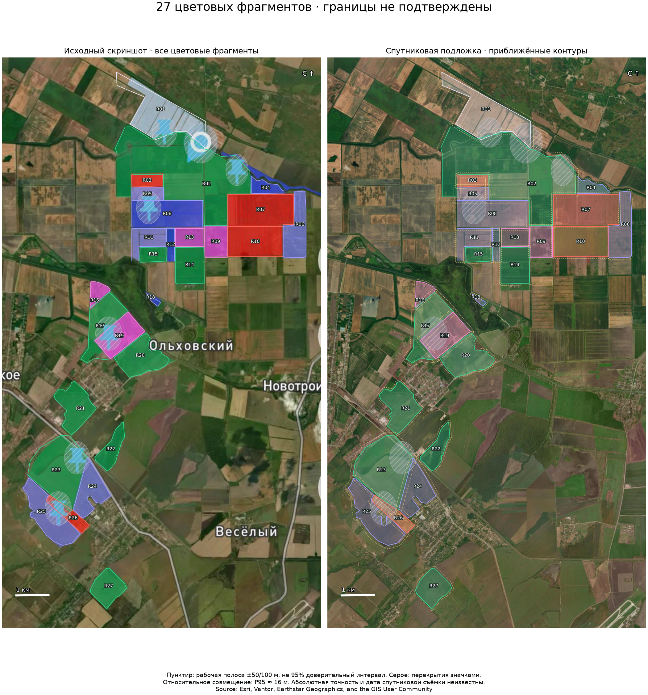

# Приближённые контуры цветных площадей

Дополнение: [рельеф, почвы и история индексов по всем приближённым площадям](FARM_AREA_CONTEXT.md), с отдельной проверкой чувствительности к 50/100-метровым сценариям границ. Контуры остаются неподтверждёнными; модель ими не изменена.

Исследование 19 октября 2026. Охват — **все видимые цветные площади на пользовательском скриншоте**, без подтверждения границ и без изменения модели.

## Результат

- 27 цветовых фрагментов с метками R01–R27: 9 зелёных, 9 синих/сиреневых, 4 розовых, 4 красных и 1 светлый на севере.
- Это **не установленное число полей**. Один одноцветный блок может содержать несколько производственных полей или делянок. Метки не являются номерами АгроМон; поле №20 не сопоставлено с отдельным фрагментом.
- Мелкий синий фрагмент R18 у канала включён после отдельного визуального просмотра. Тонкие синие линии вдоль северо-восточного канала исключены как линии, а не площади. Булавки и указатель положения не считаются полями или датчиками.
- Исследовательский GeoJSON в WGS84: [approximate-areas.geojson](../data/farm-research/reconstruction/approximate-areas.geojson). Отдельные условные полосы: [uncertainty-bands.geojson](../data/farm-research/reconstruction/uncertainty-bands.geojson).
- [Интерактивная карта](http://127.0.0.1:8770/farm-reconstruction) показывает спутник/скриншот, выбор фрагмента, координаты внутренней опорной точки, приближение, полосы и перекрытия значками. Ссылка добавлена на страницу открытых данных. Изменения рабочего паспорта отсутствуют.



## Источники и происхождение координат

1. Оригинальный пользовательский PNG, 1244×2560: `docs/assets/farm-reference/farm-map-user-provided.png`. Изображение с надписью «ГКФХ Бровиной О. Н.» сохранено без изменения. Дата захвата неизвестна; «2026» в интерфейсе — сезон, а не установленная дата спутниковой съёмки.
2. Независимо полученная геопривязанная подложка [Esri World Imagery](https://services.arcgisonline.com/ArcGIS/rest/services/World_Imagery/MapServer). Сохранены ответ export, JPEG 2600×2900 и метаданные сервиса. URL запроса и SHA-256 находятся в [summary.json](../data/farm-research/reconstruction/summary.json). Атрибуция: **Source: Esri, Vantor, Earthstar Geographics, and the GIS User Community**. Дата съёмки и абсолютная точность мозаики не установлены. Это не свежая съёмка Sentinel-2.
3. Для преобразования использован **возвращённый сервисом extent**, а не первоначальный bbox: [документация export-map](https://developers.arcgis.com/rest/services-reference/enterprise/export-map/) предупреждает об изменении охвата при согласовании соотношения сторон.

Закрытый аккаунт АгроМон не открывался, экспорт из него не получен. Данные НСПД не использованы для построения геометрий. Исторический список из 26 кадастровых записей в другом исследовании не сопоставлен с этими 27 фрагментами.

## Привязка и отдельная проверка

Автоматически сопоставлены мелкие детали фонового изображения: дороги, каналы, структуры полей. SIFT до 25 000 признаков; взаимные совпадения с отношением расстояний дескрипторов <0,60 в обоих направлениях. На исходном изображении разрешена область y=380…2050; интерфейс сверху и снизу исключён.

До расчёта преобразования точки разделены по пространственным ячейкам 200×200 исходных пикселей. Ячейки с `(floor(x/200)+2*floor(y/200)) mod 4 == 0` оставлены для проверки. Остальные использованы для оценки подобия (масштаб, поворот, сдвиг), RANSAC с порогом 3 пикселя подложки. Контрольные точки не отбирались по полученной ошибке.

| Проверка | Результат |
| --- | ---: |
| Взаимные совпадения | 754 |
| Расчёт преобразования | 591 |
| Проверка в отдельных пространственных ячейках | 163 |
| Медиана отклонения проверочных совпадений | 4,2 м |
| P95 отклонения проверочных совпадений | 15,7 м |
| Максимум отклонения проверочных совпадений | 29,5 м |

Расстояния посчитаны в UTM 37N (EPSG:32637), с учётом масштаба Mercator. Проверочные пары и матрица сохранены в `registration.json`. Это **относительная проверка совпадения двух изображений**. Она не измеряет абсолютное смещение спутниковой мозаики, не является геодезической проверкой и не подтверждает правильность обводки границ. Детали изображений пространственно зависимы; 163 пары не означают 163 независимых полевых измерения.

## Обводка и неопределённость

Первичная цветовая сегментация вручную проверена и дополнена. Уточнены северная светлая область, раздельные синие/розовые/красные прямоугольники и маленькая синяя площадь у канала. Под булавками части края соединены предположительно; соответствующие перекрытия выделены серым. Пиксельные обводки и способ каждой сохранены в `pixel-traces.json`. Это приближение видимых областей, а не извлечение исходных векторов.

- **±50 м** — рабочая полоса у контура фрагмента без заметного перекрытия значками.
- **±100 м** — рабочая полоса ко всему контуру фрагмента, пересекающего булавку/указатель. Скрытый край и топология особенно неопределённы.
- Полосы рассчитаны вокруг линии края в метрической UTM, затем преобразованы в WGS84. Они показывают сценарий чувствительности к смещению границы. Это **эвристика**, а не измеренная ошибка границы или 95% доверительный интервал. Даже эти полосы не гарантируют охвата истинной границы, особенно при неизвестном абсолютном смещении мозаики.
- Небольшие несовпадения соседних обводок, зазоры и перекрытия допустимы в этом исследовательском наборе. Экспорт не имеет точности согласованной топологической карты полей.
- Площадь обводки в свойствах GeoJSON — вычисленная площадь нарисованного фрагмента. Она не подтверждает площадь владения или производственного поля; её нельзя использовать как согласованную площадь хозяйства. Суммарная площадь объединения не является оценкой площади собственности.

Подтверждение культур, фаз, границ, номеров и принадлежности остаётся за агрономом/уполномоченным представителем. История карточки поля №20 не распространена на остальные площади. На карте нет автоматических агрономических диагнозов или утверждения о пригодности прежней яблоневой модели для полевых культур.

## Воспроизведение и проверки

Дополнительные зависимости выделены в `requirements-farm-reconstruction.txt`; для этого запуска OpenCV 5.0.0.93 и Shapely 2.2.0 установлены только в `tmp/georef-deps`, модельное окружение не заменялось.

```powershell
.venv\Scripts\python.exe -X utf8 scripts/register_farm_screenshot.py
.venv\Scripts\python.exe -X utf8 scripts/build_farm_reconstruction.py
.venv\Scripts\python.exe -X utf8 -m unittest tests.test_farm_reconstruction tests.test_land_view
```

Первая команда создаёт `registration-reproduced.json`, сохраняя проверенную матрицу `registration.json`. Вторая пересобирает GeoJSON, карту и отчёт из замороженной матрицы и проверенных пиксельных обводок. Опция `--initialize-traces` только для намеренного восстановления исходной версии ручной разметки из скрипта; обычная пересборка её не перезаписывает.

Пройдены 7 тестов: хэши источников, отдельные пространственные ячейки проверки, географический охват и неподтверждённые свойства, выдача всех ресурсов и GeoJSON, изоляция журналов при чтении карты, прежние проверки страницы открытых данных. Дополнительно проверены валидность всех полигонов, масштаб метрических полос и обратное преобразование координат. Просмотрены оригинал и совмещённая подложка, переключатели и карточки, доступность на узком экране.

Рабочий `data/field` сохранён побайтно (198 файлов). Модель, детектор, правила выбора по 2023–2024, исходный ориентир и измерения не менялись; повторное обучение не запускалось.
