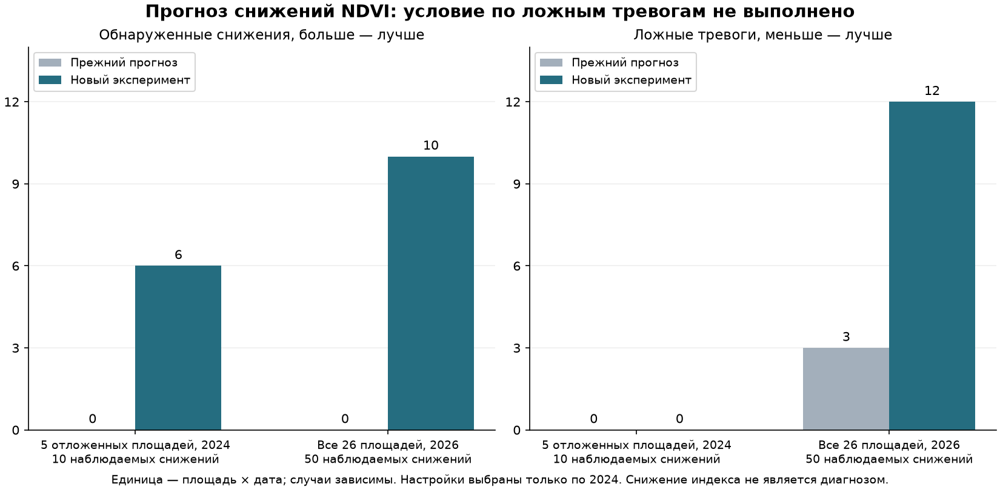

# Почему пропускаются резкие снижения NDVI/NDMI

Дата: 19 октября 2026. Итог: **найден прогноз части снижений NDVI, но без роста ложных тревог улучшить перенос пока не удалось. Кандидат отклонён, прежние модели сохранены.**

## Диагноз по данным 2024 года

Прежний вариант предсказывает среднее изменение индекса, выбран по средней абсолютной ошибке и сильно сглаживает хвосты. В первоначальном обучении было 85 пар на 7 датах, **0 снижений NDVI и только 4 снижения NDMI на 0.10**. При выборе настроек по летним данным появились 33/28 событий. Выбранная регуляризация100 дополнительно подавила изменения: на всех 489 пригодных парах 2024 года вне географического резерва самый отрицательный прогноз изменения составил −0.083 для NDVI и −0.055 для NDMI. Порог события −0.10 не пересекался. Улучшение среднего MAE не оптимизировало редкие события.

В расширенном наборе 2024 вне резерва — 66 снижений NDVI на18датах и63 снижения NDMI на21дате. Из них49/66 и44/63 уже сопровождались отрицательным предыдущим темпом (эквивалент −0.05 за7дней). Это возможность прогнозировать **продолжение** снижения; раннее обнаружение до его начала здесь не доказано.

Проверка происхождения меток на одинаковых пикселях: все66 NDVI и61 из63 NDMI сохранили снижение ≥0.10 при общей пригодной поддержке ≥80%. Значит, смена облачной маски не объясняет большинство событий. На всех11 сценариях геометрии снижение сохраняется для51 из59 полностью проверяемых NDVI-событий и50 из55 NDMI-событий. Остальные чувствительны к контуру/составу поддержки; они **не удалялись после просмотра результатов**. Числа — площадь×дата, не независимые случаи.

Причины реальных изменений неизвестны: не подтверждены культуры, фазы, уборка и обработки. Нельзя автоматически считать такие метки болезнью, недостатком влаги или ущербом.

## Что изменено в отдельном эксперименте

- Прямая классификация события «падение наблюдаемого медианного индекса ≥0.10 через6–8дней» вместо вывода события из сглаженного среднего прогноза.
- 8 вариантов: простые временные признаки / расширенные признаки, глубина деревьев2/3, вес редкого события1/3. Фиксированы120итераций, learning_rate0.04, l2_leaf_reg10, seed1729. Ранней остановки по2026 нет.
- К текущим индексам и короткому темпу добавлены30-дневный тренд, отклонение от предыдущего максимума, разброс истории, пространственный IQR и **доля общих пикселей, уже снизившихся между предыдущим и текущим снимками**. Будущий снимок не используется ни в одном признаке. ПолеID, будущая дата съёмки и будущая облачность не используются.
- Последовательные проверки по месяцам июнь–октябрь2024: каждое обучение содержит только пары, чья целевая дата строго раньше начала проверяемого месяца. Пары через границу месяца исключены. 5 южных площадей R23–R27 не обучают/не выбирают/не калибруют.
- Проверки отбора:274пары на25датах,44 события NDVI и36 NDMI. Это меньше полного архива из-за начала обучения и удаления пересекающих месяцы пар; качество относится к этому доступному поднабору.
- Строгое условие отбора:0ложных тревог и0дат с ложной тревогой, минимум2попадания на2датах. Ни один из8обычных вариантов не прошёл. Все результаты и первое отклонение сохранены.
- **До обращения к2026** добавлен второй этап только по2024:4фиксированных условия допуска сигнала (без условия / индекс ещё выше заданного уровня / оба предыдущих темпа отрицательны / значимая доля пикселей уже снижается). Сохранены исходный протокол, первый отказ и протокол пересмотра. Всего288 комбинаций модель×условие×порог на индекс; отбор по этим25датам оптимистичен и не является независимым качеством.
- Выбран для NDVI вариант с историей/пикселями, глубиной3, весом1, порогом0.7 и условием отрицательного темпа обоих индексов ≤−0.05за7дней при текущем NDVI≥0.40. На последовательном отборе:3попадания на2датах,0ложных,41пропуск. Для NDMI подходящего варианта нет, сохранён прежний выход.
- Итоговый NDVI-классификатор обучен только на489парах2024,39датах,21площади; максимальная целевая дата2024-10-14. Все параметры и бинарная модель зафиксированы перед оценкой2026. **Ни2025, ни2026 не используются для обучения или выбора.** Станционный погодный детектор и прежний точечный прогноз индексов не изменялись.

## Перенос без изменения настроек

| Проверка NDVI | Пар / дат | Найденные снижения: прежний → новый | Ложные: прежний → новый | Доля верных новых тревог |
|---|---:|---:|---:|---:|
| 5 отложенных южных площадей, 2024 | 84 / 26 | 0 → 6 из 10 | 0 → 0 | 100.0% |
| Все 26 пригодных площадей, 2026 | 499 / 27 | 0 → 10 из 50 | 3 → 12 | 45.5% |
| Остальные 21 площадь, 2026 | 397 / 26 | 0 → 4 из 32 | 3 → 11 | 26.7% |
| 5 отложенных южных площадей, 2026 | 102 / 24 | 0 → 6 из 18 | 0 → 1 | 85.7% |

На всех площадях2026 новый вариант обнаруживает20% снижений (10из50), но ложные возрастают с3до12, даты с ложными — с3до8. На пяти южных площадях улучшение есть и в2024, и в2026, однако в2026 появилась1ложная тревога вместо0. **Условие пользователя не выполнено и на общем, и на географическом тесте. Кандидат не включён в продукт.**

NDMI после отбора оставлен прежним: на2026 по-прежнему0попаданий из42 и2ложные тревоги. Это отказ от неподтверждённой замены, а не улучшение NDMI.

Результат показывает, что прямое обучение событию снимает абсолютное сглаживание, но ещё не даёт надёжного переноса. Возможные причины — один обучающий сезон, неоднородные неизвестные культуры/операции, различия сезонов/версий обработки и отбор большого числа правил по25датам. Их причинный вклад не установлен. Число ложных тревог важно оценивать одновременно с попаданиями: прежний почти молчащий выход сам по себе не является хорошим детектором.

## Что это означает для продукта

Можно показывать наблюдаемые изменения, даты/маски, неопределённость контура и собирать результаты осмотра. Эту экспериментальную тревогу нельзя представлять как проверенный риск болезни, рекомендацию обработки или гарантированный недельный прогноз. Выход классификатора — оценка события, не откалиброванная вероятность. Он требует, чтобы снижение уже началось на прошлых снимках, поэтому не доказывает предупреждение до начала проблемы.

Следующий полезный набор данных — подтверждённые культуры/фазы и операции по датам, включая посев/уборку и осмотры контрольных мест без сигнала. Для следующего эксперимента нужны многолетние источники с проверенными версиями и внешняя/будущая проверка. За2026 уже известны результаты: новые гипотезы можно выбирать по2024, но повторный просмотр того же2026 нельзя называть нетронутым тестом. Порог после этого результата **не повышался по2026**; выбирать только удачную южную подгруппу для рабочего внедрения также нельзя.

## Артефакты и проверки

`data/farm-research/field-decline-model/`: исходный и пересмотренный протоколы, первичный отказ, диагноз2024, признаки с отдельными полями аудита цели, полная таблица отбора и помесячные внеобучающие оценки, замороженный выбор, `ndvi.cbm`, результаты2026 и проверка сохранности. Операционные записи/датчики/осмотры не создавались.

Выбор SHA256 `2da7d315bdb334ee7ede424a27fa25d90fa4c11fda12ca874a625a7c800fd686`. Проверено 1744 прежних файлов источников, моделей и рабочего журнала — байты сохранены. Верификация подтверждает только2024 в fit, исключение5резервныхплощадей, отсутствие пересечения целевых дат с валидацией и неизменность признаков2024. Код дополнительно блокирует новый подбор внутри эксперимента после появления тестового отчёта; это не замена научной дисциплине и внешней проверке.

Воспроизведение из нового каталога: `scripts/train_field_decline_model.py fit`, затем `fit-gated`, затем `evaluate`; после тестовой оценки подбор на месте блокируется. `scripts/report_field_decline_model.py` формирует отчёт/график без обучения. Зависимости — существующие ML/GIS-наборы проекта. Исходный архив не пересобирается и не перезаписывается.

Методические ограничения: ретроспективные переработанные снимки; доступность этих же байтов в исторический день выпуска не доказана; в облачные пропуски прогнозная проверка отсутствует; соседние площади и даты зависимы. История2026 уже описательно и количественно изучалась ранее, поэтому эта оценка без подбора не является новой полностью слепой внешней проверкой.

Параметры классификатора сверены с [официальной документацией CatBoost](https://catboost.ai/docs/en/references/training-parameters/common). Результаты качества рассчитаны на сохранённых данных проекта, не взяты из внешних публикаций.
