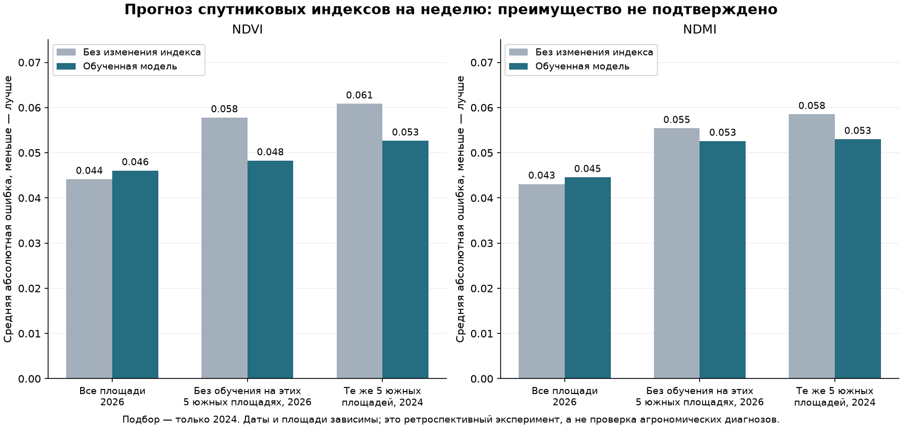

# Модель для площадей: проверка по задаче кейса

Дата: 19 октября 2026. Статус: **исследовательский эксперимент; в рабочий продукт не подключён**.

## Почему выбрана эта задача

В исходной презентации Onlyfarms (`assets/agro-case.pdf`, слайд 1) проблема — запоздалая или необоснованная защита от болезней, вредителей и заморозков, нехватка информации по отдельным участкам. Указанные в презентации опросы, потери и экономия не подтверждены этим экспериментом. Презентация не задаёт проверенную целевую метку болезни или потребности в обработке.

Региональное задание КЛЮЧа требует проверяемой ценности для клиента, исследования с практиками, проверки прототипа и экономики (`assets/klyuch-2026-business-brief.pdf`, стр. 7; `assets/klyuch-2026-criteria.pdf`). Следовательно, цель — помогать принять решение об осмотре и проверить его результат. Красивый график индекса сам по себе этого не доказывает.

На открытых данных можно проверить прогноз ожидаемых NDVI/NDMI, затем сравнивать его с новым снимком. Это подзадача будущего сценария «изменение → осмотр → подтверждённый результат». **NDMI не является измерением влажности почвы. Снижение любого индекса не является диагнозом, ущербом или показанием к обработке.** Остаток прогноза также ещё не проверен как полезный сигнал для осмотра.

## Что выполнено

- Расширен архив на март–октябрь 2024: 98 полных сцен; для отдельной проверки использованы 55 ранее сохранённых сцен июля–октября 2026. Разные сцены в один день не считаются независимыми наблюдениями.
- Каталог 2023 собран, но все 197 записей исключены действующим фильтром версии обработки. В этом запуске 2023 **не участвовал**. Это ограничение нашего источника/политики, а не доказательство непригодности всех PB05.09: ESA описывает её как действовавшую операционную версию. Нужна отдельная сверка происхождения и реобработки, без молчаливого отключения фильтра.
- До обучения сохранено изменение протокола: весна 2024 — первоначальное обучение, июнь–июль — выбор среди 8 вариантов, август–октябрь — калибровка диапазона; пересекающие границы целевые пары удалены. В 2025 данных нет, в 2026 нет обучения, калибровки и выбора настроек.
- R23–R27 заранее отложены по географии: их метки не используются в обучении, выборе или калибровке. Это соседние площади того же региона, **не независимые новые хозяйства**.
- Используются неподвижные ядра приближённых контуров, минимум 10 пригодных ячеек и 80% покрытия, SCL-маска с отступом от облаков/краёв. R18 имеет только 2 ячейки ядра и исключён. Солнечный зенит не более 70°. В каждой временной тройке одна версия обработки.
- Цель — наблюдаемый медианный индекс на ближайшем пригодном снимке через 6–8 дней. Нужен предыдущий снимок за 2–21 день той же версии; пропуски не интерполируются. На входе текущие индексы, предыдущий темп изменения и календарная дата; отдельные кандидаты использовали DSM. Рельеф не дал преимущества при выборе.
- Выбран `temporal_ridge_100`: ошибка на выборе 0.0817 против 0.0848 у сохранения текущего значения. Итоговое обучение: 217 пар на 21 дате, 21 площадь; калибровка: 236 пар на 16 датах. Число пар нельзя считать числом независимых случаев.
- Параметры, выбор и радиусы интервала сохранены до расчёта тестовых метрик. История 2026 ранее изучалась описательно, поэтому это отложенная от настройки проверка, **не полностью слепая внешняя проверка**.

## Качество

MAE ниже — лучше. В таблице среднее MAE по NDVI/NDMI, сначала одинаковый вес каждой дате, затем каждой площади внутри даты. Пары — площадь × дата, даты в разных строках пересекаются.

| Проверка | Пар / дат | Модель | Без изменения индекса | Изменение ошибки |
|---|---:|---:|---:|---:|
| 5 южных площадей, 2024 | 84 / 26 | 0.0528 | 0.0597 | -11.5% |
| Остальные 21 площадь, 2026 | 397 / 26 | 0.0460 | 0.0425 | +8.4% |
| 5 южных площадей, 2026 | 102 / 24 | 0.0504 | 0.0566 | -10.9% |
| Все 26 пригодных площадей, 2026 | 499 / 27 | 0.0453 | 0.0436 | +3.9% |

На всём 2026 отдельно: MAE NDVI **0.0460**, NDMI **0.0445**. Результат неоднороден: южные площади выигрывают, общий тест проигрывает базовому прогнозу. Устойчивое преимущество или статистическая значимость не доказаны.

**Критичный продуктовый недостаток:** при заранее зафиксированном вспомогательном пороге снижения индекса на 0.10 модель не предсказала ни одного из 50 снижений NDVI и ни одного из 42 снижений NDMI в 2026. Ложных предсказаний снижения соответственно 3 и 2. Это спектральные события, не подтверждённые стресс/болезни; события по индексам и площадям могут пересекаться. Хорошее среднее MAE не означает обнаружения событий, ради которых клиент открывает продукт.

## Диапазон ошибки и границы

Номинал 90% рассчитан отдельно для каждого индекса по максимальной ошибке среди обучаемых площадей на каждой из 16 калибровочных дат. Радиусы: NDVI ±0.182, NDMI ±0.236. На всех площадях 2026 покрытие составило 97.6% / 98.3%, средняя полная ширина 0.362 / 0.472. Диапазон широкий относительно интересующего снижения 0.10: высокое покрытие здесь не означает полезную точность. Показатели на калибровочном наборе не являются тестовой проверкой. Нет гарантии на отдельную площадь, оба индекса одновременно или другой сезон.

Для 473 из 499 тестовых пар удалось проверить все 11 сценариев геометрии с теми же тремя снимками. Медианный размах прогноза при смене геометрии — 0.020 / 0.016, максимальный — 0.480 / 0.378. В 368 полных сценарных парах размах наблюдаемого будущего значения обоих индексов не более 0.05. **Это чувствительность к эвристическим границам, не вероятностная уверенность в контуре.** Небольшой типичный размах не отменяет больших локальных расхождений.

## Что можно использовать и что делать дальше по кейсу

Сейчас полезны реальные снимки с датами, облачными пропусками, сравнение изменений и связанный журнал осмотров. Новый прогноз индексов — только исследовательский слой; он пока не обосновывает предупреждение, лечение или обещание экономии. Прогноз погоды/детектор не изменены, его прежние станционные показатели не стали местной проверкой этих площадей.

1. Подтвердить реестр, контуры, культуру и фазу по каждой площади; получить историю посева, уборки и операций. Без них нормальная смена покрова смешивается с потенциальной проблемой.
2. Выбрать с агрономом один конкретный сценарий защиты для фактической культуры, определить нужное время предупреждения и цену пропуска/лишнего осмотра. Пшеницу, рапс, сою и яблоню не объединять одним порогом ущерба.
3. Сначала оценить **уже наблюдаемое** изменение как основание для осмотра: заранее зафиксировать доступное число осмотров, осматривать также контрольные места без сигнала, сохранять дату, фото, фазу и заключение агронома. Не считать отсутствие записи отсутствием проблемы. Измерять долю полезных осмотров, пропуски по контролям и затраты времени.
4. Для следующего прогнозного эксперимента — проверенный многолетний архив с источниками/версиями и журналом операций. Проверять не только среднее MAE, но и резкие изменения, ложные тревоги и доступность в облачные периоды. Уже посмотренный 2026 больше не называть новым слепым тестом.
5. Для утверждений о заморозках на этих площадях нужны местные температурные наблюдения и заранее согласованный протокол; для болезней — независимые подтверждённые исходы. По NDVI/NDMI их не создавать.

Для защиты честная формулировка: «Мы проверили на реальных спутниковых данных возможность недельного прогноза и выявили, что текущая модель не даёт устойчивого преимущества и пропускает резкие снижения. Поэтому продукт показывает наблюдаемые изменения и собирает результаты осмотров для следующей проверяемой модели». Экономию от сокращения обработок пока не заявлять.

## Воспроизведение и сохранность

`scripts/collect_field_model_archive.py` — независимый архив, `scripts/train_field_index_model.py` — эксперимент, `scripts/report_field_index_model.py` — этот отчёт и график. Нужны GIS-зависимости реконструкции. Все артефакты находятся в `data/farm-research/field-index-model/`: исходные каталоги, два протокола с причиной пересмотра, схема географического разделения, наблюдения, замороженные параметры, прогнозы, сценарная чувствительность и машиночитаемый отчёт.

SHA256 замороженной модели: `b518c04fc57182e5c31abb6db72286c178a6d4d0a6b06a6ef15c75acd65790dc`. Проверено 1918 ранее существовавших файлов источников, моделей и операционного журнала: байты прежние. Рабочая модель, детектор, паспорт, датчики и журнал не записывались. Исследовательские результаты не подменяют фактические осмотры.

Источники: исходная презентация и региональные материалы в `assets/`; [SentiWiki: продукты и версии Sentinel-2](https://sentiwiki.copernicus.eu/web/s2-products), Earth Search `sentinel-2-c1-l2a` с сохранёнными STAC/COG происхождением и хешами. Переработанный архив не доказывает доступность этих же байтов в исторический день выпуска: проверка ретроспективная по датам съёмки, не имитация доказанного онлайн-прогноза.
