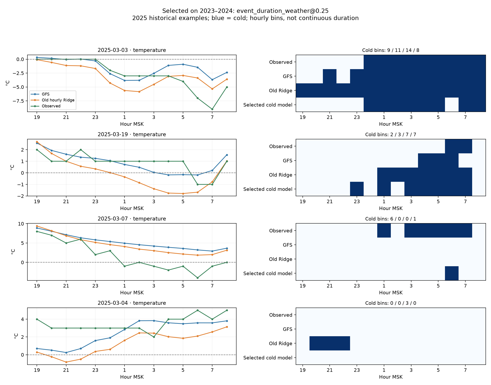

# Обнаружение и длительность заморозка

Расчёт 2026-10-12T17:28:28.607340+00:00. Краснодар, станция 34929, яблоня как сценарий; погодная цель T<0 °C.

Выбран **event_duration_weather@0.25** только по 2023–2024. Обучение 2022–2023; 2025 уже был просмотрен и остаётся исторической проверкой. Модель демонстрации не заменена.

## Почему почасовой Ridge ухудшает время холода

1. Старая модель выбиралась по средней почасовой MAE температуры; сам Ridge учит квадратичную ошибку остатка с регуляризацией. Ошибка знака около нуля и лишний холодный час не имели отдельного штрафа. Тёплые часы преобладают; средняя MAE скрывает качество редкого события.
2. В финальном обучении 166 отрицательных часов из 2576, 21 холодных ночей из 184. В валидации всего семь холодных ночей: выбор нестабилен.
3. Ridge обучен на остатке Tфакт−TGFS с признаками температуры, профиля, календаря и индикаторов часа. Его поправка меняет переход через ноль, хотя улучшение MAE не требует правильного времени перехода. Ниже показано точное аддитивное разложение поправки; это алгебра, не причинное влияние независимых признаков.
4. Станционные цели целочисленные: ровно 0 °C — не заморозок по заданному строгому порогу. Небольшая отрицательная поправка превращает такой час в ложный холод. Минимум и общая MAE не проверяют форму холодного эпизода.

| Фактическая T, диагностический срез 2025 | Часов | MAE GFS °C | MAE Ridge °C | Bias GFS °C | Bias Ridge °C |
|---|---:|---:|---:|---:|---:|
| T<0 | 46 | 1.840 | 2.693 | 0.895 | -1.088 |
| T=0 | 13 | 1.700 | 1.385 | 1.643 | 0.667 |
| 0<T<=2 | 52 | 1.569 | 1.292 | 1.362 | 0.464 |
| T>2 | 1176 | 1.300 | 1.230 | -0.337 | -0.106 |

Срезы по факту — только объяснение прошлого результата, в выборе новой модели не участвуют.

| Ночь | Холодных часов факт / GFS / Ridge | Лишних пересечений в холод |
|---|---|---:|
| 2025-03-01 | 14 / 14 / 14 | 0 |
| 2025-03-02 | 14 / 14 / 14 | 0 |
| 2025-03-03 | 9 / 11 / 14 | 3 |
| 2025-03-04 | 0 / 0 / 3 | 3 |
| 2025-03-07 | 6 / 0 / 0 | 0 |
| 2025-03-19 | 2 / 3 / 7 | 4 |
| 2025-03-20 | 1 / 0 / 0 | 0 |
| 2025-04-11 | 0 / 0 / 1 | 1 |

| Первый добавленный холодный час, МСК | TGFS → TRidge °C | Факт °C | Intercept | Текущая T | Профиль | Календарь | Индикаторы часа |
|---|---|---:|---:|---:|---:|---:|---:|
| 03.03 19:00 | 0.32 → -0.09 | 0 | 0.06 | -0.86 | -0.26 | -0.28 | 0.92 |
| 04.03 20:00 | 0.51 → -0.22 | 3 | 0.06 | -0.84 | -0.30 | -0.27 | 0.61 |
| 20.03 01:00 | 0.72 → -0.35 | 1 | 0.06 | -0.82 | -0.13 | -0.09 | -0.09 |
| 12.04 05:00 | 1.14 → -0.23 | 1 | 0.06 | -0.78 | -0.17 | 0.08 | -0.57 |

## Новая постановка

Реестр закреплён в `config/frost_study.json` до новой валидации: GFS и две семьи, по три фиксированных порога 0.25/0.50/0.75, всего семь вариантов. C=1, scaler только обучения, LogisticRegression без class weights; Ridge длительности alpha=10. Нет поиска настроек, календаря, измерений или каскада с исправленной температурой во входах.

- `cold_hour_logistic`: напрямую учит знак T<0 на каждом часе; порог задаёт холодную маску.
- `event_duration_weather`: отдельный классификатор ночного события, Ridge числа холодных часов только на холодных обучающих ночах и часовой классификатор для расположения этих часов. При событии длительность округляется и ограничивается 1–14, затем выбираются k часов с наибольшей оценкой холода. Разрывы не заполняются, отдельные эпизоды сохраняются. Ошибки этих трёх голов могут накапливаться.

Выход — холодные часы и эпизоды; новая модель не выдаёт искусственную температуру. Оценки классификаторов не откалиброваны как вероятности. Температурный и RH прогнозы прежнего этапа сохранены отдельно.

Выбор: L=¼·(доля пропущенных холодных ночей + доля ложных тревог среди тёплых + MAE длительности холодных/14 + MAE длительности тёплых/14). Так тёплое большинство не подавляет холодные ночи. Пропуски включены в длительность; ложные тревоги штрафуются и как событие, и как часы. Веса заданы до расчёта как исследовательский компромисс, не оценка стоимости ущерба. Начало не оптимизируется условной MAE попаданий: она могла бы улучшаться простым отказом от сложных ночей.

Фолды: 2022→2023, 2022–2023→2024. Классы и ошибки длительности объединяются по ночам с собственными знаменателями, а не простым средним двух сезонов. GFS может выиграть; прежний Ridge — диагностическая база вне нового реестра. Финальный fit только 2022–2023. `frost-select` не открывает станционный файл 2025; модель/выбор и SHA записываются до его чтения в `frost-study`. Повторение проверяет неизменность выбора и коэффициентов.

## Выбор на 2023–2024

| Метод | L ↓ | Пропуски из 7 | Ложные | MAE длительности холодных ч | MAE длительности тёплых ч |
|---|---:|---:|---:|---:|---:|
| gfs | 0.304 | 6 | 0 | 5.000 | 0.000 |
| cold_hour_logistic@0.25 | 0.233 | 4 | 2 | 4.857 | 0.017 |
| cold_hour_logistic@0.5 | 0.273 | 5 | 0 | 5.286 | 0.000 |
| cold_hour_logistic@0.75 | 0.316 | 6 | 0 | 5.714 | 0.000 |
| event_duration_weather@0.25 | 0.142 | 2 | 1 | 3.857 | 0.011 |
| event_duration_weather@0.5 | 0.180 | 3 | 1 | 4.000 | 0.011 |
| event_duration_weather@0.75 | 0.224 | 4 | 1 | 4.429 | 0.011 |

| Сезон | Метод | Пропуски/холодных | Ложные | MAE длительности холодных ч |
|---|---|---|---:|---:|
| 2023 | gfs | 2/3 | 0 | 3.333 |
| 2023 | hourly_ridge_reference | 1/3 | 1 | 2.000 |
| 2023 | event_duration_weather@0.25 | 1/3 | 1 | 3.000 |
| 2024 | gfs | 4/4 | 0 | 6.250 |
| 2024 | hourly_ridge_reference | 2/4 | 0 | 4.000 |
| 2024 | event_duration_weather@0.25 | 1/4 | 0 | 4.500 |

Всего семь положительных ночей в выборе и зависимые холодные серии: преимущество в валидации не является независимым подтверждением. 2025 не слепой тест; нужна новая станция/сезон с заранее закреплённым протоколом.

## Исторический 2025: без переключения на победителя этого года

| Метод | L ↓ | Пропуски/6 | Ложные | MAE длительности все / холодные ч | Первый холодный час MAE ч (n) | Recall холодных часов |
|---|---:|---:|---:|---|---|---:|
| gfs | 0.113 | 2 | 0 | 0.110 / 1.667 | 1.250 (4) | 0.826 |
| cold_hour_logistic@0.25 | 0.155 | 2 | 2 | 0.275 / 3.667 | 3.500 (4) | 0.848 |
| cold_hour_logistic@0.5 | 0.128 | 2 | 0 | 0.165 / 2.500 | 2.000 (4) | 0.848 |
| cold_hour_logistic@0.75 | 0.116 | 2 | 0 | 0.121 / 1.833 | 1.250 (4) | 0.804 |
| event_duration_weather@0.25 | 0.065 | 0 | 3 | 0.319 / 3.000 | 2.667 (6) | 0.783 |
| event_duration_weather@0.5 | 0.134 | 2 | 0 | 0.187 / 2.833 | 2.250 (4) | 0.739 |
| event_duration_weather@0.75 | 0.134 | 2 | 0 | 0.187 / 2.833 | 2.250 (4) | 0.739 |
| hourly_ridge_reference | 0.141 | 2 | 2 | 0.231 / 2.833 | 2.500 (4) | 0.848 |

Сравнение первого холодного отсчёта на одинаковых попаданиях:

| Определение | Общих ночей | GFS MAE ч | Выбранная MAE ч |
|---|---:|---:|---:|
| Первый холодный отсчёт | 4 | 1.250 | 2.250 |
| Начало без границы у обеих моделей | 2 | 2.500 | 3.500 |

Парная разность MAE длительности GFS−модель на фактически холодных ночах, календарные блоки; положительное значение — выигрыш. Пустые тёплые блоки сохраняются; повторения без холодных ночей исключены и посчитаны. Это чувствительность одного сезона с шестью событиями, не доказательство переносимости.

| Блок, дней | Блоков с холодом / всех | Выигрыш ч | 95% диапазон ч | Повторов без холодных ночей |
|---|---|---:|---|---:|
| 3 | 3/31 | -1.333 | [-3.000, 1.000] | 199 |
| 7 | 2/14 | -1.333 | [-3.000, -0.500] | 579 |
| 14 | 2/7 | -1.333 | [-3.000, -0.500] | 452 |

| Холодная ночь или тревога выбранного метода | Исход | Холодных часов факт / GFS / модель | Первый холодный отсчёт факт / модель МСК |
|---|---|---|---|
| 2025-03-01 | hits | 14 / 14 / 14 | 01.03 19:00 / 01.03 19:00 |
| 2025-03-02 | hits | 14 / 14 / 10 | 02.03 19:00 / 02.03 21:00 |
| 2025-03-03 | hits | 9 / 11 / 8 | 04.03 00:00 / 04.03 00:00 |
| 2025-03-07 | hits | 6 / 0 / 1 | 08.03 01:00 / 08.03 06:00 |
| 2025-03-18 | false_alarms | 0 / 0 / 3 | — / 19.03 06:00 |
| 2025-03-19 | hits | 2 / 3 / 7 | 20.03 06:00 / 19.03 23:00 |
| 2025-03-20 | hits | 1 / 0 / 4 | 21.03 06:00 / 21.03 04:00 |
| 2025-04-08 | false_alarms | 0 / 0 / 5 | — / 09.04 04:00 |
| 2025-04-11 | false_alarms | 0 / 0 / 3 | — / 12.04 05:00 |

## Что изменилось и где остаётся ошибка

Ночной детектор: пропуски 2 → 0 из 6, ложные тревоги 0 → 3. Но MAE длительности фактически холодных ночей 1.667 → 3.000 ч; первого холодного часа на 4 общих попаданиях 1.250 → 2.250 ч. Снижение выбранного составного L не означает улучшения каждого из его компонентов.

| Ночь | Исход | Оценка события | Сырая условная длительность ч | Холодных часов модель / факт |
|---|---|---:|---:|---|
| 2025-03-01 | hits | 1.000 | 14.140 | 14 / 14 |
| 2025-03-02 | hits | 0.960 | 10.440 | 10 / 14 |
| 2025-03-03 | hits | 0.990 | 7.611 | 8 / 9 |
| 2025-03-07 | hits | 0.438 | 0.496 | 1 / 6 |
| 2025-03-18 | false_alarms | 0.494 | 3.399 | 3 / 0 |
| 2025-03-19 | hits | 0.949 | 7.436 | 7 / 2 |
| 2025-03-20 | hits | 0.489 | 3.673 | 4 / 1 |
| 2025-04-08 | false_alarms | 0.281 | 5.350 | 5 / 0 |
| 2025-04-11 | false_alarms | 0.478 | 2.637 | 3 / 0 |

Ночной классификатор решает, будет ли хоть один отрицательный отсчёт; он не гарантирует нужного числа часов. Длительность учится лишь на 21 холодной обучающей ночи, поэтому её переносимость ограничена. Ранжирование выбирает часы отдельно и может ставить разрозненные лишние отсчёты раньше факта. Это видимые ошибки отдельных голов и декодирования, не доказанная физическая причина. Модель полезна как исследовательский детектор; заменять ей GFS для расписания защиты пока оснований нет.



## Ограничения и воспроизведение

Цель — T воздуха на станции 2 м, не температура тканей яблони и не потеря урожая. Начало — первый отрицательный часовой отсчёт, длительность — число холодных часовых интервалов в [19,09). За границами окна начало/конец неизвестны; минутная и непрерывная точность не заявляются. Неполные 14 температур исключаются из fit/score; прогноз всё равно возвращается без использования факта. Источник ISD-lite/METAR не заменяет QC. Те же ближайшая точка GFS и архивная доступность Last-Modified+10 минут; первая публикация неизвестна.

```powershell
.\.venv\Scripts\python.exe -m agro_checker frost-select --offline
.\.venv\Scripts\python.exe -m agro_checker frost-study --offline
.\.venv\Scripts\python.exe -m agro_checker frost-replay --night 2025-03-07
```

Модели/выбор: `models/research-frost/`; выдачи всех 368 ночей: `data/processed/frost-study/`. Replay проверяет SHA, отделяет факт от прогноза, маркирует роль сезона. [Численные результаты и происхождение](FROST_STUDY_SUMMARY.json).
