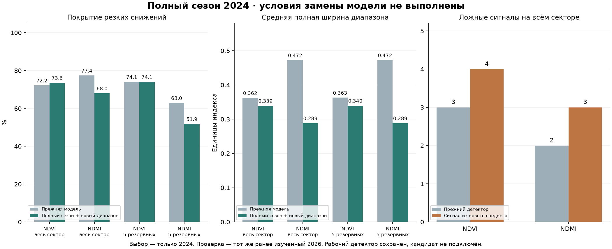

# Полный сезон обучения и диапазон ошибки индексов

Дата: 20 октября 2026. **Условия улучшения не выполнены; кандидат остаётся исследовательским.** Полный сезон немного улучшил среднюю точность, диапазон стал уже, но покрытие резких снижений NDMI ухудшилось. Если строить тревоги из нового среднего прогноза, ложных сигналов больше. Рабочие модели и прежний детектор сохранены.

## Данные и обучение

Сектор — 27 приблизительных цветных обводок, не подтверждённые поля хозяйства. R18 имеет недостаточное внутреннее ядро и остаётся исключённым, 26 фрагментов пригодны для эксперимента. Цель — NDVI/NDMI ближайшего пригодного снимка через 6–8 дней, а не болезнь, ущерб или фактическая влажность почвы.

Точечная модель temporal_ridge_100 обучена на **489 парах / 39 датах** за весь доступный сезон **март–октябрь 2024**, до целевой даты 2024-10-14. Это не полный календарный год. Сохранены прежние семь входов и коэффициент регуляризации 100, выбранный ранее по 2024: эксперимент изолирует расширение сезона. R23–R27 исключены из обучения, выбора и калибровки. Предыдущая точечная модель использовала 217 пар / 21 дату до 21 июля 2024.

Весь протокол сохранён до обучения, выбор — до чтения тестовых данных 2026. В текущем запуске 2025 отсутствует. 2026 уже анализировался раньше: повторная проверка не стала новым слепым тестом. Проверяется тот же набор 499 пар / 27 дат; не менялись целевые даты, облачная поддержка или состав площадей ради улучшения результата.

## Как отделены ошибки прогноза от обучения

Для каждой доступной даты 2024 средний прогноз строился моделью, знавшей только пары с target строго раньше этой даты. Ошибки этих прогнозов образуют причинный OOF-набор. Минимум обучения — 5 дат и 20 пар; недостаточно ранних наблюдений не заменяли предсказаниями модели, уже знавшей факт.

Для внешних проверок августа, сентября и октября средний прогноз снова обучался только на прошлом. Модель хвостов получала ранние OOF-ошибки, последние 8 доступных OOF-дат выделялись для калибровки. Из обучения хвостов исключены пары, чей target пересекал начало калибровки. Ошибки с target после начала внешней проверки недоступны ни обучению, ни калибровке.

| Проверка с | Последний target среднего | Последний target хвостов | Калибровка с | Последний target калибровки | Пар проверки |
|---|---|---|---|---|---:|
| 2024-08-01 | 2024-07-21 | 2024-06-18 | 2024-06-21 | 2024-07-21 | 72 |
| 2024-09-01 | 2024-08-25 | 2024-07-06 | 2024-07-11 | 2024-08-25 | 94 |
| 2024-10-01 | 2024-09-29 | 2024-08-12 | 2024-08-15 | 2024-09-29 | 28 |

После выбора средний прогноз переобучен на всём доступном сезоне 2024. Финальная модель хвостов использовала 270 OOF-ошибок / 24 даты до 2024-09-11; отдельно 132 ошибок / 8 дат с 2024-09-14 до target 2024-10-14 для калибровки.

OOF-ошибки относятся к постепенно обучавшимся моделям, а финальный средний прогноз знает больше данных. Это перенос калибровки, **не точная гарантия conformal coverage**. Отдельная проверка 2026 оценивает этот перенос. Внешние прогнозы 2024 используются для выбора кандидата, поэтому их качество оптимистично и не является независимым итоговым тестом.

## Выбор диапазона только по 2024

Проверены четыре заранее заданных варианта: симметричный максимум ошибки; глобальные асимметричные хвосты; условные квантильные хвосты CatBoost; условные хвосты с тройным весом резких снижений и дополнительной нижней поправкой по калибровочным событиям. Вход хвостов — только текущие/прошлые индексы, темпы, календарь и интервал между снимками. Фактическое будущее снижение используется только в обучении/калибровке и подсчёте качества, не как вход при прогнозе.

Правила допуска к выбору: общее покрытие ≥90%, покрытие резких снижений ≥85% для каждого индекса, средняя ширина не больше 110% симметричного сравнения. Среди прошедших выбирается минимальный interval score с тройным весом событий. Это проектные критерии эксперимента, не гарантия качества продукта. Четыре кандидата оценены на одинаковых 194 парах / 14 датах внешних проверок 2024: всего 18 событий NDVI на 5 датах и 11 NDMI на 7 датах.

| Вариант | Покрытие снижений NDVI / NDMI | Ширина NDVI / NDMI | Взвешенный interval score | Результат |
|---|---:|---:|---:|---|
| date_max | 100.0% / 85.7% | 0.611 / 0.453 | 0.633 | прошёл |
| global_asymmetric | 100.0% / 85.7% | 0.454 / 0.327 | 0.484 | прошёл |
| conditional | 100.0% / 64.3% | 0.246 / 0.191 | 0.352 | ndmi: decline coverage |
| event_weighted | 100.0% / 78.6% | 0.280 / 0.249 | 0.408 | ndmi: decline coverage |

Выбран **global_asymmetric**. Более узкие условные модели отклонены ещё по 2024 из-за покрытия NDMI, не по результатам 2026. После замораживания другие кандидаты на 2026 не запускались. Финальная калибровка содержит только 2 события NDVI на 2 датах и 6 NDMI на 3 датах; это слабая опора для хвостов, а не большая независимая выборка.

## Проверка на секторе в 2026

| Проверка | Индекс | MAE прежде → теперь | Покрытие резких снижений | Полная ширина на всех парах |
|---|---|---:|---:|---:|
| Весь сектор | NDVI | 0.0460 → 0.0437 | 72.2% → 73.6% | 0.362 → 0.339 |
| Весь сектор | NDMI | 0.0445 → 0.0451 | 77.4% → 68.0% | 0.472 → 0.289 |
| 5 резервных площадей | NDVI | 0.0482 → 0.0459 | 74.1% → 74.1% | 0.363 → 0.340 |
| 5 резервных площадей | NDMI | 0.0526 → 0.0508 | 63.0% → 51.9% | 0.472 → 0.289 |

Среднее MAE двух индексов на всём секторе 0.0453 → 0.0444, снижение ошибки на 1.9%. Простой прогноз сохранения текущего индекса имел MAE 0.0436: новый средний прогноз по-прежнему не показал общего преимущества над ним. Новое MAE NDVI лучше, NDMI немного хуже прежней модели.

Полная ширина NDVI уменьшилась примерно на 6%, NDMI на 39%. Общие покрытия стали 97.2% / 96.1%, но на сильных снижениях NDMI — только 68.0% вместо 77.4%. На резервных площадях оно снизилось с 63.0% до 51.9%; NDVI там осталось 74.1%. Сужение диапазона и улучшение среднего interval score не компенсируют провал целевой подгруппы. Требование улучшить покрытие обоих индексов на всём секторе и резерве не выполнено.

MAE и ширина даны в единицах индекса. Покрытие взвешено поровну по датам, затем по площадям внутри даты. При подсчёте покрытия снижений веса пересчитываются на этой подгруппе. Пары соседних мест и перекрывающихся дат зависимы, это не независимые полевые происшествия.



## Ложные тревоги и сохранённый детектор

Прежний детектор спектрального снижения сохранён: на 499 парах по-прежнему 3 ложных сигнала NDVI и 2 NDMI, 0 обнаруженных событий из 50/42. Это отсутствие изменения детектора, не достижение нового прогноза.

Отдельная обязательная проверка тревог из нового среднего прогноза показала **4 ложных NDVI и 3 NDMI**, без новых попаданий. Число дат ложных сигналов также выросло с 3/2 до 4/3. На пяти резервных площадях NDVI вырос с 0 до 1 ложного сигнала. Поэтому новый средний прогноз не прошёл условие замены предупреждений. Интервалы не превращались в дополнительный детектор по нижней границе: такие сигналы здесь не проверялись и в продукт не добавлены.

## Что следует из результата

Полного сезона одной Ridge недостаточно для решения задачи резких изменений. Смешанное улучшение среднего прогноза не доказывает надёжность предупреждений. Глобальные хвосты сузились, но плохо перенеслись на сильные снижения NDMI в другом году и на резервных площадях; редкие события в калибровке ограничивают оценку.

Существующие диапазон и детектор не заменены. Следующее независимое исследование должно заранее задать условную надёжность и поддержку хвостов по датам событий, а не выбирать только общий score. Нужны более разнообразные проверенные сезоны и реальные культуры/операции для отделения нормальной смены покрова. Использовать новые годы для обучения без отдельного протокола нельзя. Выбор модели полезности осмотра также требует фактических осмотров и контролей; индексные события их не заменяют.

## Проверки и воспроизведение

Численные результаты: [report.json](../data/farm-research/full-season-intervals/report.json). Протокол: [protocol.json](../data/farm-research/full-season-intervals/protocol.json). Выбор: [frozen-selection.json](../data/farm-research/full-season-intervals/frozen-selection.json). Сохранены OOF-прогнозы, внешние прогнозы 2024, таблица выбора и единственный набор тестовых прогнозов выбранного кандидата.

Независимая проверка подтверждает: только 2024 в обучении/выборе/калибровке; резервные ID исключены; временные окна не пересекают границы; выбор воспроизводится по таблице; когорта 499 пар и старые прогнозы совпадают; модель/протокол/код неизменны между fit и evaluate. Заблокирован повторный fit после замораживания и после оценки.

Побайтно сохранены 2687 прежних файлов моделей, исследования и журнала; FieldStore 198 файлов. Реальные осмотры, культуры, диагнозы и локальные измерения не создавались. В рабочий интерфейс кандидат не подключён.

```text
.venv/Scripts/python.exe -X utf8 scripts/train_full_season_intervals.py protocol
.venv/Scripts/python.exe -X utf8 scripts/train_full_season_intervals.py fit
.venv/Scripts/python.exe -X utf8 scripts/train_full_season_intervals.py evaluate
.venv/Scripts/python.exe -X utf8 scripts/verify_full_season_intervals.py
.venv/Scripts/python.exe -X utf8 scripts/report_full_season_intervals.py
```

Повторный fit в существующий замороженный эксперимент намеренно отклоняется; для воспроизведения результатов достаточно проверки и отчёта. Новое обучение требует нового отдельного протокола, не перезаписи этого выбора.
