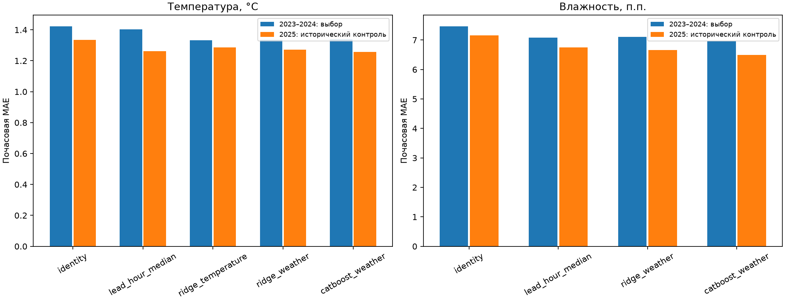
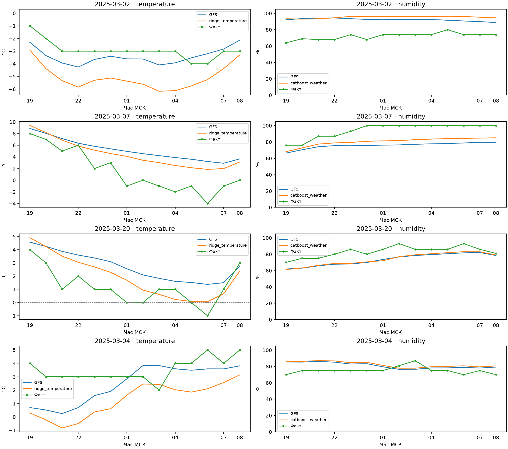

# Почасовая температура, влажность и время заморозка

Расчёт 2026-10-12T17:06:34.951602+00:00. Краснодар 34929, яблоня, погодный порог `<0 °C`.

## Результат проверки

В историческом 2025 почасовая MAE T 1.335 → 1.287 °C; RH 7.162 → 6.500 п.п. Выбор этих моделей сделан по 2023–2024, без настройки на 2025.

Качество времени холода: пропуски 2 → 2 из 6, ложные тревоги 0 → 2; MAE длительности на холодных ночах 1.667 → 2.833 ч. На 4 общих попаданиях MAE первого отрицательного отсчёта 1.250 → 2.500 ч. Улучшение общей почасовой MAE не подтверждает улучшение обнаружения или расписания заморозка. Исследовательские кривые доступны для проверки; модель демонстрации не заменена.

## Постановка и выбор

Прогноз одного выпуска GFS 06 UTC на 14 часов 19:00–08:00 МСК, окно до 09:00 исключая конец. Отдельные модели уточняют температуру 2 м и относительную влажность 2 м. Прямая база RH взята из `RH:2 m above ground`, а не вычислена из точки росы. Выпуск, действие, слой, единицы, мгновенный шаг, ближайшая точка и версия объекта проверены; ETag/Last-Modified совпадают с температурным объектом. Gate — архивный Last-Modified+10 минут, первая публичная доступность неизвестна.

Протокол `config/hourly_study.json` задан до оценки. Температура: GFS, медиана остатка по часу, Ridge только температуры, Ridge погоды, CatBoost погоды. Влажность: GFS, медиана по часу, Ridge/CatBoost погоды. Настройки прежние: Ridge alpha=10/SVD со scaler только на обучении; CatBoost MAE, 200 деревьев, глубина 3, LR=.03, L2=10, фиксированный seed. Без поиска настроек, early stopping и подбора порога. RH ограничена 0–100% для всех методов по заранее заданному правилу. Входы — только прогнозы и календарь; измерений и каскада с обученной температурой во входах RH нет.

Проверка следующих сезонов: 2022 → 2023, 2022–2023 → 2024. Для каждого выхода отдельно выбрана минимальная MAE объединённых валидационных часов; порядок конфигурации разрешает равенство. Модели для 2025 обучены только на 2022–2023, без дообучения на 2024. Выбор и модели записаны до расчёта 2025. **2025 ранее просмотрен, это исторический контроль, не слепой тест.**

Выбраны: температура **ridge_temperature**, влажность **catboost_weather**.

## Цели и полнота

Только ISD-lite/METAR; для каждого выхода собственная проверка источника и наличия значения. RH допускается в диапазоне 0–100%. Станционная RH может быть вычисленной величиной; источник не заменяет независимый QC. Модельные заполнения исключены. Почасовое обучение/MAE используют все пригодные цели, неполная ночь не заполняется. Для минимума и времени холода нужны все 14 температур; пропуски RH не исключают пригодную температуру и наоборот.

| Год | Ожидаемых часов | Пригодная T | Пригодная RH |
|---|---:|---:|---:|
| 2022 | 1288 | 1288 | 1288 |
| 2023 | 1288 | 1288 | 1288 |
| 2024 | 1288 | 1285 | 1285 |
| 2025 | 1288 | 1287 | 1287 |

RH: 5152 сообщений, 3.77 GiB, ошибок 0. Источники и статусы исключений сохранены в JSON.

## Почасовое качество

| Выход | Метод | MAE 2023–2024 | MAE 2025 | Bias 2025 | Часов 2025 |
|---|---|---:|---:|---:|---:|
| temperature (°C) | identity | 1.424 | 1.335 | -0.204 | 1287 |
| temperature (°C) | lead_hour_median | 1.402 | 1.262 | -0.029 | 1287 |
| temperature (°C) | ridge_temperature | 1.332 | 1.287 | -0.111 | 1287 |
| temperature (°C) | ridge_weather | 1.334 | 1.272 | -0.224 | 1287 |
| temperature (°C) | catboost_weather | 1.337 | 1.257 | -0.021 | 1287 |
| humidity (п.п.) | identity | 7.471 | 7.162 | 1.177 | 1287 |
| humidity (п.п.) | lead_hour_median | 7.086 | 6.751 | 1.169 | 1287 |
| humidity (п.п.) | ridge_weather | 7.109 | 6.657 | 0.843 | 1287 |
| humidity (п.п.) | catboost_weather | 6.970 | 6.500 | 0.769 | 1287 |

| Выбранный выход | Снижение MAE относительно GFS | 95% парный диапазон, блок 7 дней |
|---|---:|---|
| temperature | 0.048 | [-0.104, 0.172] |
| humidity | 0.662 | [0.282, 1.047] |

Bootstrap сохраняет часы вместе в календарных блоках, 5000 повторов; использует вес по пригодным целям, не сжимает календарь из-за пропусков. Варианты 3/14 дней есть в JSON. Это приблизительная чувствительность по одному сезону, не гарантия переносимости; несколько сравнений и зависимость событий ограничивают вывод.

Дополнительный диагностический срез: в 46 часах с фактической T<0 °C MAE влажности 12.891 → 14.430 п.п. у выбранного метода. Это ретроспективная диагностика, не критерий выбора и не настройка по 2025. Улучшение общей RH MAE не гарантирует улучшения в холодные часы.



## Что означает начало и длительность

Каждый часовой отсчёт условно представляет следующий час внутри [19:00,09:00). Длительность — число отсчётов T<0, умноженное на один час; это дискретная оценка, не измеренная непрерывная длительность. Отдельные холодные эпизоды не соединяются через тёплый промежуток. Первый отрицательный отсчёт задаёт обнаруженный час; при предыдущем неотрицательном отсчёте начало локализовано только в интервале между ними. Линейная интерполяция и минутная точность не используются.

Если первый отсчёт уже отрицательный, истинное начало до/в 19:00 неизвестно (left-censored). Если последний отрицательный, конец после 08:00 неизвестен (right-censored); оценка заканчивается границей окна 09:00. Ошибка первого холодного часа считается только на попаданиях и отдельно на парах без цензурирования начала. Пропуски не превращаются в нулевую ошибку времени: показаны отдельно, а ошибка длительности на фактически холодных ночах включает пропуски. Нулевые тёплые ночи могут скрывать ошибки в общей MAE длительности, поэтому показаны оба среза.

## Время холода на валидации

| Год | Метод T | Пропуски/холодных | Ложные тревоги | MAE длительности холодных ночей ч |
|---|---|---:|---:|---:|
| 2023 | identity | 2/3 | 0 | 3.333 |
| 2023 | ridge_temperature | 1/3 | 1 | 2.000 |
| 2024 | identity | 4/4 | 0 | 6.250 |
| 2024 | ridge_temperature | 2/4 | 0 | 4.000 |

Данные валидации участвуют в выборе метода; их преимущество не является независимым подтверждением.

## Заморозки и время: исторический 2025

| Метод T | Полных ночей | Попадания | Пропуски/холодных | Ложные | MAE минимума °C | MAE длительности все/холодные ч | MAE первого часа на попаданиях ч (n) | MAE начала без границы ч (n) |
|---|---:|---:|---:|---:|---:|---|---|---|
| identity | 91 | 4 | 2/6 | 0 | 1.562 | 0.110 / 1.667 | 1.250 (4) | 2.500 (2) |
| lead_hour_median | 91 | 4 | 2/6 | 0 | 1.453 | 0.110 / 1.667 | 1.000 (4) | 2.000 (2) |
| ridge_temperature | 91 | 4 | 2/6 | 2 | 1.459 | 0.231 / 2.833 | 2.500 (4) | 5.000 (1) |
| ridge_weather | 91 | 5 | 1/6 | 2 | 1.429 | 0.231 / 3.000 | 2.400 (5) | 3.500 (2) |
| catboost_weather | 91 | 4 | 2/6 | 1 | 1.522 | 0.198 / 2.833 | 2.500 (4) | 5.000 (1) |

Сравнение выбранной модели с GFS на одинаковых ночах (условно на общих попаданиях):

| Определение | Одинаковых пар | MAE GFS ч | MAE выбранного ч |
|---|---:|---:|---:|
| Первый холодный отсчёт | 4 | 1.250 | 2.500 |
| Начало без границы окна у обеих моделей | 1 | 2.000 | 5.000 |

## Холодные ночи и ложные тревоги выбранной модели

| Ночь | Исход | Первый холодный отсчёт факт/прогноз МСК | Холодных часов факт/прогноз | Граница начала факт/прогноз |
|---|---|---|---|---|
| 2025-03-01 | hits | 01.03 19:00 / 01.03 19:00 | 14 / 14 | True / True |
| 2025-03-02 | hits | 02.03 19:00 / 02.03 19:00 | 14 / 14 | True / True |
| 2025-03-03 | hits | 04.03 00:00 / 03.03 19:00 | 9 / 14 | False / True |
| 2025-03-04 | false_alarms | — / 04.03 20:00 | 0 / 3 | False / False |
| 2025-03-07 | misses | 08.03 01:00 / — | 6 / 0 | False / False |
| 2025-03-19 | hits | 20.03 06:00 / 20.03 01:00 | 2 / 7 | False / False |
| 2025-03-20 | misses | 21.03 06:00 / — | 1 / 0 | False / False |
| 2025-04-11 | false_alarms | — / 12.04 05:00 | 0 / 1 | False / False |



## Ограничения и воспроизведение

Выбор оптимизирует почасовую MAE, а не обнаружение заморозков. Показанные ошибки времени условны на попаданиях; нельзя трактовать их без числа пропусков и малого числа пригодных пар начала. Почасовые цели T целочисленны, соседние часы/холодные ночи зависимы. Температура станции не равна температуре цветков; реальная фаза яблони неизвестна. Вероятности, интервалы температуры и риск потери урожая не откалиброваны. Новая независимая проверка требуется.

```powershell
.\.venv\Scripts\python.exe -m agro_checker humidity-fetch --workers 10
.\.venv\Scripts\python.exe -m agro_checker hourly-study --offline
.\.venv\Scripts\python.exe -m agro_checker hourly-replay --night 2025-03-07
```

Прогнозы всех 368 ночей: `data/processed/hourly-study/forecasts.csv` и проверяемый SHA-256 snapshot; модели/выбор: `models/research-hourly/`. Прогноз и последующие наблюдения в replay разделены; обучающие ночи маркируются как in-sample. Прежняя демонстрация не перезаписывается. [Сводка и происхождение](HOURLY_STUDY_SUMMARY.json).

Источник единиц/UTC: [Meteostat](https://dev.meteostat.net/formats); [NOAA GFS](https://www.nco.ncep.noaa.gov/pmb/products/gfs/).
