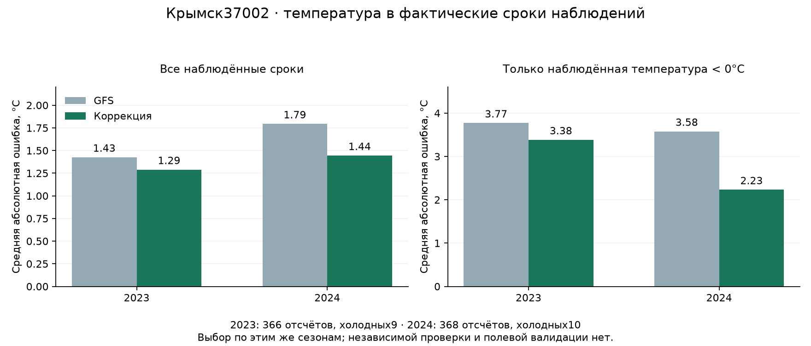

# Крымск: происхождение данных и проверка по срокам наблюдений

17 октября2026. Отдельный исследовательский эксперимент; **не включён в полевой прогноз**. Выбран `ridge_weather_10`. Температура в проверках2023–2024 улучшилась; качество реального предупреждения на ферме этим не подтверждено. Исходные точечная модель, детектор, его порог/маски и диапазон сохранены.

## Что подтверждено о происхождении

Станция Крымск37002 присутствует в [официальном паспорте Росгидромета2017](https://www.meteorf.gov.ru/upload/iblock/58b/%D0%9F%D0%B0%D1%81%D0%BF%D0%BE%D1%80%D1%82%20%D0%93%D0%9C%D0%91%20%D0%9A%D1%80%D0%B0%D1%81%D0%BD%D0%BE%D0%B4%D0%B0%D1%80%D1%81%D0%BA%D0%BE%D0%B3%D0%BE%20%D0%BA%D1%80%D0%B0%D1%8F.pdf):44.90,38.00,35м. [Провайдер](https://www.pogodaiklimat.ru/station/37002.htm) даёт более подробные44.9109,38.0053,35м. Это примерно14,58км от точки фермы. Текущая установка прибора и история переносов независимо не подтверждены.

[Описание источников](https://www.pogodaiklimat.ru/about.php) говорит об архивах на основе международного обменаSYNOP и американскихMETAR. [FAQ](https://www.pogodaiklimat.ru/faq.php) описывает цепочку КН-01 → центр данных в Вашингтоне → декодирование и обработка, автоматический контрольT и ручные исправления. Это заявление поставщика о своей системе: исходных телеграмм для каждой записи Крымска у нас нет. Архив может содержать поздние исправления, время которых неизвестно.

Легенда архивных таблиц определяетT как температуру воздуха на2м, время какUTC. Под «фактическим сроком» здесь понимается опубликованный номинальный срок; секундная точность снятия измерения не установлена. Модельные курсивныеT исключаются парсером; в данном срезе их0. Отсутствие такой пометки не заменяет первичныеQC-флаги. ОпубликованныеTmin не использованы: окно каждого экстремума пока не подтверждено. Описанный вFAQ суточный агрегат также не наша ночная цель.

Сохранены исходные страницы справки,URL, дата получения иSHA; каждая использованная страница наблюдений тоже проверена поSHA. [Машинная сводка](KRYMSK_OBSERVED_TIME_SUMMARY.json) разделяет заявления провайдера и независимо подтверждённые факты. Прямое получение официального каталогаЕИП в этой сессии завершилось ошибкой проверкиTLS, веб-запрос — тайм-аутом. Официального экспортаT Крымска пока нет; это не доказательство отсутствия данных.

У [источника](https://www.pogodaiklimat.ru/agreement.php) п3.1 задаёт личное некоммерческое использование, п3.5 требует предварительного письменного разрешения для коммерческого использования, п3.7 — атрибуцию, п3.3 ограничивает статус данных при решениях с риском материальных потерь. **Разрешения для продукта нет.** Использован только уже локальный исследовательский кэш; новые сезоны архива не собирались, сообщения держателям не отправлялись, исходные наблюдения не публикуются вGit.

## Данные и точное сопоставление

2022–2024, март–май, с нужными сроками1июня для последней ночи. **1102 допустимыхT из1104 ожидаемых**,276ночей,275полных по4срокам. Не хватает21UTC16апреля и03UTC17апреля2023; эти два срока пропущены в почасовой метрике, вся соответствующая ночь исключена из метрики4-точечного минимума. Остальные наблюдения ночи остаются допустимыми отдельнымиT.

| СрокUTC | СрокМСК | Заблаговременность от06UTC |
|---|---|---|
|18:00|21:00|12ч|
|21:00|00:00 следующего дня|15ч|
|00:00 следующего дня|03:00 следующего дня|18ч|
|03:00 следующего дня|06:00 следующего дня|21ч|

GFS извлечён заново **в координатах станции**, исходныеGRIB06UTC, по одному выпуску на ночь; егоT/RH/Td/ветер/облачность,14часов, все поля и временные признаки проходят прежние проверки. Ближайшая ячейка45.00,38.00,9,92км от станции. У фермы та же ячейка, но это не превращает станционнуюT в факт фермы. Время выдачи сценария15UTC; Last-Modified+10мин используется только как прокси доступности, первая историческая публикация не доказана. В признаки входят только прогнозы и календарь; измерения для входных признаков не используются.

Нет интерполяции, подстановки суточногоTmin, реанализа или измерений другой станции. Из четырёх отсчётов нельзя установить непрерывный минимум, точное начало или длительность заморозка; отсутствие наблюдённого холода не исключает холод между сроками.

## Протокол выбора

Реестр7вариантов и критерии зафиксированы в `config/krymsk_observed_time.json` до расчёта ошибок. Проверка2023: обучение2022; проверка2024: обучение2022–2023. Выбор по среднемуMAE двух сезонов с равным весом. Для допуска нужна экономияMAE≥5% в каждом году, без ухудшенияMAE на холодных сроках и без дополнительных ложных пересечений нуля на полных4-точечных ночах в каждом году. Иначе оставался быGFS.

Ridge корректирует остатокGFS; масштабирование признаков учится только на предыдущих сезонах. Признаки: температура и форма прогнозной ночи, срок/календарь; в погодном варианте дополнительно дефицит точки росы,RH, облачность, ветер и фиксированные взаимодействия. После выбора сохранён отдельный исследовательский fit2022–2024; приведённые метрики относятся к последовательным проверкам, **не к качеству этого финальногоfit в будущем**.

Данные2025–2026 не загружались и не использовались этим экспериментом.2023–2024 уже применены для выбора, поэтому это development-результат, не новый слепой тест. Объекты прежнего детектора на Крымске не вычислялись: его перенос на эту станцию пока не валидирован.

## Результат температуры

| Год проверки | Отсчёты | MAE GFS → коррекция,°C | СнижениеMAE |90-й процентиль абсолютной ошибки,°C |
|---|---:|---:|---:|---:|
|2023|366|1.426 → 1.290|9.6%|2.981 → 2.655|
|2024|368|1.794 → 1.444|19.5%|3.822 → 2.951|



| Год | Холодные отсчётыT<0 | ИхMAE GFS → коррекция,°C | Холодные4-точечные ночи с прогнозомT<0 | Ложные холодные4-точечные ночи |
|---|---:|---:|---:|---:|
|2023|9|3.771 → 3.383|1/3 → 1/3|0 → 0|
|2024|10|3.578 → 2.232|0/4 → 2/4|0 → 0|

Последние два столбца — **диагностика пересечений нуля температурой, не качество прежнего детектора**. В2023 осталось2пропуска из3холодных ночей; в2024 —2из4. Всего19холодных отсчётов в7ночах; они не независимые19событий. Ноль ложных пересечений на этом срезе не гарантирует их отсутствие в будущем.

Описательный парный bootstrap по7-дневным блокам, с отдельной выборкой внутри каждого года: разницаMAE «коррекция−GFS»95% от-0.314 до-0.175°C.28блоков,2000повторов. Это проверка устойчивости на тех же development-сезонах, без поправки на выбор лучшей модели; независимого подтверждения или гарантии покрытия диапазона ошибки она не даёт.90-й процентиль ошибки в таблице — характеристика полученных ошибок, не готовый прогнозный диапазон.

### Ошибка по срокам

Bias=прогноз−наблюдение; положительный означает слишком тёплый прогноз.

| Год | МСК |N| MAE GFS → коррекция,°C | Bias GFS → коррекция,°C |
|---|---|---:|---:|---:|
|2023|21:00|92|1.578 → 1.375|-0.851 → +0.196|
|2023|00:00|91|1.320 → 1.179|-0.083 → +0.198|
|2023|03:00|92|1.395 → 1.276|+0.373 → +0.237|
|2023|06:00|91|1.409 → 1.327|+0.490 → +0.135|
|2024|21:00|92|1.713 → 1.283|-1.230 → -0.391|
|2024|00:00|92|1.549 → 1.333|+0.103 → +0.130|
|2024|03:00|92|1.956 → 1.608|+0.892 → +0.505|
|2024|06:00|92|1.958 → 1.553|+1.322 → +0.745|

На холодных отсчётах bias положительный и после коррекции: прогноз по-прежнему слишком тёплый. Поэтому среднее улучшение ещё не делает модель достаточным основанием для запуска защиты сада.

### Весь заранее заданный реестр

| Вариант |MAE2023|MAE2024|ColdMAE2023|ColdMAE2024|Допуск|
|---|---:|---:|---:|---:|---|
|gfs|1.426|1.794|3.771|3.578|база|
|bias|1.416|1.815|4.088|3.746|не прошёл|
|slot_bias|1.386|1.681|4.093|3.393|не прошёл|
|ridge_temperature_10|1.339|1.550|3.687|2.438|прошёл|
|ridge_weather_10|1.290|1.444|3.383|2.232|прошёл|
|ridge_weather_100|1.305|1.467|3.551|2.371|прошёл|
|ridge_weather_1000|1.347|1.593|3.897|2.941|не прошёл|

## Что можно заявить и следующий шаг

Можно показать воспроизводимое улучшение станционнойT в известных сроках на двух последовательных prior-проверках и честно показать оставшиеся промахи. Нельзя обещать такую же ошибку в саду, точную температуру цветка, надёжное обнаружение всех заморозков, их длительность, проценты ущерба или экономию урожая. Коррекция не подключена к интерфейсу решений.

Следующий приоритет: получить официальный либо согласованный экспорт срочныхT37002 сQC и историей станции; сопоставить одинаковыеUTC-сроки с нашим кэшем и изолировать расхождения. Затем независимые будущие наблюдения и датчик2м в хозяйстве. Для 2025–2026 заранее создать отдельный протокол проверки с этим уже зафиксированным вариантом; ни выбор, ни повторная калибровка по ним не допускаются. Более частый ряд нужен отдельно для начала/длительности холода.

## Воспроизведение и сохранность

Только локальный кэш, без изменения сервисов:

```powershell
.\.venv\Scripts\python.exe -m agro_checker.krymsk_observed_data
.\.venv\Scripts\python.exe -m agro_checker.krymsk_observed_study
.\.venv\Scripts\python.exe -m agro_checker.krymsk_observed_report
```

Повтор проверяетSHA исходных данных, научных модулей, конфигурации, моделей и прогнозов. Изменённые источники требуют нового эксперимента; нельзя перезаписывать замороженный выбор. Данные и модель находятся в игнорируемомGit каталоге `data/working-zone-01/krymsk-observed-time/`; локальные сырые данные не становятся публичным датасетом.

SHA выбора: `48cb8ed9288f8648af78fe9059fac284b9a891670802146eb8cbfc22b3631daa`. Исходный детекторSHA `fba66530ceca0a4baee688eeb96df88b98b5b3c36150fef3575d96c03828eab8` сохранён; прежний point и range artifacts проверены тем же способом. Полевая выдача и записи решений не менялись.
