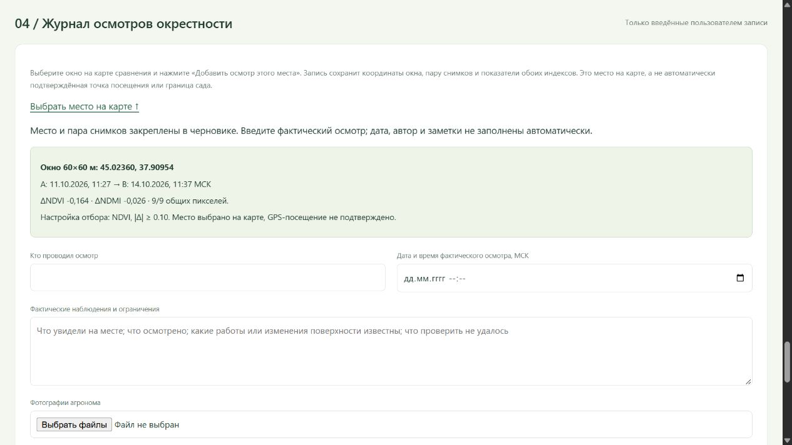

# Осмотры по спутниковым окнам

Продолжение: [история повторных осмотров](LAND_REPEAT_VISITS.md) объединяет одно место по общей сетке, показывает фотографии и заметки по датам рядом с динамикой NDVI/NDMI, объясняет пропуски сравнения между посещениями. Рабочих записей пока нет.

Добавлено 18 октября 2026. [Открыть журнал](http://127.0.0.1:8770/land#land-journal).

## Пользовательский путь

1. В сравнении съёмок выбрать пару дат и окно на карте: щелчком или стрелками клавиатуры. Можно осмотреть как выделенное окно, так и контрольное место, не прошедшее фильтр.
2. Нажать «Добавить осмотр этого места». В черновике закрепляются центр окна 60×60 м, исходная пара снимков, оба индекса и настройка фильтра. Это выбранное место, а не измеренная GPS-точка посещения.
3. Вручную указать автора, дату и время фактического осмотра в МСК, наблюдения и ограничения. Можно приложить до трёх фотографий. Дата, автор и факты автоматически не заполняются.
4. Сохранить. В журнале появятся заметка, приложения, время осмотра и отдельное серверное время записи. Рядом показаны сохранённые ΔNDVI/ΔNDMI, поддержка общих пикселей, чувствительность к сдвигу и разрыв между осмотром и снимком B.
5. Кнопка «Показать место и сохранённое сравнение» открывает исходные карты A/B, а не последнюю доступную съёмку. Вернуться к обновляемой истории можно кнопкой «К текущему периоду».

Смена окна, индекса или пары снимков не переносит введённый черновик на другое место. Несохранённый ввод защищён предупреждением при закрытии вкладки, но не хранится после перезагрузки. Повторная отправка того же запроса не создаёт вторую запись. Исправление сохраняется новой записью; первоначальная остаётся в журнале.

## Достоверность и ограничения

Новый журнал пуст: реальных осмотров, авторов, дат и фотографий команда пока не получила. Для проверки использовалось отдельное временное хранилище с явно техническими записями и тестовой картинкой; оно удалено.

Спутниковые изменения и сообщение автора сопоставляются по месту и времени. Причина изменения индекса не устанавливается. Геолокация и время фотографии, личность автора и сам факт посещения автоматически не подтверждаются. Границы сада неизвестны. Автоматических диагнозов нет; эти записи не участвуют в обучении и оценке погодного прогноза. Существующий детектор, модели и выбор настроек сохранены.

## Хранение и фотографии

Записи добавляются в существующий локальный FieldStore отдельным видом `land_inspection`, поток `landmark-01`; прежние осмотры после прогнозной ночи и их показатели не меняются. Оригинальная пара карт со сведениями о фильтрах сохраняется отдельным неизменяемым артефактом с SHA-256. Для свежей истории закреплён конкретный выпуск архива и его контрольная сумма: обновление последних 90 дней не подменяет контекст старой записи.

Фотографии: JPEG, PNG или WebP, до 5 000 000 байт каждая, до 32 Мп и 12 000 пикселей по стороне, без анимации. Сервер проверяет формат и декодирование, сохраняет исходные байты с контрольной суммой и фактическим типом изображения. Файлы доступны только через приложения к записи в локальном сервисе; сторонняя отправка не настроена. Исходные метаданные фотографий могут сохраняться внутри оригиналов.

Для проверки изображений используется установленный Pillow 12.3.0; зависимость закреплена в `requirements-field-media.txt`. [Документация проверки и загрузки изображений](https://pillow.readthedocs.io/en/stable/reference/Image.html).

Резервная копия должна включать весь каталог `data/field`, в том числе `land-inspection-contexts` и `land-inspection-media`. Кнопка экспорта выгружает записи и метаданные JSON, **без файлов фотографий**. Оригиналы открываются по отдельности из записей. При нарушении контрольной суммы сервис сообщает об ошибке, не подставляет другие данные.

## Проверка реализации

Прошли 511 Python- и 26 JavaScript-тестов, всего 537. Проверены валидация ввода и изображений, исходные байты JPEG/PNG/WebP, закрепление версии, повторная отправка, HTTP-защита и обнаружение повреждённых артефактов. В браузере на временном журнале проверены сохранение, запрет переноса заполненного черновика и повторное открытие исходной пары. Форма просмотрена на широком экране и ширине 390 пикселей.

Все 198 существовавших файлов `data/field` и указатель опубликованной спутниковой истории после проверки остались побайтово прежними. Новый журнал в рабочем хранилище содержит ноль записей. Проверка техническая; пользовательский тест с агрономом ещё предстоит.

