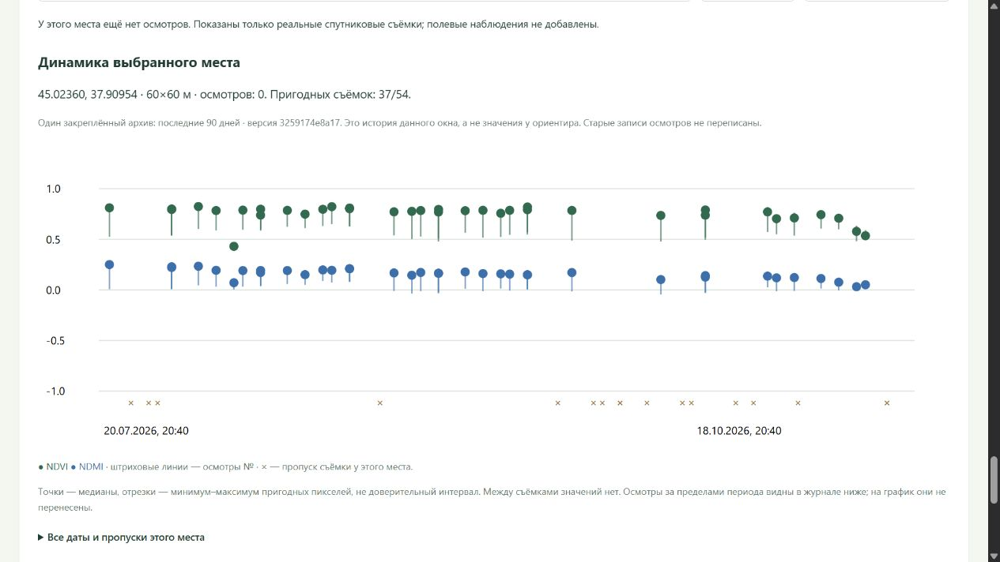

# История повторных осмотров одного места

Добавлено 18 октября 2026. [Открыть журнал](http://127.0.0.1:8770/land#land-journal).

## Что появилось

У выбранного окна есть отдельная история: фактические даты осмотров, авторы, исходные заметки и фотографии по посещениям, а рядом — ряд NDVI/NDMI этого же окна. В графике сохранены все даты съёмок и облачные/технические пропуски. Точки — медианы, отрезки — диапазон пригодных пикселей; значений между съёмками нет. Вертикальные штриховые линии обозначают введённые даты осмотров внутри периода архива.

Места объединяются по точному квадрату общей сетки UTM37N, 60×60 м. Номер окна внутри вырезки и округлённые географические координаты не служат ключом. Поэтому новый номер окна после смены вырезки не разделяет одно место, а соседнее окно не попадает в чужую историю. Это место анализа, не подтверждённая точка посещения или контур сада.

В рабочем журнале осмотров по спутникам по-прежнему **ноль записей**. Выбор окна показывает реальные спутниковые данные и пустую историю посещений. Записи и фотографии появляются только после ручного сохранения пользователем. Учебные фикстуры в рабочий журнал не переносились.

В проверенном рабочем окне с центром 45.02360, 37.90954 версия `3259174e8a17419ca701b102275569ad` дала 37/54 пригодных съёмок и 17 пропусков. У ориентира в том же архиве пригодны 35/54: качество пересчитывается по выбранному месту, а не копируется из прежней сводки. Это доступность наблюдений, не подтверждение агрономической точности.

## Как использовать

1. Выбрать окно в сравнении съёмок и нажать «История этого места». Просмотр не создаёт запись и не меняет заполненный черновик осмотра.
2. В журнале можно выбрать другое сохранённое место из списка. Хронология упорядочена по указанному времени осмотра; время фактической записи сервером остаётся отдельным.
3. «Добавить повторный осмотр» открывает пустую форму для того же окна и показанной пары снимков. Прежние автор, дата, заметки и фото не копируются. Чтобы закрепить новую пару, сначала выбрать её и то же окно на карте.
4. После сохранения новый осмотр появляется в общей хронологии. Фото сохраняются при своей записи; рядом с повторным посещением показано сравнение с предыдущим. Первоначальные заметки и спутниковые артефакты не переписываются.

Просматриваемая история и черновик формы могут относиться к разным местам: цель формы отдельно указана в зелёной карточке. Просмотр чужой истории не переносит в неё введённые факты.

## Что означает «изменилось между посещениями»

Показаны обе исходные заметки и приложения в хронологии. Сервис сообщает только, совпадает ли текст заметок и сколько фотографий приложено в каждой записи; содержимое фото и агрономический смысл текста автоматически не оцениваются.

Для численного сопоставления выбрана фиксированная описательная политика:

- Для каждого посещения берётся последняя пригодная съёмка **не позже** указанного времени, с отставанием не более семи дней. Дата и отставание показаны. Это правило отображения, а не подобранный агрономический порог.
- Изменение B − A считается по одним и тем же пикселям окна: нужны центр и минимум 5/9 общих пригодных пикселей. Это медиана парных разностей, а не разность медиан разных наборов.
- Число пар и диапазон разностей по пикселям видны рядом с ΔNDVI/ΔNDMI. Это не доверительный интервал; маска облаков и точность геопривязки на месте не проверены.
- Если для обоих посещений выбрана одна съёмка, изменение отсутствует как измерение; ноль не подставляется. Одинаковое время записей также не доказывает два отдельных посещения.
- Старый снимок, отсутствие предыдущей съёмки, несовпадающие версии обработки или недостаточное общее покрытие дают объяснённый пропуск, без восстановления данных.

История строится из одного явно указанного периода и закреплённой версии архива. Съёмки этого окна проверяются локально; пригодность у ориентира не распространяется автоматически на другое место. Осмотры вне периода остаются в журнале, но не переносятся на график. Новая история не переписывает сравнение, сохранённое с каждым старым осмотром. Для нового контекста можно выбрать новую пару на карте.

Съёмка до посещения могла быть обработана, опубликована или загружена позже. Такое ретроспективное сопоставление не доказывает доступность снимка в тот день и не является проверкой прогноза. Разница индексов не устанавливает болезнь, повреждение, урожайность или потребность в поливе. Автоматических диагнозов нет; записи не используются для обучения или расчёта качества погодной модели.

## Реализация и проверка

Новый read-only адаптер `land_place_history.py`; история доступна через GET `/api/land/inspections/<id>/history` и запрос точной пары/окна `/api/land/inspections/history`. Список/JSON-экспорт дополнен производными группами мест, без изменения существующих событий. Схема хранения, оригиналы фото, модели и детектор сохранены.

Проверены 522 Python- и 30 JavaScript-тестов (552 суммарно), включая раздельность соседних мест, независимость от номера окна, порядок по фактической дате, общие пиксели вместо разности медиан, облака/пропуски, запрет снимков из будущего, семидневный предел и закреплённый выпуск архива. Проверено HTTP-чтение реальной архивной пары и сохранённого осмотра.

Браузерная проверка шла в отдельном удаляемом хранилище: две явно технические записи одного места и одна соседнего, затем третье посещение первого окна через форму. Подтверждены группировка, фотографии, парное изменение и объяснение одной съёмки для двух посещений. Временные сервер и вкладка закрыты, хранилище удалено. Мобильный вид проверен на ширине 390 пикселей; рабочая страница остаётся с нулём осмотров. Проверка с реальным агрономом ещё предстоит.

