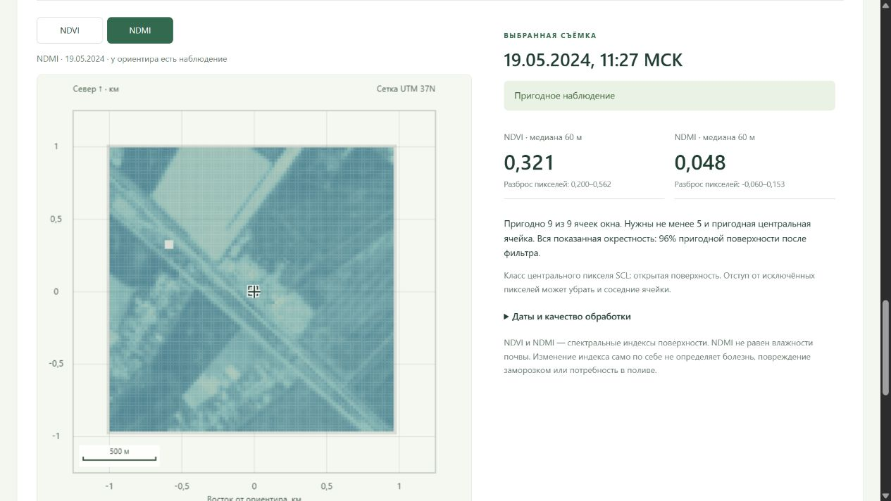

# Карты и спутниковая история в полевом интерфейсе

Добавлена [история одного места и повторных посещений](LAND_REPEAT_VISITS.md): отдельная кнопка на карте, выбор места в журнале, график обоих индексов, заметки/фото по датам и сравнение соседних визитов без диагноза.

Выбранные окна теперь связаны с [журналом осмотров](LAND_INSPECTIONS.md): фактические дата/автор/заметки/фото вводятся вручную, сравнение обоих индексов сохраняется с исходной парой снимков. Рабочий журнал пока пуст.

Добавлено [сравнение двух пригодных снимков](SENTINEL_CHANGE.md): разности на общих пикселях и окна для осмотра без автоматического диагноза.

**Обновление 18 октября:** добавлен период «Последние 90 дней» с ручной загрузкой новых сцен и контролем свежести. [Результат и сценарий обновления](SENTINEL_REFRESH.md). Старый сценарий ниже относится к периоду «Архив · март–май 2024»; выберите его перед показом примеров 2024 года.

Добавлено 18 октября 2026 года. Открыть: **http://127.0.0.1:8770/land** или ссылка «Карты и спутниковая история» в полевом пилоте. Раздел открывается отдельно, поэтому не сбрасывает черновик паспорта в прежней вкладке.

Данные закреплены за ориентиром **45.024106, 37.911914**. Карты не следуют за выбранным паспортом и не представляют неизвестные границы сада. Рамка 60×60 м на спутниковой карте — окно расчёта истории, не полигон хозяйства.

## Что проверить при показе

1. Карта Copernicus DSM: источник, выпуск 2021, шаг около 30 м, высота ячейки ориентира 20,1 м и контекст 9,2–28,8 м. Показана поверхность с деревьями/зданиями, а не геодезическая съёмка или карта заморозка.
2. SoilGrids: выбрать свойство и глубину 0–5 или 15–30 см. Щелчок по карте или стрелки клавиатуры выбирают одну из нативных 250-метровых ячеек. Кнопка возвращает к ячейке ориентира. Для глины 0–5 см в ней показаны 33,5% и квантили провайдера 2,6–86,4%. Цветовая шкала отражает диапазон средних оценок по окрестности; численный интервал под картой — неопределённость внешней модели в выбранной ячейке. Это разные величины. Не лабораторный анализ или текущая влажность.
3. Спутниковая история: все 36 съёмок марта–мая 2024; 13 пригодных дат, 23 пропуска. Начальная дата 3 марта — полностью облачная в этой вырезке: индексы отсутствуют, карта серая. Наблюдение не заменяется более ранним снимком.
4. Выбрать 10 марта или 19 мая через график/список. Дата, карта, медианы NDVI/NDMI и число пригодных ячеек меняются вместе. Переключатель NDVI/NDMI меняет только слой карты; ряд показывает оба индекса. На 19 мая медианы 0,321/0,048, поддержка 9/9 ячеек. Серые пиксели исключены по качеству, а не равны нулю.
5. Вернуться к 3 марта: оба индекса снова отсутствуют. Открыть таблицу всех дат и сведения об обработке. Даты съёмки, обработки, каталога и получения архива показаны отдельно в МСК.

Точки графика — медианы окна 60×60 м; вертикальные отрезки — пространственный минимум–максимум пригодных пикселей этого окна. Это **не доверительные интервалы** измерения/прогноза и не оценка ошибки маски облаков. Точки между съёмками не соединены, пропуски не заполнены. На узком экране график прокручивается внутри своей области, даты также выбираются из списка.

## Данные и воспроизведение

Источник — [замороженный аудит открытых данных](OPEN_LAND_REPORT.md). Его исходники, протокол и кэш не менялись. Новый `agro_checker/land_view.py` — адаптер только для показа: проверяет хэши аудита и всех вырезок, читает локальные растры, повторяет утверждённый расчёт индексов и проверяет совпадение медиан/поддержки с архивом. Ничего не скачивает, не обучает и не записывает в поле.

Нативные углы ячеек DEM и SoilGrids преобразованы в общую метрическую систему UTM 37N относительно ориентира. Почвенная сетка в исходной Homolosine не подменяется квадратной UTM-сеткой. Карта не повышает пространственное разрешение исходных значений. Для Sentinel 10-метровые B04/B08 сведены к 20 м с контролем всех дочерних пикселей; B11/SCL остаются 20 м. Маска допускает SCL 4/5, исключает соседство непригодных пикселей и проверяет исходные пропуски. Разрешение карты не означает агрономическую точность.

`GET /api/land` отдаёт метаданные, рельеф, почвы и ряд; `GET /api/land/scene/<id>` — карту ровно той сцены, которая есть в проверенном каталоге. Произвольные пути не принимаются. Данные вычисляются один раз на процесс и остаются проверенным снимком архива в памяти; для повторной проверки файлов нужен перезапуск сервера. Отсутствующий/изменённый архив или необязательные геозависимости дают явную недоступность, без синтетической подмены. При переключении даты прежняя карта сразу убирается, запоздавший ответ другой даты игнорируется.

Запуск обычный: `python -m agro_checker field-serve --port 8770`, с установленными зависимостями [requirements-geodata.txt](../requirements-geodata.txt). Никаких внешних тайлов, CDN, новых аккаунтов или ключей не нужно; все карты работают из сохранённого архива.

Проверки: **482 Python + 22 JavaScript = 504**, без пропусков. Новые проверки сверяют нативную геометрию, почвенные квантили, реальные облачные пропуски, медианы и пространственные диапазоны всех принятых дат, ограничение HTTP-путей, отказ при ошибке аудита и отсутствие записей в полевой журнал. Браузером проверены desktop и ширина 390 px, смена свойства/глубины/ячейки, дат и индекса. Все 198 файлов `data/field` совпали до/после; прежняя выдача и цепочка хэшей моделей/детектора/выбора настроек сохранены. Эти технические проверки не устанавливают точность агрономических прогнозов.

## Границы обещаний

Это архивный обзор окрестности, не оперативный мониторинг сада. Нет подтверждённого контура, локальной проверки почвенных квантилей, независимой проверки облачной маски или диагноза растений. NDMI не является влажностью почвы; карты не выдают дозы полива/защиты, прогноз урожая или риск повреждения. Погодный прогноз, прежний детектор, обучение и контрольные годы не менялись.
