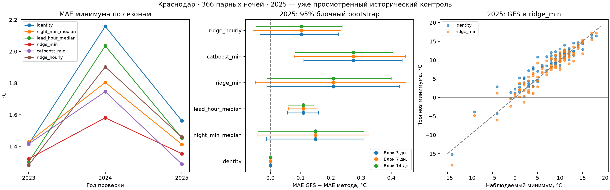

# Построение модели и качество: Краснодар, яблоня, заморозки

Сформировано 2026-10-12T15:19:39.901907+00:00. Исследовательский расчёт не меняет модель интерфейса.

## Основной результат

Выбор по прошлым сезонам: **ridge_min**. В историческом контроле 2025 MAE минимума 1.562 → 1.354 °C (13.3% снижения); пропуски 2 → 1 из 6, ложные тревоги 0 → 1. MAE холодных ночей 2.790 → 2.902 °C. 95% блочный диапазон выигрыша за 7 дней [-0.049, 0.449] °C; по этой малой выборке нет основания считать метод готовым к полевому применению.

CatBoost имеет меньшую среднюю ошибку на 2025, но он не выиграл заданный выбор на прошлых сезонах; переключение на него по историческому контролю означало бы подбор по уже просмотренному году. Средняя MAE, температура холодных ночей и обнаружение заморозка дают разные оценки полезности.

## Постановка и честность проверки

Цель — температура 2 м у станции 34929. Прогноз одного выпуска GFS 06 UTC на ночь 19–09 МСК; все методы получают одинаковые 14 часов. Ночные минимумы и почасовая температура — разные цели. Ridge/CatBoost для минимума предсказывают остаток `наблюдаемый минимум − минимум GFS`; они не сдвигают всю кривую. Отдельный Ridge обучен на почасовых остатках, его минимум получен из 14 прогнозов.

**2025 уже просмотрен в предыдущих отчётах и демонстрации. Это исторический контроль, не новый слепой тест.** Новые параметры зафиксированы в конфигурации до запуска этой серии; дополнительного поиска по 2025 нет. Выбор метода использует только прогнозы следующих сезонов: 2022 → 2023 и 2022–2023 → 2024. Полные ночи и холодные серии не разделяются случайно между обучением и проверкой. Средняя MAE объединённых валидационных ночей — критерий выбора; при равенстве берётся более простой метод по порядку конфигурации. Для исторического контроля все методы обучены только на 2022–2023, без дообучения на 2024.

## Признаки и параметры

12 признаков минимума: минимум, максимум, среднее, диапазон GFS; температуры начала и конца ночи; изменение за ночь; раннее охлаждение; утренний подъём от минимума; индекс часа минимума; sin/cos календарного дня. Год не является признаком. Это прогнозные значения, известные в выбранном выпуске, а не будущие измерения. Почасовой Ridge: текущая прогнозная температура, минимум/диапазон/изменение ночи, sin/cos дня и 14 индикаторов часа. Стандартизация Ridge обучается только на тренировочной части.

Ridge alpha=10.0, SVD. CatBoost: 200 деревьев, глубина 3, learning_rate 0.03, L2=10, MAE, фиксированный seed; без early stopping, eval_set и поиска гиперпараметров. Шесть кандидатов включают три прежние базы. Минимальная сетка намеренно ограничивает число попыток при 184 тренировочных ночах. Статическая высота/координаты одной станции не варьируются; прошлые измерения не включены из-за неизвестных лагов публикации.

## Проверка следующих сезонов

| Год | Обучение | Метод | MAE минимума °C | MAE холодных °C | Пропуски/холодных | Ложные тревоги | MAE часа °C |
|---|---|---|---:|---:|---:|---:|---:|
| 2023 | [2022] | identity | 1.415 | 3.973 | 2/3 | 0 | 1.288 |
| 2023 | [2022] | night_min_median | 1.427 | 2.901 | 1/3 | 1 | 1.842 |
| 2023 | [2022] | lead_hour_median | 1.302 | 3.458 | 1/3 | 0 | 1.263 |
| 2023 | [2022] | ridge_min | 1.321 | 2.606 | 1/3 | 1 | — |
| 2023 | [2022] | catboost_min | 1.416 | 2.609 | 1/3 | 1 | — |
| 2023 | [2022] | ridge_hourly | 1.282 | 2.959 | 1/3 | 1 | 1.183 |
| 2024 | [2022, 2023] | identity | 2.159 | 4.849 | 4/4 | 0 | 1.566 |
| 2024 | [2022, 2023] | night_min_median | 1.805 | 4.066 | 4/4 | 0 | 1.568 |
| 2024 | [2022, 2023] | lead_hour_median | 2.035 | 4.806 | 4/4 | 0 | 1.549 |
| 2024 | [2022, 2023] | ridge_min | 1.581 | 3.186 | 2/4 | 0 | — |
| 2024 | [2022, 2023] | catboost_min | 1.746 | 3.685 | 2/4 | 0 | — |
| 2024 | [2022, 2023] | ridge_hourly | 1.903 | 3.628 | 2/4 | 0 | 1.486 |

Выбран **ridge_min** по объединённой валидации: identity: 1.785 °C; night_min_median: 1.615 °C; lead_hour_median: 1.666 °C; ridge_min: 1.450 °C; catboost_min: 1.580 °C; ridge_hourly: 1.591 °C.

## Вклад признаков и переобучение

Абляция Ridge с тем же alpha=10: каждая группа обучена только на прошлых сезонах. Это дополнительная исследовательская диагностика после ранее просмотренного 2025; группы не участвуют в выборе победителя.

| Признаки остатка минимума | MAE 2023–2024 °C | MAE 2025 °C |
|---|---:|---:|
| gfs_min_only | 1.543 | 1.428 |
| calendar_only | 1.550 | 1.393 |
| profile_without_calendar | 1.493 | 1.403 |
| full_profile_and_calendar | 1.450 | 1.354 |

| Метод | MAE на обучении 2022–2023 °C | MAE 2024 °C |
|---|---:|---:|
| identity | 1.535 | 2.159 |
| night_min_median | 1.383 | 1.805 |
| lead_hour_median | 1.450 | 2.035 |
| ridge_min | 1.241 | 1.581 |
| catboost_min | 0.944 | 1.746 |
| ridge_hourly | 1.351 | 1.903 |

Разрыв обучения и следующего сезона включает и подгонку, и изменение погоды; его нельзя целиком приписать переобучению. Признаки температуры зависимы между собой; коэффициенты Ridge и встроенные важности CatBoost не доказывают причинное влияние факторов.

## Исторический контроль 2025

91 полная ночь, 6 холодных ночей в 3 последовательных сериях. Серии — описательная группировка, не доказательство независимости.

| Метод | MAE минимума °C | Bias °C | MAE холодных °C | MAE часа °C | Попадания | Пропуски | Ложные тревоги | Recall | Precision |
|---|---:|---:|---:|---:|---:|---:|---:|---:|---:|
| identity | 1.562 | 1.097 | 2.790 | 1.328 | 4 | 2 | 0 | 0.667 | 1.000 |
| night_min_median | 1.413 | 0.314 | 2.529 | 1.582 | 4 | 2 | 1 | 0.667 | 0.800 |
| lead_hour_median | 1.453 | 0.894 | 2.689 | 1.256 | 4 | 2 | 0 | 0.667 | 1.000 |
| ridge_min | 1.354 | 0.080 | 2.902 | — | 5 | 1 | 1 | 0.833 | 0.833 |
| catboost_min | 1.289 | 0.149 | 2.627 | — | 4 | 2 | 2 | 0.667 | 0.667 |
| ridge_hourly | 1.459 | 0.644 | 2.986 | 1.282 | 4 | 2 | 2 | 0.667 | 0.667 |

Прочерк MAE часа у моделей минимума означает отсутствие почасового прогноза. MAE часа у night_min_median описывает прежний диагностический сдвиг, не оптимизированный по часам. Recall/precision относятся к погодному порогу `<0 °C`; они не являются вероятностью повреждения яблони.

## Устойчивость выигрыша

Положительная разность MAE GFS − MAE метода означает улучшение. Парный bootstrap использует календарные блоки по 3/7/14 дней, 5000 повторов; пропущенная ночь не сжимает календарь. Пары остаются вместе. Это приближённая чувствительность к зависимости, не гарантия на новой станции/сезоне. Только один контрольный сезон, мало блоков и нет поправки на множественные исследовательские сравнения.

| Метод | Выигрыш °C | 95% диапазон, 3 дня | 7 дней | 14 дней |
|---|---:|---|---|---|
| identity | 0.000 | [0.000, 0.000] | [0.000, 0.000] | [0.000, 0.000] |
| night_min_median | 0.149 | [-0.012, 0.307] | [-0.042, 0.323] | [-0.041, 0.310] |
| lead_hour_median | 0.109 | [0.057, 0.159] | [0.059, 0.155] | [0.058, 0.144] |
| ridge_min | 0.208 | [-0.011, 0.426] | [-0.049, 0.449] | [-0.011, 0.400] |
| catboost_min | 0.273 | [0.111, 0.436] | [0.079, 0.447] | [0.081, 0.406] |
| ridge_hourly | 0.103 | [-0.035, 0.225] | [-0.058, 0.234] | [-0.048, 0.238] |



## Где модель ошибается

| Ночь | Факт °C | GFS °C | Сдвиг минимума °C | Ridge min °C | CatBoost min °C |
|---|---:|---:|---:|---:|---:|
| 2025-03-01 | -14.000 | -15.200 | -15.982 | -18.047 | -17.321 |
| 2025-03-02 | -4.000 | -4.256 | -5.038 | -5.991 | -5.088 |
| 2025-03-03 | -9.000 | -3.818 | -4.601 | -4.803 | -5.422 |
| 2025-03-04 | 2.000 | 0.247 | -0.535 | -1.257 | -0.074 |
| 2025-03-07 | -4.000 | 2.909 | 2.127 | 1.195 | 1.719 |
| 2025-03-18 | 1.000 | 1.518 | 0.736 | 0.158 | -0.094 |
| 2025-03-19 | -1.000 | -0.182 | -0.965 | -2.323 | -1.955 |
| 2025-03-20 | -1.000 | 1.374 | 0.592 | -0.343 | 0.098 |
| 2025-04-11 | 0.000 | 1.138 | 0.355 | 0.563 | 0.416 |

По месяцам, диапазонам прогнозного минимума, холодным сериям, часам и 10 крупнейшим ошибкам результаты сохранены в JSON. Диагностика по фактическому охлаждению выполняется после ночи и не входит в признаки.

Пропуск 7–8 марта сохраняется у всех шести методов: факт −4 °C, GFS +2.909 °C, Ridge +1.195 °C. Ridge распознаёт 20–21 марта (−0.343 °C вместо GFS +1.374 °C при факте −1 °C), но для экстремальной ночи 1–2 марта переохлаждает прогноз до −18.047 °C при факте −14 °C. Исходный минимум GFS −15.200 °C в эту ночь далеко за тренировочным диапазоном [-3.870, 18.718] °C. Это конкретный риск экстраполяции; однопараметрическая проверка диапазона ещё не является полноценным детектором сдвига данных.

На уровне последовательных холодных серий GFS и Ridge обнаруживают хотя бы одну ночь в 2 из 3 серий. Ночное улучшение 4/6 → 5/6 не означает дополнительной обнаруженной серии заморозков.

## Качество целей и чувствительность порога

- 2022: 92 парных ночей, холодных 18, минимум ровно 0 °C у 2; 100.0% принятых почасовых целей целочисленны; источники всех ожидаемых часов {'isd_lite': 1282, 'metar': 6} (модельные заполнения исключены); холодные месяцы {'03': 18}.
- 2023: 92 парных ночей, холодных 3, минимум ровно 0 °C у 2; 100.0% принятых почасовых целей целочисленны; источники всех ожидаемых часов {'isd_lite': 1268, 'metar': 20} (модельные заполнения исключены); холодные месяцы {'03': 2, '04': 1}.
- 2024: 91 парных ночей, холодных 4, минимум ровно 0 °C у 2; 100.0% принятых почасовых целей целочисленны; источники всех ожидаемых часов {'isd_lite': 1181, 'metar': 104, 'dwd_mosmix': 3} (модельные заполнения исключены); холодные месяцы {'03': 4}.
- 2025: 91 парных ночей, холодных 6, минимум ровно 0 °C у 2; 100.0% принятых почасовых целей целочисленны; источники всех ожидаемых часов {'isd_lite': 1271, 'metar': 16, 'dwd_mosmix': 1} (модельные заполнения исключены); холодные месяцы {'03': 6}.

Полнота и источник проверены, но исходные флаги качества независимого станционного ряда не восстановлены. Грубая дискретность у нуля делает разницу `<0` и `<=0` существенной. В JSON показана диагностика порогов −2/0/+1 °C с одинаковыми строгими условиями для факта и прогноза. Это проверка чувствительности, не выбор наиболее выгодного порога и не агрономические пороги.

## Температура и правило тревоги

Дополнительный запас в правиле тревоги не меняет прогноз температуры. Таблица ниже показывает для выбранного метода правило `прогноз < 0 + запас`, факт всегда `<0`. Запасы 0/1/2/3 °C заданы в конфигурации; их стоимость для хозяйства не установлена, оперативный запас не выбран.

| Запас °C | Пропуски 2023–2024 | Ложные тревоги 2023–2024 | Пропуски 2025 | Ложные тревоги 2025 |
|---|---:|---:|---:|---:|
| 0.0 | 3 | 1 | 1 | 1 |
| 1.0 | 2 | 3 | 1 | 6 |
| 2.0 | 1 | 8 | 0 | 11 |
| 3.0 | 0 | 13 | 0 | 15 |

Вероятности заморозка и интервалы температуры не публикуются: валидация уже участвует в выборе, и 4 холодные ночи 2024 недостаточны для убедительной отдельной калибровки. Bootstrap выше описывает метрику, а не диапазон прогноза отдельной ночи.

## Следующая версия модели

1. Добавить из того же заранее доступного выпуска ветер 10 м, точку росы/влажность 2 м и облачность; проверять единицы, слой, момент действия и S3 gate каждого параметра. Сравнить с температурными признаками отдельной абляцией. Текущие ошибки сами по себе не доказывают радиационный механизм или полезность этих признаков.
2. Сверить холодные ночи и нули с независимыми первичными наблюдениями/флагами QC. Записывать фактическую доступность измерений, прежде чем вводить вечерний станционный лаг.
3. Заранее закрепить критерий принятия: выигрыш по минимуму вместе с ограничением пропусков/ложных тревог, стоимость ошибок согласовать с агрономом. Сравнивать также почасовой метод и исходный GFS.
4. Собирать будущие выдачи и садовые измерения вместе с фазой яблони; новый сезон/другая станция должны стать свежей проверкой. 2025 больше не использовать как слепой тест. Аэропорт и сетка в 8.69 км не заменяют измерения цветков в саду.

## Воспроизведение

```powershell
.\.venv\Scripts\python.exe -m pip install -r requirements-model.txt
.\.venv\Scripts\python.exe -m agro_checker model-study --offline
```

Конфигурация: `config/model_study.json`. Вход — проверенный кэш исходных извлечений и наблюдений; сетевых запросов в команде нет. Фичи/прогнозы — `data/processed/model-study/`, обученные модели и закреплённый выбор до расчёта 2025 — `models/research/`. Хэши протокола, входов, исходного кода и версии пакетов: [MODEL_STUDY_SUMMARY.json](MODEL_STUDY_SUMMARY.json). Основные таблицы интерфейса и его модель не перезаписываются.

Документация: [CatBoostRegressor](https://catboost.ai/docs/en/concepts/python-reference_catboostregressor), [Ridge](https://scikit-learn.org/stable/modules/generated/sklearn.linear_model.Ridge.html), [временная проверка](https://scikit-learn.org/stable/modules/cross_validation.html#time-series-split).
