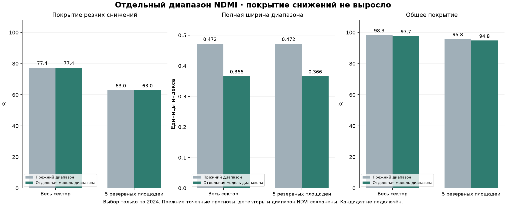

# Отдельная модель диапазона ошибки NDMI

Дата: 20 октября 2026. **Покрытие резких снижений на 2026 не улучшилось.** Выбранный по 2024 диапазон примерно на 22.5% уже при том же покрытии снижений, но это не выполнение задачи повысить надёжность на таких событиях. Рабочий диапазон не заменён. Прежние точечный прогноз, оба детектора и диапазон NDVI сохранены.

## Что зафиксировано

Прогноз среднего — прежняя temporal_ridge_100, обученная на 217 парах / 21 дате до 2024-07-21. Коэффициенты и прогнозы не заменялись моделью полного сезона из отклонённого эксперимента. Индекс NDMI отражает спектральное соотношение поверхности, а не фактическую влажность почвы или диагноз.

Сектор представлен неподтверждёнными обводками, пять резервных фрагментов R23–R27 исключены из обучения, выбора и калибровки. R18 по-прежнему не имеет достаточного ядра; целевая когорта — прежние 499 пар / 27 дат 2026 по 26 пригодным фрагментам. Это ранее изученная отложенная от подбора проверка, не новый слепой тест. 2025 отсутствует.

## Ошибки для обучения диапазона

Не использованы ошибки точечного прогноза на собственных обучающих примерах. Для ранних дат 2024 построены причинные прогнозы того же алгоритма с обучением только на target < issue. После 2024-07-21 использован именно прежний замороженный прогноз: он не видел этих целевых исходов. Получены 182 ранних ошибок причинных моделей и 236 ошибок замороженного среднего.

Ранние прогнозы относятся к моделям с меньшим обучением; перенос их ошибок на прежний замороженный прогноз приблизителен. Для внешней оценки августа–октября 2024 использован только замороженный точечный прогноз, не новые модели среднего. Внутри каждого блока ошибки обучения хвостов и калибровки имеют target до начала блока. Последние 8 известных дат — калибровка; из обучения диапазона исключены target, пересекающие её начало.

После выбора модель хвостов обучена на 270 ошибках / 24 датах, в том числе 55 снижениях на 16 датах, до target 2024-09-11. Калибровка отдельно: 132 ошибок / 8 дат, всего 6 снижений на 3 датах, до target 2024-10-14. Малое число дат не даёт надёжной оценки будущих экстремальных хвостов.

## Выбор только по 2024

До обучения сохранены 10 вариантов: прежний диапазон; шесть асимметричных оболочек с нижним квантилем .05/.10 среди резких снижений и дополнительным запасом 0/.025/.05; минимум ошибки на снижениях; условные хвосты с тройным весом снижений; сценарная модель нижнего хвоста на снижениях. Верхний хвост использует все исходы. Фактическое будущее снижение допустимо как метка обучения хвоста, но не передаётся модели при прогнозе. Сценарная модель не оценивает вероятность снижения.

Сравнение — одинаковые 194 пары / 14 дат внешних блоков августа, сентября и октября 2024: 11 снижений на 7 датах. Условия: общее покрытие и покрытие снижений ≥90% как в сумме, так и в каждом блоке с событиями; ширина ≤110% прежней. Среди прошедших — минимум interval score с тройным штрафным весом событий. Все параметры выбраны до запуска 2026.

| Вариант | Покрытие снижений | Полная ширина | Взвешенный score | Допуск по 2024 |
|---|---:|---:|---:|---|
| legacy | 100.0% | 0.472 | 0.549 | прошёл |
| event_q05_pad000 | 85.7% | 0.350 | 0.432 | pooled: decline; 2024-09-01: decline |
| event_q05_pad025 | 85.7% | 0.371 | 0.442 | pooled: decline; 2024-09-01: decline |
| event_q05_pad050 | 100.0% | 0.393 | 0.458 | прошёл |
| event_q10_pad000 | 78.6% | 0.342 | 0.433 | pooled: decline; 2024-09-01: decline |
| event_q10_pad025 | 85.7% | 0.364 | 0.442 | pooled: decline; 2024-09-01: decline |
| event_q10_pad050 | 85.7% | 0.385 | 0.452 | pooled: decline; 2024-09-01: decline |
| event_date_min | 85.7% | 0.351 | 0.433 | pooled: decline; 2024-09-01: decline |
| conditional_weight3 | 78.6% | 0.262 | 0.429 | pooled: decline; 2024-09-01: overall; 2024-09-01: decline |
| scenario_lower | 78.6% | 0.318 | 0.424 | pooled: decline; 2024-09-01: decline |

Выбран **event_q05_pad050**. Условные модели не прошли минимум покрытия; меньший запас вниз также не прошёл отдельный сентябрьский блок. Показанные 100% — всего 11 событийных пар, не доказательство гарантии. Прежний радиус сам калибровался на 2024, поэтому его 2024 показатели оптимистичны; это известный бюджет ширины, а не независимая проверка старого диапазона.

## Результаты замороженного варианта

| Проверка | Пар / дат | Покрытие снижений | Общее покрытие | Средняя полная ширина |
|---|---:|---:|---:|---:|
| 5 резервных, 2024 | 84 / 26 | 100.0% → 100.0% | 98.1% → 98.1% | 0.472 → 0.366 |
| Весь сектор, 2026 | 499 / 27 | 77.4% → 77.4% | 98.3% → 97.7% | 0.472 → 0.366 |
| Остальные 21, 2026 | 397 / 26 | 82.8% → 82.8% | 98.8% → 98.2% | 0.472 → 0.366 |
| 5 резервных, 2026 | 102 / 24 | 63.0% → 63.0% | 95.8% → 94.8% | 0.472 → 0.366 |

Все покрытия взвешены одинаково по датам, затем по площадям внутри даты. Для событийной подгруппы веса пересчитываются по её датам. Поэтому 77.4% не равно простой доле покрытых пар из 42. Площадь × дата не является независимым агрономическим происшествием; в 2026 всего 42 событийные пары на 16 датах, на резерве — 15 на 9 датах.

Полная ширина сократилась с 0.472 до 0.366, но те же 10 фактов по всему сектору остались ниже нижней границы. Добавились 4 выхода вверх (на резерве — 1); это промахи диапазона, а не новые тревоги детектора. Общее покрытие снизилось с 98.3% до 97.7% и осталось выше номинального ориентира 90%. Покрытие снижений не выросло ни на секторе, ни на резерве. Условия улучшения не выполнены.



## Почему цель не достигнута

Прежний диапазон имел запас ±0.236230. У выбранного варианта после калибровки запас вниз 0.236500, вверх 0.129807. Дополнительный запас вниз относительно старого — всего 0.000269 единицы NDMI. Выигрыш ширины получен почти полностью сокращением верхнего запаса. Таким способом нельзя устранить исходы, существенно выходящие ниже прежней границы; список нижних промахов действительно совпадает.

Критерии на 2024 отсеяли модели с недостаточным покрытием, но оставшихся 11 проверочных событий и 6 калибровочных снижений недостаточно для надёжного переноса хвоста на другой год. Более низкий общий interval score и меньшая ширина не заменяют проверки интересующей подгруппы. После оценки другой кандидат, запас или порог по 2026 не выбирался.

## Что сохранено в продукте

Прежний точечный прогноз совпадает на всех 499 парах с сохранёнными результатами. Оба детектора совпадают по каждой записи: ложные сигналы остаются 3 для NDVI и 2 для NDMI; новых попаданий нет. Для NDMI детектор по-прежнему пропускает 42 индексных снижения. Границы NDVI также совпадают с прежними. Нижняя граница NDMI не превращалась в тревогу или вероятность проблемы. В рабочий интерфейс новый диапазон не подключён.

Эксперимент даёт более узкий исследовательский диапазон при прежнем покрытии снижений, но **не подтверждает повышение надёжности нижнего хвоста NDMI**. Здесь «хвост» — редкие большие отрицательные ошибки индекса. Следующий протокол должен отдельно контролировать достаточность независимых дат сильных снижений и надёжность переноса хвоста; расширение данных не должно подменяться выдуманной культурой, операцией или осмотром.

## Проверки и воспроизведение

[Протокол](../data/farm-research/ndmi-error-only/protocol.json), [замороженный выбор](../data/farm-research/ndmi-error-only/frozen-selection.json), [результаты](../data/farm-research/ndmi-error-only/report.json), [независимая проверка](../data/farm-research/ndmi-error-only/verification.json). Сохранены исторические ошибки, внешние прогнозы 2024, таблица всех кандидатов и единственный вариант тестовых прогнозов.

Проверены: только 2024 в обучении и калибровке; исключение резервных ID; временное разделение; воспроизведение выбора; неизменные код/источники/коэффициенты между fit и evaluate; совпадение когорты, точек, детекторов и границ NDVI; одинаковые случаи нижних промахов. Побайтно сохранены 2720 прежних файлов, включая предыдущий отклонённый эксперимент; FieldStore 198 файлов. Реальных наблюдений не добавлено.

```text
.venv/Scripts/python.exe -X utf8 scripts/train_ndmi_error_only.py protocol
.venv/Scripts/python.exe -X utf8 scripts/train_ndmi_error_only.py fit
.venv/Scripts/python.exe -X utf8 scripts/train_ndmi_error_only.py evaluate
.venv/Scripts/python.exe -X utf8 scripts/verify_ndmi_error_only.py
.venv/Scripts/python.exe -X utf8 scripts/report_ndmi_error_only.py
```

Fit заблокирован после замораживания и теста. Повторные проверка и отчёт не переобучают модель. Результат остаётся исследовательским: нет точной условной гарантии, новых подтверждённых границ и проверки агрономической пользы.
