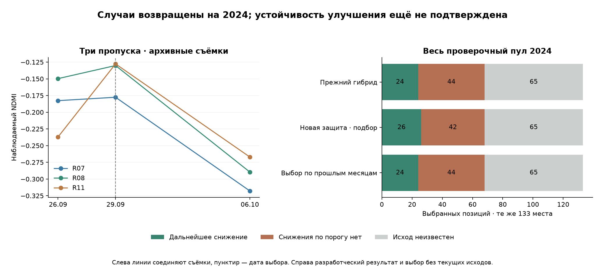

# Пропуски NDMI 29 сентября: диагностика и защита ранжирования

21 октября 2026. **На разработческом 2024 новая защита вернула R07, R08 и R11 без увеличения известных ложных выборов: 26 событий / 42 отрицательных вместо 24 / 44, неизвестных по-прежнему 65.** Но она изменила выбор лишь на одной уже разобранной дате. Выбор настроек по более ранним месяцам её не подтвердил: остался прежний результат 24 / 44 / 65. В рабочий продукт изменение не перенесено.

## Что произошло на трёх площадях

29 сентября → 6 октября NDMI снизился на 0,139–0,159, тогда как NDVI почти не изменился. Перед выбором наблюдалась обратная картина: NDVI немного снижался, NDMI рос.

| Фрагмент | Индексы 29 сентября: NDVI / NDMI | Предшествующий недельный темп: NDVI / NDMI | ΔNDMI после выбора | ΔNDMI по 11 сценариям границ |
|---|---:|---:|---:|---:|
| R07 | 0.154 / -0.178 | -0.021 / +0.012 | -0.140 | -0.140…-0.130 |
| R08 | 0.178 / -0.130 | -0.022 / +0.046 | -0.159 | -0.159…-0.143 |
| R11 | 0.187 / -0.128 | -0.087 / +0.255 | -0.139 | -0.139…-0.121 |

Все текущие и целевые ядра имеют 100% покрытия. Все 11 сценариев границ подтверждают последующее снижение NDMI ниже −0,10. Это проверка геометрической устойчивости спутникового исхода, не доказательство повреждения/дефицита воды/необходимости осмотра.

Недельный темп пересчитан с фактического трёхдневного интервала 26–29 сентября. В частности, +0,255 у R11 — темп, а не наблюдённое изменение ровно за неделю: фактический прирост NDMI около +0,109. На R07/R08 он значительно меньше. Объединять эти три случая в одну агрономическую причину без полевых данных нельзя.

## Почему гибрид их заменил

Прежний гибрид начинал с трёх мест простого правила и защищал их только при недельном темпе снижения от 0,20. Здесь оценки простого правила были 0,021 / 0,022 / 0,087 — ни одна защита не сработала. Они всё равно оказались первыми в простом правиле, потому что у остальных площадей на этой дате снижение было ещё слабее.

Дальше замены шли по оценке ExtraTrees:

| Замена | Преимущество оценки ExtraTrees | У выбранного вместо него случилось снижение |
|---|---:|---|
| R07 → R16 | +0.0916 | да |
| R11 → R19 | +0.0398 | нет |
| R08 → R05 | +0.0036 | нет |

Оценки классификатора не являются проверенными вероятностями повреждения/пользы выезда. Разница всего +0,0036 также могла заменить место, потому что отдельной защиты от слабого преимущества не было.

Модель сентября обучалась на 325 завершённых парах, 29 датах и 69 положительных примерах до 1 сентября. Восстановленные позднее исходы не использованы для её переобучения. Точная сумма вкладов путей всех 256 деревьев воспроизвела сохранённые внеобучающие оценки. У R11 рост NDMI на общих пикселях уменьшал оценку примерно на 0,0173, а положительный 30-дневный тренд NDMI — на 0,0094. Это алгебраическое объяснение оценки, не физическая причина будущего снижения.

Модель искала событие «снизился хотя бы один индекс», а не специально разворот NDMI. R16 действительно снизился по NDVI на 0,190 и был верным выбором; R19/R05 порогового снижения не имели. Поэтому ошибка здесь — состав ограниченной очереди, а не отсутствие всех верных прогнозов.

## Что изменено в отдельном исследовании

Сохранены прежние сильные сигналы и добавлены гипотезы защиты **только по известным на дату выбора входам**:

- при слабом сигнале всей очереди сохранять исходные три места;
- сохранять исходное место при расхождении NDVI↓ / NDMI↑, устойчивом по всем 11 геометрическим сценариям;
- дополнительно проверить условия отрицательного NDMI / NDVI до 0,30;
- требовать большего преимущества оценки для замены;
- сочетать слабый сигнал всей очереди и устойчивое расхождение обоих индексов во всех трёх исходных местах.

Последний вариант `weak_divergent_round` выбран как разработческое исправление. Он сохраняет три исходных места, когда **максимальная** оценка недавнего снижения во всём доступном списке меньше 0,10 и у всех трёх исходных мест NDVI снижается, а NDMI растёт на общих пикселях во всех вариантах границ. Никаких условий по R07/R08/R11 или по 29 сентября в функции выбора нет. 0,10 — исследовательский порог индекса, не агрономический норматив.

Все варианты используют тот же лимит до трёх площадей/дату, детерминированные совпадения оценок, те же 699 кандидатов и 133 выбранные позиции. Порог события −0,10, окно 6–8 дней, входы, исходный ExtraTrees, точечные модели, детекторы и диапазоны не менялись.

## На каких данных выбирали

Использован консервативный набор: **368 известных / 331 неизвестный исход на 699 кандидатах 2024**. 94 цели за границами месяцев доступны для новой разработки 2024; прежние прогнозы и месячное обучение не пересчитывались. Все три цели дополнительных плиток оставлены неизвестными, в том числе два случая с конфликтом облачных масок. Проверка не получает выгоды от спорной новой разметки.

Гипотезы возникли после разбора сентября, поэтому итог по всему 2024 — **разработческая оценка с повторным использованием данных**, а не независимый тест. Это разрешённый подбор по 2024, но нельзя выдавать его за доказанную точность будущего сезона. Данные/исходы 2025–2026 в этом этапе не анализировались. Пространственный резерв R23–R27 не участвует.

## Все зафиксированные варианты

| Вариант | События | Отрицательные | Неизвестно | Потеряно находок простого правила | Парная разница к прежнему гибриду, п.п. | Максимальный прирост отрицательных к гибриду |
|---|---:|---:|---:|---:|---:|---:|
| `baseline` | 19 | 49 | 65 | 0 | -16.67…+9.42 | +23 |
| `extra` | 24 | 44 | 65 | 7 | -7.97…+7.97 | +11 |
| `old_hybrid` | 24 | 44 | 65 | 3 | +0.00…+0.00 | +0 |
| `weak_round_0.05` | 24 | 44 | 65 | 3 | -3.62…+3.62 | +5 |
| `weak_round_0.1` | 25 | 43 | 65 | 0 | -4.35…+5.80 | +6 |
| `weak_round_0.2` | 21 | 45 | 67 | 0 | -9.42…+6.52 | +13 |
| `divergent` | 25 | 44 | 64 | 0 | -1.45…+2.17 | +2 |
| `divergent_negative_ndmi` | 25 | 43 | 65 | 0 | +0.00…+1.45 | +0 |
| `divergent_low_ndvi` | 25 | 43 | 65 | 0 | +0.00…+1.45 | +0 |
| `weak_divergent_round` | 26 | 42 | 65 | 0 | +1.45…+1.45 | -2 |
| `margin_0.1` | 22 | 45 | 66 | 0 | -11.59…+9.42 | +16 |

Проверка исправления требует сохранить каждый известный положительный случай простого правила, не уменьшить число событий прежнего гибрида, не увеличить известные отрицательные относительно обоих и пройти неблагоприятные сценарии неизвестных исходов против прежнего гибрида со строго положительной нижней парной разницей. Из прошедших выбирается максимальная нижняя разница, затем меньше отрицательных, затем заранее заданный порядок.

Это **отдельно** от более строгого общего допуска, который требует доказать выигрыш также против простого правила с учётом его несовпадающих неизвестных исходов. У выбранного исправления первый критерий выполнен, общий — нет. Исследовательский выбор не заменяет рабочий допуск.

## Что именно улучшилось, а что потеряно

По всему 2024: прежний гибрид **24 / 44 / 65**, исправленный **26 / 42 / 65**. Сохранены все 19 известных находок простого правила и четыре ранее возвращённых июньских случая. Все 65 выбранных неизвестных совпадают **по идентичностям**, а не только по количеству.

Изменена **ровно одна дата**: R07/R08/R11 заняли места R16/R19/R05. Возвращены три известных положительных случая, удалены один положительный и два отрицательных. При лимите три места невозможно одновременно сохранить все четыре верных случая R07/R08/R11/R16. Нельзя заявлять «добавили три без потери других находок».

Парная разница к старому гибриду равна **+1.45 п.п.** с равным весом дат; нижний и верхний сценарии пропусков совпали, потому что все изменённые места имеют известные исходы. Максимальный прирост отрицательных равен **-2**, то есть на этом наборе отрицательных на два меньше. Это арифметическое свойство сравнения на 2024, не статистическая гарантия будущего эффекта.

Против простого правила неизвестность всё ещё допускает **-7.97…+18.12 п.п.**, возможный рост отрицательных до 11. Эти сценарии не являются доверительными интервалами. Общий допуск не пройден.

## Проверка с выбором настроек только по прошлым месяцам

Для каждого месяца июнь–октябрь правило выбиралось заново по более ранним входным пулам, с известными целями строго до начала этого месяца. Кандидаты с отсутствующей/ещё не наступившей целью оставались в списках с `unknown`; не удалялись ради более красивой метрики. Требовались минимум 20 известных случаев на пяти датах. Если условия улучшения не выполнялись, оставался прежний гибрид.

**Ни на одном месяце новая защита не была выбрана.** Итог такого порядка: **24 события / 44 отрицательных / 65 неизвестных**, а три сентябрьских случая всё ещё потеряны. Новое условие изменяет очередь только на 29 сентября, а исходы этой даты получены 6 октября и не могли выбрать настройку ни к 1 сентября, ни к 1 октября.

Эта проверка препятствует прямому выбору по текущим исходам. Но и её нельзя назвать слепым тестом идеи, поскольку сама гипотеза защиты придумана после просмотра сентября. Она показывает отсутствие подтверждения по более ранней истории, а не устанавливает, что правило обязательно бесполезно.

## Решение

Есть небольшой объяснимый кандидат, который сохраняет эти три снижения без роста отрицательных **на разобранном 2024**. Заморожен исследовательский вариант и его точный список; рабочий продукт не изменён. Для следующей проверки следует заранее зафиксировать это правило и оценивать на новом сезоне/независимом наборе все выбранные и контрольные места. Нельзя продолжать менять правило по 2025–2026 или считать неизвестные исходы отрицательными ради допуска.

Причины изменения NDMI, культура, операции и реальная полезность осмотра не размечены. Снижение NDMI не превращено в автоматический диагноз или вымышленный результат посещения.

## Воспроизведение и сохранность

`scripts/train_ndmi_turn_guard.py protocol|run`, `scripts/verify_ndmi_turn_guard.py`, `scripts/report_ndmi_turn_guard.py`. Повторный `run` после заморозки запрещён. Заморозка `1be87ad6d83b64126103a91ba4bbc32860e65c8f0c1b6d09e2e72634b5ab72bb`.

Данные в `data/farm-research/ndmi-turn-guard-2024/`: протокол, все варианты, точные замены/вклады модели, последовательная проверка, исследовательский список и верификация. Это не назначения осмотров. Все `actual_visit` остаются пустыми; задач не создано.

**188 целевых тестов прошли, включая 16 новых.** Проверены исходный гибрид, все 11 вариантов, те же 133 позиции, точные обмены и совпадение неизвестных, консервативные метки, устойчивость к подмене будущих исходов, настройки только по прошлым месяцам, неизменность 2432 прежних защищённых файлов. Производственные модели, диапазоны, интерфейс и журнал сохранены.
