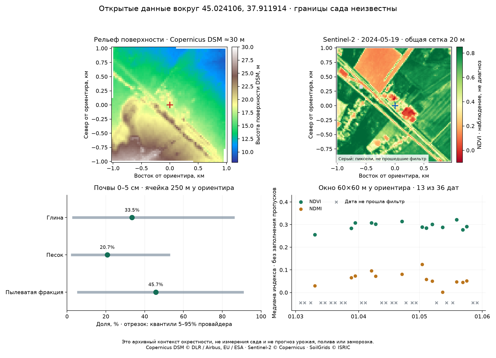

# Открытые данные вокруг ориентира: что пригодно для продукта

Проверено 18 октября 2026 года. Опорная точка **45.024106, 37.911914** — подтверждённый пользователем ориентир; название и границы хозяйства будут уточнены у агронома. Области выборки ниже не являются границами сада.

**Результат:** без местных датчиков можно строить картографический контекст и спутниковую историю поверхности с контролем качества. Для этой окрестности фактически получены DEM, почвенные оценки с квантилями и пиксели 36 сцен Sentinel-2. Это не подтверждает качество прогноза заморозка, урожая, болезней или потребности в поливе. Модели и исходный детектор не менялись.

## Что можно включить в продукт

|Функция|Что уже проверено на данных|Что обещать пользователю|Граница применимости|
|---|---|---|---|
|Карта высот поверхности|Copernicus DSM GLO-30, реальный растровый фрагмент около2×2км|Показать опубликованные высоты и крупные перепады, помочь выбрать места осмотра|Поверхность включает деревья/здания; это не геодезическая съёмка, не карта холодных карманов|
|Предварительная почвенная справка|30 растров SoilGrids:5 свойств×2 глубины×3 статистики, сетка250м|Показать внешнюю модельную оценку вместе с широким диапазоном провайдера|Не лабораторный анализ, не сегодняшняя влажность; не назначать дозу удобрений/полива|
|Спутниковая история NDVI/NDMI|Пиксели всех36 доступных сцен весны2024, фильтр качества и пропуски|Показать пространственные различия и даты наблюдений поверхности; подсказать зоны для осмотра|Индекс не устанавливает причину изменения, сорт, болезнь, заморозок или урожайность|
|Показ качества и свежести|Дата съёмки, версия обработки, облачная маска, исходные URL и контрольные суммы|Честно показывать «нет пригодного наблюдения», вместо ложного обновления каждый день|Маска сама алгоритмическая; она не гарантирует идеального удаления облаков|
|Сводка по подтверждённому полигону|Техническая извлекаемость пикселей проверена; полигон пока неизвестен|После получения контура считать распределения по его внутренним пикселям|Сейчас сводка по всему саду не вычислена; для узких рядов и границ будут смешанные пиксели|

Рабочий результат — архивный прототип такого модуля данных, с изображением, JSON-сводкой и проверяемыми исходниками. Архивные карты подключены к отдельному разделу [полевого интерфейса](LAND_UI.md); оперативные предупреждения ими не изменены. «Зоны для осмотра» здесь — описательные различия снимка, не автоматический диагноз.

## Рельеф: фактические значения и ограничения

Скачан публичный [Copernicus DEM GLO-30](https://registry.opendata.aws/copernicus-dem/), файл25357882байт, выпуск2021 по описанию зеркала. Это DSM — модель поверхности с растительностью и сооружениями. [Описание поставщика и лицензия](https://copernicus-dem-30m.s3.amazonaws.com/readme.html).

Вырезка: 65×91 ячеек, около2×2км вокруг ориентира. Высота в ячейке ориентира **20.1м**, минимум–максимум контекста **9.2–28.8м**. Медиана высоты контекста 16.4м. Значения относятся к растру, их десятые доли не означают такую полевую точность.

В этом тайле угловая сетка около 21.9×30.9м. Дополнительная расчётная сетка UTM30м использует билинейную интерполяцию, а не новые измерения. Медиана/90-й перцентиль наклона поверхности — 0.59° / 2.02°; это производные DSM, включая влияние зданий и растительности.

Крупные перепады полезны для подготовки обследования. Но из них не получена температурная поправка: не доказаны холодные низины, дренаж воздуха, риск затопления или распределение воды в саду. Для таких выводов нужны соответствующие цели проверки, границы и сведения о препятствиях/каналах.

## Почвы: полезен диапазон, а не одна точная цифра

Официальный [WCS ISRIC](https://docs.isric.org/globaldata/soilgrids/WCS_from_Python.html) реально вернул30 GeoTIFF. Окно9×9 нативных ячеек250м — примерно2.25×2.25км. Оно выровнено по DescribeCoverage в Homolosine WGS84, без запроса искусственной сетки10м. В центре использована одна содержащая ориентир ячейка; по всем81 ячейкам сохранён контекст. Единицы преобразованы по [таблице ISRIC](https://docs.isric.org/globaldata/soilgrids/SoilGrids_faqs_01.html), неизвестные/отрицательные значения не приняты.

У полученного DescribeCoverage в общем поле `uom` стоит единица радиационного потока, не относящаяся к clay. Она не использована для интерпретации почвы: преобразование основано на зарегистрированном имени свойства и официальной таблице ISRIC. Это одна из причин проверять смысл метаданных, а не доверять любому автоматически возвращённому полю.

|Глубина|Свойство|Оценка в ячейке ориентира|Квантили5–95% в этой ячейке|Разброс средних оценок по контексту|
|---|---|---:|---:|---:|
|0-5cm|Глина, %|33.5|2.6–86.4|32.0–36.7|
|0-5cm|Песок, %|20.7|2.0–53.1|18.6–21.9|
|0-5cm|Пылеватая фракция, %|45.7|5.2–91.0|42.8–48.3|
|0-5cm|pH в воде|6.8|5.3–8.2|6.6–6.9|
|0-5cm|Органический углерод, г/кг|48.2|5.8–167.2|47.5–56.8|
|15-30cm|Глина, %|36.9|1.9–87.5|34.9–40.3|
|15-30cm|Песок, %|18.4|2.2–49.6|16.6–19.9|
|15-30cm|Пылеватая фракция, %|44.7|2.7–91.3|41.2–47.1|
|15-30cm|pH в воде|7.0|5.3–8.4|6.6–7.1|
|15-30cm|Органический углерод, г/кг|21.6|3.2–51.1|17.0–28.9|

Это предсказания внешней почвенной модели. Квантили задают её номинальный90% прогнозный диапазон; местное покрытие этого диапазона по пробам почвы не проверено. Последний столбец — пространственный разброс модельных средних, а не дополнительный доверительный диапазон. Квантили разных фракций нельзя складывать в состав одной конкретной пробы.

Пример: глина33.5% при диапазоне2.6–86.4% — слишком неопределённая оценка, чтобы уверенно выбрать по ней технологический режим. Справку с таким диапазоном можно показать агроному для планирования проверки. Нельзя подавать её как уже установленный состав сада. Органический углерод не превращался в «гумус» постоянным коэффициентом.

Свойства почвы не являются временным рядом её влажности или анализом питания растений. Текущую влажность корнеобитаемого слоя, потребность в азоте, дозу полива и экономию воды по этим картам не вычисляем. У WCS нет подтверждённого номера единой неизменной редакции всех слоёв: сохранены полученные18октября байты/SHA, но не доказана доступность этой версии для исторического прогноза2023–2024.

## Спутники: пиксели получены, облачные пропуски сохранены

Источник — [Earth Search Collection1 Sentinel-2 L2A](https://github.com/Element84/earth-search/blob/main/docs/collections/sentinel-2-l2a.md). Пагинация пройдена до пустой второй страницы: **36 сцен**, а не только первые результаты каталога. Из каждой реально прочитаны B04, B08, B11 и SCL на окне около2×2км: **144 растровые вырезки**. Локально сохранены исходные цифровые значения этих вырезок и их SHA, ссылка на полный объект, ETag/размер/LastModified до и после чтения. Полный checksum COG взят из метаданных и явно помечен как непроверенный, поскольку весь многомегабайтный объект не скачивался. Проверяем SHA именно локальной вырезки, а не выдаём его за хэш полного спутникового файла.

Общая сетка20м: B04/B08 с10м усредняются2×2 только при наличии всех дочерних пикселей; B11/SCL остаются нативными20м. [Маска SCL](https://documentation.dataspace.copernicus.eu/APIs/SentinelHub/Data/S2L2A.html) допускает классы4/5, исключая воду, снег, облака, тени и неопределённые классы. Добавлен запас1 ячейка вокруг исключённых пикселей; невалидные края также скрыты. Облачность всей плитки не заменяет проверку конкретного места. Маска — консервативный рабочий фильтр, не независимо проверенная истина об облаках.

Коэффициенты scale/offset прочитаны из STAC, сверены с заголовком TIFF и применены один раз. На пробе24мая2024 Collection1 содержит red2224/nir2516, scale0.0001, offset−0.1: отражения0.1224/0.1516. Старое зеркало возвращало1224/1516 уже после вычитания1000. Повторно применив−0.1, можно было бы получить неверный NDVI. В новой выборке старые и новые коллекции не смешиваются; неоднозначная поправка отвергается.

NDVI=(B08−B04)/(B08+B04), NDMI=(B08−B11)/(B08+B11) на отражательной способности. Это спектральные показатели, а не проценты влажности почвы. Положительные отражения и наличие данных проверены до расчёта. Для временной иллюстрации используется медиана окна **60×60м возле ориентира**, минимум5 из9 пригодных ячеек и пригодный центральный пиксель. Это окрестность ориентира, **не среднее по хозяйству**.

По этим правилам пригодны **13 из36 дат**, не приняты 23. Самый длинный промежуток между пригодными съёмками — **около 18 дней**. Ряды не интерполированы и не соединены на графике через пропуски. Скачанное число сцен не означает ежедневную видимость участка.

Диапазон медианы NDVI60м: 0.255–0.321; NDMI: 0.002–0.124. Интерпретировать это как состояние яблонь нельзя: точка не подтверждена внутри сада, окна могут содержать здания, дороги и разные культуры. Изменение индекса также не доказывает водный стресс или повреждение заморозком.

|Дата съёмки2024|SCL в центре|Пригодных ячеек в окне60м|Результат|NDVI60м|NDMI60м|
|---|---:|---:|---|---:|---:|
|2024-03-03|9|0/9|не принята|—|—|
|2024-03-05|8|0/9|не принята|—|—|
|2024-03-08|9|0/9|не принята|—|—|
|2024-03-10|5|9/9|принята|0.255|0.030|
|2024-03-13|9|0/9|не принята|—|—|
|2024-03-15|9|0/9|не принята|—|—|
|2024-03-18|9|0/9|не принята|—|—|
|2024-03-20|7|0/9|не принята|—|—|
|2024-03-23|9|0/9|не принята|—|—|
|2024-03-25|10|0/9|не принята|—|—|
|2024-03-28|5|9/9|принята|0.284|0.065|
|2024-03-30|5|9/9|принята|0.308|0.074|
|2024-04-02|10|0/9|не принята|—|—|
|2024-04-04|10|0/9|не принята|—|—|
|2024-04-07|5|9/9|принята|0.308|0.096|
|2024-04-09|5|9/9|принята|0.303|0.072|
|2024-04-12|10|0/9|не принята|—|—|
|2024-04-14|9|0/9|не принята|—|—|
|2024-04-17|8|0/9|не принята|—|—|
|2024-04-19|9|0/9|не принята|—|—|
|2024-04-22|5|9/9|принята|0.315|0.081|
|2024-04-24|8|0/9|не принята|—|—|
|2024-04-27|10|0/9|не принята|—|—|
|2024-04-29|9|0/9|не принята|—|—|
|2024-05-02|5|9/9|принята|0.290|0.124|
|2024-05-04|5|9/9|принята|0.285|0.058|
|2024-05-07|5|9/9|принята|0.301|0.051|
|2024-05-09|10|0/9|не принята|—|—|
|2024-05-12|5|9/9|принята|0.288|0.002|
|2024-05-14|9|0/9|не принята|—|—|
|2024-05-17|9|0/9|не принята|—|—|
|2024-05-19|5|9/9|принята|0.321|0.048|
|2024-05-22|5|9/9|принята|0.277|0.046|
|2024-05-24|5|9/9|принята|0.291|0.052|
|2024-05-27|10|0/9|не принята|—|—|
|2024-05-29|9|0/9|не принята|—|—|

Все эти снимки архивные, за весну2024. Даты съёмки/обработки/создания каталожной записи/изменения объекта/получения хранятся раздельно. Новая выгрузка не доказывает, что именно эта обработанная версия была доступна до исторической ночи. **Данные не подставлены в обучение прогнозов и не улучшали заявленные метрики моделей.**

## Какие обещания обоснованны

Можно обещать показать источник, дату и разрешение карты, воспроизводимый расчёт индексов и явное отсутствие пригодного снимка. После подтверждения контура можно технически повторить извлечение по его внутренней части и показывать пространственные различия для осмотра. Дополнительные датчики для самого расчёта этих карт не нужны.

Нельзя пока обещать локальную точность ночной температуры, температуру цветков, надёжное начало/длительность заморозка, влажность почвы в корнях, обнаружение болезни, урожайность, сохранённый урожай или правильную дозу защиты. Для проверки этих целей нужны соответствующие независимые факты: собственные записи агронома, анализы, осмотры, урожайные журналы или приборы. Это не обязательно всегда новые датчики, но обязательна связь результата с реальной проверяемой целью. Ни большая ML-модель, ни количество открытых слоёв этого не заменяют.

Практический следующий шаг без приборов: получить контур, повторить качественную спутниковую выборку по внутренним пикселям, показывать даты и долю покрытия, дать агроному отметить на карте реальные различия и причины. Автоматические диагнозы/тревоги не выпускать до отдельной проверки. Подбор моделей остаётся отдельным опытом по заранее фиксированным годам, без настройки по2025–2026.

## Техническая надёжность и воспроизведение

- Извлечение: `agro_checker/open_land_data.py`; [протокол](../config/open_land_audit.json); необязательные зависимости [requirements-geodata.txt](../requirements-geodata.txt). Reporting-only `open_land_report.py` не меняет исходники данных.
- [JSON-сводка](OPEN_LAND_SUMMARY.json) содержит фактические значения, все36 дат, причины непригодности, источники и проверочные хэши. Кэш: `data/working-zone-01/open-land/`.
- Хэш манифеста аудита `13866acbd1ffd686af59215e0c34c12adecac0fc71afce9fa4899ca5d0e3cbbd`. Исходники/протокол/сырые файлы/локальные вырезки проверяются по SHA; повтор работает из кэша, без скрытого обновления карт. Для новой даты/версии — отдельный снимок данных.
- Тесты: **478 Python +20 JavaScript =498 прошли**, включая8 новых проверок CRS/выравнивания, единиц, единичной поправки отражения, дочернего nodata, соседства облаков, воды/снега. Это проверки обработки, не полевая валидация качества глобальных карт.
- Источники бесплатны для доступа, но стабильность внешних API и своевременность снимков не гарантированы. Кэш и явная отметка свежести обязательны для продуктовой интеграции. Публичный показ должен сохранять указания источников и необходимые уведомления: [условия Copernicus DEM](https://copernicus-dem-30m.s3.amazonaws.com/readme.html), [описание доступа SoilGrids](https://docs.isric.org/globaldata/soilgrids/SoilGrids_faqs_02.html), [Sentinel-2 COG](https://registry.opendata.aws/sentinel-2-l2a-cogs/).
- Прежние point/detector/range и научные выборы не изменены. Новых целей на участке, выдач и метрик поля не добавлено.

Запуск: `.venv\Scripts\python.exe -X utf8 -m agro_checker.open_land_report`.
