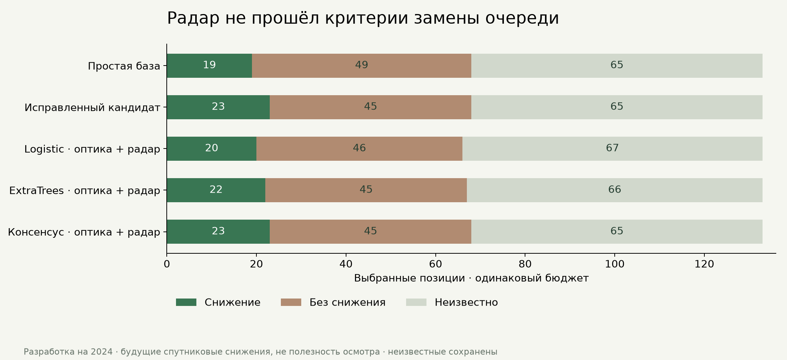

# Sentinel-1 для сектора: данные собраны, улучшение очереди не подтверждено

9 ноября 2026. Выполнены три части: сбор и аудит радарных данных, отдельный опыт
по приоритету на 2024 и проверка работы будущих выпусков. **Рабочие модели,
детектор, точечные прогнозы и зафиксированный будущий эксперимент сохранены.**

[Читаемый отчёт](../data/farm-research/radar-priority-2024/index.html) ·
[Полные результаты](../data/farm-research/radar-priority-2024/report.json) ·
[Протокол до обучения](../data/farm-research/radar-priority-2024/protocol.json) ·
[Радарные ряды всех площадей, CSV](../data/farm-research/sentinel1-2024/sector-series.csv) ·
[Хеши артефактов](../data/farm-research/radar-priority-2024/artifact-manifest.json).

## Доступность и качество

Microsoft Planetary Computer RTC: **102 сцены 2024**, все VV/VH-вырезки загружены
без аккаунта. Перечень исходного Earth Search GRD содержит **120** записей: 18
исходных съёмок отсутствуют в RTC. Оба каталога выгружены до конца пагинации;
снимки, исходные URL и хеши сохранены. Токены временного доступа не сохраняются.
Источники: [каталог RTC](https://planetarycomputer.microsoft.com/api/stac/v1/collections/sentinel-1-rtc),
[правила анонимного доступа](https://planetarycomputer.microsoft.com/docs/concepts/sas/),
[официальные предупреждения качества](https://sar-mpc.eu/disclaimers/).

Четыре серии Sentinel-1A: относительные орбиты **21 и 94 — нисходящие**, **43 и 116 —
восходящие**. Съёмки разных серий не образуют пару изменения. Использована фактическая
геопривязка TIFF: STAC-transform некоторых сцен отличается от самого растра.
Линейная мощность gamma0 усреднена до прежней сетки 20 м; значения в отчётах — dB.
Это обратное рассеяние, не NDMI и не измеренная влажность почвы.

Сохранены 27 приблизительных обводок и 11 сценариев смещения. Порог ядра прежний:
минимум 10 ячеек и 80% совместной пригодности. По 26 обводкам есть пригодные ядра;
**R18 не проходит геометрический минимум**. Число пригодных сцен различается по площади.
В CSV есть все 2754 сочетания сцены и обводки, включая пропуски.

Для всех **699 прежних входных кандидатов** удалось найти допустимую радарную пару.
Возраст позднего входа — 0,355–7,847 суток на конец даты выпуска. Дельты считаются
на общих пригодных пикселях, без интерполяции; неполная поддержка сценариев явно
отмечена. Это не восстанавливает **331 неизвестный будущий оптический исход**.

## Проверка качества по ESA

После фиксации модельного результата выгружен весь список 428 quality disclaimers
SAR-MPC. Прочитаны 12 месячных RFI-отчётов за 2024. Список и исходные PDF сохранены.
Совпадение определялось по шаблону исходной GRD-съёмки либо той же платформе,
режиму, абсолютной орбите, datatake и существенному перекрытию времени съёмки.
Различаются точное совпадение шаблона приобретения GRD и перекрытие других типов продукта.

**13 из 102 сцен имеют потенциальный риск исходного RFI-продукта**. Они участвовали
в **273 из 699** радарных входных пар. Например, исходная съёмка 14 сентября
15:28:18 UTC есть на стр. 19 отчёта #244. Соответствие проверено и визуально.

Это **не доказательство помех на пикселях хозяйства**. ESA отмечает неполноту списков
и возможное поражение лишь части сцены. Не вошедшие в список 89 сцен также имеют
неподтверждённый статус, а не сертификат чистоты. Провайдер RTC не даёт достаточной
попиксельной оценки остаточного RFI. Не установлено, относятся ли помехи к нашему ядру
и в какой мере они повлияли на модельный результат.

[Совпадения с PDF, страницы и исходные имена](../data/farm-research/sentinel1-2024/quality/scene-risk.json) ·
[PDF и их источники](../data/farm-research/sentinel1-2024/quality/rfi-reports.json).

Проверка качества не меняла метки, маски, входной пул, обученные модели и оценки.
Сохранены также неудачная попытка загрузки страниц без завершающего `/` и протоколы
парсеров до поддержки разных wildcard-шаблонов PDF. В доказательствах используются
валидированные канонические страницы и PDF; пустые HTTP-redirect ответы не считаются источником.

## Эксперимент

Те же 699 входов / 46 дат, 368 известных и 331 неизвестный исход, 133 выбора.
Резерв R23–R27 не участвует в обучении/выборе. Цель прежняя: будущее снижение
ядра NDVI либо NDMI на 0,10 через 6–8 дней; это не повреждение посевов и не польза визита.

Добавлены 14 признаков: уровни VV/VH и их отношение, изменения по общей маске,
возраст и интервал пары, пригодность, чувствительность к границам и индикаторы
отсутствия данных/направления. Возраст максимум 18 суток, предыдущая съёмка 4–36
суток ранее — зафиксировано до запуска, без поиска по целевым результатам.
Пары сравниваются внутри одной орбиты, однако абсолютные VV/VH-уровни не приведены
к общей межорбитальной норме. Это дополнительное ограничение текущего опыта;
его вклад в результат отдельно не установлен.

Logistic Regression и ExtraTrees имеют прежние параметры. В пяти блоках июнь–октябрь
обучение допускает только законченные цели `target < начало месяца`. Оптические
контрольные модели воспроизвели сохранённые OOF-оценки. Дополнительно проверен
консенсус с прежними защитами сильных сигналов и слабой расходящейся очереди.

| Метод | Найдено снижений | Выбрано без снижения | Неизвестно | Потеряно прежних находок кандидата |
|---|---:|---:|---:|---:|
| Простая база | 19 | 49 | 65 | 4 |
| Исправленный кандидат | 23 | 45 | 65 | 0 |
| Logistic, оптика + радар | 20 | 46 | 67 | 8 |
| ExtraTrees, оптика + радар | 22 | 45 | 66 | 9 |
| Консенсус, оптика + радар | 23 | 45 | 65 | 2 |



Равные итоги консенсуса скрывают замену двух положительных случаев:
R22 → R21 (1 июня), R11 → R08 (10 августа). Общее количество находок одинаково,
но требование сохранения **каждой** прежней находки нарушено. Есть также перестановки
неизвестных исходов; максимально возможный рост отрицательных выборов относительно
кандидата — **6**. Это сценарная граница неизвестности, не статистический интервал.

Ни один радарный вариант не прошёл зафиксированные критерии. Последовательный выбор
по предшествующим месяцам во всех блоках сохранил прежнего кандидата. Новые файлы
`experimental-*.joblib` лежат только в каталоге отдельного исследования и не подключены к сервису.

**2024 многократно использовался в разработке:** временные блоки не делают этот опыт
независимой проверкой. Фактическая доступность переобработанных RTC в исторический момент
выпуска не доказана — проверка ретроспективная по датам приобретения. 2025–2026 не
использовались для обучения, выбора настроек или оценки моделей этого опыта.

## Будущие выпуски

Планировщик `Onlyfarms-ProspectiveCheck` успешно отработал **9 ноября, 18:00 МСК**,
код 0. Опубликован архив `prospective-20261109T150001`. Дополнительная проверка
контролирует неизменность моделей/протокола, воспроизведение прогнозов, свежесть
периода архива, включённость задачи и давность её последнего успешного запуска.
Сохраняется отдельная датированная квитанция, без обучения и выпуска прогнозов.

```powershell
.venv\Scripts\python.exe -X utf8 scripts/check_prospective_health.py --save
```

Это локальный контроль: требуются включённый ноутбук, вошедший пользователь и интернет.
Он не доказывает круглосуточную доступность и не рассылает уведомления.
Первый прогноз остаётся один: цели **14–16 ноября**, окончательная оценка **не раньше
20 ноября**. Неизменный SHA протокола:
`19eed33976b38bdd15ba2b51f20e371a33e4d77776273283e7ad6dcd4117d3d3`.

## Воспроизведение и передача

Каталоги, сводки по сценам, признаки с источниками, оценки, отдельные модели, официальные
PDF и хеши включены в Git. 70,2 МиБ исходных sparse-вырезок находятся в игнорируемом
кэше: их можно восстановить без аккаунта, допускаются только совпавшие SHA256.
Повторная загрузка одной сцены проверена: получен исходный хеш. Для нового ноутбука:

```powershell
.venv\Scripts\python.exe -X utf8 scripts/restore_radar_cache.py
.venv\Scripts\python.exe -X utf8 scripts/restore_radar_cache.py --verify-only
.venv\Scripts\python.exe -X utf8 -m unittest tests.test_radar_priority
```

Код извлечения и эксперимента закреплён хешами; протоколы/результаты не переписываются.
Повторное обучение в том же каталоге заблокировано. Экспорт отчёта не переобучает модель:
`scripts/report_radar_priority.py`. Проверка PDF требует `pypdf`; использован отдельный
документный Python Codex, окружение зафиксированной модели не менялось.

Следующий радарный опыт потребует отдельной регистрации с контролем RFI/версий источника,
новым протоколом и повторным сравнением на том же бюджете. Причина агрономической проблемы
и полезность осмотра по этим открытым данным пока не обучены.
