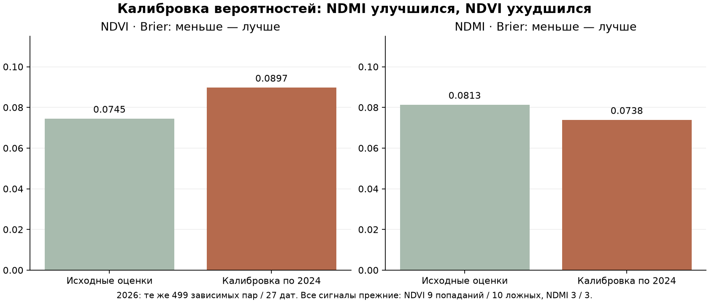
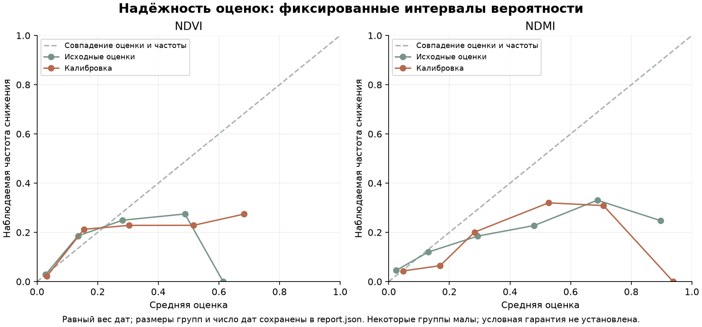

# Калибровка сезонного детектора и сохранение найденных снижений

Дата: 21 октября 2026. **Снизить ложные тревоги без потери найденных снижений не удалось.** Все прежние сигналы сохранены. Для NDMI улучшилась общая вероятностная ошибка, для NDVI она ухудшилась. Калибровки остаются исследовательскими; в продукт не подключены.

## Какие детекторы проверяли

- NDVI: сохранённый сезонный `season25` из предыдущего эксперимента, порог 0,5 и прежнее условие отрицательного прошлого темпа. На 2026 до калибровки — 9 попаданий из 50, 10 ложных.
- NDMI: сохранённый временной классификатор `2024_only`, порог 0,85 и прежнее условие. До калибровки — 3 попадания из 42, 3 ложные. Принятого сезонного NDMI-детектора нет; его существование не предполагается.

Их финальные веса, признаки, условие и пороги неизменны. Дополнительный слой может только отфильтровать исходную тревогу: `старая тревога AND новая оценка >= порог`. Он не может создать новую тревогу, но может потерять верную — это проверяется по конкретным случаям, а не только сумме попаданий.

## Почему одного пересчёта вероятности недостаточно

Обычные монотонные методы меняют численные оценки, сохраняя порядок; изотоническое преобразование может объединять оценки в равные группы. Они не добавляют информации для различения событий. Поэтому изменение вероятностной ошибки и изменение качества тревог рассматриваются отдельно. Brier и logloss оценивают не только калибровку, но и различимость случаев; снижение Brier не доказывает надёжность каждой выданной вероятности. Методологический источник — [официальная документация scikit-learn](https://scikit-learn.org/stable/modules/calibration.html).

## Обучение без утечки

Собраны причинные прогнозы: 418 пар «площадь × дата» на 33 датах 2024. Для каждой даты базовая модель обучалась только на примерах, чей целевой снимок был строго раньше этой даты. Первоначально требуется минимум 5 дат / 20 текущих пар. Ранние годы добавлялись только в прежний NDVI-алгоритм. Собственные обучающие предсказания не использовались для калибровки.

Затем пять внешних проверок июнь–октябрь: калибратор видит только завершённые целевые даты до начала месяца; проверка — выдачи в месяце с целью до следующего месяца. Получились те же 274 пары / 25 дат. Пересекающие границы окна исключены; R23–R27 не обучают базовую модель, калибратор, нормировки и не выбирают пороги.

Это последовательные обновления базовой модели внутри месяца. Поэтому их исходные результаты на отборе отличаются от прежнего ежемесячного OOF: NDVI 4 попадания / 0 ложных, NDMI 14 / 2. Разные результаты отбора не подменяют контроль 2026: его финальные базовые бинарные модели сохранены точно прежними.

При недостатке классов/дат применяется исходная оценка без калибровки и остаётся в знаменателе. В мета-проверке fallback встречался для 2 сочетаний «индекс × месяц»; эти периоды не удалялись. Финальная калибровка обучена на всех причинных прогнозах 2024 до 2024-10-14.

Ограничение: калибратор обучается на оценках последовательно растущих моделей, а затем применяется к сохранённой финальной модели. Их распределения могут отличаться; это не доказанная гарантия переноса. Настройки базовых алгоритмов и предыдущие условия ранее выбирались по 2024; повторное использование 2024 делает оценки отбора оптимистичными.

## Что попробовали и как выбирали

Семь вариантов: исходные оценки; temperature scaling; регуляризованный Platt с неотрицательным наклоном; монотонная beta-калибровка; изотоническая с 50% исходной оценки; условная логит-поправка по четырём прошлым сезонным признакам; её 50% смесь с исходной оценкой.

Условные признаки — положение в наблюдавшемся диапазоне, прошлый недельный темп относительно амплитуды, интервал до предыдущего снимка и флаг поддержки истории. Это не культура/BBCH и не будущая сезонная информация. Варианты и регуляризация зафиксированы до обучения; изотоническая калибровка на малых данных особенно ограничена по переносу.

Порог фильтра выбирается только по мета-OOF 2024. Условия: сохранить каждый прежний TP, не добавить тревог, не увеличить ложные пары и даты, не ухудшить Brier и logloss. Затем минимизировать ложные, Brier и logloss. При одинаковом результате выбирается **меньший порог фильтра**, чтобы не вводить лишнее отсечение без подтверждения. Порог 0 означает отсутствие дополнительной фильтрации.

| Индекс | Выбранная калибровка | Порог фильтра | Brier на отборе | Logloss на отборе |
|---|---|---:|---:|---:|
| NDVI | platt | 0.0 | 0.1097 → 0.1027 | 0.3359 → 0.3258 |
| NDMI | isotonic_shrink50 | 0.0 | 0.1361 → 0.1305 | 0.5126 → 0.4758 |

Оба порога — 0. По 2024 не подтверждено безопасное отсечение тревог, которое одновременно сохраняет все найденные события и улучшает вероятностные оценки. Тот факт, что наблюдаемые ложные тревоги малы или отсутствуют, не позволяет обещать их отсутствие в другом году.

Даже без условий по Brier/logloss среди проверенных вариантов с сохранением каждого прежнего TP минимум ложных на отборе: NDVI 0, NDMI 2. Для NDMI уменьшить две исходные ложные без потери одного из 14 верных в этой сетке не получилось. Для NDVI исходных ложных на отборе нет, поэтому дополнительное отсечение не имеет подтверждённой пользы.

## Проверка замороженного выбора на 2026

Те же 499 пар / 27 дат, выдачи с 28 июля, факты до 19 октября. 2026 уже изучался ранее, поэтому это проверка без нового подбора, а не свежий слепой тест. 2025 отсутствует в текущем архиве. Спектральные снижения не являются подтверждёнными повреждениями или полезностью осмотра.

| Индекс | Вариант | Найдено / событий | Ложные пары | Дат с ложными | Brier ↓ | Logloss ↓ | ECE ↓ |
|---|---|---:|---:|---:|---:|---:|---:|
| NDVI | Исходный детектор | 9 из 50 | 10 | 8 | 0.0745 | 0.2423 | 0.0308 |
| NDVI | Выбранная калибровка | 9 из 50 | 10 | 8 | 0.0897 | 0.2733 | 0.0738 |
| NDMI | Исходный детектор | 3 из 42 | 3 | 3 | 0.0813 | 0.3337 | 0.0548 |
| NDMI | Выбранная калибровка | 3 из 42 | 3 | 3 | 0.0738 | 0.2926 | 0.0411 |

Для NDMI Brier снизился на 9.2%, logloss также уменьшился. Но сигналов осталось столько же: это улучшение численных оценок в этом архиве, а не улучшение обнаружения. Для NDVI Platt поднял оценку исходного 0,5 примерно до 0.69; эта поправка с 2024 не перенеслась и усилила завышение оценок на 2026. Это механизм преобразования; причины межгодового сдвига по культурам/операциям/версии не установлены.

Кривые построены с заранее фиксированными границами групп и равным суммарным весом дат; размеры групп и число дат записаны в JSON. Например, после калибровки NDMI в группе 0,8–1,0 всего 3 пары на 3 датах, без подтверждённых снижений. Поэтому нельзя объявлять высокие оценки надёжными вероятностями для агронома по улучшению одного среднего Brier. ECE зависит от разбиения и также не является гарантией.

## Пространственный перенос и сохранение случаев

| Поднабор | Индекс | Пар | Brier: исходный → новый | TP / FP после | Потеряно прежних TP |
|---|---|---:|---:|---:|---:|
| Резервные площади 2024 | NDVI | 84 | 0.0389 → 0.0470 | 7 / 0 | 0 |
| Резервные площади 2026 | NDVI | 102 | 0.0896 → 0.0869 | 4 / 1 | 0 |
| Остальные площади 2026 | NDVI | 397 | 0.0766 → 0.0956 | 5 / 9 | 0 |
| Резервные площади 2024 | NDMI | 84 | 0.0741 → 0.0769 | 2 / 0 | 0 |
| Резервные площади 2026 | NDMI | 102 | 0.0949 → 0.0905 | 3 / 0 | 0 |
| Остальные площади 2026 | NDMI | 397 | 0.0823 → 0.0743 | 0 / 3 | 0 |

На пяти резервных площадях 2024 обе выбранные калибровки ухудшили Brier. На резерве 2026 Brier обеих немного улучшился. Это неоднородный перенос, а не подтверждённая универсальная калибровка. Резервные фрагменты близки к обучающим и не являются независимым хозяйством.

По конкретным случаям сохранены все 9 прежних попаданий NDVI и все 3 NDMI; все ложные также сохранены. Новый слой не добавил ни одной тревоги. Порог после просмотра 2026 не повышался ради красивого числа ложных.

## Решение

**Цель не достигнута, рабочие модели и интерфейс сохранены.** NDMI получил ограниченное улучшение вероятностной ошибки, NDVI — ухудшение. Принятой модели вероятности повреждения или полезности осмотра из этого не следует.

Для следующей проверки нужны независимые даты/сезоны с достаточным числом реальных ложных тревог исходного детектора, заранее выделенная проверка и сведения о культурах/операциях. Уменьшать ложные, сохраняя все найденные события, по текущему отбору надёжно не научились. Повторного подбора по 2026 здесь нет.

## Воспроизведение

`scripts/train_seasonal_calibration.py protocol|fit|evaluate`, `scripts/verify_seasonal_calibration.py`. Проверены причинные сроки базового OOF, отделение калибровки от собственных обучающих предсказаний, месячные разрывы, резерв, воспроизведение выбора и параметров, совпадение всех 499 исходных оценок и базовых сигналов с прошлым экспериментом, идентичность найденных случаев и неизменность 2211 прежних файлов. Заморозка: `c9670e84134922611ead81119d2e4aa6fc6214d96c4b96645b66f2dec1449447`. После неё повторное обучение и оценка запрещены.
