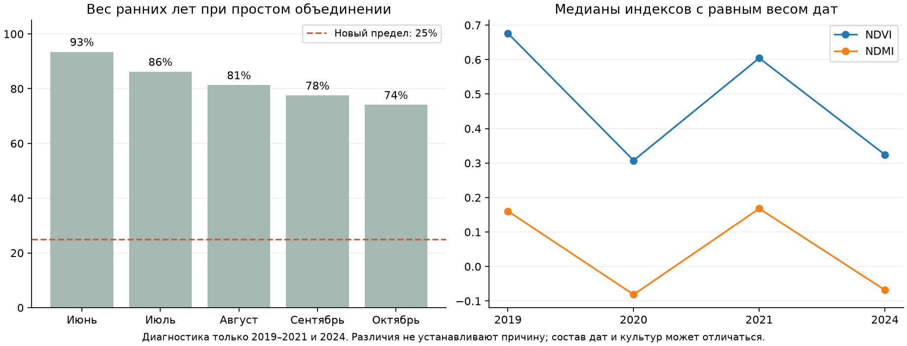
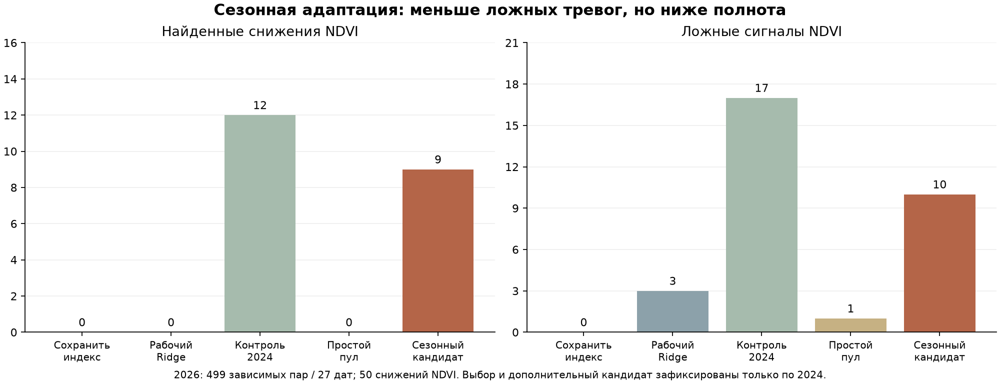

# Сезонные различия и версии Sentinel-2: отдельный эксперимент

Дата: 21 октября 2026. **Цель «обнаруживать больше резких снижений без роста ложных тревог» не достигнута.** Сезонная адаптация уменьшила ложные сигналы относительно прежнего исследовательского классификатора, но сохранила их больше рабочего Ridge. Кандидаты не подключены. Точечный прогноз, диапазоны, старый детектор, интерфейс и журнал сохранены.

## Почему ранний архив не помог при простом добавлении

Диагностика использует только обучающие ранние годы и 2024 вне резервных площадей.

1. **Ранний архив определял большую часть обучения.** При равном весе дат его доля — 71.9% в итоговом пуле, в первой проверке июня — 93.5%. Это измеренная доля веса, а не доказательство единственной причины ухудшения.
2. **Различаются уровни и динамика индексов.** Ранние годы неоднородны между собой. Медианы ниже рассчитаны с одинаковым весом дат, поэтому отличаются от обычной медианы всех пар.

| Год | Пар / дат | Медиана NDVI / NDMI | Версии обработки |
|---|---:|---:|---|
| 2019 | 255 / 28 | 0.676 / 0.160 | 05.00 |
| 2020 | 598 / 45 | 0.308 / -0.081 | 05.00 |
| 2021 | 337 / 27 | 0.604 / 0.168 | 05.00 |
| 2024 | 489 / 39 | 0.324 / -0.068 | 05.10, 05.11 |

3. **Один и тот же признак продолжения снижения имеет разную связь с целью.** Среди пар с совместным прошлым отрицательным темпом и заданным уровнем индекса падение NDVI на следующем снимке встречается в 2024 у 38 из 58 пар (65,5%), в 2021 — у 16 из 39 (41,0%). Для NDMI — 38 из 58 против 14 из 36 (38,9%). Это зависимые пары и описательная связь. Более ранние годы меняют не только распределение входов, но и наблюдаемую связь входа с событием. Одно перевзвешивание входов не гарантирует её восстановления.
4. **Сезон и версия обработки смешаны.** Все ранние обучающие пары имеют PB05.00. В 2024 PB05.10 приходится на март–июль, PB05.11 — на август–октябрь. В сохранённом наборе нет пар одного срока съёмки и места, переобработанных двумя версиями, чтобы независимо оценить эффект версии.

По [официальному описанию Copernicus](https://sentiwiki.copernicus.eu/web/s2-processing), версии обозначают изменения обработки; Collection-1 предусматривает согласованную переобработку раннего архива. Это основание учитывать метаданные, но не основание автоматически прибавлять поправку к NDVI/NDMI. Scale и offset уже проверены при сборе. Из этого эксперимента нельзя причинно приписать сдвиг именно PB, культуре, погоде или операциям.

Ранее проверенные метки в основном сохраняются на общих пригодных пикселях: NDVI 172 из 175, NDMI 154 из 157. Поэтому одну смену облачной поддержки нельзя считать достаточным объяснением проблемы. Остаточные облака, тени и неопределённость контуров полностью не исключены.

## Что проверено

До обучения зафиксированы девять вариантов: контроль только 2024; прежний простой пул; пул с фиксированным суммарным весом; ограничение старого архива 25%; относительная сезонная динамика; версия обработки; оба блока; перевзвешивание по сходству входов; согласие адаптации и контроля.

В новых взвешенных моделях ранние даты получают суммарно 25%, текущие известные даты 2024 — 75%. Суммарный эффективный вес ограничен числом обучающих пар 2024, чтобы дополнительный объём не менял силу регуляризации незаметно. Отдельный контроль фиксированного веса позволяет отличать это от ограничения доли источника.

Фиксация суммарного веса контролирует масштаб взвешенной функции потерь. У ExtraTrees минимальный лист по-прежнему задаётся числом строк, а не суммой весов: полная эквивалентность сложности на разных объёмах данных не заявляется.

Сезонные признаки — амплитуда наблюдавшейся к дате истории, относительный предыдущий темп и отклонение от наблюдавшегося максимума, флаги достаточности истории. История только прошлая, того же года и PB. Это не известная культура, не реальная фаза BBCH и не будущий максимум сезона.

Версия представлена категориальными признаками. Для неизвестной версии предусмотрено заранее фиксированное усреднение по поддержанным версиям 2024 с весами из обучающих дат. Это статистическая гипотеза переноса, не проверенная радиометрическая гармонизация. Согласие двух моделей означает минимум их оценок. Оценки не объявляются откалиброванными агрономическими вероятностями.

Для перевзвешивания сходства отдельная логистическая модель различает старые и известные текущие входы. Она не использует метки снижения и признаки проверяемого месяца; отношения весов ограничены [0,1; 10], затем применяется общий предел 25%. Такое перевзвешивание не исправляет произвольное изменение связи входов с целью.

## Выбор только по 2024

Те же 274 пары / 25 дат, июнь–октябрь. Обучение содержит только целевые даты строго раньше начала проверяемого месяца; пересекающие границу пары исключены. Все R23–R27 вне обучения, выбора, перевзвешивания и расчёта нормировок во всех годах. Порог события прежний: снижение медианы ядра минимум на 0,10 через 6–8 дней. Критерии: 0 ложных пар и дат, минимум 2 попадания на 2 датах; затем максимальная полнота с равным весом дат. Эти оценки использованы для выбора и оптимистичны.

| Индекс | Вариант | Результат отбора 2024 |
|---|---|---|
| NDVI | Только 2024 | 4 из 44; 0 ложных; 3 даты |
| NDVI | Простое объединение лет | 2 из 44; 0 ложных; 2 даты |
| NDVI | Пул с фиксированным весом обучения | 2 из 44; 0 ложных; 2 даты |
| NDVI | Ранние годы: вес 25% | Не прошёл условия отбора |
| NDVI | Относительная сезонная динамика + вес 25% | 4 из 44; 0 ложных; 3 даты |
| NDVI | Версия обработки + вес 25% | 3 из 44; 0 ложных; 2 даты |
| NDVI | Сезон + версия + вес 25% | Не прошёл условия отбора |
| NDVI | Сезон + версия + сходство входов | Не прошёл условия отбора |
| NDVI | Согласие контроля и адаптированной модели | 4 из 44; 0 ложных; 3 даты |
| NDMI | Только 2024 | 9 из 36; 0 ложных; 2 даты |
| NDMI | Простое объединение лет | Не прошёл условия отбора |
| NDMI | Пул с фиксированным весом обучения | Не прошёл условия отбора |
| NDMI | Ранние годы: вес 25% | Не прошёл условия отбора |
| NDMI | Относительная сезонная динамика + вес 25% | Не прошёл условия отбора |
| NDMI | Версия обработки + вес 25% | Не прошёл условия отбора |
| NDMI | Сезон + версия + вес 25% | Не прошёл условия отбора |
| NDMI | Сезон + версия + сходство входов | Не прошёл условия отбора |
| NDMI | Согласие контроля и адаптированной модели | Не прошёл условия отбора |

Основной выбор: **NDVI: Только 2024; NDMI: Только 2024**. Сезонный NDVI и согласие моделей сравнялись с контролем, поэтому при равенстве остался более простой контроль. Лучший адаптированный NDVI — `season25`, выбран до 2026 для отдельной заранее предусмотренной проверки. Для NDMI адаптация не прошла условия уже по 2024.

До теста зафиксированы только четыре оценки: основной выбор, лучший адаптированный вариант и два контроля. Другие варианты не проверялись по 2026 и не выбирались по его результатам. Новых порогов после проверки нет.

## Проверка на том же секторе 2026

499 одинаковых пар / 27 дат, выдачи с 28 июля, факты до 19 октября. 2026 уже изучался в предыдущих работах: это проверка замороженных вариантов без подбора, а не новый слепой тест. 2025 отсутствует в существующем наборе. Предсказанные события — спектральные снижения, не подтверждённый ущерб или необходимость обработки.

| Индекс | Вариант | Найдено / событий | Ложные пары | Дат с ложными | Полнота | Доля верных тревог |
|---|---|---:|---:|---:|---:|---:|
| NDVI | Сохранение индекса | 0 из 50 | 0 | 0 | 0.0% | — |
| NDVI | Рабочий Ridge | 0 из 50 | 3 | 3 | 0.0% | 0.0% |
| NDVI | Контроль только 2024 | 12 из 50 | 17 | 10 | 24.0% | 41.4% |
| NDVI | Простой пул ранних лет | 0 из 50 | 1 | 1 | 0.0% | 0.0% |
| NDVI | Лучший адаптированный кандидат по 2024 | 9 из 50 | 10 | 8 | 18.0% | 47.4% |
| NDMI | Сохранение индекса | 0 из 42 | 0 | 0 | 0.0% | — |
| NDMI | Рабочий Ridge | 0 из 42 | 2 | 2 | 0.0% | 0.0% |
| NDMI | Контроль только 2024 | 3 из 42 | 3 | 3 | 7.1% | 50.0% |
| NDMI | Простой пул ранних лет — отказ, сохранён старый выход | 0 из 42 | 2 | 2 | 0.0% | 0.0% |
| NDMI | Лучший адаптированный кандидат по 2024 — отказ, сохранён старый выход | 0 из 42 | 2 | 2 | 0.0% | 0.0% |

Сезонный NDVI уменьшил ложные тревоги 17→10, но снизил попадания 12→9. При сопоставлении конкретных сигналов убраны 9 прежних ложных, добавлены 2 новых ложных и потеряны 3 верных попадания. Рабочий Ridge даёт 3 ложные, сохранение индекса — 0: заданный бюджет всё равно превышен. Поэтому это компромисс между чувствительностью и тревогами, а не достигнутая цель улучшения.

| Проверка адаптированного NDVI | Пар | Найдено / событий | Ложные | Дат с ложными |
|---|---:|---:|---:|---:|
| Резервные площади 2024 | 84 | 7 из 10 | 0 | 0 |
| Резервные площади 2026 | 102 | 4 из 18 | 1 | 1 |
| Остальные площади 2026 | 397 | 5 из 32 | 9 | 7 |

Соседние резервные фрагменты не являются независимыми хозяйствами. Выбирать только удачные места по 2026 нельзя. На 2026 встречаются ранее не поддержанные версии: {'05.12': 395, '05.13': 104}. Версионные варианты не выиграли отбор по 2024 и на 2026 отдельно не испытывались; нельзя заявлять доказанное исправление этих версий. Выбранный сезонный кандидат не использует категориальный PB-блок.

## Решение и ограничения

**Новая модель в продукт не подключена.** Основной выбор и лучший адаптированный кандидат не удовлетворяют условию большего обнаружения без роста ложных тревог. Результат не доказывает, что сезонная адаптация или ранние годы вообще бесполезны: проверены конкретные способы переноса на ограниченной выборке.

Для проверки именно влияния версии нужны сравнимые продукты одной съёмки в разных PB либо независимый согласованный источник. Для агрономической полезности нужны фактические культуры, операции и результаты осмотров: текущее событие не различает нормальную уборку/созревание и проблему. Повторный подбор по уже просмотренному 2026 не выполняется; следующая проверка должна быть заранее выделена.

## Воспроизведение

`scripts/train_season_version_decline.py protocol|fit|evaluate`; `scripts/verify_season_version_decline.py`. После заморозки повторное обучение/оценка запрещены. Проверка воспроизвела выбор и четыре оценки на 499 парах, контрольные OOF совпали с предыдущим экспериментом с точностью 10⁻¹², проверены хронология, предел веса, отсутствие проверочных данных в доменной модели и неизменность 2196 прежних файлов. Прежний точечный прогноз, детектор, интервалы и журнал сохранены. Заморозка: `5ad240856b0027aca98d8f34ef91567ef22886a20c23a0d238c0140205670f6d`.
