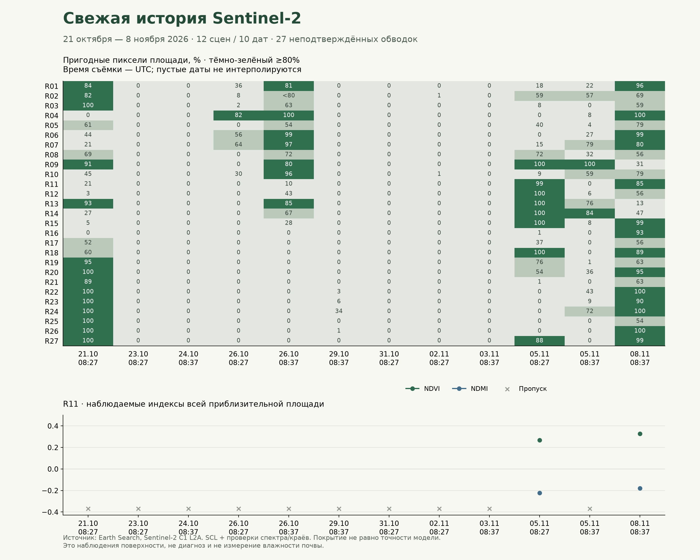

# Свежие снимки сектора и проверка приоритета — 9 ноября 2026

Последующий отдельный опыт: [защита R07 в консенсусном рейтинге](CONSENSUS_NDMI_GUARD_REPORT.md).
Его результат и ограничения не изменяют замороженные цифры ниже.

**История NDVI/NDMI обновлена реальными пикселями по 8 ноября. Улучшение
обученного приоритета без потери прежних находок пока не подтверждено.**
Точечные модели и прежние детекторы не переобучались. Осмотров не создавали.

## Что получено

- Каталог запрошен по прежнему bbox сектора с 20 октября до
  **09.11.2026 11:20:51 UTC**, без фильтра облачности всей плитки.
- **24 записи / 10 дат**. Пагинация пройдена полностью; исходные страницы,
  URL, время получения и SHA сохранены.
- **12 сцен покрывают всю рабочую сетку**, для них загружены нативные вырезки
  SCL, B04, B08, B11 и рассчитаны NDVI/NDMI. Ещё 12 записей соседней плитки не
  покрывают всю сетку: они сохранены в каталоге, но не используются как полные
  снимки хозяйства. Это не облачные отказы.
- После повторов сетевых сбоев **0 технических ошибок**. Индексы готовы для
  облачных сцен тоже: непригодные пиксели остаются в маске, а не становятся нулями.
- Последняя съёмка: **8 ноября, 08:37:39 UTC / 11:37:39 МСК**.

Использован тот же замороженный спектральный алгоритм: проверка метаданных
геометрии, scale/offset ровно один раз, сетка 20 м, SCL 4/5, отступ от исключённых
пикселей, nodata/положительные отражения. Пригодность площади требует минимум
10 ячеек и покрытия ≥80%; для места 60 м остаются ≥5 и ≥80%. Порогов по новым
2026 данным не подбирали. Маска SCL не прошла независимую полевую проверку.

Источники: [каталог Earth Search и описание коллекций](https://github.com/Element84/earth-search/blob/main/docs/collections/sentinel-2-l2a.md),
[каналы и SCL Sentinel-2 L2A](https://documentation.dataspace.copernicus.eu/APIs/SentinelHub/Data/S2L2A.html).
Процент `eo:cloud_cover` всей плитки не подменяет локальную проверку.

## Сколько действительно пригодно

| Проверка | Результат |
|---|---:|
| Площади хотя бы с одним пригодным новым наблюдением | 24/27 |
| Площади с пригодным наблюдением именно 8 ноября | 14/27 |
| Площади без пригодных новых дат | R05, R08, R17 |
| Пригодное сравнение 5 ноября 08:27 → 8 ноября | 4/27: R11, R15, R18, R27 |
| Общая пара для автоматического выбора по прежнему правилу | Нет |

Автовыбор по-прежнему требует ≥70% отдельно пригодных площадей на обеих датах,
одинаковую обработку и интервал 7–21 день. Новые даты этому правилу не отвечают.
Оно не ослаблено ради свежего результата. В интерфейсе новый период можно
выбрать вручную; отсутствие автоматической пары не означает отсутствие всех
наблюдений. Пара 5–8 ноября показывает только три дня и не становится проверкой
прогноза на 6–8 дней.



Подробности: [качество 27 площадей](../data/farm-observations/versions/2026-11-09/quality-report.json),
[все 324 сочетания «площадь × полная сцена»](../data/farm-observations/versions/2026-11-09/area-scene-quality.csv),
[история и 11 сценариев границ](../data/farm-observations/versions/2026-11-09/summary.json).
Два пролёта за один день — две сцены, а не дополнительные независимые дни.

## Пример R11

За 5 ноября 08:27 → 8 ноября 08:37 UTC на общей пригодной части:

- ΔNDVI **+0,0532**, ΔNDMI **+0,0254**;
- общие пригодные пиксели — **83,86%**;
- это наблюдаемый сдвиг индексов, не диагноз, не доказательство восстановления
  растений и не измерение почвенной влаги.

Значение разности — медиана попиксельных разностей; она не обязана равняться
разности двух медиан. У опорного окна 60 × 60 м этой площади на той же паре
**0 общих пригодных ячеек из 9**: пригодность всей обводки не переносится на
произвольную точку. Для такого места NDMI/NDVI остаются неизвестными.

[Открыть сравнение R11](http://127.0.0.1:8770/scouting#changes?area=R11&period=autumn2026&metric=ndmi&before=S2B_T37TDK_20261105T082407_L2A&after=S2B_T37TDK_20261108T083052_L2A).
В меню архива доступен период **«Октябрь–ноябрь 2026»**. Старый «Архивный пример»
и его исходные даты сохранены. Если общей пары нет, интерфейс предлагает ручной
выбор и не оставляет зависшую надпись «Проверяем архив».

## Новый опыт с приоритетом: согласие двух моделей

Проверено небольшое заранее записанное семейство правил: начать с трёх мест
простого недавнего снижения, сохранить сильные сигналы и разрешить не больше
одной замены за дату, только если **Logistic Regression и ExtraTrees** оба
предпочитают новое место. Это разные модели на связанных данных, а не два
независимых источника подтверждения.

Использованы только сохранённые внеобучающие оценки **2024 года** и тот же пул:
**699 кандидатов, 46 дат, 368 известных / 331 неизвестный исход**. Неизвестные
включены в знаменатель. Позднее восстановлены только допустимые месячные
границы; три спорные цели дополнительной плитки остаются неизвестными.
Метки — будущие спутниковые снижения, не полезность визита агронома.

| Вариант, 133 выбранные позиции | Известные снижения | Известные отрицательные | Неизвестные | Потеряно находок простого правила |
|---|---:|---:|---:|---:|
| Простое недавнее снижение | 19 | 49 | 65 | 0 |
| Прежний исследовательский гибрид | 24 | 44 | 65 | 3 |
| Согласие моделей, защита 0,10 / отступ 0 | 20 | 48 | 65 | 1 |
| Согласие моделей, защита 0,20 / отступ 0 | 22 | 46 | 65 | 1 |
| Выбор только по ранее завершённым месяцам 2024 | 19 | 49 | 65 | 0 |

У варианта 22/46/65 парная разница с простым правилом допускает
**−2,90…+7,25 п.п.**, а неблагоприятные неизвестные исходы — до **+4**
отрицательных выборов. Это границы сценариев неизвестности, не доверительный
интервал. Он также теряет одну прежнюю находку. Поэтому строгий допуск не пройден.
Помесячный выбор настроек с отсечением ещё не завершённых целей оставляет базу.

Потеря — **R07, 29 сентября → 6 октября 2024**, ΔNDMI около **−0,140** при
почти неизменном NDVI. Согласие моделей всё ещё недостаточно защищает отдельное
снижение NDMI после слабого недавнего сигнала. По этому результату новый порог
не подбирали: это диагностика ограничения, а не основание для ещё одного
исправления по той же уже разобранной дате.

**Решение:** не подключать этот вариант к рабочему ранжированию. Известные
итоговые суммы лучше базы, но этого недостаточно для обещания «без роста ложных
выборов и без потери находок». Повторное исследование уже изученного 2024 —
разработка, не независимое доказательство. Данные/исходы 2025–2026 для выбора
этого опыта не читались; свежие 2026 сцены обработаны отдельной цепочкой наблюдений.

[Протокол до запуска](../data/farm-research/consensus-priority-2024/protocol.json) ·
[Все кандидаты, потери, помесячный выбор](../data/farm-research/consensus-priority-2024/report.json).
Сохранены прежние точечные прогнозы, детекторы и диапазоны; новые осмотры не созданы.

## На чём теперь сосредоточиться

1. **Качество оснований:** возраст пригодного снимка именно места, общие пиксели,
   устойчивость к сдвигам и отказ при пропусках. Это уже можно проверять без
   агрономической разметки; нельзя превращать «нет наблюдения» в «нет проблемы».
2. **Восстановление исходов 2024:** дополнительные разрешённые источники могут
   уменьшить 331 неизвестный исход, но нельзя ради этого расширять окно 6–8 дней,
   смешивать версии/датчики или менять критерии после результата без отдельного
   протокола. Сейчас их не заполняли и не перетренировывали старый детектор.
3. **Замороженный теневой список:** зафиксировать правило и будущие выпуски
   до исходов; оценивать их после новых пригодных съёмок. Уже просмотренные
   2025–2026 не становятся новым слепым тестом.
4. **Полезность выезда:** нужны фактические результаты выбранных и контрольных
   мест. Без них нельзя обучить и проверить вероятность полезного осмотра.
   Пока можно поддерживать объяснимую подготовку обследования, но не обещать
   обнаружение болезни, рост урожая или подтверждённую экономию.

## Хранение и воспроизведение

База `data/farm-research/area-context/` не изменена: прежние **92** NPZ и все
замороженные исторические данные остаются прежними. Новые **12** NPZ находятся
в `data/farm-observations/versions/2026-11-09/`; опубликованная версия выбирается
атомарным `current.json`. Вместе доступно **104** архива индексов. TIFF-кэш
исключён из Git; индексы, метаданные и SHA доступны для переноса.

Сервер читает опубликованную версию при старте. После следующей публикации
нужен перезапуск; фонового расписания и автоматического обновления браузера нет.
Сохранённые задачи сохраняют свои исходные даты/основания; в новом API лишь
добавлены период, `default_period`, `archive_updated_at` и последняя пригодная
дата каждой площади. Дизайн и правила расчётов не менялись.

```powershell
# Новая выгрузка требует нового имени версии и явного времени UTC.
.venv\Scripts\python.exe -X utf8 scripts/refresh_sector_sentinel.py collect --version NEW_VERSION --through 2026-11-09T11:20:51Z
.venv\Scripts\python.exe -X utf8 scripts/refresh_sector_sentinel.py analyse --version NEW_VERSION
.venv\Scripts\python.exe -X utf8 scripts/refresh_sector_sentinel.py publish --version NEW_VERSION

# Повторное обучение/подбор замороженного опыта запрещены самим скриптом.
.venv\Scripts\python.exe -X utf8 scripts/experiment_consensus_priority.py protocol
.venv\Scripts\python.exe -X utf8 scripts/experiment_consensus_priority.py run
```

Последний `run` на этом комплекте намеренно откажет: результат уже заморожен.
Для проверки без повторного подбора использовать тесты и сохранённый отчёт.
Не применять NEW_VERSION буквально к опубликованному рабочему архиву без
действительно нового сбора и проверки. Публикация не пишет в журнал хозяйства.

Проверки: 41 Python-тест, 8 JS-тестов; контроль 104 NPZ; повторный расчёт
индексов из четырёх нативных каналов для всех 12 новых сцен; HTTP/PNG/история и
браузерный путь ручного выбора 5–8 ноября. Рабочий журнал после проверки:
0 задач / 0 посещений / 0 планов.
