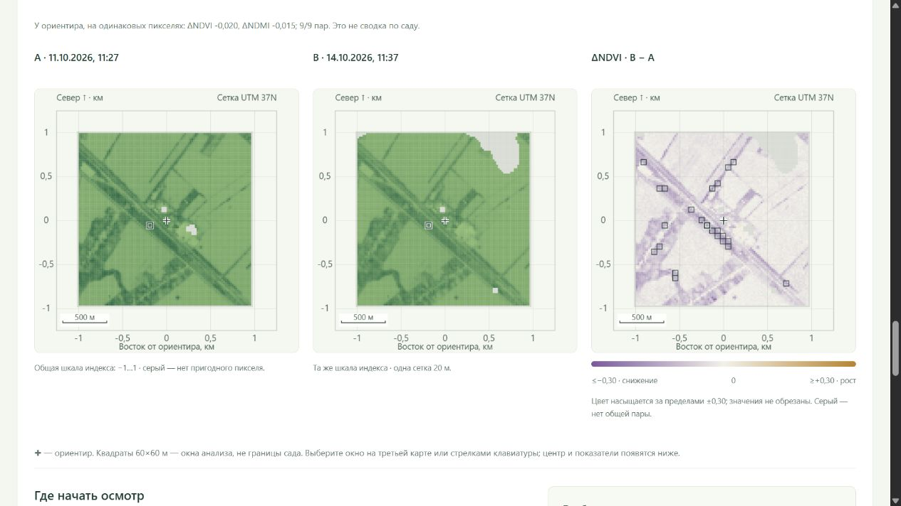

# Сравнение съёмок и карта изменений NDVI/NDMI

Добавлен [переход от выбранного окна к осмотру](LAND_INSPECTIONS.md): заметки и фото рядом с сохранёнными изменениями обоих индексов. Новые снимки не заменяют контекст записанного осмотра; наблюдения не заполнены искусственно.

Добавлено 18 октября 2026. [Открыть сравнение](http://127.0.0.1:8770/land#changes). Границы сада не установлены; все результаты относятся к окрестности ориентира 45.024106, 37.911914.

## Что реализовано

Два выбора даты из пригодных съёмок выбранного периода, карты A/B на общей шкале, карта разности **B − A**, переключение NDVI/NDMI и слой общего покрытия. Третий слой можно переключить на «Окна для осмотра». Даты, версии обработки, покрытие, парная сводка у ориентира и ограничения относятся к одной выбранной паре; запоздавший ответ другой пары не подставляется.

Первоначальная пара выбирается по времени и качеству покрытия, а не по величине разности: последняя пригодная съёмка плюс ближайшая предыдущая с покрытием окрестности ≥80% и той же версией обработки, если она есть. Остальные пригодные съёмки доступны вручную. В частности, съёмка 13 октября пригодна у ориентира, но покрывает лишь около 20% окрестности; её можно выбрать и увидеть ограничения, она не удалена из списка.

## Результат на текущих данных

Начальная пара — **11 октября 2026, 11:27 МСК → 14 октября, 11:37 МСК**, оба Sentinel-2C, версия обработки 05.13. Общее пригодное покрытие **91,64%**, **9164** пары ячеек 20 м. В пересечении вырезок: только A пригоден в 405 ячейках, только B — в 26, обе даты непригодны в 405. На оставшуюся непригодную поверхность разность не распространяется.

У ориентира на одних и тех же девяти пикселях окна 60×60 м: медиана парных разностей NDVI **−0,01960**, NDMI **−0,01505**. Это не разность двух медиан по меняющемуся составу пикселей и не среднее по саду.

|Порог отображения модуля изменения|Окна NDVI по фильтру|Окна NDMI по фильтру|
|---|---:|---:|
|0,05|102|160|
|0,10 (начальное значение)|23|0|
|0,15|0|0|
|0,20|0|0|

Порог не подбирался по агрономическим исходам и **не валидирован как порог повреждения или статистической значимости**. Таблица показывает, насколько число выделений зависит от настройки просмотра. Ноль окон при строгом фильтре не подтверждает отсутствие проблем.

При выборе пары 13–14 октября общее пригодное покрытие лишь около **18,5%**. Интерфейс сообщает, что результат нельзя распространять на остальную окрестность. При одинаковых или обратных датах сравнение отклоняется; прежняя карта скрывается.

[JSON с политикой, показателями, координатами выделенных окон и версиями наблюдений](SENTINEL_CHANGE_SUMMARY.json).

## Как получены разности

- Используются уже проверенные наблюдения из [обновляемого Sentinel-архива](SENTINEL_REFRESH.md) либо отдельного архива весны 2024. Новая загрузка или переобучение для сравнения не нужны.
- Сопоставляются координаты исходных 20-метровых ячеек в общей системе UTM 37N, а не одинаковые индексы строк/столбцов. Целочисленный сдвиг вырезок учитывается; при несовмещаемой сетке сравнение отклоняется. Повторной интерполяции индексов нет.
- Пиксель должен пройти прежний консервативный фильтр SCL/исходных данных в **обе** даты и иметь оба индекса. Пропуск в любой дате остаётся пропуском разности. Серый не равен нулю изменения. Слой покрытия различает обе даты/только A/только B/ни одну.
- Разность индекса посчитана попиксельно B − A. Карта использует фиксированную симметричную шкалу ±0,30; более сильные значения насыщают цвет, но численно не обрезаются. Повышение и снижение индекса подписаны нейтрально, без обозначения «здоровья».

## Почему окно выделяется для осмотра

Прозрачный, пока не проверенный в поле фильтр применяется к непересекающимся окнам **60×60 м**, выровненным по глобальной UTM-сетке:

1. Все 9 из 9 ячеек имеют общую пригодную пару.
2. Не менее 8 из 9 парных изменений направлены одинаково.
3. Для каждого из девяти сдвигов снимка B на −20/0/+20 м по каждой оси доступны все девять ячеек. Диагональные сдвиги достигают около 28 м. Снимок A фиксирован.
4. Все девять медиан парных разностей сохраняют одно направление и достигают выбранного порога отображения.
5. Версии обработки A/B совпадают и известны. Если версии различаются, численная разность остаётся справочной, а фильтр осмотра отключается.

Это **проверка чувствительности к выбранным сдвигам**, а не установленная величина ошибки геопривязки и не гарантия устойчивости ко всем артефактам. Пространственный минимум–максимум парных разностей тоже не доверительный интервал. Вероятность болезни, стресса, повреждения или ущерба не вычисляется.

В таблице до 12 окон с наибольшим модулем изменения среди прошедших фильтр; все прошедшие окна видны на карте. При выборе окна подсвечивается один и тот же квадрат на A/B/разности, показываются приблизительный центр, поддержка, обе медианы, разброс пикселей и диапазон сценариев. На карте можно выбирать мышью или стрелками клавиатуры. Координаты центра помогают обсудить место осмотра, не означают метровую точность границ или подтверждённую принадлежность хозяйству.

## Ограничения интерпретации

Как следует из [описания обработки Sentinel-2](https://sentiwiki.copernicus.eu/web/s2-processing) и [описания L2A/SCL](https://documentation.dataspace.copernicus.eu/APIs/SentinelHub/Data/S2L2A.html), оптическое наблюдение зависит от обработки и маски качества. Здесь маска облаков не прошла независимую проверку на месте. Остаточные облака/тени, атмосфера, освещение, геометрия наблюдения, сезонность и смена поверхности могут влиять на разность. Совпадение версии обработки само по себе не доказывает полной сопоставимости.

Увеличение или снижение NDVI/NDMI по двум датам не устанавливает причину. NDMI не равен влажности почвы. Если между датами более 14 дней, отдельно отмечается возможность сезонных изменений; это пояснение просмотра, а не порог агрономического события. Для разных спутников показывается дополнительная оговорка о геометрии и калибровке. Никаких назначений полива, обработки или защиты из этих окон не выпускается.

## Проверка и воспроизведение

Новый read-only модуль `agro_checker/land_change.py`; GET `/api/land/compare?period=recent|archive&before=<ключ>&after=<ключ>`. Принимаются только зарегистрированные идентификаторы двух съёмок из одного выбранного набора. Модуль не пишет в архивы и полевой журнал. Политика фильтра находится в ответе API и JSON-отчёте; интерфейс использует те же правила, совпадение на всех окнах текущей пары проверено.

**500 Python + 24 JavaScript = 524 теста прошли.** Новые проверки: нулевое изменение для одинаковой поверхности; отсутствие нулевой подмены пропусков; совмещение сдвинутых вырезок; отказ при дробной сетке и неверных датах; равномерное изменение; подавление изменения на границе, исчезающего при сдвиге; отключение фильтра при разных версиях обработки; медиана по общей поддержке; ограниченный read-only HTTP и неизменность полевого журнала. Все парные разности текущей пары сверены с входными картами. Проверены браузером NDVI/NDMI, фильтр порога, слой покрытия, выбор окна клавиатурой, частичное покрытие, отказ при одинаковых датах, прямой переход по ссылке после загрузки и мобильная ширина 390 px.

Замороженные исходники, исходный Sentinel-архив, указатель опубликованных свежих наблюдений, **198 файлов поля**, прогноз, детектор и цепочки выбора настроек сохранились. Данные 2025–2026 не использовались для обучения или подбора прогнозных моделей. Выделенные окна — инструмент планирования проверки, а не подтверждённая точность агрономического продукта.
