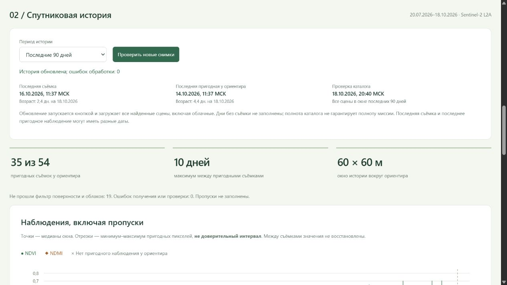

# Обновляемая история Sentinel-2 вокруг ориентира

Добавлено [сравнение двух пригодных снимков](SENTINEL_CHANGE.md): разности на общих пикселях и окна для осмотра без автоматического диагноза.

Реализовано и проверено 18 октября 2026 года. [Открыть интерфейс](http://127.0.0.1:8770/land#history). Период по умолчанию — **последние 90 дней**; архив марта–мая 2024 выбирается отдельно.

## Фактический результат загрузки

Окно каталога: 20 июля — 18 октября 2026 года, ориентир 45.024106, 37.911914, вырезка около 2×2 км. Получены **54 съёмки**, из них **35 пригодны** для окна 60×60 м у ориентира, **19 не прошли фильтр поверхности/облаков**, технических ошибок после повторной загрузки **0**. Это количество съёмок, а не уникальных календарных дней: иногда доступны два пролёта за день.

Последняя найденная съёмка — **16 октября, 11:37 МСК**, у ориентира облака. Последняя пригодная — **14 октября, 11:37 МСК**, медиана NDVI **0,250**, NDMI **−0,043**, пригодны 9 из 9 ячеек окна. Это наблюдения смешанной поверхности возле ориентира; они не устанавливают состояние яблонь или влажность почвы. Наибольший интервал между пригодными съёмками в этом окне — около **10 дней**.

Первое получение завершилось с двумя обрывами соединения у поставщика. Эти даты были сохранены как технические пропуски, а не как облака или нулевые индексы. Реальное нажатие «Проверить новые снимки» повторно обработало их, использовало 52 уже сохранённых объекта и завершилось без ошибок. Предыдущая частичная версия сохранена для аудита.

Итоговая версия: `3259174e8a17419ca701b102275569ad`; SHA манифеста **`3c6158f2353401b9f5222ab8797c38aaa16023b7d1ea158e1b3909a9db1e4245`**. [Сводка со всеми датами и источниками](SENTINEL_REFRESH_SUMMARY.json).

## Сценарий использования

1. Открыть спутниковую историю и оставить «Последние 90 дней». Видны дата последней съёмки, дата последнего пригодного наблюдения, возраст обоих и время проверки каталога.
2. Начальная выбранная дата — самая новая съёмка, даже если она облачная. На 16 октября индексы у ориентира отсутствуют. Хорошая съёмка 14 октября не подставляется вместо неё.
3. Выбрать 14 октября в списке или на графике, переключить NDVI/NDMI. Карта, дата и сведения о качестве связаны с одной версией сцены. На графике нет интерполяции; отрезки обозначают пространственный разброс, а не доверительный интервал.
4. Нажать «Проверить новые снимки». Во время загрузки отображается прогресс, повторное нажатие не создаёт вторую задачу. Старые данные доступны, пока новая версия не опубликована целиком. При сетевой ошибке проверки каталога последняя сохранённая история остаётся доступна и появляется сообщение об ошибке.
5. Переключить период на «Архив · март–май 2024»: прежние 36 съёмок/13 пригодных остаются отдельной серией. Между 2024 и 2026 линия не строится.

Обновление **ручное, по кнопке**. Периодический фоновый сбор или внешние уведомления не включались. После сдвига 90-дневного окна прежние выгрузки остаются в версиях на диске; интерфейс показывает текущее окно и фиксированный архив 2024. Полнота выдачи доступного каталога не гарантирует наличие всех съёмок миссии. Если съёмки не было, ежедневное наблюдение не выдумывается.

## Источники и контроль качества

Использован [Earth Search v1, Sentinel-2 C1 L2A](https://github.com/Element84/earth-search/blob/main/docs/collections/sentinel-2-l2a.md), без автоматического перехода на отличающуюся beta-схему v2. Пагинация пройдена полностью, включая пустую завершающую страницу. Фильтра по облачности всей плитки нет: сохраняются и облачные сцены.

Для каждой сцены получены B04, B08, B11 и SCL, сохранены локальные нативные вырезки. Метаданные геометрии сверяются с TIFF; scale/offset отражательной способности применяются ровно один раз и должны совпадать между STAC и TIFF. Общая сетка 20 м, 10-метровые полосы усредняются 2×2 только при пригодности всех дочерних пикселей. Использован прежний консервативный [фильтр SCL](https://documentation.dataspace.copernicus.eu/APIs/SentinelHub/Data/S2L2A.html): классы 4/5, отступ от исключённых пикселей, проверки исходных пропусков и положительных отражений. Маска облаков не прошла независимую местную валидацию.

Дата съёмки должна иметь часовой пояс и попадать в окно запроса, не в будущее относительно его конца. Даты обработки, создания каталожной записи и получения пикселей сохраняются отдельно; отсутствующие значения не восстанавливаются. Возраст в интерфейсе считается относительно серверного времени, указанного рядом с возрастом, а не выдаётся за новую съёмку. Публикация обработанной сцены возможна с задержкой; получение версии сегодня не доказывает её доступность для исторического прогноза.

У каждого внешнего растрового объекта проверяются ETag, размер и Last-Modified до и после чтения. При изменении объекта сцена не публикуется как корректная. Для сохранённых вырезок и JSON проверяются SHA. Полный checksum исходного многомегабайтного COG — заявленный провайдером, не независимо проверенный: скачаны только вырезки. Повторная загрузка с неизменными метаданными использует проверенную локальную версию; это не новая независимая проверка всего удалённого COG. Переработанная каталожная запись получает новый ключ версии.

## Изоляция и надёжность

Новый модуль `agro_checker/sentinel_updates.py` и протокол `config/sentinel_refresh.json`; хранение отдельно в `data/working-zone-01/sentinel-updates/`. Замороженные `open_land_data.py`, `open_land_audit.json` и старый кэш не изменены. Каждый запуск сохраняет фактические байты кода/политики, страницы каталога, снимок результата и манифест. Успешные объекты не перезаписываются; указатель опубликованной версии заменяется атомарно. Незавершённые вырезки остаются вне опубликованного набора. Кэш объектов в памяти проверяется при первом чтении версии процессом; перезапуск повторяет проверку.

GET `/api/land/recent` и `/api/land/recent/scene/<version-key>` читают только опубликованную версию. POST `/api/land/refresh` запускает отдельную задачу с прежней защитой localhost/same-origin/token, без произвольных координат/URL. Каталог и источники растров ограничены зарегистрированными HTTPS-хостами. Есть блокировка параллельных обновлений между процессами. При переключении периода/даты предыдущая карта убирается; запоздавший ответ другой версии не подменяет выбранную дату.

Запуск сервера прежний: `python -m agro_checker field-serve --port 8770`. При необходимости такое же ручное обновление из терминала: `python -m agro_checker.sentinel_updates`. Нужны уже зарегистрированные зависимости `requirements-geodata.txt`. Для текущих источников новые аккаунты/ключи не потребовались.

Проверки: **491 Python + 23 JavaScript = 514**, без пропусков. Проверены пагинация, облачные сцены без предварительного отсева, будущие/неполные даты, недопустимые URL, раздельные облачные/технические пропуски, отсутствие замены истории при ошибке каталога, целостность опубликованной версии, несовпадение геометрии, смена удалённого объекта при чтении, токен и дедупликация задач, отсутствие записи в полевой журнал. Все 54 набора нативных полос повторно пересчитаны: маски, карты, медианы и число пригодных ячеек совпали. Проверены интерфейс кнопки, повторное получение пропущенных сцен, переключение 2024/2026 и NDMI, обычный и узкий экран.

Все **198 файлов полевого журнала** совпали до/после, полевая сводка остаётся без проверенных ночей. Исходный детектор, точечная модель, диапазоны, цепочки выбора и контрольные архивы сохранены. Снимки 2026 используются для показа наблюдений, **не для обучения или подбора настроек**. Границы сада не добавлялись, автоматические агрономические диагнозы и обещания их точности не включены.
