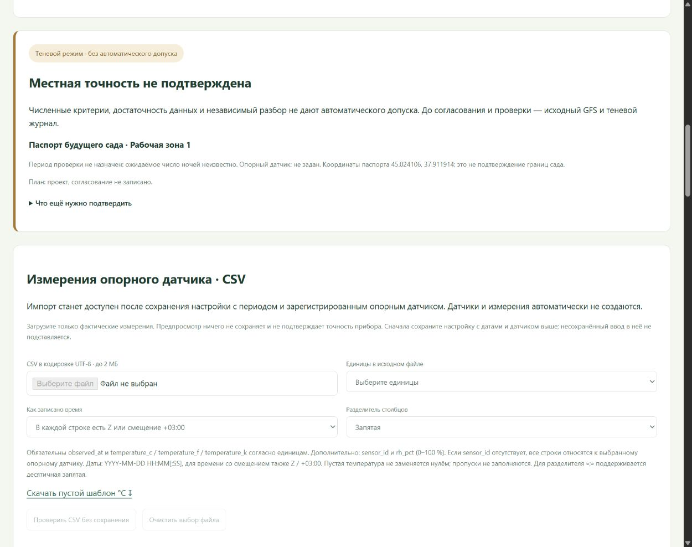

# Измерения опорного датчика: CSV → проверка → отчёт

После сохранения CSV можно открыть [график выбранной ночи рядом с GFS](SITE_VALIDATION_NIGHT.md): пригодные и исключённые измерения, пропуски, строки источника и отдельная выгрузка. График использует тот же журнал, не добавляет измерений и не меняет модель.

Добавлено 19 октября 2026. Раздел находится в [отчёте участка](http://127.0.0.1:8770/validation), после карточки статуса и перед полнотой данных. Рабочие измерения пока отсутствуют, выдуманные строки не добавлены. Модель, детектор и научные архивы не менялись.

## Порядок работы

1. Зарегистрировать настоящий датчик в паспорте. Сохранить [настройку проверки](SITE_VALIDATION_SETTINGS.md) с обеими датами и опорным датчиком воздуха около 2 м. Можно использовать черновую версию: импорт не превращает её в согласованный контроль.
2. Выбрать CSV UTF-8, единицы исходной температуры, правило времени и разделитель. Затем нажать «Проверить CSV без сохранения».
3. Проверить строки, число повторов и исключений, полноту каждой завершённой ночи. Исправить ошибки, конфликтующие значения или скачки в источнике и повторить проверку.
4. Указать автора, подтвердить реальное происхождение файла и сохранить проверенные измерения. Отчёт выбранной версии обновится. Согласование условий, проверка точности прибора и допуск модели этим действием не выполняются.

Пока период или прибор неизвестны, загрузка недоступна. Существующие несохранённые поля настроек не подставляются в импорт. Смена периода/участка и сохранение новой настройки блокируются при выбранном CSV; сначала сохранить измерения или очистить выбор файла.

## Формат файла

[Пустой шаблон °C](../config/site_measurements_template.csv) содержит только заголовок, без выдуманных наблюдений.

| Поле | Правило |
| --- | --- |
| `observed_at` | Обязательно. ISO `YYYY-MM-DD HH:MM[:SS]` или с `T`; секунды могут содержать доли. |
| `temperature_c` / `temperature_f` / `temperature_k` | Один обязательный столбец согласно выбранным °C/°F/K. После преобразования допустимы −60…60 °C. |
| `sensor_id` | Необязательно. Если есть, каждая строка должна совпадать с выбранным опорным прибором. Если нет, весь файл относится к нему. |
| `rh_pct` | Необязательно. Пустое значение сохраняется отсутствующим; числа только 0…100 %. |

В режиме «в каждой строке есть смещение» нужен `Z` либо `+03:00` и т. п. Для времени без пояса явно выбрать московское UTC+3 или UTC. Смешение двух способов в одном файле не принимается. Неоднозначные даты вида 02/03/2026 не угадываются. Нет будущих измерений, дат до 2000 года, NaN/Infinity, неизвестных столбцов, повторяющихся заголовков или строк с неверным числом полей.

Разделители: запятая, точка с запятой или табуляция. При точке с запятой/табуляции разрешена десятичная запятая. BOM UTF-8 поддерживается. Другую кодировку нужно явно пересохранить в UTF-8. Ограничения: 2 МБ и 10 000 строк за импорт.

## Проверка и пропуски

Предпросмотр не создаёт событий. По каждой строке определяется один статус:

- готова: новое значение в ночном окне периода;
- точный повтор: одинаковые температура и влажность одного прибора в один нормализованный срок UTC, внутри файла или в журнале; повтор не сохраняется;
- конфликт: разные значения в один срок либо нерешённая подозрительная запись в журнале; импорт блокируется, прежние значения не перезаписываются;
- ошибка: неверные дата, число, единицы/заголовок, прибор, отсутствие температуры, будущий срок и т. п.; импорт блокируется;
- скачок: более 0,5 °C/мин при расстоянии до соседнего отсчёта не более 30 минут, включая соседние сохранённые значения; импорт блокируется для проверки источника;
- вне периода: вне назначенных ночных окон 19:00–09:00 МСК; строка не сохраняется.

Ошибки и скачки блокируют пакет целиком. Точные повторы и строки вне ночных окон показаны отдельно и исключаются из сохранения. Если новых подходящих строк нет, пустой пакет не создаётся. Эвристика скачка не заменяет калибровку датчика и не гарантирует физическую достоверность остальных строк.

Полнота показана для каждой завершённой ночи: 14 часовых целей с допуском ±5 минут и 168 пятиминутных слотов с допуском ±1 минута. Используются уже принятые строки датчика плюс новые готовые; это предварительная полнота записей, а не допуск по метаданным. Показаны недостающие отсчёты и изменение часовой полноты. Нули, интерполяция и копирование прогноза в факты не используются. Проверяются все строки, в интерфейсе показаны до 200 с приоритетом проблемных.

## Сохранение и происхождение

POST `/api/site-validation/measurements/preview` проверяет файл без записи; POST `/api/site-validation/measurements/commit` повторяет проверку. Оба защищены существующими loopback/origin/token правилами. Подмена файла, версии, паспорта или изменение журнала после предпросмотра дают конфликт и требуют новой проверки.

Сохранение атомарно в существующем FieldStore: один `import_batch` с исходным CSV, SHA-256, автором, единицами, правилом времени, версией настройки и снимком датчика; далее только новые принятые события `measurement`. Сбой откатывает пакет и строки вместе. Идентичный повтор запроса возвращает прежний пакет; тот же ID с изменённым содержимым отклоняется. Личность автора и происхождение файла заявлены пользователем, автоматически не удостоверяются.

После импорта выбранная версия отчёта читает тот же журнал. Счётчики измерений ограничены ночными окнами выбранного периода, количество прочих строк показано отдельно. Проверка метаданных, QC и полноты, своевременная выдача GFS, статус защиты и зафиксированный период по-прежнему нужны для включения ночи в оценку. Импорт сам по себе не гарантирует появление метрик. Кандидат модели и диапазоны не выдумываются, итоговый статус остаётся без автоматического допуска.

## Проверка реализации

В общей Python-серии прошли 559 тестов; затем добавлены и пройдены ещё две проверки атомарности и границ счётчиков. Всего прошли 561 уникальный Python-тест и 34 JavaScript-теста — 595 проверок. Целевой модуль импорта содержит 13 Python-тестов; JS проверяет представление пропусков и экранирование входных строк.

В отдельном удаляемом техническом хранилище через браузер проверены ошибочный файл, корректный предпросмотр, подтверждение, сохранение 14 синтетических технических отсчётов, обновление отчёта и защита несохранённого CSV. Статус не стал допуском. Проверен экран 390 px. Временные файлы, журнал, сервер и вкладка удалены/закрыты; синтетические отсчёты не попадали в рабочие данные. Все 198 прежних рабочих файлов проверены по SHA-256.

