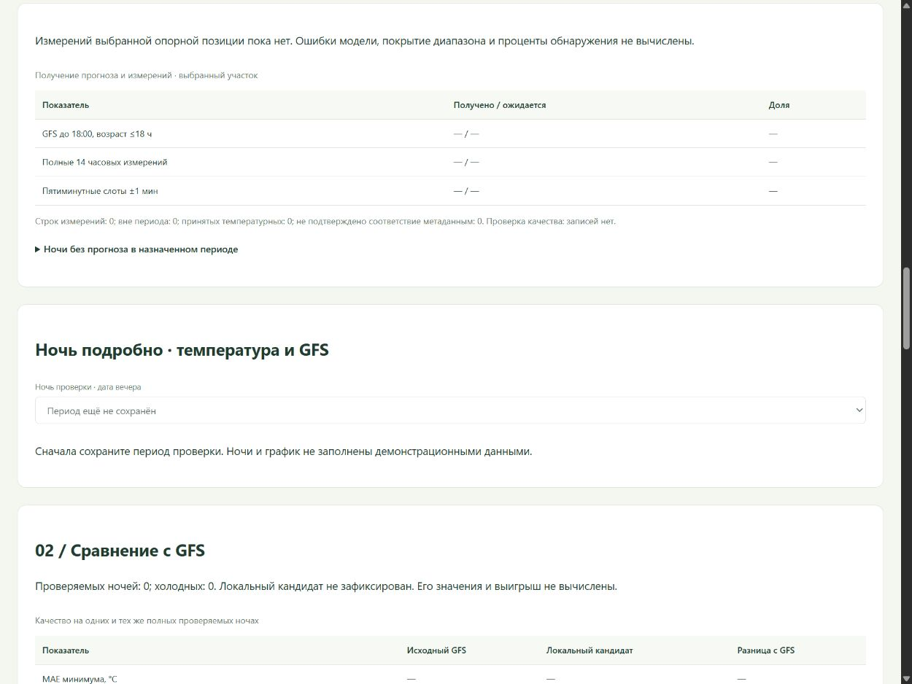
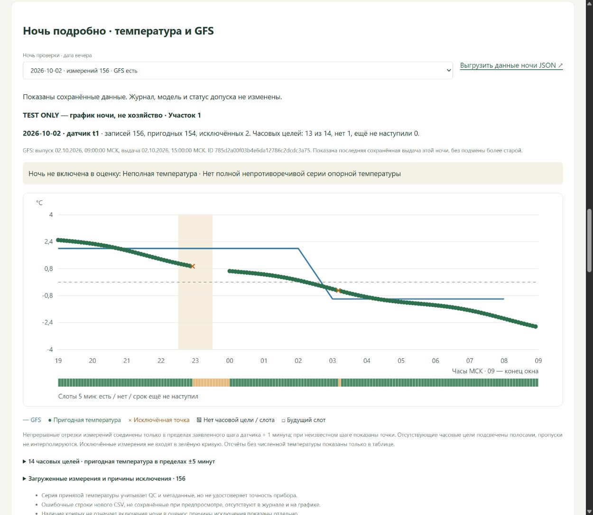

# Ночь подробно: температура, GFS и исключения

Добавлено 19 октября 2026 в [отчёт участка](http://127.0.0.1:8770/validation). Раздел находится после полноты данных и перед общим сравнением с GFS. Модель, детектор, критерии и измерения при просмотре не меняются. Автоматического допуска нет.

## Выбор и источники

Выбрать сохранённую версию [периода проверки](SITE_VALIDATION_SETTINGS.md), затем дату вечера в разделе «Ночь подробно». В списке есть все ночи периода, включая ночи без измерений или GFS и ещё не завершённые. Для каждой показано число строк выбранной опорной позиции и наличие сохранённой выдачи.

Показана последняя сохранённая выдача GFS, та же, что использует отчёт, с ID, временем выпуска и выдачи. Новые прогнозы при просмотре не загружаются. Если новая выдача исключена из оценки, более удобная старая не подставляется. Рядом указано, включена ли ночь в оценку, и причины исключения. Наличие кривых само по себе не означает пригодность ночи для расчёта качества.

Данные датчика берутся из существующего журнала, в том числе из [нового CSV-импорта](SITE_MEASUREMENT_IMPORT.md). Другие приборы, участки, демонстрационные паспорта и измерения вне ночного окна не подставляются. Рабочий журнал пока пуст; на рабочей странице нет выдуманных кривых или результатов.

## График

- Синяя линия — сохранённый GFS; зелёные точки и отрезки — загруженная температура с принятым QC и соответствующими метаданными опорной позиции.
- Оранжевые кресты — исключённые измерения с численной температурой: отклонённый/подозрительный QC, повторы, конфликт принятых значений в один срок, несовпадение метаданных и другие основания. Эти точки не входят в зелёную серию.
- Оранжевые полосы — отсутствующие пригодные часовые цели. Нижняя полоса показывает все 168 пятиминутных слотов: есть, нет, срок ещё не наступил. Будущие сроки не объявляются пропусками.
- Пропуски не заполняются нулём или интерполяцией. Линия измерений разрывается на исключённых записях и при превышении заявленного шага датчика + 1 минута. При неизвестном шаге показаны отдельные точки. На узком экране график прокручивается горизонтально.

Окно — 19:00–09:00 МСК, правая граница исключена. Часовые цели: 19:00–08:00, допуск ближайшего измерения ±5 минут. Пятиминутные слоты: 19:00–08:55, допуск ±1 минута. Частота регистратора и требования полноты протокола показаны отдельно: соединённая кривая не доказывает наличие всех пятиминутных отсчётов.

## Разбор и выгрузка

Под графиком есть таблица 14 часовых целей с состоянием, фактическим временем и температурой, а также таблица загруженных строк: QC, причины исключения, заметка разбора, пакет CSV и номер строки. Таблица показывает до 200 записей с приоритетом исключённых; график и выгрузка учитывают все записи ночи.

Записи без определимого времени показаны отдельно (первые 50 выбранного прибора из журнала): их нельзя отнести к выбранной ночи. Измерения без численной температуры не рисуются на оси. Ошибочные строки нового CSV, которые не были сохранены при предпросмотре, на график не попадают; их исправляют до импорта.

Ссылка «Выгрузить данные ночи JSON» закрепляет паспорт, зону, версию и дату. Endpoint GET `/api/site-validation/night` только читает данные. При смене выбора или ошибке старый график скрывается; прежние или учебные значения не используются как замена. После импорта выбранная ночь обновляется вместе с отчётом.

## Проверки

Прошли 572 Python- и 39 JavaScript-тестов, всего 611. Новые проверки охватывают пустой ряд, разрывы, QC, конфликты принятых значений, несовпадение метаданных, позднюю новую выдачу GFS, границы периода/ночи, будущие сроки, отсутствие температуры/времени, изоляцию приборов и экранирование входных строк. Просмотр не создаёт записей и не меняет прогноз/метрики.

В отдельном удаляемом техническом журнале проверены выбор двух ночей, исчезновение старых кривых на ночи без данных, разрыв ряда, пропущенная часовая цель, два исключённых отсчёта, причины с номерами строк и экран 390 px. Временный сервер и вкладка закрыты, журнал с техническими отсчётами удалён. 198 рабочих файлов FieldStore сохранены побайтово; реальных измерений не добавлено.

Рабочее пустое состояние:

Отдельная проверка интерфейса на синтетических технических отсчётах. **Это не данные хозяйства и не качество модели**; сам временный журнал удалён:

