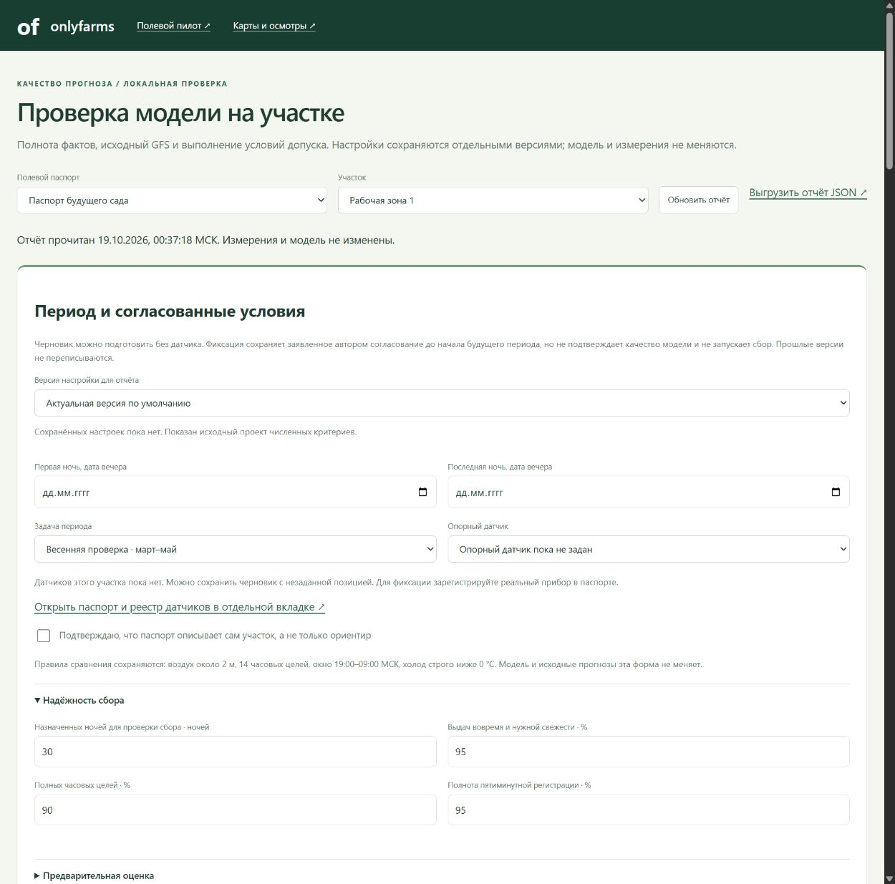

# Настройка периода и фиксация критериев проверки

После сохранения дат и опорного прибора доступна [загрузка фактов из CSV с предпросмотром](SITE_MEASUREMENT_IMPORT.md). Импорт не фиксирует согласование и не меняет модель.

Добавлено 19 октября 2026. Форма находится в начале [отчёта проверки](http://127.0.0.1:8770/validation), под выбором паспорта и участка.

Можно назначить даты вечеров первой/последней ночи, выбрать весеннюю или техническую проверку, зарегистрированный датчик и численные критерии. Показаны 27 редактируемых численных условий в пяти группах, включая время подготовки L и бюджет ложных за 30 ночей. Проценты вводятся как 95, а не 0,95. Исходные числа — предложения команды, не согласованные результаты.

Рабочие периоды, авторы и согласования за пользователя не заполнены. В рабочем хранилище нет измерений участка и настроек нового вида. Модели, исходный GFS, детектор и глобальный проект протокола сохранены.

## Черновик

Указать автора и известные сведения, затем нажать «Сохранить черновик». Можно оставить обе даты, датчик и L/B незаданными; одна дата без другой не принимается. Выдуманный ID прибора не принимается даже в черновике — выбирать можно только датчики текущего участка.

Черновик сохраняется отдельным событием и не подтверждает согласование. Он доступен в выборе версий, но не заменяет существующую зафиксированную версию по умолчанию. При явном просмотре черновика его период/критерии видны в отчёте; ночи не объявляются зафиксированным контролем качества.

## Фиксация согласованных критериев

Сначала получить реальные сведения агронома. Для фиксации нужны:

- Название/код, контур и координаты фактического участка в паспорте, явное подтверждение, что это сам участок.
- Проверенный по сведениям паспорта датчик воздуха около 2 м данного участка, уже назначенный опорным. Для другой опорной позиции сначала сохранить новую версию паспорта. Форма условий паспорт не переписывает.
- Обе даты будущего периода, до 19:00 МСК первой ночи; весенний режим ограничен мартом–маем. Технический режим не подтверждает весеннюю агрономическую область.
- Все численные критерии, включая L/B, автор, основание и явное подтверждение, что условия действительно согласованы.

Кнопка фиксации неактивна при отсутствии подходящего датчика или подтверждённого паспорта. Ссылка рядом открывает паспорт и реестр приборов отдельно, сохраняя ввод. Проверка точности прибора этой формой автоматически не производится.

Фиксация сохраняет серверное время, автора, основание, критерии и версию паспорта. Это запись заявленного автором согласования: его личность или полномочия не проверяются программой. Она **не даёт допуска модели**, не включает автосбор и не отправляет команд оборудованию. Статус местного качества остаётся отдельным.

## Версии и защита сохранения

Каждое сохранение создаёт append-only событие `site_validation_plan` внутри прежнего FieldStore. В нём есть SHA-256 плана, ссылки на исходную и предыдущую версии, ID запроса и признак отсутствия автоматического допуска. Старые планы не обновляются и не удаляются. `config/site_validation_plan.json` остаётся исходным шаблоном.

Выбор версии пересчитывает отчёт по её критериям и периоду; выгрузка JSON закрепляет тот же ID. Автор, время и основание показаны отдельно от формы. Автор и подтверждение согласования не копируются в новую форму автоматически. По умолчанию выбирается последняя фиксированная версия, при её отсутствии — последний черновик или исходный проект.

Нельзя записать фиксацию задним числом или на период, пересекающийся с ранее зафиксированным периодом этого участка. Для нового протокола нужен отдельный будущий период. Смена датчика не делает прошлую выдачу прогнозом другой позиции; нужны новые выдачи после обновления паспорта.

При изменении паспорта или появлении новой версии в другой вкладке сохранение отклоняется с конфликтом, введённые поля остаются в форме. Повтор идентичного запроса возвращает ту же запись, не создавая дубль. Изменённое содержимое с прежним ID не переписывает событие. Смена отчёта блокируется при несохранённом вводе; закрытие вкладки вызывает предупреждение. Несохранённый ввод после перезагрузки не восстанавливается.

## Границы настройки

Источник — GFS; веса моделей и кандидат не задаются через форму. Сохраняются прежние правила 14 часов, 19:00–09:00, воздух 2 м, погодный порог 0 °C, сопоставление ±5 минут без интерполяции. Отсутствие роста пропусков/ложных, отдельный разбор неопределённости и отсутствие автоматического управления не отключаются переключателем. Критерии оценивают результат, но не обучают модель под него.

Сведения и измерения нужно получить у агронома по [протоколу](field-validation/PROTOCOL.md). Согласованный календарь не является доказательством точности.

## Проверка реализации

Прошли 548 Python- и 33 JavaScript-теста, всего 581. Проверены независимость от модели/паспорта, пустой черновик, точный контекст фиксации, история, конфликты вкладок и паспорта, повтор запроса, даты, наложение периодов, числа/датчики, HTTP-защита и чтение версии. После добавления отображения основания целевые проверки повторены.

В браузере на удаляемом техническом паспорте сохранены черновик и фиксированная версия, открыта старая версия, проверены защита ввода и экран 390 пикселей. Фиксация не дала допуска; измерений в копии не было. Временные сервер/вкладка закрыты, каталог удалён. Все 198 прежних файлов FieldStore сохранены побайтово; настроек нового вида в рабочем журнале не добавлено.

