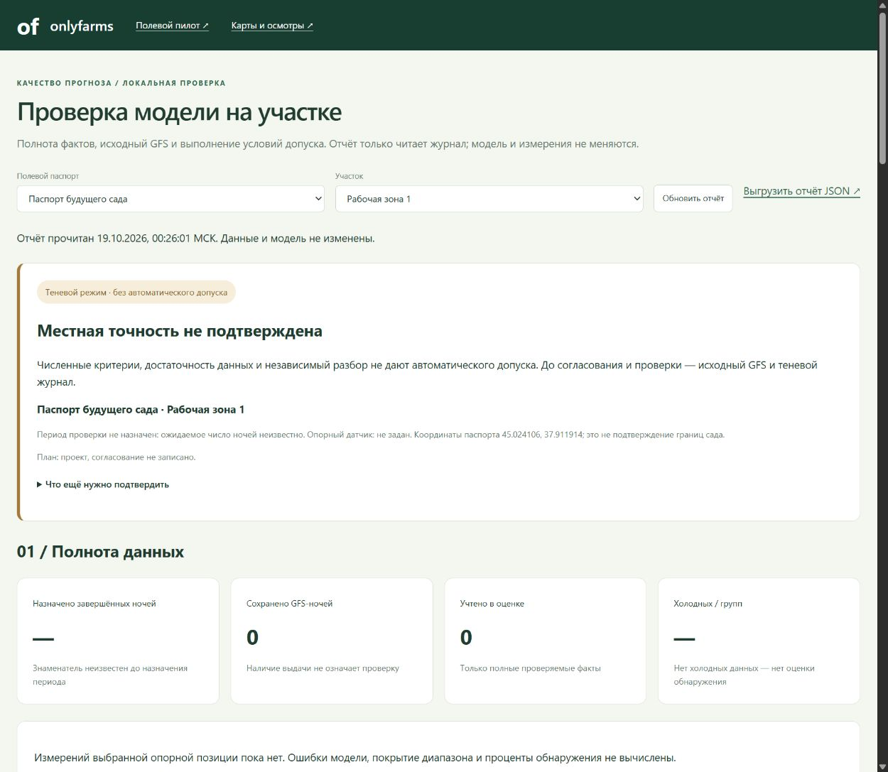

# Отчёт проверки прогноза на участке

Добавлен [разбор отдельной ночи с графиком температуры и GFS](SITE_VALIDATION_NIGHT.md). Все ночи сохранённого периода доступны для выбора; исключённые измерения и пропуски показаны отдельно, прежний график не подставляется при отсутствии данных.

Добавлен [импорт CSV опорного датчика](SITE_MEASUREMENT_IMPORT.md): предварительная проверка, привязка к выбранной версии периода, сохранение фактов и пересчёт отчёта. Чтение отчёта остаётся без записи; загрузка выполняется отдельным явным действием.

Добавлена [форма периода и фиксации критериев](SITE_VALIDATION_SETTINGS.md). Отчёт читает выбранную сохранённую версию условий участка, а при её отсутствии — первоначальный проект. Настройки записываются отдельно от измерений; автоматического допуска нет.

Добавлено 19 октября 2026. [Открыть отчёт](http://127.0.0.1:8770/validation). Ссылка есть в меню полевого пилота и в разделе журнала. Страница открывается отдельно, поэтому несохранённый паспорт в прежней вкладке не перезагружается.

Отчёт читает местный журнал и [проект протокола](field-validation/PROTOCOL.md). Он не импортирует данные, не запускает GFS, не обучает модель, не согласовывает регламент и не включает сбор. В рабочем отчёте сейчас нет измерений выбранного участка, период не назначен, местный кандидат не зафиксирован. Итог — **местная точность не подтверждена**; проценты и ошибки отсутствуют, а не равны нулю.

## Что показано

1. Полевой паспорт и участок. Демонстрационные паспорта не входят в выбор. Для закреплённой проверки используется указанная версия паспорта и опорный датчик; отличия от последнего паспорта обозначены.
2. Полнота: назначенные завершённые ночи, сохранённые выдачи, учтённые ночи, холодные даты/группы, доли своевременных свежих GFS, полных 14 часовых целей и пятиминутных слотов. До назначения периода ожидаемое число ночей неизвестно. Отсутствующие прогнозы остаются в знаменателе.
3. Сравнение: MAE минимума по всем и холодным ночам, смещение, почасовая MAE, TP/FN/FP/TN, обнаружение и два разных показателя ложных тревог. GFS оценивается только на полных проверяемых местных фактах. Колонки локального кандидата и разницы пусты: его сопоставимых сохранённых прогнозов пока нет, GFS в них не копируется.
4. Тридцать один критерий из проекта протокола, с фильтром по группам. Различаются выполненный численный порог, невыполненный порог, нехватка данных, несогласованное условие, отсутствие кандидата и необходимость отдельного разбора. Зелёная строка не означает допуска модели.
5. Перечень последних GFS-выдач по ночам с количеством фактов, включением/исключением и причинами. Экспорт JSON содержит те же результаты, идентификаторы исходных выдач, версии и SHA плана. Показанные числа не записываются обратно в журнал как наблюдения или согласование.

## Правила расчёта

Границы периода берутся из выбранной сохранённой версии, а до её появления — из `config/site_validation_plan.json`; учитываются только ночи, завершённые к серверному времени, с датой вечера включительно. Без периода нет расчётного процента полноты. До закрепления участка/версии/датчика нет основной оценки качества, даже если старые наблюдения уже есть в журнале. Весенняя область не заполняется осенними ночами.

Последняя реальная GFS-выдача выбирается до чтения её исхода; более старая с удобными фактами не подставляется. Требуются исходный выпуск до 19:00, соответствующая версия паспорта, опорная температура около2м, завершённая полная ночь и подтверждённое отсутствие защиты. Смена метаданных датчика при импорте, неполные или противоречивые принятые значения приводят к исключению с объяснением. Старые импорты не содержат независимой истории установки; совпадение сохранённых метаданных не заменяет документ проверки прибора.

Часовая цель повторяет nearest±5мин без интерполяции; конфликтующие принятые температуры одного срока не разрешаются выбором удобного значения. Полнота частого ряда считается по168 фиксированным пятиминутным слотам 19:00–08:55 с допуском±1мин: много строк в одном слоте не повышают долю, пропуски не восстанавливаются. Это полнота регистрации, а не доказательство точности прибора.

Нулевой знаменатель даёт отсутствующую оценку. Отсутствие холодных ночей не даёт100% обнаружения или ноль серьёзных пропусков. Бюджет за30ночей не вычисляется по неполному контролю: нужны все назначенные ночи с проверяемыми исходами. Порог погоды0°C и серьёзный промах при≤−1°C не являются порогами повреждения яблони.

Часовая ошибка первого холодного отсчёта/длительности показана как диагностическая величина. Условие точного времени остаётся на отдельном разборе: нужны границы переходов, частый ряд и цензурирование. Диапазоны исследовательских станционных моделей не подставляются вместо местного диапазона.

Поддерживается текущая версия правил14часов, шаг5мин, окно19–09 и порог0°C. Изменение этих правил в плане приводит к явному отказу, а не к молчаливому расчёту по прежним константам.

## Что остаётся за отдельной проверкой

Согласование L/B и периода, проверка точности/установки прибора и часов, восстановление резервной копии, чувствительность к пограничным температурам, блочные интервалы, независимость эпизодов и сравнение нескольких зон не подтверждаются автоматически. Парное сравнение локального кандидата и его диапазона требует его зафиксированных выдач в совместимой схеме. Отчёт не выдаёт формальное разрешение на применение: итоговый допуск остаётся за проверкой протокола и агрономом.

Исходный `field-report` сохранён. Новая страница добавляет расчёт части условий протокола отдельным read-only адаптером; не переписывает прежние метрики, модели или критерии.

## Проверка реализации

Проверены535Python-тестов полного набора и32JS-теста; после дополнительных защит целевые15Python-тестов отчёта повторены, всего537разныхPython и32JS (569проверок). Использованы только удаляемые технические фикстуры: пропуск холода, тёплая ночь, защита, неполный период, новая непроверяемая выдача, смена датчика, конфликт температур, исключение демо и неподдерживаемые правила. GET проверен на отсутствие записи и ограничение происхождения запроса. Временный браузерный сервер с пустым паспортом закрыт и удалён; реальных измерений не создавалось.

Проверены широкий и390px экраны, выбор группы критериев и пустые значения. Все198 прежних файлов полевого хранилища и опубликованный указатель Sentinel сохранены; исходные модели/детектор проверены. Полевой автосбор не включался.

