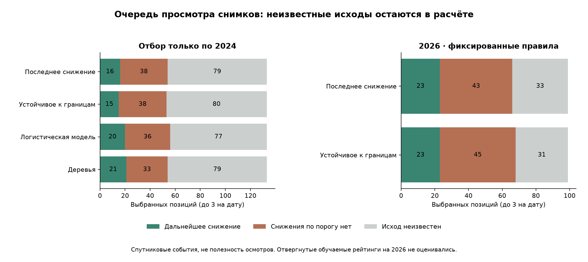

# Полный список кандидатов и спутниковый ориентир для осмотров

21 октября 2026. **Обучаемый приоритет полезных осмотров пока не подтверждён: реальных меток полезности нет.** Выполнен отдельный эксперимент по более узкой задаче — ранжированию площадей по последующему спектральному снижению. Новые модели не доказали улучшение с сохранением прежних найденных случаев и учётом неизвестных исходов. По 2024 оставлено простое правило последнего снижения, производственного подключения нет.

## Что изменилось в проверке

Прежние модели оценивались на парах с пригодным следующим снимком через 6–8 дней: 573 пары 2024 и 499 пар 2026. Это допустимая условная проверка спектрального прогноза, но она не описывает весь список, доступный команде на дату выбора. В реальной очереди нельзя заранее знать, где найдётся пригодный следующий снимок.

Теперь кандидат создаётся **без поиска будущего снимка**. Нужны текущая пригодная съёмка и предыдущая той же версии обработки за 2–21 день. Все такие кандидаты остаются в очереди. Затем независимо присоединяются известные исходы из прежнего набора; отсутствие исхода остаётся `null`, а не отрицательной меткой.

| Архив | Кандидатов | Дат с кандидатами | Известен исход через 6–8 дней | Исход неизвестен |
|---|---:|---:|---:|---:|
| 2024 | 1165 | 65 | 573 | 592 |
| 2026 | 676 | 34 | 499 | 177 |

Это весь **пригодный входной пул данного архива**, а не полное ежедневное покрытие хозяйства. Площадь без пригодного текущего/прошлого наблюдения не ранжируется. Среди дат готовых архивных сцен (97 в 2024 и 45 в 2026) на 32 / 11 датах не было ни одного кандидата; причины не приписаны автоматически облакам. Список дат сохранён отдельно.

R01–R27 — приблизительные обводки, а не подтверждённые ID полей. R18 не имеет достаточного ядра. Ограничение исходных пикселей — минимум 10 ячеек, 80% покрытия и одна версия обработки — сохранено. Никакие реальные осмотры или результаты посещений не добавлены.

## Что именно предсказывается и сравнивается

Положительный спутниковый исход: хотя бы один из NDVI/NDMI снизился минимум на 0,10 на прежней ближайшей пригодной съёмке через 6–8 дней. Отрицательный — оба доступных индекса не достигли такого снижения. Неизвестный — подходящей цели нет или она пересекает границу проверочного месяца.

Это **не** повреждение растений, диагноз, потеря урожая или необходимость осмотра. Снижение после уборки также остаётся положительным спектральным исходом. Учить модель полезности осмотра на этих метках и называть её проверенной агрономической моделью нельзя.

Зафиксирован исследовательский бюджет до **трёх площадей на дату**, одинаковый для всех способов. Он не согласован как реальный график выездов. Если пригодных площадей меньше трёх, используются все; отсутствие очередного снижения не является рекомендацией обязательно ехать в три места. При равных оценках применяется фиксированный хеш, не будущий результат.

Четыре способа:

- последнее наблюдавшееся недельное снижение NDVI/NDMI — простой ориентир;
- изменение, сохраняющееся во всех 11 сценариях границ на общих пикселях двух прошлых снимков;
- логистическая модель по 30 прошлым спектральным признакам и признакам поддержки;
- ExtraTrees по тем же 30 признакам.

Устойчивость рассчитана по уже видимым снимкам: базовый контур, восемь сдвигов, ядро, расширение. Неполная поддержка даёт явный флаг и нулевую оценку правила устойчивости; кандидат остаётся в пуле. Нулевой балл здесь не доказывает отсутствие проблемы. Модели не используют ID площади, целевую дату/изображение, будущие облака или результаты осмотров.

Логистическая модель C=0,1; деревья — 256, глубина 3, минимум 15 примеров в листе. Параметры фиксированы заранее. При недостатке классов/дат — простое правило, без выдуманных положительных примеров.

## Как выбирали только по 2024

Пять последовательных проверок июнь–октябрь. Обучение видит только известные цели строго до начала месяца. Из проверочного списка **не удаляются** кандидаты с неизвестной или пересекающей границу месяца целью: их исход для расчёта неизвестен. Все кандидаты одной даты остаются вместе. R23–R27 не обучают модель, нормировку и выбор.

Итоговый отбор — 699 кандидатов на 46 датах, 133 выбранные позиции. Для 274 кандидатов цель известна внутри проверочного месяца. Финальное обучение допустимого алгоритма использует прежние 489 размеченных неотложенных пар 2024. В 2025 и 2026 обучения/настройки нет.

Улучшение допускается только при сохранении **каждого** найденного простым правилом известного положительного случая, строгом улучшении нижней границы парной разницы и отсутствии возможного роста отрицательных выборов с учётом пропусков. Простое увеличение суммы попаданий не заменяет сохранение случаев.

## Неизвестные исходы и границы вывода

Для выбранных позиций нижний сценарий доли событий = известные события / все позиции; верхний = (известные события + неизвестные) / все позиции. В основной оценке каждая дата имеет равный вес, поэтому проценты могут отличаться от деления суммарных чисел.

Это **границы из-за пропущенных исходов, не 95% доверительные интервалы**. Они не учитывают неопределённость переноса на другой сезон/хозяйство. Дополнительно считалась парная разница: общие выбранные места сокращаются, а неизвестные в несовпадающих частях списков получают лучший/худший возможный исход. Так общие пропуски не раздувают разницу, но и не создают мнимый выигрыш.

## Результат отбора 2024

| Способ | Позиции | Дальнейшее снижение | Снижения по порогу нет | Неизвестно | Доля событий: нижний–верхний сценарий | Потеряно известных событий простого правила |
|---|---:|---:|---:|---:|---:|---:|
| Последнее снижение | 133 | 16 | 38 | 79 | 13.4–72.1% | 0 |
| Устойчивое к границам | 133 | 15 | 38 | 80 | 12.7–72.1% | 4 |
| Логистическая модель | 133 | 20 | 36 | 77 | 16.3–73.6% | 3 |
| Деревья | 133 | 21 | 33 | 79 | 17.0–75.7% | 4 |

Деревья выглядят лучше по сумме известных событий: 21 против 16, при 33 известных отрицательных вместо 38. Но они потеряли 4 конкретных случая простого правила, а 79 из 133 выбранных позиций не имеют исхода. Парная разница допускает от **-24.6 до +31.9 п.п.**; возможен рост отрицательных выборов до 34 позиций. Нельзя объявить выигрыш, игнорируя пропуски и заменённые верные случаи.

По зафиксированным условиям ни один вариант не прошёл; выбран прежний простой ориентир. Он также не становится доказанной моделью осмотров — это лишь объяснимое исследовательское правило.

## После фиксации выбора: 2026

На 2026 оценены только выбранный способ и заранее фиксированные два правила. Отвергнутые логистическая модель и деревья на 2026 не проверялись. Это защищает от последующего выбора удачного варианта по этому году.

| Пул выбранного простого правила | Дат | Позиции | Дальнейшее снижение | Снижения по порогу нет | Неизвестно | Нижний–верхний сценарий доли |
|---|---:|---:|---:|---:|---:|---:|
| Все пригодные площади 2026 | 34 | 99 | 23 | 43 | 33 | 22.5–55.9% |
| Обучаемая территория 2026 | 33 | 98 | 13 | 54 | 31 | 13.1–45.5% |
| Резервная территория 2026 | 30 | 86 | 17 | 47 | 22 | 19.4–43.9% |
| Резервная территория 2024 | 52 | 139 | 12 | 46 | 81 | 8.3–66.7% |

На полном пуле 2026 устойчивое к границам правило дало 23 известных события, 45 отрицательных и 31 неизвестный исход; простое — 23 / 43 / 33. Подтверждённого преимущества нет. Пространственные поднаборы **ранжируются отдельно**, поэтому их позиции/находки не складываются в общий результат; три из пяти резервных площадей — другая доля охвата, чем три из всего сектора. Соседний резерв не является независимым хозяйством.

23 здесь нельзя сравнивать с прежними 9 попаданиями NDVI или 3 NDMI: другая цель (любой из двух индексов), полный пул и фиксированное число выбранных позиций вместо порога старого детектора. Старые детекторы, их пороги и результаты сохранены.

2026 уже изучался ранее — это проверка без нового подбора, не свежий слепой тест. В текущем архиве нет проверки за 2025. Даты, соседние площади и перекрывающиеся изменения зависимы.

## Готовый архивный список для просмотра источников

Для последней доступной даты **2026-10-19** отдельно сохранён `archive-review-list.json`: версия правила, весь размер входного пула, до трёх выбранных площадей, даты и исходные признаки. Формирование списка не читает будущие исходы. Это не назначения и не якобы проведённые осмотры.

| Площадь | Прошлая → текущая съёмка | Последний недельный темп NDVI | NDMI | Общие пиксели | Следующий ручной шаг |
|---|---|---:|---:|---:|---|
| R04 | 2026-10-13 → 2026-10-19 | -0.041 | +0.074 | 92.6% | проверить поддержку источника |
| R06 | 2026-10-13 → 2026-10-19 | -0.010 | +0.006 | 100.0% | сравнить пригодные снимки |

Недельный темп пересчитан с фактического интервала, это не измеренное изменение ровно за 7 суток и не будущий прогноз. Статус культуры/операции/посещения неизвестен. Доступность этих же перепроцессированных изображений в исходный исторический день не доказана. Порядок предназначен для ручного просмотра архива; он не предписывает агрономическую операцию.

## Что теперь готово для продукта

Есть проверяемый способ сохранять полный пул, одинаковый бюджет, причины выбора, поддержку источников и неизвестность результата. Он выявляет, где эффект пока нельзя подтвердить. Дальнейшая модель должна обучаться по реальным исходам осмотров, а не подменять их следующим снимком.

Комплект [сбора реальных данных](inspection-priority/PROTOCOL.md) остаётся пустым: проверка шаблонов вернула `no_data`, 0 назначений / 0 результатов и `training_allowed=false`. Для первого реального раунда нужны подтверждённая привязка Rxx к полям, зафиксированный до просмотра системы обычный список агронома, список системы, случайные контроли и результаты всех назначений. Невыполненные осмотры останутся неизвестными. Расписание, бюджет и критерии должны быть согласованы до сбора; текущие три позиции — условие исследования.

Никакой автоматической подмены списка агронома или рабочего допуска не добавлено. До реальной проверки можно показывать изменение и качество источника, помогать вручную сформировать осмотр и сохранить результат; обещать экономию времени, диагноз или полноту обнаружения повреждений по этим цифрам нельзя.

## Проверка и воспроизведение

`scripts/train_spectral_triage.py protocol|fit|evaluate`, `scripts/verify_spectral_triage.py`, `scripts/report_spectral_triage.py`. После заморозки повторное обучение и оценка заблокированы. Заморозка: `ee302fdc013d0409791f397a605aca0008bc3f5d29017edc6b9e762070cce1e2`.

142 целевых теста прошли, включая 18 новых. Верификация воспроизвела полный пул, прежние 573/499 размеченных случаев и их значения, все внеобучающие оценки 2024, выбор, сохранение неизвестных в знаменателях, отсутствие будущих сцен в признаках, контроль пиксельных хешей и неизменность 2282 прежних файлов. Реальных меток полезности осмотра — 0. Исследовательские исходы не импортированы в журнал, новые задачи не созданы.
