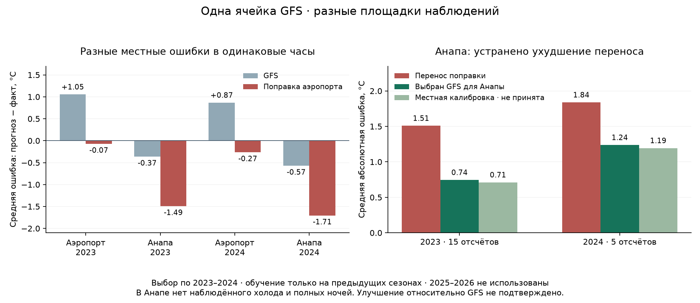

# Перенос коррекции Витязево → Анапа

Отдельный эксперимент, 17 октября 2026 года. Выбор: **сохранить прежнюю поправку в Витязево, для другой физической позиции использовать GFS** (`identity_gfs`). Ухудшение от переноса устранено. Убедительного выигрыша местной калибровки относительно GFS пока нет. Сервис и исходный детектор не изменялись.

## Почему прежняя коррекция ухудшает Анапу

Это две позиции: аэропорт 45.002,37.347,53 м и синоптическая точка 44.883,37.283,32 м. У них одна ближайшая ячейка GFS45.0,37.25 и одинаковые модельные входы. Прежняя регрессия не получает местных признаков и предсказывает одинаковую температуру для обеих точек. Одинаковый код исходного архива не означает одинаковую площадку наблюдения.

На одинаковых UTC-сроках Анапа теплее аэропорта в среднем на 1.15°C в 2022 (8 пар),1.42°C в 2023 (15 пар),1.44°C в 2024 (5 пар). Поэтому перенос аэропортового охлаждения даёт отрицательное смещение в Анапе:

|Год|Физическая точка|Общих сроков|Смещение GFS, °C|Смещение коррекции, °C|MAE GFS → коррекция, °C|
|---|---|---:|---:|---:|---:|
|2023|Витязево|15|+1.054|-0.075|1.289 → 1.238|
|2023|Анапа|15|-0.366|-1.495|0.745 → 1.508|
|2024|Витязево|5|+0.866|-0.267|2.954 → 2.005|
|2024|Анапа|5|-0.574|-1.707|1.237 → 1.838|

Поправка в среднем составляет −1.129°C в 2023 и−1.133°C в 2024 на этих общих сроках. Она помогает аэропорту, где GFS теплее измерений, но охлаждает уже слегка заниженный GFS Анапы. Сравнение по одним датам и часам отделяет это различие от неравномерной полноты данных.

Разница не постоянна: в 2024 от −1.9 до+6.2°C. Например, 7 апреля 00UTC GFS10.19°C, аэропорт 4.0°C, Анапа 10.2°C, перенос даёт 7.52°C. По GFS в этот час ветер 1.38 м/с, облачность 6.1%. А 16 апреля 03UTC при ветре 10.90 м/с и облачности 100% аэропорт 16.0°C, Анапа 14.1°C: знак различия обратный. Это прогнозные погодные поля, не показания ветромера на участке.

Описательные срезы уже после выбора, **не использованные для подбора**:

|Срез GFS|Часов|Анапа − аэропорт, °C|MAE Анапы GFS → перенос, °C|
|---|---:|---:|---:|
|Ветер ≥ 2 м/с|16|+1.10|0.91 → 1.58|
|Облачность ≥ 50%|14|+1.01|0.60 → 1.14|
|Облачность < 50%|6|+2.40|1.49 → 2.64|
|Ветер < 2 м/с|4|+2.72|0.69 → 1.64|

Эти редкие сроки не доказывают причинную роль моря, высоты или рельефа. Высота отличается лишь на 21 м; данных двух площадок недостаточно, чтобы обучить надёжный закон поправки по высоте/берегу. Дополнительно различаются типы сообщений: аэропорт FM-15 с целыми°C, Анапа FM-12 с десятыми. Измеренное различие включает микроклимат, площадку и особенности наблюдений. В 2023–2024 у Анапы 15 из 20 отсчётов приходятся на 03UTC, остальные 5 на 00UTC; каждую из 20 ночей представляет только один срок. По ним нельзя восстановить минимум всей ночи.

## Что проверено

Использован чистый разделённый [архив 2022–2024](VITYAZEVO_SPLIT_REPORT.md). Новых загрузок не понадобилось. Наблюдения с QC1/5, точные UTC, без интерполяции и смешения площадок. Старые ISD-Lite данные с подменой позиции в обучение не попали.

Реестр 9 вариантов и правила сохранены до расчёта их ошибок в [протоколе](../config/station_transfer.json) и `protocol-before-fit.json`. Варианты: GFS, прямой перенос, отключение переноса на другую позицию и три местных поправки с двумя величинами сглаживания: ошибка GFS на площадке; разность одновременных показаний двух площадок; остаточная ошибка регрессии аэропорта на местных измерениях.

Для местной поправки нужны минимум 3 разные прошлые ночи на **том же сроке**, прогнозная температура должна лежать внутри прошлого местного диапазона. Поправка сглаживается множителем n/(n+5) или n/(n+20); при нехватке данных возвращается GFS с причиной. Это ограничитель экстраполяции, а не доказательство достаточности 3 измерений. Новый участок без собственных прошлых измерений всегда получает GFS с отметкой отсутствия местной проверки.

Хронология: обучение 2022 → проверка 2023; обучение 2022–2023 → проверка 2024. Ни один прогноз не использует измерения своего сезона или текущей ночи. Нормализатор/погодная регрессия аэропорта взяты из соответствующего прежнего фолда, без повторного подбора. Итоговый исследовательский файл сохраняет обучение 2022–2023, **без дообучения на 2024**. Прогнозы аэропорта точно совпадают с прежними на всех 2576 часах двух проверочных сезонов.

Теперь Анапа — площадка разработки этого нового опыта: её старые измерения используются для местной калибровки, а 2023–2024 — для выбора. **Это не новая независимая проверка переноса на неизвестную станцию.**2025–2026 не открывались, не оценивались и не участвовали в выборе этим экспериментом.

## Результаты Анапы и выбор

|Год|Измерений|Прямой перенос, MAE°C|Выбранный GFS, MAE°C|Снижение против переноса|Местная поправка `local_bias_5`, MAE°C|
|---|---:|---:|---:|---:|---:|
|2023|15|1.508|0.745|50.6%|0.710|
|2024|5|1.838|1.237|32.7%|1.194|

Местная поправка даёт выигрыш относительно GFS лишь 4.6% /3.5%: ниже заранее принятого порога 5% **в каждом году**. Её описательный недельный bootstrap-интервал разницы MAE относительно GFS —[-0.160;+0.086]°C, включает отсутствие выигрыша. Всего 15 непустых календарных блоков,2000 повторов, равный вес годов; это иллюстрация неопределённости на годах выбора, не независимое подтверждение и не доверительный диапазон температуры.

Даже 90-й перцентиль абсолютной ошибки 2024 у этой поправки хуже GFS:2.754 против 2.614°C. Поэтому не снижаем порог принятия после просмотра результата. Калибровка применялась к 9 из 15 проверочных часов 2023 и 4 из 5 часов 2024; остальные оставались GFS. В 2023 обучение местной поправки 03UTC —6 ночей 2022; в 2024 —18 ночей для 03UTC и 4 для 00UTC. Другие сроки не получили достаточной поддержки.

|Вариант|MAE2023, °C|MAE2024, °C|Местно скорректированных часов 2023 /2024|Решение|
|---|---:|---:|---:|---|
|gfs|0.745|1.237|0 / 0|сравнение|
|naive_reference|1.508|1.838|0 / 0|сравнение|
|identity_gfs|0.745|1.237|0 / 0|выбран|
|local_bias_5|0.710|1.194|9 / 4|не прошёл|
|local_bias_20|0.721|1.202|9 / 4|не прошёл|
|paired_delta_5|1.008|1.249|9 / 4|не прошёл|
|paired_delta_20|1.093|1.447|9 / 4|не прошёл|
|residual_bias_5|0.974|1.439|9 / 4|не прошёл|
|residual_bias_20|1.075|1.447|9 / 4|не прошёл|

Кандидат допускается, если в каждом году улучшает GFS Анапы минимум на 5%, не увеличивает ложные/пропущенные пересечения 0°C на наблюдённых сроках и точно сохраняет аэропортовые прогнозы. Ни одна местная поправка не прошла. Ноль наблюдённых холодных сроков означает **отсутствие проверки холода**, а не идеальный детектор. Все варианты имеют 0 наблюдённых ложных пересечений в Анапе; между наблюдениями ложные тревоги не оценены.

## Витязево и сохранённые ограничения

|Год|Наблюдённых часов|MAE всех часов GFS → сохранённая поправка, °C|MAE холодных часов, °C|MAE минимума полных 14-часовых ночей, °C|
|---|---:|---:|---:|---:|
|2023|1269|1.428 → 1.187|6.755 → 3.589|1.968 → 1.379|
|2024|1181|2.281 → 1.629|6.837 → 3.334|3.368 → 2.203|

Это прежние результаты, нового улучшения в аэропорту не заявляем. Холодная ошибка 3.3–3.6°C остаётся большой; на 5 полных холодных ночах 2023–2024 поправка даёт 3 обнаружения и 2 пропуска пересечения 0°C. Исходный продуктовый детектор с его порогом, вероятностями и временем эпизода сохранён и на эти площадки не переносился. Отдельные температурные пересечения его не заменяют.

В Анапе 0 отрицательных наблюдений и 0 полных 14-часовых ночей. Начало, длительность, минимум, покрытие холодного диапазона ошибки и ущерб яблоне здесь не проверены. По ферме 45.024106,37.911914 новых измерений нет. Выбранная стратегия — исследовательский результат, к полевому сервису не подключена; исходный прогноз фермы не изменён.

## Практический вывод для продукта и агронома

Подтверждённое улучшение — устранение ухудшения от чужой поправки, а не победа над GFS в новой локации. Совпадение ячейки GFS или кода архива больше не основание переносить калибровку. Выдача эксперимента содержит источник прогноза, причину возврата к GFS, наличие местной калибровки и явный признак отсутствия местной проверки холода. Нельзя обещать точность 0.7°C или надёжность заморозков на участке по этим 20 тёплым отсчётам.

Следующий содержательный шаг с агрономом — получить непрерывные местные ряды с координатами, высотой/размещением датчиков, точным временем и контролем качества, включая спокойные ясные холодные ночи, ветреные эпизоды и обычные тёплые ночи. По возможности нужны одновременные измерения в низине и обычной части сада: один датчик не описывает всю площадку. До получения данных не придумываем поправку на рельеф и не обещаем температуру цветков или эффективность защиты. Нужны дневник фенофазы, действий и повреждений, чтобы затем проверить полезность решений, а не только MAE.

Для следующего опыта заранее зафиксировать более строгую проверку: другая физическая станция полностью вне обучения/выбора и будущие сезоны после заморозки протокола. Раздельно оценивать режим без местных меток и калибровку на прошлых местных сезонах. Текущие 2023–2024 остаются годами разработки, а ранее просмотренные 2025–2026 нельзя объявить новым слепым тестом.

## Воспроизводимость

- Проверка 17 октября: **458 Python + 20 JavaScript = 478 тестов прошли**, без пропусков. Из них 13 новых тестов границ переноса/калибровки. Дополнительно подтверждены SHA прежних моделей и выборов, неизменность исходного полевого выпуска и отсутствие новых полевых измерений; график просмотрен.
- Модель: `agro_checker/station_transfer_study.py`; отчёт отдельно: `station_transfer_report.py`.
- Протокол: [config/station_transfer.json](../config/station_transfer.json).
- Итог со всеми метриками/парными сроками: [STATION_TRANSFER_SUMMARY.json](STATION_TRANSFER_SUMMARY.json).
- Кэш: `data/working-zone-01/station-transfer/`: протокол, диагноз до сравнения, модели фолдов, все прогнозы/причины и неизменяемый выбор.
- SHA выбора: `6421cc017d795d2658e7fe0a117ad7a782cee063f6e55a332d5f5f679194dbe9`. Родительский выбор: `c1c0a6013777bbe50a13bfe594829ca42e8b4203dcdf5a04ef33030adcf86e3c`.
- Исходные данные/родительские выборы и артефакты защищены SHA; повтор запуска проверяет их и читает сохранённый выбор. Любой следующий поиск требует нового эксперимента.

Запуск из корня: `.venv\Scripts\python.exe -X utf8 -m agro_checker.station_transfer_report`.
