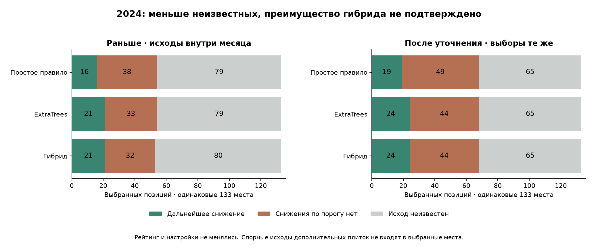

# Неизвестные спутниковые исходы: восстановление и проверка гибрида

21 октября 2026. **Проверка стала полнее, но преимущество гибрида без роста ложных выборов не подтверждено.** В выбранной очереди неизвестность уменьшилась с 80 до 65 из 133 мест. Теперь у гибрида и ExtraTrees одинаково: 24 известных снижения / 44 отрицательных / 65 неизвестных. Выявлены ещё три потерянных относительно простого правила случая, прежде скрытые границей месяца. Гибрид не подключён к продукту.

## Что зафиксировано до восстановления

699 кандидатов на 46 датах 2024, исходные входные признаки и внеобучающие оценки, лимит до трёх мест на дату, **те же 133 выбора каждого способа**, гибрид `protect_0.2_margin_0`. Ни обучение, ни новые пороги, ни выбор другого варианта по восстановленным исходам не выполнялись. 2025–2026 не использовались для анализа/подбора в этом этапе. R23–R27 не входят в этот проверочный пул.

Цель прежняя: хотя бы один core-медианный NDVI/NDMI снизился минимум на 0,10 на пригодной съёмке через 6–8 дней. Это спектральный исход, **не повреждение, урожайность, диагноз или польза осмотра**. Положительные и отрицательные названия относятся только к этому порогу.

## Откуда взяли дополнительные данные

Получен полный каталог [Sentinel-2 Collection 1 L2A в Earth Search](https://earth-search.aws.element84.com/v1/collections/sentinel-2-c1-l2a) для того же сектора за **2024-06-07 — 2024-11-03**: 118 записей, пагинация завершена. Для окон с отсутствующими целями прочитаны 56 сцен: 45 со спектральными данными и 11 с маской, уже исключающей пригодное ядро. Из спектральных сцен 27 повторно использованы из неизменного архива, 18 извлечены дополнительно; ещё 11 потребовали только чтения SCL. Ошибок загрузки нет.

Прежний сборщик отклонял плитку T37TDL, если она не покрывала **всю** исследовательскую сетку. Теперь её можно использовать для отдельного фрагмента: отсутствующие за границей пиксели остаются nodata, ядро не уменьшается ради покрытия. Мозаики и подстановка другого дня не применяются.

Сохранены прежние условия: одинаковая версия обработки с исходным снимком, минимум 10 пригодных ячеек и 80% ядра, 20-метровая сетка, исходные scale/offset, положительные конечные отражения, классы SCL 4/5 с отступом 3×3, высота Солнца от 20°. Классификация SCL включает облака и тени, но сама является результатом обработки, а не местным измерением: [описание Copernicus](https://sentiwiki.copernicus.eu/web/s2-processing). Сравнение масок соседних плиток выполнено отдельно.

## Что удалось уточнить

До восстановления во всём пуле было **274 известных / 425 неизвестных** исхода.

| Изменение | Число кандидатов | Значение |
|---|---:|---|
| Цель уже была, но пересекала границу месяца | 94 | Допущена только в отдельную оценку зафиксированного рейтинга |
| Пригодная по исходной маске цель соседней плитки | 3 | Формальное восстановление; два случая имеют конфликт масок |
| После формального восстановления | 371 известных / 328 неизвестных | Спорные три можно исключить без изменения выбранных очередей |

94 цели ранее скрывались **при выборе настроек** из-за границы месячной проверки. После фиксации прогнозов оценить их допустимо: они не возвращались в обучение, нормировку, выбор варианта или входы. Это расширенная оценка разработанного 2024, а не новый независимый сезон.

В очереди гибрида восстановились **15** ранее скрытых месячной границей исходов: 3 положительных и 12 отрицательных. Все три новые цели соседних плиток находятся за пределами списков, выбранных всеми тремя способами.

## Три новых цели: проверка происхождения и неопределённости

| Фрагмент | Дата выбора → дополнительная цель | ΔNDVI | ΔNDMI | Сверка соседних плиток | Есть в выбранных местах |
|---|---|---:|---:|---|---|
| R12 | 2024-07-01 → 2024-07-08 | -0.054 | +0.044 | нет общих пригодных пикселей; маски противоречат | нет |
| R13 | 2024-07-01 → 2024-07-08 | -0.038 | +0.029 | нет общих пригодных пикселей; маски противоречат | нет |
| R09 | 2024-09-11 → 2024-09-19 | +0.002 | +0.010 | 913 общих пригодных пикселей | нет |

R12/R13 на 8 июля: T37TDL классифицирует все пиксели ядер как **SCL 5 (не растительность)**, исходная T37TDK — как **SCL 10 (тонкие перистые облака)**. Общих пригодных пикселей нет. Такие значения нельзя выдавать за бесспорный факт отсутствия облаков; формальная пригодность одной маски недостаточна для независимого подтверждения.

Для R09 на 19 сентября есть 913 общих пригодных ячеек — 77,1% ядра. Медианная разница NDVI между плитками +0,0077, NDMI −0,0067; 90-й процентиль абсолютной разницы 0,0105 / 0,0129. Это проверка согласия на общей части, не гарантия качества остальных пикселей. Все 11 сценариев геометрии имеют поддержку у трёх новых целей, но это не устраняет неопределённость облачной маски.

Консервативный сценарий **без всех трёх** новых целей уже посчитан отдельно (`month_boundary_only`). Он оставляет 368 известных исходов во всём пуле и даёт **абсолютно те же результаты выбранных очередей**, что формальное дополнение. Поэтому вывод о гибриде не опирается на спорные восстановления.

## Сравнение неизменных списков

Числа в ячейках: дальнейшее снижение / отрицательный выбор / неизвестный исход. В каждой строке остаются те же 133 места.

| Способ | До уточнения | После уточнения |
|---|---:|---:|
| Простое правило | 16 / 38 / 79 | 19 / 49 / 65 |
| ExtraTrees | 21 / 33 / 79 | 24 / 44 / 65 |
| Гибрид | 21 / 32 / 80 | 24 / 44 / 65 |

Прежнее преимущество гибрида на один известный отрицательный выбор исчезло: 32 против 33 превратилось в **44 против 44**. Это не ухудшение прогнозов от новых данных — порядок не менялся. Изменилось знание фактических спутниковых исходов.

Против простого правила известные итоги гибрида лучше по сумме: 24 события против 19 и 44 отрицательных против 49. Но проверка конкретных случаев выявляет потерю трёх его находок; суммы не доказывают сохранение прежних событий.

## Новые выявленные потери: 29 сентября

| Фрагмент | Дата выбора → цель | ΔNDVI | ΔNDMI |
|---|---|---:|---:|
| R11 | 2024-09-29 → 2024-10-06 | -0.004 | -0.139 |
| R07 | 2024-09-29 → 2024-10-06 | +0.018 | -0.140 |
| R08 | 2024-09-29 → 2024-10-06 | +0.000 | -0.159 |

Все три цели относятся к **одной дате 29 сентября → 6 октября**, а не к трём независимым сезонам. Здесь снизился NDMI при почти неизменном NDVI. Месячная граница раньше скрывала эти исходы. Исходные четыре июньских восстановления гибрида сохранены, но утверждение «сохранили все находки простого правила» теперь неверно для расширенного набора.

## Что осталось неизвестным

| Причина в найденном каталоге и прежних условиях | Во всём пуле | В выбранных местах гибрида |
|---|---:|---:|
| Недостаточно пригодных пикселей ядра | 264 | 53 |
| Нет цели той же версии обработки в окне | 59 | 9 |
| Нет съёмки в окне 6–8 дней | 5 | 3 |
| Всего | 328 | 65 |

Первую строку нельзя целиком назвать облаками: учитываются SCL, границы/отступы, nodata и пригодность спектральных данных. В машиночитаемых источниках сохранены количества классов и покрытие каждого фрагмента. Отсутствие цели не превращено в отрицательную метку.

В оставшихся **65 / 133** выбранных позициях исход всё ещё неизвестен. Не расширяли окно на 5–10 дней, не смешивали версии, не интерполировали через облака, не подставляли Landsat/радар вместо измеренного NDMI. Это изменило бы задачу и потребовало отдельной проверки.

## Насколько проверка стала надёжнее

Парная разница доли событий гибрида против правила сузилась с **−15,9…+23,9 п.п. до -9.4…+16.7 п.п.** Против ExtraTrees сейчас **-8.0…+8.0 п.п.** Общие выбранные места сокращаются, неизвестные в различающихся частях получают худший/лучший возможный исход.

В неблагоприятном сценарии неизвестных возможен рост отрицательных выборов до **13 против правила и 11 против ExtraTrees**. Это не ожидаемое число ошибок и не доверительный интервал. Сужение неопределённости полезно, но знак выигрыша всё ещё не установлен.

**Условия сохранения всех базовых событий и отсутствия возможного роста ложных выборов не выполнены.** Гибрид остаётся исследовательским кандидатом; заменять им действующий способ оснований нет. Дальше полезнее независимая фиксированная проверка и реальные исходы выбранных/контрольных мест, чем новый подбор по этим же данным. Реальные осмотры должны учитываться отдельно от спутникового события.

## Сохранность и воспроизведение

`scripts/collect_triage_outcomes.py protocol|catalogue|collect|evaluate`, затем `scripts/verify_triage_outcomes.py`, `scripts/report_triage_outcomes.py`. Повторный сбор/оценка после заморозки запрещены. Заморозка `f51f8344fcefb4de6ce54d334f5562e90910a0ce0364a216ec63761d2755a90a`.

В `data/farm-research/triage-outcomes-2024/` сохранены полные страницы STAC с URL/временем/SHA, версии удалённых объектов, фактические растровые вырезки и хеши, статистика ядер/сценариев, журнал причин неизвестности, расширенные спутниковые исходы и все три неизменные очереди. Новые крупные растры исключены из Git, метаданные и хеши сохранены.

Верификация заново рассчитала индексы из загруженных каналов и все целевые статистики, проверила хеши, отсутствие изменения входов/рейтинга/274 старых известных исходов, точные 133 выбора и отсутствие подбора/переобучения. **172 целевых теста прошли, включая 16 новых. 2304 прежних защищённых файлов неизменны.** Ни одна задача, операция или запись осмотра не создана. Точечные прогнозы, детекторы, диапазоны, интерфейс и журнал прежние.

Ограничения: приблизительные неподтверждённые контуры, зависимость соседних площадей и дат, ранее использовавшийся при разработке 2024, модельные маски облаков, неизвестная историческая доступность нынешних перепроцессированных байтов. Уточнение спутникового архива не подтверждает агрономическую причину изменения.
