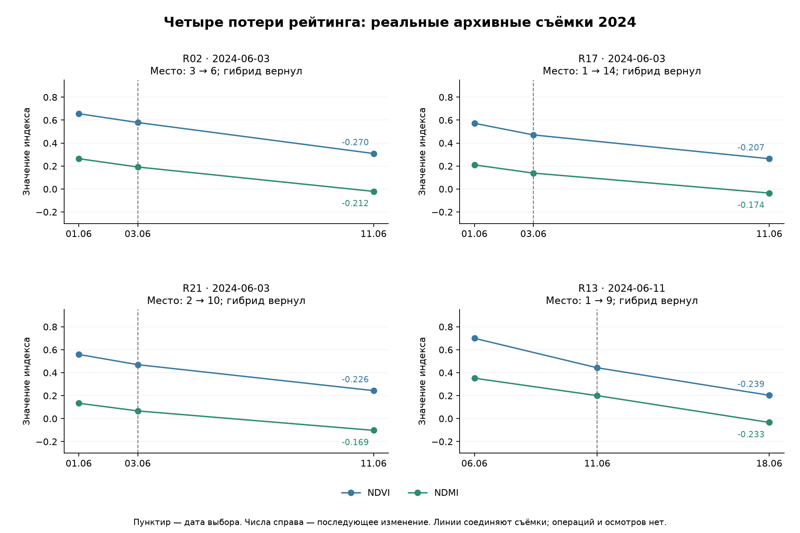
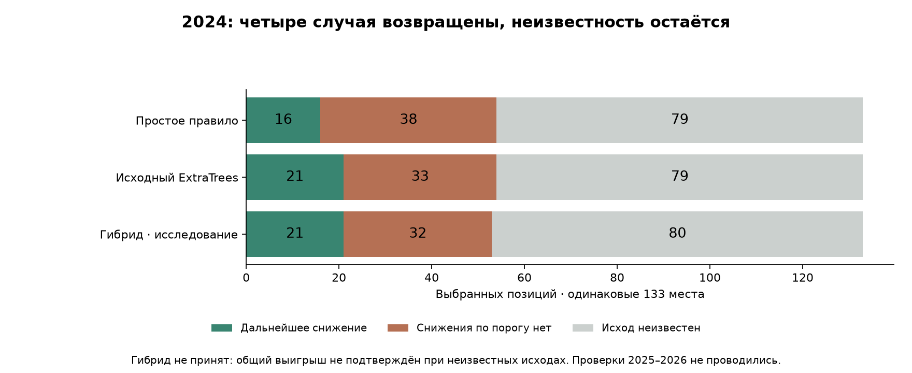

# Возврат четырёх потерь спектрального рейтинга

21 октября 2026. **В исследовании 2024 гибрид вернул все четыре потерянных случая, сохранил все 16 находок простого правила и дал 21 известное снижение при 32 отрицательных выборах.** Исходный ExtraTrees давал 21 / 33. Но гибрид заменил четыре другие находки ExtraTrees, а 80 из 133 исходов неизвестны. Улучшение всей очереди без роста ложных выборов не доказано; рабочие модели и интерфейс сохранены.

## Какие четыре случая потеряны

Это исходы на приблизительных фрагментах, а не подтверждённые повреждения/уборка/проведённые осмотры. Положительный исход — снижение любого индекса минимум на 0,10 на пригодном снимке через 6–8 дней.

| Фрагмент | Выбор → проверочная съёмка | ΔNDVI после выбора | ΔNDMI после выбора | Место: правило → ExtraTrees | Общие пиксели двух входных съёмок |
|---|---|---:|---:|---:|---:|
| R02 | 2024-06-03 → 2024-06-11 | -0.270 | -0.212 | 3 → 6 | 100.0% |
| R17 | 2024-06-03 → 2024-06-11 | -0.207 | -0.174 | 1 → 14 | 85.3% |
| R21 | 2024-06-03 → 2024-06-11 | -0.226 | -0.169 | 2 → 10 | 100.0% |
| R13 | 2024-06-11 → 2024-06-18 | -0.239 | -0.233 | 1 → 9 | 100.0% |

Три случая относятся к одной дате 3 июня и четвёртый — к 11 июня; это не четыре независимых сезона/эпизода. Во всех четырёх снизились оба индекса. Даты/ID найдены в диагностике 2024 и **не входят** в правило восстановления.

## Почему модель их опустила

Непосредственная причина — сортировка: на 3 июня оценки потерянных фрагментов около 0,067–0,077, тогда как три выбранных получили 0,081–0,087. У R13 11 июня было девятое место. Это выход классификатора, не проверенная вероятность повреждения или пользы выезда.

К июню обучающая часть содержала только **85 известных исходов на семи датах, четыре положительных примера на трёх датах**. Деревья глубины 3 с минимумом 15 примеров в листе сглаживают различия; требования сохранять порядок сильных уже наблюдаемых снижений у них нет. Это ограничение обучающего материала и устройства рейтинга, а не установленная агрономическая причина.

Проверена точная арифметическая декомпозиция путей всех 256 деревьев: прошлое снижение увеличивало оценку этих случаев, то есть сигнал не был полностью проигнорирован. Однако другие кандидаты получили более высокую итоговую оценку. Вклад признака в дереве не доказывает причинность и не объясняет, почему физически изменились растения.

Все четыре входные пары имели поддержку всех 11 сценариев границ, общие пригодные пиксели 85,3–100%. Знак уже видимого снижения сохранялся при сдвигах. При этом три июньских скорости пересчитаны с интервала всего **два дня** на недельный темп: это усиливает короткий скачок и не является измерением изменения ровно за неделю. У R13 прошлый интервал — пять дней. Границы по-прежнему не подтверждены.

## Почему нельзя просто объединить два списка

На 3 июня простое правило выбрало R02/R17/R21, ExtraTrees — R09/R13/R22. Все шесть имеют положительный дальнейший спектральный исход. При лимите **три позиции на дату** сохранить шесть отдельных идентичностей невозможно. Возврат старых случаев заменяет другие верные выборы; увеличение бюджета создало бы несопоставимую проверку.

На 11 июня у списков также разные известные находки — R13 и R12. Для всех четырёх восстановлений новый гибрид теряет четыре известные находки исходного ExtraTrees: R09/R13/R22 от 3 июня и R12 от 11 июня. Число 21 сохраняется, состав — меняется. Ни один фрагмент не объявлен вымышленным осмотром.

## Что попробовали

До расчёта результатов зафиксированы 11 вариантов, включая оба исходных способа:

- смешение процентильных рангов с долями ExtraTrees 0,25 / 0,50 / 0,75;
- сохранение одного или двух первых мест простого правила, остальные места — по ExtraTrees;
- защита уже выбранных простым правилом сильных сигналов с недельным темпом от 0,10 / 0,20; замена остальных мест только при преимуществе оценки ExtraTrees более 0 / 0,05.

Защита применяется только к исходным трём местам, не создаёт новые места и не использует будущую метку. Границы 0,10/0,20 — исследовательские пороги, не агрономические нормативы. Доля рангов — не смешение откалиброванных вероятностей.

Использованы те же 699 входных кандидатов на 46 датах, из них 274 с известной целью внутри проверочного месяца. Все варианты выбирают **133 позиции**. Неизвестные исходы и цели за границей месяца остаются в списках. Исходные месячные оценки ExtraTrees вне обучения переиспользованы без изменения: обучение по завершённым целям до начала месяца. Полный обучающий пул прежнего этапа — 489 известных пар вне пространственного резерва; новый финальный ExtraTrees в этом этапе не обучался. R23–R27 исключены из выбора и обучения.

Результаты уже разобранного 2024 использованы для разработки и выбора — это оптимистичная проверка, не независимое доказательство качества. Данные/исходы **2025–2026 не анализировались** в этом этапе. Никаких новых настроек исходного ExtraTrees или старых детекторов не меняли.

## Все варианты 2024

| Вариант | Снижение | Нет снижения по порогу | Неизвестно | Вернул четыре | Потерял других находок правила | Максимальный прирост отрицательных: против правила / ExtraTrees |
|---|---:|---:|---:|---:|---:|---:|
| `baseline` | 16 | 38 | 79 | 4/4 | 0 | +0 / +44 |
| `extra` | 21 | 33 | 79 | 0/4 | 4 | +34 / +0 |
| `blend_0.25` | 17 | 37 | 79 | 4/4 | 0 | +9 / +36 |
| `blend_0.5` | 19 | 34 | 80 | 2/4 | 2 | +18 / +22 |
| `blend_0.75` | 20 | 33 | 80 | 0/4 | 4 | +30 / +6 |
| `anchor_1` | 21 | 32 | 80 | 2/4 | 2 | +25 / +10 |
| `anchor_2` | 18 | 36 | 79 | 3/4 | 2 | +18 / +26 |
| `protect_0.1_margin_0` | 17 | 37 | 79 | 4/4 | 0 | +18 / +25 |
| `protect_0.1_margin_0.05` | 17 | 36 | 80 | 4/4 | 0 | +8 / +33 |
| `protect_0.2_margin_0` | 21 | 32 | 80 | 4/4 | 0 | +22 / +12 |
| `protect_0.2_margin_0.05` | 18 | 35 | 80 | 4/4 | 0 | +9 / +30 |

Последняя колонка — неблагоприятные сценарии неизвестных исходов в несовпадающих частях списков; общие выборы сокращаются. Это не ожидаемое число ошибок и не доверительная граница.

## Перспективный, но не принятый гибрид

`protect_0.2_margin_0`: защищает исходные три сигнала с недельным темпом от 0,20; оставшиеся места может заменить более высокой оценкой ExtraTrees. Среди вариантов, сохранивших все четыре и все находки правила, он имеет наименьшее число **известных** отрицательных выборов при числе находок не ниже ExtraTrees. Это диагностический пример из таблицы, а не второй способ принятия модели.

На известных исходах:

- против правила: 16 → **21** событие, 38 → **32** отрицательных, 79 → **80** неизвестных; ни одной прежней известной находки правила не потеряно;
- против ExtraTrees: **21 → 21** событие, 33 → **32** отрицательных, 79 → **80** неизвестных; четыре исходные потери восстановлены ценой четырёх других положительных случаев.

Итоговые суммы скрывают обмены. Против правила добавлены 5 положительных / 9 отрицательных / 28 неизвестных позиций; убраны 0 / 15 / 27. Против ExtraTrees добавлены 4 / 2 / 13; убраны 4 / 3 / 12. Поэтому даже уменьшение итогового числа известных отрицательных не доказывает, что все новые выборы лучше.

При равном весе дат доля событий гибрида находится между **17.0% и 76.4%** в зависимости от неизвестных исходов. Парная разница против правила допускает **-15.9…+23.9 п.п.**, против ExtraTrees — **-8.7…+9.4 п.п.** Неизвестные способны дать рост отрицательных выборов до 22 / 12 соответственно. Границы пропусков не являются доверительными интервалами и не учитывают перенос между сезонами.

## Решение и следующий шаг

Условия принятия заданы до сравнения: вернуть все четыре, сохранить каждый прежний положительный случай правила, не снизить число известных событий ExtraTrees, не увеличить известные отрицательные относительно обоих способов, пройти неблагоприятные сценарии неизвестности относительно обоих и получить строго положительную нижнюю парную разницу против правила. **Ни один вариант не прошёл все условия.** Заморожено сохранение простого правила, без обещания улучшения. Никакие отвергнутые варианты не проверялись по 2025–2026 и не подключены к рабочему интерфейсу.

Есть проверяемый кандидат для следующей независимой проверки: он восстанавливает сильные сигналы на разработческом 2024 и не увеличивает известные ложные выборы. Для подтверждения нужно зафиксировать его до нового сезона/раунда и собирать одинаковую проверку выбранных и контрольных мест. Отсутствующий снимок или невыполненный осмотр останется неизвестным, не отрицательной меткой. Эти спутниковые цифры не заменяют реальные результаты осмотров и не доказывают экономию времени.

Результаты осмотров, операции и культуры не выдуманы. Задачи/визиты не создавались; точечные прогнозы, детекторы, диапазоны, UI и журнал прежние. Контуры остаются приблизительными.

## Воспроизведение

`scripts/train_triage_retention.py protocol|run|verify`, `scripts/report_triage_retention.py`. Повторный `run` после заморозки запрещён. Заморозка `43e66e9d6589d46b55c33972d3427d068c9258b61c8c34feae4afdd64df37e33`.

Файлы `diagnostics.json`, `selection-table.json` и `candidate-comparison-2024.json` в `data/farm-research/triage-retention-2024` сохраняют случаи, неизменные входы, состав списков и все обмены. Последний файл — исследовательские прогнозы и спутниковые исходы, не импорт журнала.

Верификация воспроизвела оценки и диагностику, все 11 списков на тех же 699 кандидатах, точные четыре идентичности и 133 позиции; подмена будущих меток не меняет ранжирование. **2297 прежних защищённых файлов неизменны. 156 целевых тестов прошли, включая 14 новых.** Тесты включают сохранение бюджета, неизвестные исходы, порядок при равных оценках, защиту сильных сигналов, запрет будущих годов/резервных фрагментов в выборе и запрет повторного подбора после заморозки.
