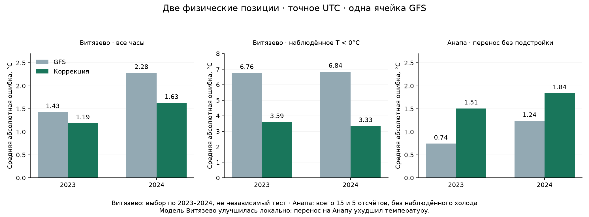

# Витязево и Анапа: очищенный архив и проверка модели

**17 октября 2026.** Собраны полные годовые NOAA ISD 2022–2024 и разделены две физические позиции. На Витязево температурная коррекция улучшила обе последовательные prior-проверки. **Перенос на Анапу ухудшил температуру**, поэтому результат не является общей моделью района или проверкой сада. Исходный детектор, точечная модель, диапазон и полевой маршрут сохранены.

## Источники и две позиции

Исходные полные файлы: [2022](https://www.ncei.noaa.gov/pub/data/noaa/2022/370010-99999-2022.gz), [2023](https://www.ncei.noaa.gov/pub/data/noaa/2023/370010-99999-2023.gz), [2024](https://www.ncei.noaa.gov/pub/data/noaa/2024/370010-99999-2024.gz). Сохранены оригинальные gzip-байты, URL, SHA и время скачивания.2024 читается из предыдущего неизменённого кэша;2022–2023 скачаны дополнительно. Полные файлы содержат17522,17403 и17693 сообщения соответственно, всего52618.

| Позиция | Координаты | Высота в сообщении | Тип сообщений весной | Роль |
|---|---|---:|---|---|
| Витязево, аэропорт |45.002,37.347|53м|FM-15|Обучение и выбор настроек|
| Анапа, синоптическая позиция |44.883,37.283|32м|FM-12|Только проверка переноса после фиксации выбора|

Названия помогают читать отчёт; разделение определяется точными координатами и высотой каждой записи, а не одним индексом370010. Неизвестные позиции карантинируются; здесь их0. Противоречивые дубли внутри одной позиции исключаются; здесь их0. Совпадающее время двух разных позиций не является дублем одной станции. Полные нормализованные годовые ряды сохранены отдельно для каждого пункта; исходные файлы со всеми прочими полями также сохранены.

По [спецификации NOAA](https://www.ncei.noaa.gov/pub/data/noaa/isd-format-document.pdf), T хранится в десятых°C, +9999 означает отсутствие. Для первичных целей использованы толькоQC1/5 — прошедшие все проверки. Два сомнительных аэропортовых сообщенияQC2 весен2022/2024 и отсутствующее сообщение АнапыQC9 не допускаются; исходные значения/флаги остаются в годовом архиве. **Смысл этих флагов отличается отQC Росгидромета1/2, обозначающих восстановление.**

Все пригодные аэропортовые T весен этого среза имеют целые значения°C. Десятичная шкала хранения не означает инструментальную точность0,1°C. Это точность переданных сообщений; дополнительная высокая точность из необязательных блоков не восстанавливалась.

## Полнота для ночной проверки

Архивы годовые; модель проверяется только в поддерживаемой весенней задаче. Окно ночи16:00–05:00UTC следующего дня, то есть19:00–08:00МСК. По92 ночи и1288 ожидаемых точных часовых сроков на каждый пункт и год. Включены нужные утренние сроки1июня. На30-й минуте записи не округляются к часу, пропуски не заполняются.

В каждой ячейке ниже первым указан Витязево, вторым — Анапа.

| Год | Все годовые сообщения | Весенние сообщения | Пригодные точные ночные часы | Полные14-часовые ночи |
|---|---:|---:|---:|---:|
|2022|17388 / 134|4395 / 16|1281 / 8|85 / 0|
|2023|17298 / 105|4372 / 27|1269 / 15|84 / 0|
|2024|17642 / 51|4053 / 9|1181 / 5|76 / 0|

Неполные ночи остаются в почасовой оценке по имеющимся срокам. Минимум14 часовых значений и температурные пересечения нуля оцениваются только на полностью наблюдённых ночах. Это не непрерывный минимум между наблюдениями, температура цветка или длительность реального заморозка.

## Проблема старого объединённого ISD-Lite подтверждена

Сопоставлены старыеISD-Lite цели370010 и очищенные аэропортовые значения по тем же ночнымUTC-часам. Полнота совпала, **значения совпали не везде**:

| Год | Парные часы | Расхождения | Максимальная разность,°C | Все отличающиеся старыеT совпадают с другой позицией Анапы |
|---|---:|---:|---:|---|
|2022|1281|8|3.2|да|
|2023|1269|15|4.2|да|
|2024|1181|5|6.2|да|

Пример:7апреля2024 00UTC старыйISD-Lite даёт10,2°C; аэропортовая запись —4,0°C; другая позиция Анапы —10,2°C. Это конкретный пример подстановки географически другой серии в объединённый ряд, а не просто неодинакового каталога. Число полных ночей само по себе эту проблему не обнаруживает. Списки расхождений иSHA старых источников сохранены в сводке. Старые наборы не переписаны, в новом обучении используются только раздельные full-ISD цели.

Прежние региональные исследования, включавшие370010, нельзя автоматически считать проверкой чистого аэропортового ряда. Для их исправления нужен отдельный версионированный пересчёт с сохранением прежних результатов. Исходный краснодарский детектор здесь не переобучается.

## GFS и протокол выбора

По обеим позициям заново извлечён **один исходный выпуск06UTC**, leads10–23, T/RH/Td/u10/v10/облачность. Замороженный декодер проверяет поля, единицы, время, битовую маску, SHA и принадлежность одному объекту. Обе точки попадают в ячейку45.00,37.25:7,63км от Витязево и13,27км от Анапы. Прогнозные кривые у них одинаковые. Время сценария15UTC, доступностьLastModified+10мин — прокси, не доказанная первая историческая публикация.

Реестр7 вариантов и правила допуска сохранены **до расчёта ошибок** в `config/vityazevo_split.json`. Проверка2023: обучение толькоВитязево2022; проверка2024: обучение толькоВитязево2022–2023. Стандартизация признаков обучается на тех же prior-строках. Используются прогнозная температура, форма ночной кривой, сезон, срок; погодный вариант добавляет Td-дефицит,RH, ветер, облачность и заранее заданные взаимодействия. Цели, флаги фактического холода и координатный идентификатор в признаки не входят.

Для допуска нужны ≥5% снижения почасовойMAE в каждом году, без ухудшения cold-slotMAE иMAE14-точечного минимума, без дополнительных пропусков и ложных холодных полных ночей. Среди допустимых — минимум среднейMAE двух лет с равным весом. Выбран **`ridge_weather_100`**. Финальный исследовательский артефакт — fit2022–2023 из второй проверки; повторногоfit по2024 нет.

После записи и проверкиSHA выбора открыта отдельная цельАнапы. Она не участвовала в обучении/выборе. Архив уже частично рассматривался при поиске данных; ни эта проверка, ни2023–2024 не объявляются новым слепым тестом. Данные2025–2026 этим экспериментом не скачивались, не использовались и не оценивались.

## Витязево: результат

| Проверка | Парные часы | ПочасоваяMAE GFS → модель,°C | Снижение | MAE минимума полных ночей,°C |
|---|---:|---:|---:|---:|
|2023|1269|1.428 → 1.187|16.8%|1.968 → 1.379|
|2024|1181|2.281 → 1.629|28.6%|3.368 → 2.203|

| Проверка | Холодные отсчётыT<0 | ИхMAE GFS → модель,°C | Холодные полные ночи с прогнозомT<0 | Ложные холодные полные ночи |
|---|---:|---:|---:|---:|
|2023|22|6.755 → 3.589|0/2 → 1/2|0 → 0|
|2024|31|6.837 → 3.334|0/3 → 2/3|0 → 0|

**Это пересечения нуля температурной кривой, не предупреждения исходного детектора.** В каждой проверке осталась одна пропущенная полная холодная ночь. Среди полных ночей всего2 холодных в2023 и3 в2024: мало для обещания надёжного обнаружения. ХолоднаяMAE после коррекции остаётся около3,3–3,6°C.

В2023 ещё две ночи с наблюдённым холодом неполные и не входят в счёт1/2. По всем имеющимся срокам холод наблюдался в4ночах: GFS пересёк ноль в0/4, модель —2/4. Это дополнительная диагностика на одинаково наблюдённых сроках; она не восстанавливает истинный минимум пропущенных часов. В2024 все3ночи с наблюдённым холодом полные. Пропуски не скрываются числом полных ночей.

Описательный парный bootstrap по7-дневным блокам,2000повторов, равный вес лет: разницаMAE «модель−GFS»95% от-0.625 до-0.274°C.28 календарных блоков. Интервал посчитан на тех же сезонах выбора, без поправки на выбор победителя, поэтому не является независимым подтверждением. Новый вероятностный диапазон ошибки не обучался.



## Анапа: перенос ухудшил результат

| Год | Наблюдённые часы | MAE GFS → модель,°C | Bias GFS → модель,°C | Полные ночи |
|---|---:|---:|---:|---:|
|2023|15|0.745 → 1.508|-0.366 → -1.495|0|
|2024|5|1.237 → 1.838|-0.574 → -1.707|0|

Bias=прогноз−наблюдение. Поправка Витязево сделала прогноз Анапы слишком холодным. Всего20парных ночных значений за две проверочные весны; ни одного наблюдённого отрицательного значения и ни одной полной ночи. **Надёжность обнаружения холода, минимум и длительность на Анапе не проверены.** Ноль пропусков при нуле наблюдённых холодных событий не считается успехом.

Поскольку входнойGFS и календарь совпадают, модель без местных признаков выдаёт одинаковуюT обоим пунктам. Это объясняет принципиальное ограничение переноса, но не доказывает конкретную физическую причину различий. Настройки после результатаАнапы не менялись. В сервис исследовательская поправка не подключена; прежний полевойGFS сохранён.

## Весь зарегистрированный реестр

| Вариант |MAE2023|MAE2024|Допуск|
|---|---:|---:|---|
|gfs|1.428|2.281|база|
|bias|1.483|1.996|не прошёл|
|lead_bias|1.444|1.884|не прошёл|
|ridge_temperature_10|1.338|1.909|прошёл|
|ridge_weather_10|1.239|1.638|прошёл|
|ridge_weather_100|1.187|1.629|прошёл|
|ridge_weather_1000|1.163|1.665|прошёл|

ПогоднаяRidge1000 лучше в2023, но хужеRidge100 в2024; победитель выбран по заранее заданному среднему двух лет. Простые общие и почасовые сдвиги не прошли правило≥5% в каждом году. Полные причины допуска/отклонения и ошибки холодных сроков сохранены в [численной сводке](VITYAZEVO_SPLIT_SUMMARY.json).

## Вывод для продукта и продолжение

Можно показать: исправленную идентичность источников, воспроизводимое улучшение локальной температуры и минимума в Витязево, а также честный отрицательный результат переноса на Анапу. Нельзя обещать такую ошибку на ферме45.024106,37.911914, гарантировать отсутствие заморозка или запускать защиту по одной этой модели.

Следующий приоритет — местные записи нашего агронома и дополнительные независимые температурные ряды с проверенной географией. Затем можно отдельно исследовать географические/климатические признаки или условную локальную калибровку. Старый диапазон и региональные банки с объединённым370010 требуют отдельной новой версии, а не подмены исходных данных после контроля2025–2026.

## Воспроизведение и сохранность

```powershell
.\.venv\Scripts\python.exe -m agro_checker.vityazevo_split_data
.\.venv\Scripts\python.exe -m agro_checker.vityazevo_split_study
.\.venv\Scripts\python.exe -m agro_checker.vityazevo_split_report
```

Из локального кэша, без сетевого сбора контрольных лет. Научные модули `vityazevo_split_data.py`, `vityazevo_split_study.py`, протокол и артефакты **заморожены**; повтор проверяетSHA и возвращает тот же выбор, изменение требует нового эксперимента. Reporting-only `vityazevo_split_report.py` отделён от выбора. Кэш/артефакты `data/working-zone-01/vityazevo-split/` не публикуются вGit; сырые2024читаются из прежнего regional-sources/raw.

SHA выбора: `c1c0a6013777bbe50a13bfe594829ca42e8b4203dcdf5a04ef33030adcf86e3c`. Исходный detectorSHA `fba66530ceca0a4baee688eeb96df88b98b5b3c36150fef3575d96c03828eab8` проверен вместе с прежнимиpoint/range и prior-коррекциейКрымска. Полевые выдачи, решения и профиль не изменены.
