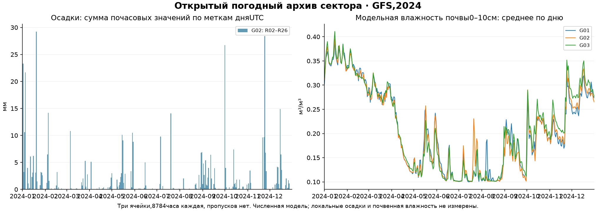
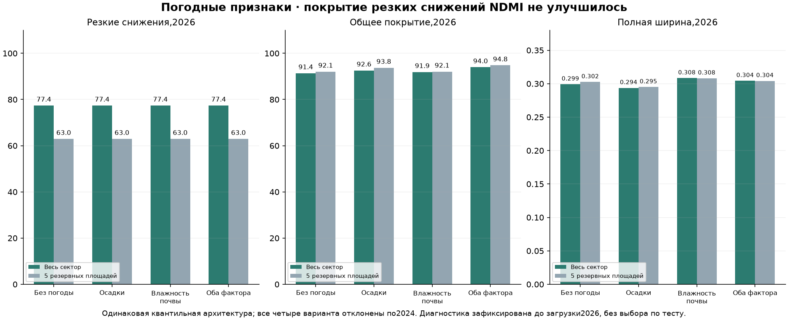

# Погодный архив сектора и диапазон NDMI

Дата: 20 октября 2026. **Архив за 2024 собран; повышение покрытия резких снижений NDMI от осадков и модельной влажности почвы не подтверждено.** При выборе только по 2024 погодные модели не прошли критерий покрытия 90%, поэтому основным остался вариант без погоды. Рабочие точечный прогноз, детекторы и диапазоны сохранены.

## Собранные данные

Источник—[Open-Meteo Historical Forecast API](https://open-meteo.com/en/docs/historical-forecast-api), явная модель NOAA GFS (`gfs_global`). Это непрерывный ряд первых часов последовательных выпусков, не единый выпуск, не ERA5 и не измерения метеостанции хозяйства. Данные со скриншотов АгроМон/ECMWF не оцифровывались и не подменяются этим источником.

За 1 января–31 декабря 2024 получены **366 дней,8784 часа в каждой из 3 возвращённых ячеек**, две переменные без пропусков: почасовые осадки,мм; модельная объёмная влажность почвы 0–10 см,м³/м³. Всего 52704 числовыхзначения. UTC, `elevation=nan`, `cell_selection=nearest`: без автоматической высотной поправки и без автоматического выбора смеси моделей. Сохранены точные запросы, исходные JSON, единицы, время получения и SHA256.

[Готовый архив 2024](../outputs/01a12f84-40ae-7493-8aee-01bfa7e3ff6e/sector-weather-2024.zip) содержит три исходных ряда, их метаданные, карту соответствия обводок ячейкам и манифест хешей. [Сводка](../data/farm-research/weather-ndmi/weather-summary-2024.json), [точки выборки и соответствие](../data/farm-research/weather-ndmi/weather-locations.json). Координаты запросов—середины ограничивающих прямоугольников приблизительных обводок; это не координаты датчиков или подтверждение границ.

| Ячейка API | Возвращённая широта,долгота | Обводки |
|---|---|---|
| G01 | 45.161087, 37.968750 | R01 |
| G02 | 45.043930, 37.968750 | R02, R03, R04, R05, R06, R07, R08, R09, R10, R11, R12, R13, R14, R15, R16, R17, R18, R19, R20, R21, R22, R23, R24, R25, R26 |
| G03 | 44.926773, 37.968750 | R27 |

**25 из 27 обводок получают одну погодную ячейку.** По [описанию провайдера](https://open-meteo.com/en/docs/historical-forecast-api) GFS имеет примерно 13 км атмосферной сетки, для ряда переменных используются иные сетки. Возвращённая точка API не удостоверяет точную пространственную поддержку каждой переменной. Погода—фон сектора, а не различие влажности между соседними полями. R18 также имеет погодный ряд, но в спектральный тест не включён из-за недостаточного внутреннего ядра.



В проверке возможностей за 1–3 апреля 2024 архив GFS с фиксированным упреждением 1 день дал 72/72 значения осадков, но 0/72 значения влажности. Исторический непрерывный GFS дал 72/72 обоих. ERA5 также вернул оба поля, ERA5-Land—только влажность; они не смешивались с выбранным GFS и не использовались для заполнения пропусков. [Single Runs API](https://open-meteo.com/en/docs/single-runs-api) описывает сохранение отдельных GFS-выпусков лишь с апреля 2026, поэтому этот ряд не объявлен архивом одного исторического выпуска 2024.

## Время доступности и признаки

Для каждого прогноза индекса использованы только погодные значения с timestamp **строго раньше 00UTC датывыдачи минус 48 часов**. Это консервативный proxy доставки, не доказательство первой исторической публикации. Исходный ряд скачан сейчас, точное время его доступности пользователю в 2024 не восстановлено. Такой эксперимент не является доказанным воспроизведением оперативного сервиса.

Добавлены восемь признаков: суммы осадков за 3/7/14 суток, число дней с суммой≥1 мм за 14 суток; средняя влажность за 24 часа и 7 суток, её изменение за 7 суток и минимум за 14 суток. Порог 1 мм—определение входного признака, не агрономическая рекомендация. Почасовые суммы используют временные метки API; график показывает сумму 24 записей по меткам UTC дня, а не независимый архив суточных измерений.

Погода после даты выбора и погода целевого окна 6–8 дней не входят в признаки. При отсутствующем часу окно помечается недоступным; осадки null не заменяются 0. Такой случай оставался бы в проверке с глобальным диапазоном вместо условной модели. В фактических обучающих и тестовых окнах погода полная, исключённых строк и подстановок не было.

После замораживания выбора и диагностических вариантов отдельно получен тот же источник за 1 января–19 октября 2026:7008 часов в каждой ячейке, обе переменные без пропусков. Эти данные использованы только в тестовых входах, не в выборе. За 2025 данные не собирались.

## Обучение и выбор по 2024

Средний прогноз—прежняя temporal_ridge_100,217 пар/21 дата до 21 июля 2024. Для модели ошибок использован прежний подход:182 причинные OOF-ошибки ранних моделей и 236 ошибок замороженного среднего после завершения его обучения. Ошибки на собственных обучающих примерах не использовались. R23–R27 вне обучения, выбора и калибровки; будущий target не входит в погодные признаки.

Внешние временные блоки—август/сентябрь/октябрь 2024; каждый хвост обучается и калибруется только на прошлом, пересекающие границы target исключены. Последние 8 известныхдат—калибровка; target обучения хвостов строго раньше её начала. Всего 194 пары/14 дат проверки, лишь 11 снижений NDMI на 7 датах. Эти прогнозы используются для выбора, поэтому их качество не является независимым итоговым тестом. Ранние OOF-ошибки переносятся на фиксированную точку приблизительно; точнойусловнойгарантии нет.

Четыре семейства: без погоды/осадки/влажность/оба фактора. В каждом одинаковые три варианта: глобальная асимметричная оболочка; условные квантильные хвосты с тройным весом снижений; сценарный нижний хвост, обученный на снижениях, с общим верхним. Оболочка не использует погодные признаки и доступна каждому семейству как контроль. Всего 12 кандидатов плюс прежний диапазон. Фиксированные CatBoost: depth 2,120 итераций,seed202410; никаких новых параметров по 2026.

Требования выбора: покрытие всех случаев и резких снижений≥90% в сумме и в каждом блоке с событиями; средняя ширина≤110% прежней. Среди прошедших—минимальный 90%intervalscore с тройным весом снижений. Верхний и нижний хвосты калибруются раздельно; при малом числе событийных дат используется максимум наблюдаемого дефицита. Прежний радиус сам калибровался по 2024, его показатели на 2024 оптимистичны.

| Вариант | Покрытие снижений | Общее покрытие | Ширина | Допуск по 2024 |
|---|---:|---:|---:|---|
| none__envelope | 100.0% | 100.0% | 0.393 | прошёл |
| none__quantile | 78.6% | 94.4% | 0.262 | pooled: decline; 2024-09-01: overall; 2024-09-01: decline |
| none__scenario | 78.6% | 98.5% | 0.318 | pooled: decline; 2024-09-01: decline |
| rain__envelope | 100.0% | 100.0% | 0.393 | прошёл |
| rain__quantile | 85.7% | 96.1% | 0.275 | pooled: decline; 2024-09-01: decline |
| rain__scenario | 78.6% | 98.5% | 0.321 | pooled: decline; 2024-09-01: decline |
| soil__envelope | 100.0% | 100.0% | 0.393 | прошёл |
| soil__quantile | 78.6% | 96.1% | 0.274 | pooled: decline; 2024-09-01: decline |
| soil__scenario | 78.6% | 98.5% | 0.318 | pooled: decline; 2024-09-01: decline |
| both__envelope | 100.0% | 100.0% | 0.393 | прошёл |
| both__quantile | 85.7% | 97.6% | 0.282 | pooled: decline; 2024-09-01: decline |
| both__scenario | 78.6% | 98.5% | 0.325 | pooled: decline; 2024-09-01: decline |
| legacy | 100.0% | 100.0% | 0.472 | прошёл |

Осадки и оба погодных фактора подняли покрытие квантильной модели с 78,6% до 85,7%, но 90% не достигли. Все погодные модели отклонены ещё по 2024. Зафиксированный основной выбор **none__envelope** не использует погоду; во всех семействах победила одинаковая глобальная оболочка. Финальные обучение/калибровка диапазона используют 270 ошибок/24 даты и 132 ошибки/8 дат соответственно; в калибровке только 6 снижений на 3 датах.

## Отдельная диагностика до загрузки 2026

Поскольку все семейства выбрали один контроль, их четыре тестовых результата не показали бы влияние погоды. До загрузки любого погодного входа 2026 сохранено [дополнение к протоколу](../data/farm-research/weather-ndmi/diagnostic-protocol-before-2026.json): проверить все 8 уже определённых обучаемых вариантов с совпадающими архитектурами и признаками погоды. Новых гиперпараметров или отбора лучшего по 2026 нет. Основной выбор не менялся, диагностическим моделям запрещена замена рабочего варианта. Даты замораживания проверены относительно времени получения исходных 2026 файлов.

Все восемь диагностических вариантов не прошли критерии 2024. Их результаты ниже нужны для сравнения факторов, не для выбора по тесту. На тех же 499 парах/27 датах 2026,42 снижениях на 16 датах; на резерве 102 пары/24 даты и 15 снижений на 9 датах:

| Диагностический вариант | Покрытие снижений:сектор/резерв | Общее покрытие сектора | Ширина сектора | Допуск 2024 |
|---|---:|---:|---:|---|
| none__quantile | 77.4% / 63.0% | 91.4% | 0.299 | не прошёл |
| rain__quantile | 77.4% / 63.0% | 92.6% | 0.294 | не прошёл |
| soil__quantile | 77.4% / 63.0% | 91.9% | 0.308 | не прошёл |
| both__quantile | 77.4% / 63.0% | 94.0% | 0.304 | не прошёл |
| none__scenario | 80.5% / 74.1% | 97.8% | 0.381 | не прошёл |
| rain__scenario | 77.4% / 63.0% | 97.7% | 0.360 | не прошёл |
| soil__scenario | 75.8% / 57.4% | 97.5% | 0.349 | не прошёл |
| both__scenario | 77.4% / 63.0% | 97.7% | 0.357 | не прошёл |

В квантильной архитектуре осадки и влажность вместе улучшили общее покрытие с 91,4% до 94,0%, при ширине 0,299→0,304. Покрытие резких снижений осталось 77,4% на секторе и 63,0% на резерве во всех четырёх вариантах. В сценарной архитектуре вариант без погоды имеет 80,5% покрытия снижений, погодные варианты—75,8–77,4%; это также не свидетельствует об улучшении от новых факторов. Эти сравнения не устанавливают статистическую значимость и не отменяют отклонения по 2024.



Основной выбор остаётся прежней исследовательской оболочкой без погоды: покрытие снижений 77,4%/63,0%,ширина 0,366 против рабочего 0,472. Это результат предыдущего эксперимента, а не улучшение от погоды. Рабочий диапазон не заменён. Погодные признаки на этих данных помогают некоторым обычным случаям, но не устраняют нижние ошибки на резких снижениях. Из-за малого числа событий, зависимых дат и общей ячейки нельзя заключить, что погода бесполезна вообще.

## Что сохранено и что можно использовать

Исходные погодные ряды пригодны как воспроизводимый модельный фон и для новых заранее спланированных исследований. Они не подтверждают влажность конкретного поля, ущерб, болезнь, фазу или полезность осмотра. Нельзя показывать модели почвенной влаги как локальные датчики или объяснять любое падение NDMI погодой без проверки операций и культуры.

Точечные прогнозы обеих величин и сигналы совпадают с прежними на каждой из 499 пар, границы NDVI также совпадают. Ложные сигналы остаются 3NDVI/2NDMI, новых попаданий нет. Нижняя граница не стала сигналом. Прежние модели и рабочий интерфейс сохранены, автоматического допуска нет.

Проверены источник/хеши/единицы/временная ось/пропуски,2024-only,резервные ID,временное разделение,48-часовая отсечка, замораживание до 2026, полная когорта, неизменность точки/детекторов/NDVI. Сохранены 2737 прежнихфайлов;FieldStore198 файлов, реальных наблюдений не добавлено. Пройдены 68 целевыхтестов, графики проверены визуально.

## Воспроизведение

[Протокол](../data/farm-research/weather-ndmi/protocol.json), [таблица выбора](../data/farm-research/weather-ndmi/selection-table.json), [замороженные модели](../data/farm-research/weather-ndmi/frozen-selection.json), [основная проверка](../data/farm-research/weather-ndmi/report.json), [диагностика](../data/farm-research/weather-ndmi/diagnostic-report.json), [верификация](../data/farm-research/weather-ndmi/verification.json).

```text
.venv/Scripts/python.exe -X utf8 scripts/collect_sector_weather.py 2024
.venv/Scripts/python.exe -X utf8 scripts/train_weather_ndmi.py protocol
.venv/Scripts/python.exe -X utf8 scripts/train_weather_ndmi.py fit
.venv/Scripts/python.exe -X utf8 scripts/weather_ndmi_diagnostics.py freeze
.venv/Scripts/python.exe -X utf8 scripts/train_weather_ndmi.py evaluate
.venv/Scripts/python.exe -X utf8 scripts/weather_ndmi_diagnostics.py evaluate
.venv/Scripts/python.exe -X utf8 scripts/verify_weather_ndmi.py
.venv/Scripts/python.exe -X utf8 scripts/report_weather_ndmi.py
```

Fit и diagnosticfreeze после замораживания/получения теста заблокированы; для повторного чтения результатов достаточно verify и report. Старый архив не перезаписывать и новый порог по 2026 не выбирать.
